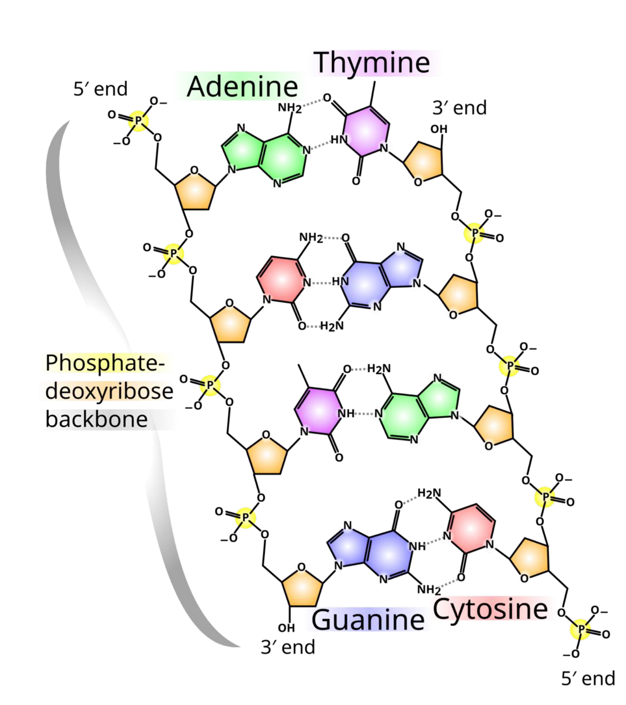

[Subject index](../README.md) · [Topic overview](README.md) · [Complete section](<Complete section.md>) · [Next](<AB-02 - Polymer physics of DNA and the worm-like chain.md>)

<!-- note-content:start -->
# Section 01: Chemistry and structure of DNA and RNA

## Intuition

A DNA strand is a charged, directional chain with a sequence of flat, aromatic "letters" sticking out of it. Two strands whose letters are complementary can line up, letter facing letter, and the flat letters then stack on top of each other like a pile of coins. That stack, twisted to fit the backbone, is the double helix. Everything else follows from three properties:
- the chain has a direction;
- the backbone repels itself;
- each letter has more than one edge that can make hydrogen bonds.

*Analogy:* a zip whose teeth come in four shapes, where each tooth fits only its partner. The analogy breaks down in two ways. First, the teeth do not just interlock, they stack, and stacking supplies most of the stability. Second, the "zip" unzips on its own when heated, because each bond is weak.

## Mechanism

**1. Backbone.**
- Each repeat unit is a five-carbon sugar (2-deoxyribose in DNA) joined to a phosphate.
- The phosphate links the 3′ carbon of one sugar to the 5′ carbon of the next (a *phosphodiester* bond). One end of the chain therefore has a free 5′-phosphate and the other a free 3′-OH, so the strand has a direction, written 5′→3′.
- Each phosphodiester is charged −1 at physiological pH (its $`\mathrm{p}K_a`$ is about 1), so the backbone is a polyanion that repels itself and any partner strand.

**2. Bases and naming.**
- The four bases attach to the 1′ carbon of the sugar. The *purines* G and A have two fused rings; the *pyrimidines* C and T have one.
- Base + sugar is a *nucleoside*. Base + sugar + one or more phosphates is a *nucleotide* (nt), for example adenosine triphosphate (ATP) or guanosine monophosphate (GMP).
- A strand is a *polynucleotide*; one shorter than about 100 nt is an *oligonucleotide* ("oligo").

**3. Canonical (Watson–Crick) pairing.**
- A pairs with T through 2 hydrogen bonds, and G pairs with C through 3.
- Pairing is *selective* because each pair is always one purine with one pyrimidine. That keeps the sugar-to-sugar distance the same for every pair, so any sequence fits the same helix. The donor and acceptor patterns then match only for A·T and G·C.
- Hydrogen bonds are weak (a few $`k_BT`$ each), so pairing is thermally reversible. Biology relies on this when strands are separated for replication and transcription, and nanotechnology relies on it to make structures that assemble themselves.

**4. Hybridisation.**
- Two complementary strands bind into a *duplex* in **antiparallel** orientation: one runs 5′→3′, the other 3′→5′. Antiparallel is the only orientation in which the pairing edges and the sugar–phosphate geometry line up.
- Cations (Na⁺, Mg²⁺) are needed to *screen* the phosphate charges. Without them, electrostatic repulsion between the two backbones outweighs pairing. Section 04 shows this as a salt dependence of the hybridisation entropy.

**5. The B-form double helix** (physiological conditions):
- right-handed;
- rise about 0.34 nm per base pair, about 10.5 bp (about 3.6 nm) per turn, diameter about 2 nm;
- the sugars join their bases on one side of each pair, so the two grooves between the backbones are unequal: a **major** and a **minor groove**. Proteins read the sequence mostly through the major groove, where more of each base's edge is exposed.
- What stabilises the helix is mainly **base stacking**: van der Waals and hydrophobic attraction between neighbouring flat bases, which stack about 0.34 nm apart. Hydrogen bonds mainly provide *specificity*. This is why Section 04 assigns energies to *pairs of neighbouring base pairs*.

**6. Other helices.**
- **A-form:** right-handed, wider and more compressed (rise about 0.26 nm/bp). It is rare for DNA–DNA duplexes but is the normal form of RNA–RNA and DNA–RNA duplexes (point 8).
- **Z-form:** a *left-handed* helix favoured by alternating purine–pyrimidine sequences (such as CGCG) and stabilised by negative supercoiling, which it relieves.

**7. Non-canonical pairing and structures.**
- **Hoogsteen pairing.** A purine can rotate about its glycosidic bond from the usual *anti* to the *syn* conformation. This presents a different edge, the Hoogsteen edge (which faces the major groove), to the pyrimidine.
  - A·T works directly.
  - For G·C, cytosine has to donate an extra hydrogen bond from its N3. N3 is normally an acceptor, so C must be **protonated** (C⁺). Its $`\mathrm{p}K_a`$ is only about 4.5, so these structures are favoured at acidic pH.
- **Triplex.** A third strand lies in the major groove of a duplex and makes Hoogsteen bonds to the purines. It is pH-dependent when it contains C⁺.
- **G-quadruplex.** Four guanines form a planar ring (a *G-tetrad*) through Hoogsteen G·G bonds. Tetrads stack, and a monovalent cation (K⁺ fits best) sits between them and coordinates the carbonyl oxygens. Runs of G separated by short loops fold this way.
- **i-motif.** The C-rich counterpart. Hemi-protonated C·C⁺ pairs intercalate, so it is also pH-dependent.

**8. RNA.** Identical in plan to DNA, except for two changes:
- **Ribose** carries a 2′-OH. This has three consequences:
  1. *Chemical instability.* At high pH or with metal ions, the 2′-oxygen attacks the neighbouring phosphorus. This cuts the backbone and leaves a 2′,3′-cyclic phosphate (self-hydrolysis). DNA lacks the 2′-OH, which is one reason it is the long-term store of genetic information.
  2. *A-form duplexes.* The 2′-OH holds the sugar in a pucker (C3′-endo) that fits only the A-form.
  3. *Richer folding.* The extra hydrogen-bonding group lets single strands fold into complex secondary and tertiary structures (tRNA, ribozymes).
- **Uracil** replaces thymine. U is T without the 5-methyl group. It pairs with A, and it also forms a **G·U wobble pair** (two hydrogen bonds, shifted geometry), which is nearly as stable as a Watson–Crick pair in RNA.

## Motivation and explanation

- **Why directionality matters in practice.** Polymerases add nucleotides only to a free 3′-OH, so DNA is always synthesised 5′→3′. Chemical synthesis (Section 06) runs the other way, 3′→5′. Primers, probes and sequencing reads are all written 5′→3′.
- **Why G·C is "stronger".** The extra hydrogen bond helps, but the larger effect is that G·C-containing steps stack more strongly. Section 04 puts numbers on this: CG/GC steps are worth about −2 kcal/mol at 37 °C, against about −0.6 for TA/AT.
- **Where the simple picture fails.** Real duplexes breathe: ends fray, and long duplexes open transient "bubbles". The "two strands are either fully paired or fully apart" picture used in Section 03 therefore holds only for short oligos.

A primer therefore has to bind with its 3′ end facing the region to be copied. Complementarity alone is insufficient: the two primers in PCR must lie on opposite strands with their extendable ends pointing towards one another. Writing both sequences 5′→3′ can conceal this geometry, so drawing the antiparallel template strands first prevents an otherwise plausible but non-amplifying design.

### Charge and reverse-complement checks

A duplex made from two unphosphorylated $`n`$-nucleotide strands contains $`2(n-1)`$ phosphodiester groups. This counts the bonds between nucleotides, rather than assigning a terminal phosphate that is absent. Counterions screen this negative backbone charge; charge counting alone does not specify the buffer needed.

Self-complementarity means equality with the **reverse complement**, with both sequences written in the same direction. Thus 5′-ATCGAT-3′ pairs fully with another copy of itself. Merely replacing each base by its complement without reversing direction misses the antiparallel geometry.

## Wider pathway

DNA stores the sequence. RNA polymerase copies it into mRNA (transcription), and ribosomes read the mRNA (translation), using tRNA anticodons that pair with codons by the same Watson–Crick and wobble rules. Every technology in this course (synthesis, PCR, sequencing, DNA nanotechnology) relies on the same specific, reversible pairing described here.

## Link to other topics

The partial molar and chemical-potential framework of Equilibrium Thermodynamics carries over to hybridisation. It becomes a chemical equilibrium between strands whose standard Gibbs energy is set by stacking and salt.

## Summary

A nucleic acid strand is a directional polyanion carrying flat bases. Complementary strands pair antiparallel, mostly stabilised by stacking.
<!-- note-content:end -->

[Subject index](../README.md) · [Topic overview](README.md) · [Complete section](<Complete section.md>) · [Next](<AB-02 - Polymer physics of DNA and the worm-like chain.md>)
