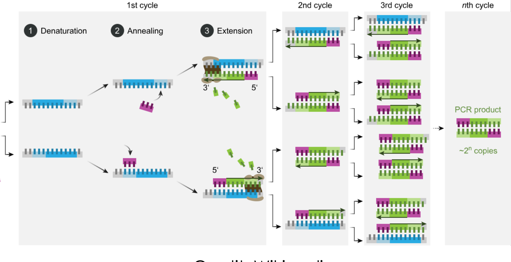

[Subject index](../README.md) · [Topic overview](README.md) · [Complete section](<Complete section.md>) · [Next](<AB-17 - Absolute and relative quantification, and melt-curve control.md>)

<!-- note-content:start -->
# Section 16: Quantitative PCR and the cycle threshold

## Intuition

Exponential processes destroy information about their starting point once they saturate. Watching only the endpoint of a PCR is like returning to a petri dish after a week: the plate is full whether you seeded ten bacteria or ten thousand.

The information is in the *timing*, not the final amount. A sample that starts with more template crosses any given level sooner. If you watch continuously and record *when* the product passes a fixed level, that time is a measure of the starting amount. Because growth is exponential, the relationship is logarithmic: each halving of the starting material delays the crossing by exactly one cycle.

This is the whole idea. Everything else is making the measurement work: a way to see the product as it accumulates, and a sensible choice of where to put the threshold.

*Analogy:* judging how much money someone started with by watching a compound-interest account and noting the date it passes £1000. Twice the starting capital reaches the mark one doubling-time earlier. The analogy breaks down because PCR eventually runs out of reagents and stops compounding, so only the early part of the curve carries information.

## Mechanism



**1. Recap of PCR.** Template, forward and reverse primers, thermostable polymerase, dNTPs and Mg²⁺ are cycled between denaturation (95–98 °C), annealing (50–65 °C) and extension (72 °C), 30–40 times. Each cycle doubles the number of double-stranded products bounded by the two primers.

**2. Making the product visible: intercalating dye.** An intercalating dye such as SYBR Green is included. It fluoresces strongly when bound to double-stranded DNA and weakly when free, so the fluorescence of the tube is proportional to the amount of double-stranded product present.


Fluorescence is read once per cycle, at the end of extension when the product is double-stranded. A qPCR machine is a thermal cycler with a fluorimeter.

**3. The amplification curve.** Plotting fluorescence against cycle number gives a sigmoid with three regions:


- **Initiation.** The product is doubling, but the signal is below the instrument's noise. Amplification is happening; it simply cannot be seen.
- **Exponential.** The signal rises above noise while reagents are still in excess, so doubling continues. **This is the only region that carries quantitative information.**
- **Plateau.** dNTPs and primers are depleted and the polymerase loses activity, so the curve saturates. All samples converge here, which is exactly why endpoint PCR cannot quantify.

**4. The threshold and $`C_t`$.** A fluorescence threshold is set above the background noise but within the exponential phase. The **cycle threshold** $`C_t`$ (also written $`C_q`$) is the cycle number at which the amplification curve crosses it. It need not be an integer, since the crossing is interpolated between cycles.

## Derivation

Notation: $`\rho_0`$ is the initial concentration (or copy number) of the target; $`\rho(n)`$ after $`n`$ cycles; $`F`$ is fluorescence; $`t`$ is the threshold value of $`F`$; $`E`$ is the amplification efficiency, with $`E = 1`$ meaning perfect doubling.

**Step 1: growth law.** Each cycle multiplies the product by $`(1+E)`$. For ideal doubling, $`E = 1`$:

**Equation (23)**

```math
\rho(n) = \rho_0\,(1+E)^n \;\xrightarrow{\;E=1\;}\; \rho_0\,2^n
```


**Step 2: what is measured.** The intercalating dye binds in proportion to the amount of double-stranded product, so

**Equation (24)**

```math
F(n) \propto \rho(n) = \rho_0\,2^n
```


**Step 3: definition of $`C_t`$.** At $`n = C_t`$ the fluorescence equals the threshold:

**Equation (25)**

```math
\rho_0\,2^{C_t} \propto t
```


**Step 4: take logarithms.** Using $`\log_{10}`$ throughout:

```math
\log\rho_0 + C_t\log 2 = \log t + \text{const}
```


**Equation (26)**

```math
\boxed{\;C_t = \frac{\log t - \log\rho_0 + \text{const}}{\log 2}\;}
```

so $`C_t \propto \log t - \log\rho_0`$. **$`C_t`$ is linear in $`\log\rho_0`$ with a negative slope**: more starting material gives a smaller $`C_t`$.

**Step 5: general efficiency.** Repeating steps 3–4 with $`(1+E)^{C_t}`$ in place of $`2^{C_t}`$:

**Equation (27)**

```math
C_t = \frac{\log t - \log\rho_0 + \text{const}}{\log(1+E)}
```

Differentiating with respect to $`\log\rho_0`$ gives the slope of a plot of $`C_t`$ against $`\log_{10}\rho_0`$:

**Equation (28)**

```math
\text{slope} = -\frac{1}{\log_{10}(1+E)} \qquad\Longrightarrow\qquad E = 10^{-1/\text{slope}} - 1
```


**Sanity checks on (28).**
- Perfect doubling, $`E=1`$: slope $`= -1/\log_{10}2 = -3.32`$. A tenfold dilution delays $`C_t`$ by 3.32 cycles, because $`\log_2 10 = 3.32`$ doublings are needed to recover a factor of ten.
- A steeper (more negative) slope means *lower* efficiency: more cycles are needed to make up a tenfold difference.
- $`E \to 0`$: slope $`\to -\infty`$, and no amount of cycling separates the samples. Quantification fails.

## Motivation and explanation

**Why the threshold must sit in the exponential phase.** Equation (23) holds only while reagents are in excess. In the plateau, $`\rho`$ no longer depends on $`\rho_0`$, so (26) is meaningless there. Placing the threshold too high puts $`C_t`$ in the saturating region and compresses the differences between samples; too low and it sits in instrument noise, making $`C_t`$ irreproducible. The threshold must be above the noise and below the onset of depletion.

**Why $`E`$ is rarely exactly 1.** Primer annealing is not instantaneous and not every template is copied each cycle, so some templates are skipped. Inhibitors carried over from the sample (haem, humic acids, ethanol) reduce polymerase activity. Long or structured amplicons extend incompletely. Typical real efficiencies are 0.9–1.0, and an assay outside about 0.9–1.1 is usually redesigned rather than corrected for.

**Why efficiency matters so much.** It enters (27) as $`\log(1+E)`$ in the denominator, so it sets the *scale* converting cycles to concentration. Assuming $`E=1`$ when it is really 0.9 misestimates every fold-change, and the error compounds with the number of cycles separating the samples. This is why a standard curve is run.

Moving the common threshold upward within the exponential region delays every crossing, because more amplification is required. With the same efficiency and fluorescence response, it shifts the calibration intercept while preserving the cycle difference between samples. If those differences change substantially when the threshold is moved within that region, the curves are not behaving as the shared-efficiency model assumes; a visually tidy crossing alone is insufficient.

**Weaknesses of intercalating dye.** The dye binds *any* double-stranded DNA, so it reports primer dimers and mis-primed products as faithfully as the intended one. It cannot distinguish them, and since a primer dimer amplifies efficiently it can dominate the signal. This is the problem the melt curve (Section 17) and sequence-specific probes (Section 18) address.

### Cycle precision and low-copy sampling

At ideal doubling, a tenfold dilution shifts the threshold by $`\log_2 10=3.32`$ cycles. A one-cycle difference represents a factor of two in starting material. The logarithmic readout compresses a wide concentration range into a short cycle interval, but makes small threshold errors consequential.

At low abundance, the tube must first receive a molecule. If random loading has mean $`\mu`$ target copies per reaction, the Poisson zero-copy probability is $`e^{-\mu}`$. At a mean of one copy it is $`36.8\%`$: even perfect amplification cannot detect a molecule absent from the aliquot. Detection limits therefore depend on replicate sampling and validated assay performance, rather than extrapolating a threshold equation to one copy. A stray amplicon can also amplify, which is why contamination controls are essential.

## Link to other topics

Equation (26) is the standard move for any exponential process: take logarithms and read the rate off a straight line, as with first-order reaction kinetics or $`\ln(C/C_0)`$ against time. The threshold crossing plays the role of a fixed conversion, and $`C_t`$ the time to reach it.

## Summary

Measuring fluorescence every cycle converts PCR from a detection method into a quantitative one. The information lies in *when* the curve crosses a threshold, and because growth is exponential that crossing is linear in $`\log\rho_0`$, equation (26).
<!-- note-content:end -->

[Subject index](../README.md) · [Topic overview](README.md) · [Complete section](<Complete section.md>) · [Next](<AB-17 - Absolute and relative quantification, and melt-curve control.md>)
