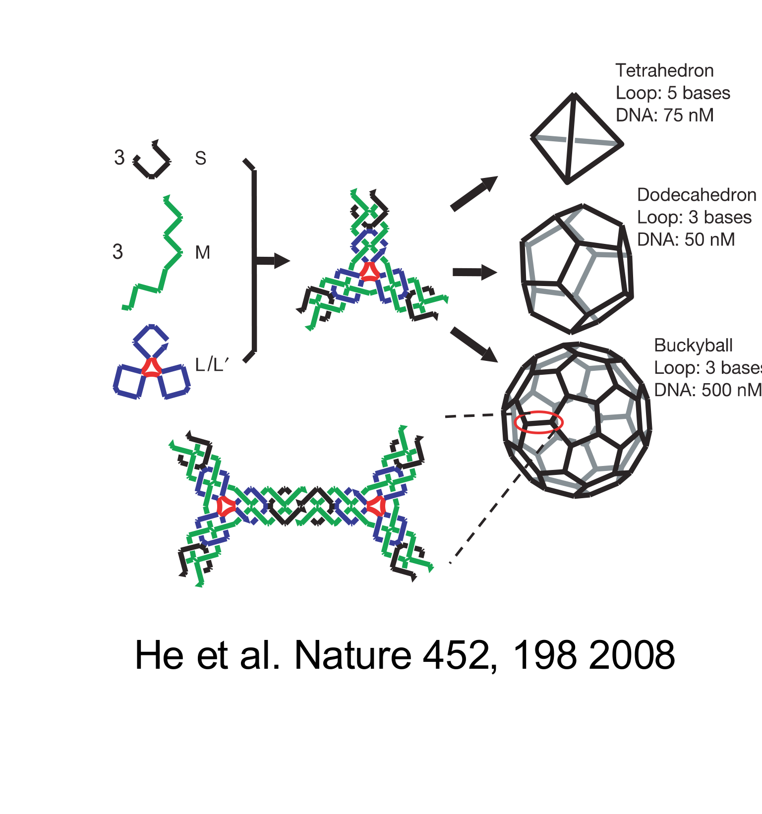
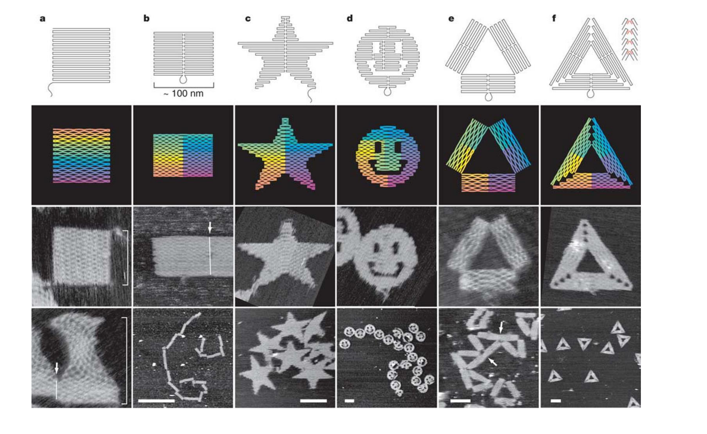

[Subject index](../README.md) · [Topic overview](README.md) · [Complete section](<Complete section.md>)

<!-- note-content:start -->
# DNA nanotechnology

## Overview

Sequence-dependent hybridisation makes DNA a programmable connector. Structural assemblies use that selectivity to organise objects, while toehold-mediated strand displacement provides controlled reactions that rearrange structures or process molecular signals.

*Assumed throughout:* hybridisation thermodynamics and nucleic-acid polymer physics.

## Section 20: DNA as a material

### Intuition

A useful construction material needs bonds that are *specific* (part A joins only to part B) and *reversible* (a mistake can be undone rather than frozen in). Most materials offer one or the other. Covalent bonds are specific but permanent; van der Waals contacts are reversible but indiscriminate.

Base pairing gives both at once, and it adds something neither offers: the bond strength is **programmable**. Choosing a sequence sets $`\Delta G^0`$, and $`\Delta G^0`$ sets both the stability and, through Section 05, the lifetime. The designer specifies which parts stick, how strongly, and how fast, by typing letters.

*Analogy:* a construction kit where every connector is cut to a code and you can order as many distinct codes as you like. The analogy breaks down because the connectors are not rigid — the strength is statistical, set by temperature and concentration, so "will these two bind?" has no answer without saying at what temperature and how dilute.

### Mechanism

**The properties that matter for construction:**

- **Chemically stable.** Unlike RNA, DNA has no 2′-OH to attack its own backbone (Section 01), so structures survive for months.
- **Arbitrary sequences are cheap.** Phosphoramidite synthesis (Section 06) makes any sequence to order, at steadily falling cost.
- **Easily functionalised.** Fluorophores, quenchers, thiols, biotin and click handles attach at either end or internally (Section 06), so DNA can be the connector between non-DNA components.
- **Known polymer physics.** ssDNA is flexible ($`l_P \approx 1`$–2 nm) and dsDNA is stiff ($`l_P \approx 50`$ nm, Section 02). Short duplexes act as rigid struts and single strands as hinges, and the designer chooses which by choosing where to pair.
- **Predictable thermodynamics.** $`\Delta G^0`$ and $`T_m`$ follow from the sequence (Section 04), so a design can be checked before it is made.
- **Thermally reversible near ambient conditions.** Melting temperatures sit in a convenient range, so structures can be assembled by cooling and disassembled by heating.


### Derivation

**Selectivity.** From Section 04, a complementary 12-mer has $`\Delta H^0 = -87.2`$ kcal/mol and $`\Delta S^0 = -240.3`$ cal K⁻¹ mol⁻¹. At 20 °C:

**Equation (33)**

```math
\Delta G^0 = \Delta H^0 - T\Delta S^0 = -87.2 + 293.15\times0.2403 = -16.8\ \text{kcal/mol}
```


Two *random* 12-mers share only short accidental stretches of complementarity, giving $`\Delta G^0 \approx -2.9`$ kcal/mol. The gap is $`\approx 14`$ kcal/mol, which at $`RT = 0.58`$ kcal/mol is a binding-constant ratio of

**Equation (34)**

```math
\frac{K_{\text{complementary}}}{K_{\text{random}}} = \exp\!\left(\frac{13.9}{0.58}\right) \approx 3\times10^{10}
```


In temperature terms the same gap appears as $`T_m = 53`$ °C against $`T_m = -31`$ °C: the designed pair needs heating past 50 °C to separate, while the random pair would need cooling far below freezing to associate at all. **There is a wide temperature window in which intended bonds are fully formed and unintended ones are entirely absent.**

**Orthogonality.** The number of distinct $`N`$-mers is $`4^N`$. For $`N = 12`$:

**Equation (35)**

```math
4^{12} = 1.7\times10^{7}
```

Almost all pairs drawn from this set interact at the random level of (34) rather than the complementary level. A designer can therefore pick a large set of sequences that are mutually non-interacting — *orthogonal* — and use each as an independent, addressable bond type.

This is the property that makes complex structures possible. With one bond type you can make a polymer; with hundreds of orthogonal bond types you can specify which particular component goes in which particular position.

### Motivation and explanation

**Why the gap in (34) is so large.** Both $`\Delta H^0`$ and $`T\Delta S^0`$ scale with the number of base pairs formed, and they nearly cancel (Section 04). A mismatched pair forms far fewer base pairs, so it loses the enthalpy but keeps most of the entropic cost of association. Selectivity is a *difference of two large numbers*, which is why it is so sharp, and also why it is sensitive to temperature.

**Why orthogonality is not simply $`4^N`$.** Equation (35) counts sequences, not usable ones. Sequences that are each other's partial complements must be excluded, as must those that fold on themselves, and GC content must be matched so that all pairs share a common $`T_m`$ (Section 04). The usable orthogonal set is far smaller than $`4^N`$ — but it is still in the hundreds or thousands, which is more than any structure needs.

**Where it fails.** Selectivity degrades as structures grow: with hundreds of strands in one pot, there are hundreds of thousands of pairwise combinations, so even a one-in-a-million spurious interaction becomes likely. This is why design is done computationally, by software that evaluates all pairings rather than just the intended ones.

A weak unintended contact can become troublesome when another contact has already tethered the two components together. The second site then searches a small local volume rather than the whole solution, reducing the association entropy cost. Pairwise sequence screening is therefore a starting point, rather than proof that a large multivalent structure has no alternative assembly. Geometry and the order in which contacts form also matter.

**The limits of the material.** DNA is not strong — a duplex is held by a few tens of $`k_BT`$ — so DNA objects are soft, and they require salt to screen the backbone charge (Section 01). They are also expensive per unit mass. DNA is not a structural material in the engineering sense; it is a material for *arranging other things with nanometre precision*.

### Link to other topics

The selectivity argument is the same one behind any chromatographic separation: a useful separation needs a large ratio of affinities between the wanted and unwanted species, and that ratio is exponential in the free-energy difference.

### Summary

DNA is a good construction material because sequence sets bond strength, giving a free-energy gap of about 14 kcal/mol between designed and accidental pairing, a factor of $`10^{10}`$ in binding constant. With $`4^{12} = 1.7\times10^7`$ sequences available, many mutually orthogonal bonds can be specified at once.

## Section 21: Structural DNA nanotechnology and DNA origami

### Intuition

Natural DNA is linear, so a duplex can only extend end to end. The founding insight of the field (Seeman, 1982) was that a *branched* junction — four strands meeting at a point, with each arm a duplex — turns DNA from a thread into a connector. Give each arm a single-stranded "sticky end" and junctions link into networks.

The design problem is then the same as any self-assembly: the target structure must be the free-energy minimum, and the system must be able to reach it. Annealing slowly from above $`T_m`$ does both, because every incorrect bond formed on the way down has time to melt and re-form.

*Analogy:* crystallising a solid from a hot solution. Cool slowly and you get a single good crystal; quench and you get a glassy mess. The analogy breaks down because each DNA "bond" here is *different* from every other, so the structure is not periodic by necessity — it is addressable, and every position can be unique.

### Mechanism


**The design workflow.** Start from the target structure, use software to find a set of oligonucleotides whose minimum-free-energy configuration is that structure, synthesise them, mix, and anneal.


**Why slow annealing.** The target is designed to be the global free-energy minimum, dominated by base pairing and so predictable from Section 04. The landscape also contains shallower local minima — partially correct structures, misbonded intermediates. Cooling slowly from above $`T_m`$ can allow incorrect contacts to exchange and help the system escape these **kinetic traps**. Rapid cooling freezes them in.

Slow cooling helps only if an incorrect contact can actually dissociate on the time available. At high temperature both correct and incorrect contacts are short-lived; as temperature falls, intended multi-contact assemblies become stable while some wrong contacts can still exchange. Cooling too far before rearrangement has occurred locks those intermediates in. The relevant comparison is bond-exchange time against the annealing schedule, so slower cooling improves access to the target without guaranteeing complete equilibrium.

#### Junctions and tiles


Junctions with complementary sticky ends tile into periodic networks. The intended application was to arrange *other* molecules on a lattice — scaffolding proteins into a crystal so they could be solved by diffraction (Section 24).

**It did not work, and the reason is instructive.** Simple junctions are **floppy**: the arms pivot about the branch point, so the structure has no defined geometry and cannot pack into a crystal. The assemblies form hydrogels and liquid-like materials instead of ordered solids. Crystallisation required rigid motifs — *tensegrity triangles* — and took 27 years from the original proposal.


**The fix is crossovers.** A **double crossover (DX) tile** has two duplexes joined at two points rather than one. Two crossovers fix the relative orientation of the helices, removing the pivot. DX tiles are rigid enough to sustain 2D crystallisation and to arrange nanoparticles on a surface.



**3D.** A DNA cube came early but was floppy for the same reason. Rigid polyhedra followed from crossover motifs, and the assembled shape can be selected by tuning flexibility and concentration: the same three-point-star motif gives a tetrahedron, a dodecahedron or a buckyball depending on loop length and DNA concentration.

#### DNA origami


Rothemund's method (2006) changed the scale of what could be built.

1. Take one **long single-stranded scaffold**, about 7 knt, from the M13 bacteriophage genome.
2. Route it back and forth to raster-fill the target shape.
3. Design **hundreds of short staple strands**, each complementary to two or more separated regions of the scaffold. Where a staple binds two regions, it pulls them together: a **crossover** linking adjacent helices.
4. Mix scaffold with excess staples and anneal. The structure folds in one step.



Structures are about 100 nm across with roughly 6 nm resolution. Each staple is independently addressable, so any staple can carry a modification and act as a **6 nm pixel** — which is how patterns and words are written on the surface.

Later work extended this to 3D (stacked helical bundles), to wireframe designs generated automatically from a mesh, and to gigadalton assemblies built by polymerising origami units.

### Motivation and explanation

**Why origami beats tiles, in one idea: stoichiometry.** In a tile assembly, every component must be present in matched amounts, because the structure is built from many copies of a few species. An error in concentration leaves unincorporated tiles or truncated lattices, and yields are poor.

In origami there is **one scaffold molecule per structure**. The scaffold sets the size and the fold, and staples are supplied in excess so that every binding site is occupied. The assembly is unimolecular in the component that matters. Yields are high, the product is monodisperse, and purification is a matter of removing surplus staples.

**Why the staples need not be purified.** Each staple occupies a unique position, so a truncated staple (Section 07) simply fails to bind one site, leaving a small defect rather than a wrong structure. Origami is remarkably tolerant of the impurity profile that phosphoramidite synthesis produces.

**Limits.** Structures are soft and require millimolar Mg²⁺. They are degraded by nucleases, limiting biological use without protection. The scaffold length caps a single origami at roughly 100 nm, so larger objects must be built hierarchically. Cost scales with the number of distinct staples.

#### Geometry sets both size and resolution

A scaffold of $`n`$ paired nucleotides has duplex contour length approximately $`0.34n\,\mathrm{nm}`$. If parallel helices are spaced by $`d`$, a fully filled single-layer rectangle has area approximately $`0.34nd\,\mathrm{nm^2}`$, neglecting turns and unpaired regions. For $`n=7249`$ and $`d=2.5\,\mathrm{nm}`$, a square would have side approximately $`78.5\,\mathrm{nm}`$. A structure described as roughly 100 nm across can therefore have a different aspect ratio or incomplete filling; that dimension does not imply a fully packed 100 nm square.

Address spacing is constrained by helix packing and crossover geometry. Sixteen base pairs span approximately $`5.44\,\mathrm{nm}`$ along a helix, so nanometre-scale placement is limited by DNA geometry as well as synthesis. A schematic outline cannot establish arbitrary sub-base-pair positioning.

### Link to other topics

Annealing through a rugged landscape to reach the global minimum is the same problem as crystallisation or protein folding, and the same solution — slow cooling — applies for the same reason: the system must stay equilibrated as the free-energy surface changes with temperature.

### Summary

Branched junctions make DNA a connector rather than a thread, but simple junctions are too floppy to order, and crossovers are what supply rigidity. Origami then solves the stoichiometry problem by using a single scaffold strand per structure, giving addressable 100 nm objects at 6 nm resolution in one annealing step.

## Section 22: Toehold-mediated strand displacement

### Intuition

To replace a strand in a duplex by complete thermal dissociation, the duplex must first separate. A sufficiently stable duplex can survive much longer than the intended operating time of a nanodevice, so waiting for spontaneous separation is impractical. The lifetime depends strongly on sequence, temperature and salt; duplex length alone does not specify a universal waiting time.

TMSD avoids it by never letting go. The incumbent strand is displaced *one base at a time*, and at every moment the invading strand has already formed whatever pairs the incumbent has given up. The number of base pairs stays roughly constant throughout, so there is no large free-energy barrier to climb.

The only cost is getting started, and that is what the toehold is for: a short single-stranded overhang on the target duplex, complementary to part of the invader. The invader binds the toehold first, which holds it in place long enough for displacement to begin.

*Analogy:* changing a rope on a loaded pulley by splicing the new rope in strand by strand rather than cutting the old one and re-threading. The load is never released, so no lifting is needed. The analogy breaks down because the splicing here is a random walk that can run backwards as easily as forwards.

### Mechanism


Notation: duplex **S** consists of the substrate strand (domains $`h^*`$ and $`b^*`$) paired with the **incumbent** strand **Y** (domain $`b`$). The **invader** strand **X** carries domains $`h`$ and $`b`$. The goal is to form duplex **L** ($`h^*b^*`$ paired with $`hb`$) and release Y.

**A.** S and X are in solution. S has a single-stranded **toehold** $`h^*`$, unpaired because Y has no $`h`$ domain.

**B.** Domain $`h`$ of X binds $`h^*`$ of S. This is ordinary hybridisation, reversible, with rate constants $`k_{\text{on}}`$ and $`k_{\text{off}}`$ set by the toehold length. Its purpose is **colocalisation**: X is now tethered beside the duplex it must invade.

**C–D.** X begins to displace Y, one base at a time. At each step one $`b`$–$`b^*`$ pair of Y breaks and one of X forms. The total number of base pairs is unchanged, so each step is roughly free-energy neutral. This is **three-way branch migration**, an unbiased random walk of the branch point that is equally likely to go either way — a *diffusive* process rather than a thermally activated one.

**E–F.** When the walk reaches the far end, Y is held by nothing and is released, completing duplex L.

**The final step is effectively irreversible on the designed operating timescale.** Once Y is released, it lacks an exposed toehold on L through which to begin rapid reinvasion: X already occupies $`h^*`$. Reverse displacement from a blunt end can still occur, but is much slower than toehold-assisted invasion. The random walk can reverse before release; after release the product is kinetically protected rather than absolutely unable to react.

**TMSD is thermodynamically downhill** because L has more base pairs than S: X pairs across both $`h^*`$ and $`b^*`$, whereas Y paired only across $`b^*`$. The toehold length sets both the driving force and the rate.

### Derivation

**The rate law.** Treating the branch-migration intermediate in steady state, the overall second-order rate constant is

**Equation (36)**

```math
k_{\text{eff}} \approx \frac{k_{\text{on}}}{k_{\text{off}}/k_{BM} + 1}
```

where $`k_{\text{on}}`$, $`k_{\text{off}}`$ are for the **toehold** and $`k_{BM}`$ is the branch-migration rate. The structure is a competition: once X has bound the toehold, it either falls off (rate $`k_{\text{off}}`$) or commits to displacement (rate $`k_{BM}`$).

The fraction of bound encounters that succeed is $`k_{BM}/(k_{BM}+k_{\text{off}})`$ in this reduced competition model. Multiplying that dimensionless probability by the bimolecular encounter rate constant $`k_{\text{on}}`$ gives (36), with the correct bimolecular units. A stronger toehold raises the probability of success per encounter; once that probability is near one, increasing binding strength cannot make new encounters happen faster.

**Short toehold, $`k_{\text{off}} \gg k_{BM}`$.** Most binding events fail, and (36) becomes

**Equation (37)**

```math
k_{\text{eff}} \approx \frac{k_{BM}k_{\text{on}}}{k_{\text{off}}} = \frac{k_{BM}}{\rho_0} \exp\!\left(-\frac{\Delta G^0}{RT}\right)
```

using $`k_{\text{off}} = k_{\text{on}}\rho_0\exp(\Delta G^0/RT)`$ from Section 05. The rate rises **exponentially** with toehold binding strength, hence with toehold length.

**Long toehold, $`k_{\text{off}} \ll k_{BM}`$.** Every binding event proceeds, and

**Equation (38)**

```math
k_{\text{eff}} \approx k_{\text{on}}
```

The rate **plateaus**: it is limited by how fast X finds S, which no further lengthening can improve.

**Crossover.** The two regimes meet where $`k_{\text{off}} = k_{BM}`$.

### Motivation and explanation


**Why this solves the original problem.** In (37) and (38), $`\Delta G^0`$ is that of the **toehold**, not of the $`b`$–$`b^*`$ duplex. The main duplex can be 20 bp and permanent while the toehold is 4 nt and transient. **Stability and rate are now set by different parts of the molecule and can be chosen independently** — which is exactly what Section 05 said was impossible by thermal melting.

**Why the plateau exists.** Once the toehold is strong enough that X essentially never escapes before committing, making it stronger changes nothing: the rate-limiting step has moved to diffusion. This is the same saturation seen in any mechanism where a binding step hands over to a committed step.

**What sets $`k_{BM}`$.** Branch migration is an unbiased random walk, so crossing $`n`$ steps takes a time scaling as $`n^2`$ rather than $`n`$. Longer branch-migration domains are therefore disproportionately slower, which is why displacement domains are kept short.

### Applications


- **DNA tweezers**, the first DNA nanomachine: a fuel strand F closes the tweezers by hybridising across the arms; an anti-fuel strand F\* removes it by TMSD, reopening them. The cycle is driven by the free energy of F–F\* hybridisation, and its by-product is F–F\* waste duplex, so the machine runs only while fuel is supplied.
- **Walkers** stepping along footholds on an origami surface, with each step a TMSD reaction.
- **Reconfigurable origami**, such as a Bennett linkage that changes conformation on addition of a strand.
- **Molecular computing**, where strand displacement cascades implement logic gates, since the output of one reaction can be the invader for the next.

#### The crossover from escape to successful displacement

In the two-pathway model, the probability that a bound invader completes branch migration before escaping is $`k_{BM}/(k_{BM}+k_{\mathrm{off}})`$. Thus $`k_{\mathrm{eff}}=k_{\mathrm{on}}k_{BM}/(k_{BM}+k_{\mathrm{off}})`$. When escape is much faster, stronger toehold binding lowers $`k_{\mathrm{off}}`$ and raises the success probability. Once $`k_{\mathrm{off}}\ll k_{BM}`$, almost every encounter succeeds and $`k_{\mathrm{eff}}`$ approaches $`k_{\mathrm{on}}`$.

An illustrative stabilisation of $`1.5\,\mathrm{kcal\,mol^{-1}}`$ per added base pair at $`25\,{}^\circ\mathrm C`$ changes the equilibrium factor by approximately 12.6 per base. It can therefore tune the escape-dominated rate by orders of magnitude, but cannot raise the rate beyond the encounter-limited plateau. A zero-length toehold is outside the literal bound-intermediate model; blunt-end displacement needs its own mechanism rather than assigning it a fictitious duplex free energy.

### Link to other topics

Equation (36) is a steady-state competition between an unproductive reverse step and a productive forward step — the same algebra as Michaelis–Menten, and with the same consequence: a rate that is first-order in the controlling parameter at one extreme and saturated at the other.

### Summary

Strand displacement exchanges a bound strand without ever opening the duplex, so the free-energy barrier is small and the rate is governed by the toehold rather than by the duplex it invades. Equation (36) gives an exponential regime and a plateau, with the crossover near 6 nt and roughly 6 orders of magnitude of tunable rate — enough to make nanostructures that move, compute and respond.

## Conclusion

DNA nanotechnology combines addressable structure with programmable reaction kinetics. The next unit develops protein structure - determination and prediction.
<!-- note-content:end -->

[Subject index](../README.md) · [Topic overview](README.md) · [Complete section](<Complete section.md>)
