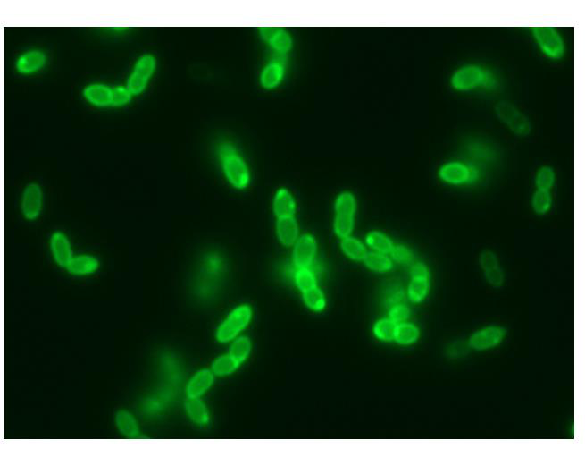

[Subject index](../README.md) · [Topic overview](README.md) · [Complete section](<Complete section.md>) · [Next](<AB-39 - Mechanical cell disruption and release kinetics.md>)

<!-- note-content:start -->
# Section 38: Why cells must be disrupted, and what resists it

## Intuition

Disruption is a deliberately destructive step in the middle of an otherwise careful process, and that is its difficulty. The wall must be broken thoroughly enough to release the product, but the product itself is a fragile molecule sitting in the same vessel — so every method that is good at breaking walls is also, to some degree, good at destroying what it releases.

Worse, breaking the cell releases *everything*: proteases, nucleic acids, lipids, and fragments of wall so small that they are harder to remove than the intact cells were. The step therefore makes the separation problem worse before it makes it better, which is why it is avoided wherever possible by secreting the product instead.

*Analogy:* opening a safe with explosives to recover a document inside. The analogy breaks down because a cell wall is not uniformly strong: it resists by being elastic and chemically crosslinked rather than merely hard, which is why chemical and enzymatic attack (Section 41) can succeed where force is clumsy.

## Mechanism

**Why products are intracellular.** Many products of interest — particularly recombinant proteins — are not secreted. They accumulate in the cytoplasm, sometimes as dense **inclusion bodies** at the poles of the cell. Such a product cannot be recovered without breaking the cell, so disruption must precede any isolation or purification.

### What has to be broken

Microorganisms used in bioprocessing are surrounded by tough **cell walls**, and their construction differs by organism:

- **Gram-positive bacteria** (for example *Lactococcus lactis*) have a **thick peptidoglycan wall** — a crosslinked mesh of sugar chains and short peptides, mechanically strong.
- **Gram-negative bacteria** (for example *E. coli*) have a **thinner peptidoglycan wall**, but it is enveloped by an **outer membrane rich in lipopolysaccharide (LPS)**. The wall is weaker but there are more layers to cross, and the LPS matters downstream because it is an endotoxin that must be removed from any injectable product.

- **Yeast** (*Saccharomyces cerevisiae*) has a **thick, multi-layered wall** of polysaccharides — β-1,3 and β-1,6 glucans — together with mannoproteins and **chitin**. This makes yeast **very difficult to disrupt**, and it is the hardest of the common hosts.
- **Mammalian cells** have only a plasma membrane and **no cell wall at all**, so they are easily disrupted. The same fragility that makes them shear-sensitive in the bioreactor (Section 31) makes them trivial to break here.

### Strategies

Four families of method, in two groups:

**Mechanical** (Section 39):
- bead mill, ultrasonication, French press, high-pressure homogeniser.

**Non-mechanical** (Section 41):
- *physical*: thermolysis, decompression, osmotic shock;
- *chemical*: detergents, solvents;
- *biological*: enzymatic digestion.

Three considerations govern the choice:
1. **Scale.** Some methods are only applicable at small or laboratory scale; others scale to production.
2. **Cell type.** Bacteria and yeast have tough walls and are **more difficult to disrupt by mechanical means only**; bacteria are also small, which makes them harder still. Mammalian cells need little.
3. **Product sensitivity.** Methods differ in how much heat and shear they impose.

**Why size can matter mechanically.** In a Newtonian flow the shear stress is $`\tau=\mu\dot\gamma`$, where $`\dot\gamma`$ is shear rate; stress itself does not grow with cell diameter. Larger cells can experience larger integrated forces and velocity differences across their extent. Rupture also depends on envelope strength, geometry and disruption mechanism, so size alone does not rank susceptibility.

## Motivation and explanation

**Why disruption is avoided when possible.** Three costs follow from breaking cells:
- *Debris.* The fragments are far smaller than intact cells, so the cell-debris removal step that follows (by the same centrifugation or filtration of Sections 33–37) is harder than the original cell removal. Section 36's $`u \propto D_p^2`$ makes this quantitative — halving the fragment size quarters the settling velocity.
- *Released contaminants.* Proteases liberated from the cytoplasm begin degrading the product immediately, which is why disruption is usually done cold (the release measurements in Section 40 were made at 5 °C) and why the subsequent steps must be fast.
- *Viscosity.* Released DNA raises the viscosity of the suspension substantially, which slows every downstream separation — again visible in Section 36, where $`u \propto 1/\mu`$.

The preferred alternative is to engineer the host to **secrete** the product, converting an intracellular recovery into a simple cell removal. Where that is not possible, inclusion bodies are sometimes an advantage: they are dense, so they can be recovered by centrifugation after disruption, though the protein must then be refolded.

Breaking the envelope releases a soluble cytoplasmic protein directly into the liquid, but an inclusion-body protein remains in a solid aggregate. In that case disruption exposes the aggregate for collection; it does not itself produce active dissolved protein. Solubilisation and refolding are separate subsequent tasks, and their losses must be included when deciding whether high intracellular expression actually improves final yield.

**Why the wall resists.** Peptidoglycan is a covalently crosslinked network enclosing the whole cell, so it behaves as a single molecule under tension and must be *ruptured*, not merely deformed. It also bears the turgor pressure of the cytoplasm, which in bacteria is several atmospheres — the wall is a pressure vessel, and it is already pre-stressed.

## Wider pathway

Disruption sits between cell removal (Sections 33–37) and primary isolation (Sections 42–45). Its output — a homogenate of product, debris, proteases and nucleic acids — is the feed for everything that follows, and the completeness of disruption sets the ceiling on overall yield.

## Link to other topics

Choosing between mechanical and chemical disruption is the familiar comminution trade-off: force is cheap and indiscriminate, selective chemistry is expensive but gentle, and the right balance depends on how much the valuable component tolerates.

## Summary

Intracellular products require the cell to be broken, but disruption releases debris, proteases and DNA that make every subsequent separation harder. Difficulty is set by the host: yeast walls of glucan and chitin are the toughest, Gram-positive bacteria have thick peptidoglycan, Gram-negative bacteria are weaker but layered, and mammalian cells have no wall at all.
<!-- note-content:end -->

[Subject index](../README.md) · [Topic overview](README.md) · [Complete section](<Complete section.md>) · [Next](<AB-39 - Mechanical cell disruption and release kinetics.md>)
