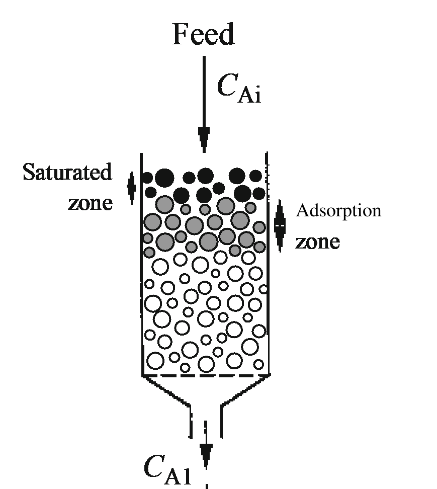

[Previous](<AB-44 - Isoelectric, polymer- and solvent-induced precipitation.md>) · [Subject index](../README.md) · [Topic overview](README.md) · [Complete section](<Complete section.md>)

<!-- note-content:start -->
# Section 45: Primary isolation by adsorption

## Intuition

Extraction and precipitation (Sections 42–44) move the *product* into a new phase. Adsorption instead holds the product still on a solid while everything else is washed away, then releases it on demand.

That ordering is what makes it selective. Binding, washing and elution are three separate opportunities to discriminate: a molecule must bind in the first step, survive the wash in the second, and be released in the third. Methods based on a single equilibrium have only one.

The practical behaviour follows from the bed being finite. Feed entering a fresh column meets unsaturated adsorbent and is stripped completely, so the outlet is clean. As the top of the bed fills, the region doing the work — the **adsorption zone** — moves downwards. Once it reaches the bottom, unadsorbed product starts appearing in the effluent: **breakthrough**. The operation is therefore inherently cyclic, not steady.

*Analogy:* a sponge wiping a spill, saturating from one end. The analogy breaks down because the adsorbent is *selective* — it is a sponge that takes up one liquid and leaves others behind — and because it can be wrung out and reused.

## Mechanism



**Adsorption** is a surface process where components of a gas or liquid bind to solid surfaces via physical or chemical interactions (van der Waals, electrostatic). The compound that binds is the **adsorbate**; the material to which it binds is the **adsorbent**.

Adsorption is often used as a primary isolation method, particularly in **separation of proteins, amino acids, antibodies and enzymes**, and in **treatment of waste waters**.

The adsorbent is normally **porous particles** with very high surface area, packed in a column. Materials include **activated charcoal** and **resins** made from styrene, divinylbenzene or acrylamide polymers. Porosity is the point: the usable surface is almost entirely internal.

### The four stages

1. **Binding** — the sample is contacted with the adsorbent, and the adsorbate binds.
2. **Washing** — the adsorbent is washed to remove unbound and weakly bound compounds.
3. **Elution** — the adsorbate is made to unbind so it can be recovered, normally by flowing a different solvent that **reverses the interactions that led to adsorption** in the first place.
4. **Regeneration** — the adsorbent is brought back to its original conditions so it can be re-used, for instance by replacing the elution solvent with the original binding solvent.

### Breakthrough


An **adsorption zone** propagates downwards at a rate much slower than the liquid flow. In this zone, adsorption is occurring and the resin is not yet saturated. Above this zone the resin is saturated. Feed comes out from the other side of the column (the **effluent**) with a time-dependent concentration $`C_A`$.

- **At early times**, the adsorption zone has not yet reached the bottom of the column, and $`C_A`$ in the effluent is low.
- **At late times**, the adsorption and saturation zones reach the bottom of the column. The column becomes saturated and $`C_A`$ starts increasing.
- The point at which $`C_A`$ starts increasing is the **breakpoint**.
- The process is **usually terminated at this stage, to avoid wasting target compound in the effluent**.

The breakthrough curve is therefore the operating signature of the column, and the breakpoint — not full saturation — sets the cycle time.

A broadened adsorption zone means some resin near the outlet is still incompletely loaded when the permitted effluent concentration is reached. Loading faster can leave less time for diffusion into porous beads and broaden this unused region. Dynamic capacity at breakthrough can therefore fall even though the equilibrium isotherm is unchanged. The batch example establishes equilibrium uptake; a packed-bed design also needs transport and a defined breakthrough criterion.

### Isotherms

An **adsorption isotherm** describes adsorption in terms of the **fraction of adsorbate bound to the adsorbent** as a function of the **bulk concentration of adsorbate**, at constant temperature.


**The Langmuir isotherm**, developed by Irving Langmuir (Nobel laureate in chemistry, 1932), is the simplest form:

**Equation (81)**

```math
C_{AS}^* = \frac{C_{ASm}K_AC_A^*}{1+K_AC_A^*}
```


where $`C_{AS}^*`$ is the equilibrium concentration of A bound onto the adsorbent (mass or moles of adsorbate per mass or volume of solid), $`C_{ASm}`$ is the maximum attainable value of $`C_{AS}^*`$ — the **saturation level**, so that $`C_{AS}^*/C_{ASm}`$ is the fraction of binding sites occupied — $`C_A^*`$ is the equilibrium concentration of A in the fluid phase, and $`K_A`$ is a constant.

**Limiting cases.**
- *Low concentration*, $`K_AC_A^*\ll1`$: $`C_{AS}^*\to C_{ASm}K_AC_A^*`$, linear in $`C_A^*`$. The surface is nearly empty, so uptake is proportional to what is offered.
- *High concentration*, $`K_AC_A^*\gg1`$: $`C_{AS}^*\to C_{ASm}`$, the plateau. Every site is occupied.

**The Langmuir isotherm is only valid if** adsorbed molecules form a **monolayer**, **all binding sites on the surface are equivalent**, and **interactions between adsorbed molecules are negligible**. These assumptions are **often not verified in real-life scenarios** — in complex adsorption media, binding sites are rarely all equivalent.


**The Freundlich isotherm** is an empirical alternative of particular interest in liquid/solid adsorption, which works well for isolation of antibiotics, hormones and steroids:

**Equation (82)**

```math
C_{AS}^* = K_fC_A^{*1/n}
```

with $`n`$ a constant where $`n>1`$, and $`K_f`$ a constant whose units depend on the units used for $`C_{AS}^*`$ and $`C_A^*`$.

**Note that different from the Langmuir isotherm, the Freundlich isotherm does not reach saturation.** Since $`1/n<1`$ the curve rises ever more slowly but without bound, which is physically impossible at very high concentration but a good description over the working range — and it accommodates a *distribution* of site energies rather than Langmuir's single type.

### Equilibrium loading controls the resin requirement

For a single batch of liquid volume $`V`$ and initial target concentration $`C_0`$, recovery $`Y`$ leaves equilibrium liquid concentration $`C^*=(1-Y)C_0`$, assuming the liquid volume is unchanged. Initially unloaded resin must take up $`YC_0V`$. If its equilibrium loading per unit resin volume is $`q(C^*)`$, conservation gives


```math
V_{\mathrm{res}}=\frac{YC_0V}{q((1-Y)C_0)}.
```


For a Freundlich isotherm $`q=K_F(C^*)^{1/n}`$ with positive parameters $`K_F,n`$, this scales as $`Y/(1-Y)^{1/n}`$ at fixed feed. Higher recovery both increases mass to adsorb and lowers the equilibrium loading of each unit of resin. This is why the last fraction of product costs disproportionately more adsorbent. Unit conventions must match those used to fit $`K_F`$. A flowing packed bed instead requires dynamic capacity at a specified breakthrough criterion; a batch equilibrium balance is not a validated column design.

## Link to other topics

Equation (81) is formally identical to Michaelis–Menten kinetics and to Langmuir–Hinshelwood surface catalysis, because binding to a finite site population can generate the same saturating algebra. Michaelis–Menten normally uses a kinetic steady-state balance; it is not generally an equilibrium adsorption model. The breakthrough curve is the same moving-front behaviour as a fixed-bed ion exchanger or a chromatographic column, which is the subject of Section 46.

## Summary

Adsorption binds the product to a solid and recovers it by elution, with binding, washing and elution each contributing selectivity — more than any other primary isolation method. The finite bed means operation is cyclic, terminated at the breakpoint when the adsorption zone reaches the outlet.

## Conclusion

Partitioning, solubility and binding equilibria set recovery, while material balances expose the concentration and capacity trade-offs. The next unit develops chromatography and final isolation.
<!-- note-content:end -->

[Previous](<AB-44 - Isoelectric, polymer- and solvent-induced precipitation.md>) · [Subject index](../README.md) · [Topic overview](README.md) · [Complete section](<Complete section.md>)
