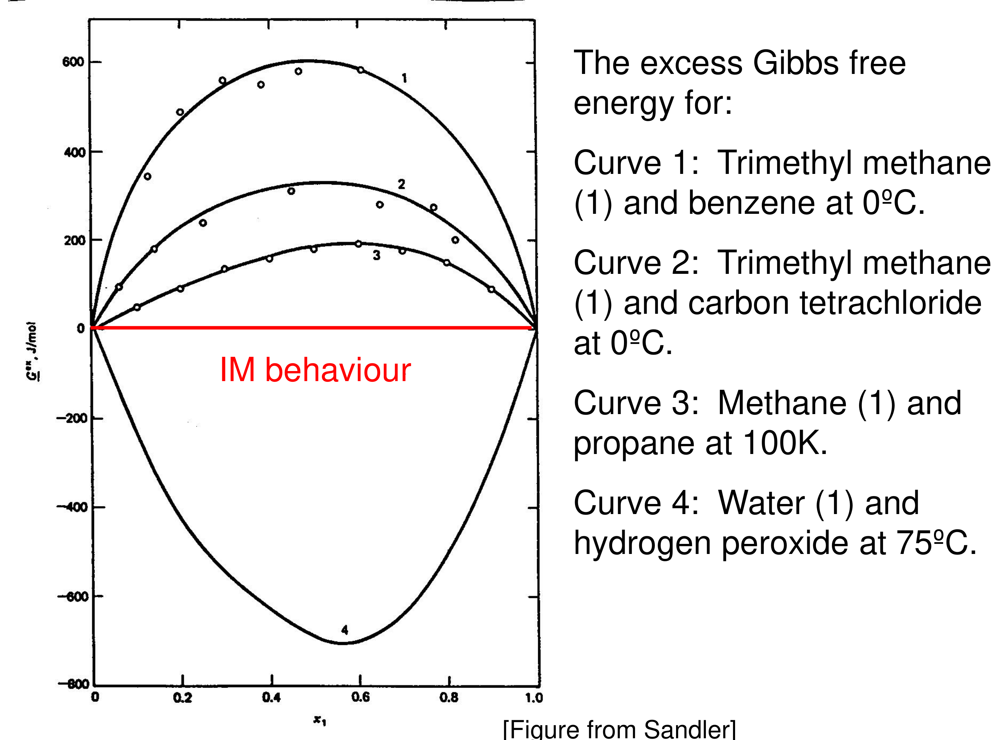

[Previous](<ET-11 - Thermodynamic consistency and the one-constant Margules model.md>) · [Subject index](../README.md) · [Topic overview](README.md) · [Complete section](<Complete section.md>) · [Next](<ET-13 - liquid oxygen–argon.md>)

<!-- note-content:start -->
# Section 12: Asymmetric models, parameters from data, and multicomponent mixtures

## Intuition

Asymmetry is the normal case. A small polar molecule dissolved in a large non-polar one is surrounded by neighbours it barely interacts with. The reverse situation is quite different. A single symmetric constant forces the two infinite-dilution activity coefficients to be equal; a second constant lets them differ.

The parameters are not predicted from first principles here. They are fitted to $`\underline{G}^{ex}`$ obtained from experiments. Vapour-pressure (VLE), freezing-point and osmotic-pressure measurements all give fugacities or chemical potentials, and hence $`\gamma_i`$ and $`\underline{G}^{ex}`$. The model is then a smooth, thermodynamically consistent interpolation of those data. It is not a theory of the mixture.

## Derivation

**Step 1: two-constant Margules.** Add an antisymmetric term:


**Equation (65)**

```math
\underline{G}^{ex} = x_1x_2\left[A + B(x_1 - x_2)\right]
```


$`A`$ and $`B`$ depend on $`T`$ only. Swapping the labels 1 ↔ 2 changes the sign of $`B`$, so $`B \neq 0`$ makes the model asymmetric. It still vanishes for both pure components.

**Step 2: activity coefficients.** Apply Section 11's formulas with $`g = x_1(1-x_1)\left[A + B(2x_1 - 1)\right]`$. After collecting powers of the other component's mole fraction:


**Equation (66)**

```math
RT\ln\gamma_1 = (A + 3B)\,x_2^2 - 4B\,x_2^3, \qquad RT\ln\gamma_2 = (A - 3B)\,x_1^2 + 4B\,x_1^3
```


**Step 3: consistency check.** Differentiate (66) with respect to $`x_1`$:
- $`d(RT\ln\gamma_1)/dx_1 = -2(A+3B)x_2 + 12Bx_2^2`$
- $`d(RT\ln\gamma_2)/dx_1 = 2(A-3B)x_1 + 12Bx_1^2`$

Then


```math
x_1\left[-2(A+3B)x_2 + 12Bx_2^2\right] + x_2\left[2(A-3B)x_1 + 12Bx_1^2\right] = x_1x_2\left[-12B + 12B(x_1 + x_2)\right] = 0
```


using $`x_1 + x_2 = 1`$. This is guaranteed by the general proof in Section 11, since (66) came from a single $`\underline{G}^{ex}`$.

**Step 4: infinite dilution.** Set $`x_2 = 1`$ in the first of (66) and $`x_1 = 1`$ in the second:


**Equation (67)**

```math
RT\ln\gamma_1^{\infty} = A - B, \qquad RT\ln\gamma_2^{\infty} = A + B
```


So the two constants map directly onto the two infinite-dilution activity coefficients, and $`B`$ measures the asymmetry. With $`B = 0`$, (66) reduces to the one-constant model.

**Step 5: multicomponent mixtures.** Sum over each *pair* of components once:

The denominator $`n`$ in $`\sum_{i\lt j}A_{ij}n_in_j/n`$ changes when $`n_k`$ is increased. Differentiating the numerator gives the interactions involving the added component; differentiating $`1/n`$ gives the common subtraction $`-\underline{G}^{ex}`$ in (69). It represents the dilution of the existing pair contributions as the total amount grows. Treating the mole fractions as independent constants during this derivative would miss it.

The pairwise assumption is a separate choice from thermodynamic consistency. Differentiating one total Gibbs-energy function guarantees consistency, but it cannot prove that binary parameters capture how a third component changes the local environment. The binary limit checks the algebra; multicomponent measurements test that physical assumption.


**Equation (68)**

```math
\underline{G}^{ex} = \sum_{i\lt j} A_{ij}\,x_ix_j
```


where $`A_{ij}`$ is the one-constant parameter fitted to the $`i`$–$`j`$ binary. To differentiate, write $`n\underline{G}^{ex} = \sum_{i\lt j}A_{ij}n_in_j/n`$. Differentiating with respect to $`n_k`$ gives


**Equation (69)**

```math
RT\ln\gamma_k = \sum_{j\neq k} A_{kj}\,x_j - \underline{G}^{ex}
```


*Check:* for a binary, $`Ax_2 - Ax_1x_2 = Ax_2(1 - x_1) = Ax_2^2`$, matching Section 11. ✓

## Motivation and explanation

**What an asymmetric fit adds.** Matching both the depth and composition of an off-centre minimum in $`\underline G^{ex}`$ gives two independent constraints on a two-parameter model. A one-constant Margules model can match the depth but forces its extremum to equimolar composition. For the negative excess-Gibbs-energy curve of water–hydrogen peroxide, this symmetry would also force the two infinite-dilution coefficients to be equal, hiding the stronger stabilisation of one dilute component. Graph-read extrema support estimates and the direction of asymmetry; they do not warrant highly precise fitted constants or extrapolation beyond the measured range.

**Where $`\underline{G}^{ex}`$ comes from.** In practice one measures something that gives a fugacity. For example, in vapour–liquid equilibrium with an ideal-gas vapour, $`\gamma_i = y_iP/(x_iP_i^{\mathrm{SAT}})`$, a result derived in Section 13. That gives $`\underline{G}^{ex} = RT\sum x_i\ln\gamma_i`$ point by point, and the model constants are fitted to the resulting curve. Freezing-point depression and osmotic pressure give the solvent's chemical potential in the same way; both appear later in the course.

**Reading the data.** The figure shows measured $`\underline{G}^{ex}`$ for four binaries.
- Curves 1–3 are positive: hydrocarbons with benzene or CCl₄, and methane–propane. Unlike contacts are unfavourable.
- Curve 4, water–hydrogen peroxide, is strongly negative and clearly skewed, with its minimum near $`x_1 \approx 0.57`$, not 0.5. Water and H₂O₂ hydrogen-bond to each other more strongly than to themselves, and the skew is exactly what $`B`$ is for.



**Why binary data are enough.** Equation (68) assumes the excess Gibbs energy is a sum of pair contributions. This is the same idea as mixing rules for an EOS. It is usually adequate, and it means a ten-component flowsheet needs only binary data, the 45 pairs, not ten-component experiments. Process simulators store binary parameters as functions of $`T`$ for exactly this reason. The approximation fails when three-body effects matter, e.g. a third component that strongly changes the hydrogen-bonding between the other two.

**Pressure.** As shown in Section 10, the pressure dependence of $`\underline{G}^{ex}`$ for liquids is a few J mol⁻¹ per 100 bar, so the parameters are taken as functions of $`T`$ alone.

## Link to other topics

The infinite-dilution activity coefficients in (67) are what ebulliometry measures directly (Section 14). They also set relative volatility at the ends of a distillation column. The pairwise construction (68)–(69) carries over to all the activity-coefficient models surveyed later (Redlich–Kister, van Laar, Wilson, NRTL, UNIQUAC).

## Summary

Adding $`B(x_1 - x_2)`$ to the Margules model breaks the symmetry while keeping it consistent. $`A`$ and $`B`$ correspond directly to the two infinite-dilution activity coefficients. Model constants come from fitting $`\underline{G}^{ex}`$ inferred from measured fugacities, and binary parameters combine pairwise to describe multicomponent mixtures.
<!-- note-content:end -->

[Previous](<ET-11 - Thermodynamic consistency and the one-constant Margules model.md>) · [Subject index](../README.md) · [Topic overview](README.md) · [Complete section](<Complete section.md>) · [Next](<ET-13 - liquid oxygen–argon.md>)
