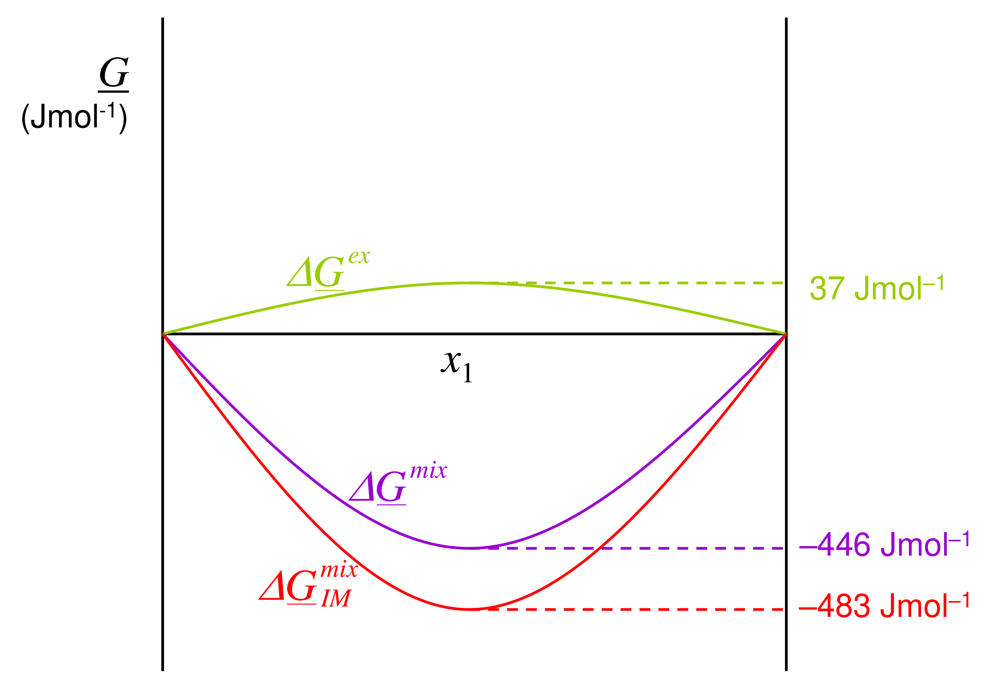

[Previous](<ET-12 - Asymmetric models, parameters from data, and multicomponent mixtures.md>) · [Subject index](../README.md) · [Topic overview](README.md) · [Complete section](<Complete section.md>)

<!-- note-content:start -->
# Section 13: liquid oxygen–argon

*Components:* liquid oxygen (1), argon (2).

## Intuition

Oxygen and argon are small, nearly spherical, non-polar molecules of similar size. Their mixture should be close to ideal. A small positive $`A`$ says they attract each other slightly less than they attract their own kind. So we expect $`\Delta\underline{G}_{\mathrm{mix}}`$ to be dominated by the ideal entropy term, with $`\gamma`$'s a little above 1 and partial pressures slightly above Raoult's law. The calculation confirms this and gives the size of the effect.

## Derivation

**(a) Gibbs energy of mixing.** Combine the ideal term and the model:


**Equation (70)**

```math
\Delta\underline{G}_{\mathrm{mix}} = RT\left(x_1\ln x_1 + x_2\ln x_2\right) + Ax_1x_2
```


**(b) Chemical potentials.** From (52) of Section 10 with the Margules $`\gamma`$'s:


**Equation (71)**

```math
\mu_1 = \underline{G}_1 + RT\ln x_1 + Ax_2^2, \qquad \mu_2 = \underline{G}_2 + RT\ln x_2 + Ax_1^2
```


Here $`\underline{G}_i`$ is pure liquid $`i`$ at the same $`T`$ and $`P`$. It can be evaluated from $`d\underline{G}_i = -\underline{S}_i\,dT + \underline{V}_i\,dP`$ and tabulated data, but it cancels in the equilibrium calculation below.

**(c) Vapour–liquid equilibrium for oxygen.** Require $`\mu_1^{L} = \mu_1^{V}`$.

*Liquid side:* (71), $`\mu_1^{L} = \underline{G}_1^{L}(T,P) + RT\ln x_1 + RT\ln\gamma_1`$.

*Vapour side:* assume an ideal-gas mixture, so $`\mu_1^{V} = \underline{G}_1^{\circ}(T) + RT\ln(y_1P/P^{\circ})`$, with $`\underline{G}_1^{\circ}`$ the pure ideal gas at $`T`$, $`P^{\circ}`$.

Choose $`P^{\circ} = P_1^{\mathrm{SAT}}(T)`$. At this pressure pure liquid oxygen coexists with its (ideal) vapour, so $`\underline{G}_1^{L}(T,P_1^{\mathrm{SAT}}) = \underline{G}_1^{\circ}(T)`$ when the reference is taken at $`P^{\circ} = P_1^{\mathrm{SAT}}`$.

*Neglect the liquid's pressure dependence:* $`\underline{G}_1^{L}(T,P)\approx\underline{G}_1^{L}(T,P_1^{\mathrm{SAT}})`$, i.e. ignore the Poynting factor (Section 06).

The pure-component terms then cancel, leaving


**Equation (72)**

```math
RT\ln x_1 + RT\ln\gamma_1 = RT\ln\frac{y_1P}{P_1^{\mathrm{SAT}}} \;\;\Rightarrow\;\; \boxed{x_1\gamma_1P_1^{\mathrm{SAT}} = y_1P}
```


This is modified Raoult's law. In fugacity language it is $`\bar f_1^{L} = \gamma_1x_1f_1^{L}`$ with $`f_1^{L} = P_1^{\mathrm{SAT}}`$, set equal to $`\bar f_1^{V} = y_1P`$. That is why fugacity is the convenient variable: equilibrium becomes a one-line equality.

**Saturation pressure.** Integrating Clausius–Clapeyron with constant $`\Delta\underline{H}^{\mathrm{vap}}`$ from the normal boiling point $`T_b`$, where $`P^{\mathrm{SAT}} = 1`$ atm:


**Equation (73)**

```math
\ln\frac{P^{\mathrm{SAT}}(T)}{P^{\mathrm{SAT}}(T_b)} = -\frac{\Delta\underline{H}^{\mathrm{vap}}}{R}\left(\frac{1}{T} - \frac{1}{T_b}\right)
```


## Motivation and explanation

**Separating three contributions to a vapour prediction.** At 83.8 K, the oxygen–argon Margules model has $`A=148\ \mathrm{J\,mol^{-1}}`$, so $`A/(RT)\approx0.212`$. At equimolar composition the ideal mixing term is about $`-483\ \mathrm{J\,mol^{-1}}`$ and the excess is $`+37\ \mathrm{J\,mol^{-1}}`$: mixing remains favourable and the total curve is convex. A positive excess term alone does not imply demixing.

At $`x_{\mathrm{O_2}}=0.3`$, the model gives $`\gamma_{\mathrm{O_2}}\approx1.110`$ and $`\gamma_{\mathrm{Ar}}\approx1.019`$. Using saturation pressures 0.507 and 0.689 bar gives a bubble pressure of approximately 0.660 bar and $`y_{\mathrm{O_2}}\approx0.256`$. The vapour is richer in oxygen than the corresponding Raoult prediction ($`y_{\mathrm{O_2}}\approx0.240`$), yet poorer than the liquid ($`x_{\mathrm{O_2}}=0.3`$). Argon remains more volatile: volatility depends on $`\gamma_iP_i^{\mathrm{SAT}}`$, not $`\gamma_i`$ alone.
The oxygen saturation pressure above comes from a constant-enthalpy Clausius–Clapeyron estimate. A more accurate value is about 0.492 bar, which lowers oxygen's predicted partial pressure from about 0.169 to 0.164 bar. Thermal property data can limit the final accuracy even when the activity model is adequate.

**What each assumption costs.**
- Ideal-gas vapour: good below 1 bar.
- Neglecting the Poynting factor: under 0.1 % at these pressures (Section 06).
- Constant $`\Delta\underline{H}^{\mathrm{vap}}`$: 3 % error in $`P^{\mathrm{SAT}}`$ over 6 K.
- One-constant Margules: adequate for two similar small molecules.

The non-ideal correction (11 % on oxygen's partial pressure) is larger than all the other approximations. So the activity coefficient is worth including even for this nearly ideal mixture. For an air-separation column, which separates O₂, Ar and N₂ with small relative volatilities, it is essential.

**Limiting cases.** As $`x_1\to 1`$, $`\gamma_1\to 1`$ and (72) gives $`y_1P\to P_1^{\mathrm{SAT}}`$, the pure vapour pressure. As $`x_1\to 0`$, $`\gamma_1\to\exp(A/RT) = 1.24`$, so oxygen's partial pressure approaches $`1.24\,x_1P_1^{\mathrm{SAT}}`$. That is linear in $`x_1`$ with a modified slope: Henry's law behaviour, discussed later.

## Link to other topics

Equation (72), $`x_i\gamma_iP_i^{\mathrm{SAT}} = y_iP`$, is the workhorse of low-pressure vapour–liquid equilibrium. Bubble- and dew-point calculations, azeotropes and the design of distillation columns in Separations all start from it. Turned around, measured $`x`$, $`y`$, $`P`$ data give $`\gamma_i`$ directly, which is how activity-coefficient parameters are obtained.

## Summary

Starting from a single model constant, $`A = 148`$ J mol⁻¹, we obtained the Gibbs energy of mixing, the chemical potentials, and, through modified Raoult's law, the oxygen partial pressure (≈0.17 bar) and the bubble pressure (≈0.66 bar) of a 30 % oxygen liquid at 83.8 K. Positive deviation raises them by 11 % and 4 % above Raoult's law.

## Conclusion

The activity coefficient measures, component by component, how far a liquid mixture departs from ideal mixing; $`\gamma > 1`$ means a higher chemical potential than in an ideal mixture at the same composition. Models are built from $`\underline{G}^{ex}`$ so that they are thermodynamically consistent, and with them modified Raoult's law $`x_i\gamma_iP_i^{\mathrm{SAT}} = y_iP`$ predicts vapour–liquid equilibrium. The next part asks where the model constants come from: measurements of activity coefficients, including from freezing points.
<!-- note-content:end -->

[Previous](<ET-12 - Asymmetric models, parameters from data, and multicomponent mixtures.md>) · [Subject index](../README.md) · [Topic overview](README.md) · [Complete section](<Complete section.md>)
