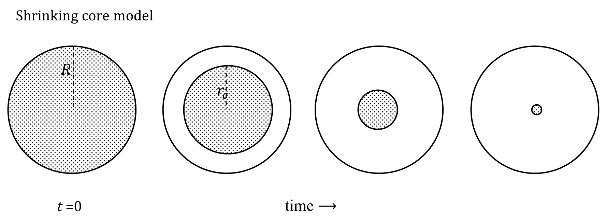
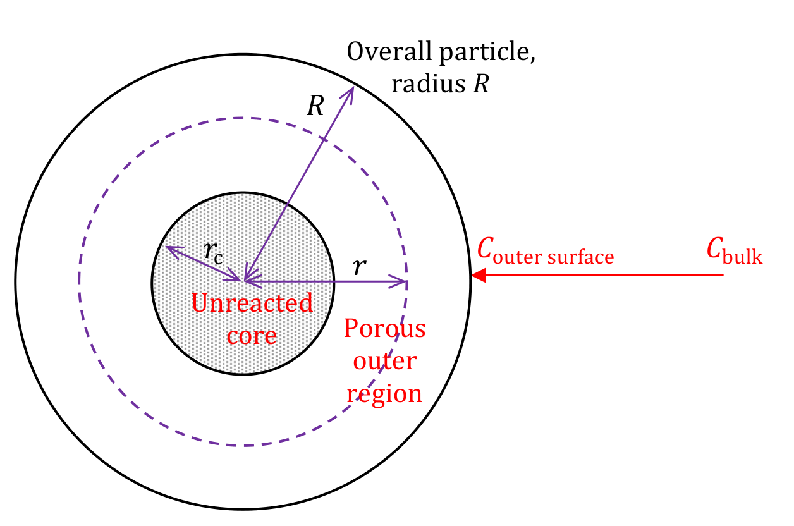

[Previous](<RE-08 - Reaction-controlled shrinking particles.md>) · [Subject index](../README.md) · [Topic overview](README.md) · [Next](<RE-10 - Shrinking-core regimes and combined resistances.md>)

<!-- note-content:start -->
# RE-09: Shrinking core with product-layer diffusion

## Overview

Assumed: Fick's law in spherical coordinates and the quasi-steady solid balance.

Many industrial solids react to give a solid product that stays in place, so the particle keeps its size while an unreacted core shrinks inside a growing product layer. If that layer is porous, reagent can continue to diffuse through it. When diffusion through the product layer is the slowest step, the time to reach conversion $`X`$ is $`t/\tau_c=1-3(1-X)^{2/3}+2(1-X)`$, with $`\tau_c\propto R^2`$. Conversion starts very fast and becomes progressively slower as the diffusion path lengthens.

## Intuition

Roasting a zinc sulfide ore particle in air turns its outside into zinc oxide. Oxygen must now diffuse through the oxide shell to reach the remaining sulfide. At first the shell is thin and supply is fast. Later, the shell is thick and the target, the core surface, is small, so each further increment of conversion takes longer.

If the product were non-porous, the layer would seal the core and stop the reaction, as a passivating film does in corrosion. The model needs a product porous enough to admit the reagent, but resistant enough that diffusion through it matters.



The sequence shows the outer radius $`R`$ fixed while the stippled unreacted core of radius $`r_c`$ recedes to nothing.

## Derivation

Write the reaction as


```math
\nu_A\mathrm{A(s)}+\nu_B\mathrm{B(g)}\longrightarrow\nu_C\mathrm{C(s)}+\text{products(g)},
```


with positive stoichiometric numbers. Examples are $`\mathrm{ZnS(s)+\tfrac32O_2(g)\to ZnO(s)+SO_2(g)}`$, the reduction $`\mathrm{Fe_3O_4(s)+4H_2(g)\to3Fe(s)+4H_2O(g)}`$, and burning coke out of a porous catalyst to regenerate it. Assume a spherical, non-porous particle of A, an overall radius $`R`$ that does not change, a sharp reaction front at $`r_c`$, constant temperature, and a constant effective diffusivity $`D_e`$ of B in the product layer. Let $`C`$ be the concentration of B in the pores of that layer.



**Step 1: no reaction in the product layer.** At radius $`r`$ with $`r_c<r<R`$, the molar flow of B moving inward is $`D_e(dC/dr)4\pi r^2`$. B does not react in this layer, so under the quasi-steady assumption that flow is the same at every radius:


```math
\frac{d}{dr}\left(D_e\frac{dC}{dr}4\pi r^2\right)=0
\quad\Longrightarrow\quad
r^2\frac{dC}{dr}=\text{constant}.
```


*Reason:* anything else would make B accumulate in or vanish from a shell that neither stores nor consumes it on this timescale.

**Step 2: integrate and apply the boundary values.** Integrating again gives $`C=a/r+b`$. If transport through the external film is fast compared with internal diffusion, $`C\approx C_{\mathrm{bulk}}`$ at $`r=R`$. If the chemical reaction at the core is fast, $`C\approx0`$ at $`r=r_c`$. Solving for $`a`$ and $`b`$,


**Equation (28)**

```math
C=C_{\mathrm{bulk}}\frac{1/r-1/r_c}{1/R-1/r_c}.
```


**Step 3: evaluate the molar flow.** Differentiating (28) and multiplying by $`D_e4\pi r^2`$,


**Equation (29)**

```math
\dot n_B=\frac{4\pi D_eC_{\mathrm{bulk}}}{1/r_c-1/R}=\frac{4\pi D_eC_{\mathrm{bulk}}Rr_c}{R-r_c}.
```


*Reason:* the $`r^2`$ cancels, as Step 1 requires, so the same answer is obtained at the outer surface (flow entering) and at the core (flow reacting). The denominator $`1/r_c-1/R`$ is the resistance of a spherical shell: it grows from zero as the core recedes and diverges as $`r_c\to0`$.

**Step 4: balance the core.** The core holds $`\tfrac43\pi r_c^3\rho_m`$ moles of A, where $`\rho_m`$ is the molar density of A. Its loss rate is the stoichiometric share of $`\dot n_B`$:


```math
-4\pi r_c^2\rho_m\frac{dr_c}{dt}=\frac{\nu_A}{\nu_B}\frac{4\pi D_eC_{\mathrm{bulk}}}{1/r_c-1/R}.
```


Separate the variables: $`(1/R-1/r_c)r_c^2\,dr_c=(\nu_AD_eC_{\mathrm{bulk}}/\nu_B\rho_m)\,dt`$.

**Step 5: integrate from $`r_c=R`$ at $`t=0`$.** With constant $`D_e`$,


```math
\frac{r_c^3-R^3}{3R}-\frac{r_c^2-R^2}2=\frac{r_c^3}{3R}-\frac{r_c^2}2+\frac{R^2}6=\frac{D_eC_{\mathrm{bulk}}}{\rho_m}\frac{\nu_A}{\nu_B}t.
```


Multiplying by $`6/R^2`$ gives $`2(r_c/R)^3-3(r_c/R)^2+1`$ on the left. Setting $`r_c=0`$ defines $`\tau_c`$, and since conversion is $`X=1-(r_c/R)^3`$, so that $`r_c/R=(1-X)^{1/3}`$,


**Equation (30)**

```math
\tau_c=\frac{\rho_mR^2}{6D_eC_{\mathrm{bulk}}}\frac{\nu_B}{\nu_A},\qquad
\frac t{\tau_c}=2\left(\frac{r_c}R\right)^3-3\left(\frac{r_c}R\right)^2+1=1-3(1-X)^{2/3}+2(1-X).
```


## Motivation and explanation

Early in the reaction the product layer is thin and the resistance $`1/r_c-1/R`$ is small, so conversion is fast. Expanding (30) for small $`X`$ gives $`t/\tau_c\approx X^2/3`$, so $`X\approx\sqrt{3t/\tau_c}`$: the parabolic growth law of a layer thickening by diffusion through itself. The infinite initial rate implied by $`\sqrt t`$ is a model artefact; at very early times the neglected film and reaction resistances are no longer small compared with a vanishingly thin layer, and they limit the rate.

Late in the reaction two effects slow it down together: the diffusion path approaches the full radius, and the reaction front's area $`4\pi r_c^2`$ shrinks. The time $`\tau_c`$ again scales as $`R^2`$ because the path length and the inventory per unit area both scale with $`R`$.

The external film and the product layer can both give $`\tau_c\propto R^2`$ for small particles, so size alone may not separate them. Gas velocity does: it changes $`k_g`$ but leaves product-layer diffusion untouched. A firm product layer usually has $`D_e`$ far below the bulk gas diffusivity $`D`$, because only the pore fraction carries flux and the paths are tortuous, so its resistance normally exceeds that of the film.

The sharp-front picture needs a non-porous reactant in which the reagent cannot penetrate ahead of the front. If A is itself porous, reaction is spread through the particle and conversion behaves between this model and uniform progressive conversion. The product may also occupy a different volume from the reactant it replaces, so the layer can crack, flake off or densify, changing $`D_e`$ or exposing fresh core. Heat release can set up temperature gradients in and around the particle.

## Link to other topics

The effective diffusivity of the product layer is the same porous-solid property used in catalyst pellets. The fixed-size spherical shell resistance is also the mass-transfer counterpart of steady conduction through an insulating shell.

## Conclusion

Product-layer diffusion makes conversion fast at first and slow later, with $`\tau_c\propto R^2`$ and no dependence on gas velocity. The remaining shrinking-core regimes, and how they combine, follow next.
<!-- note-content:end -->

[Previous](<RE-08 - Reaction-controlled shrinking particles.md>) · [Subject index](../README.md) · [Topic overview](README.md) · [Next](<RE-10 - Shrinking-core regimes and combined resistances.md>)
