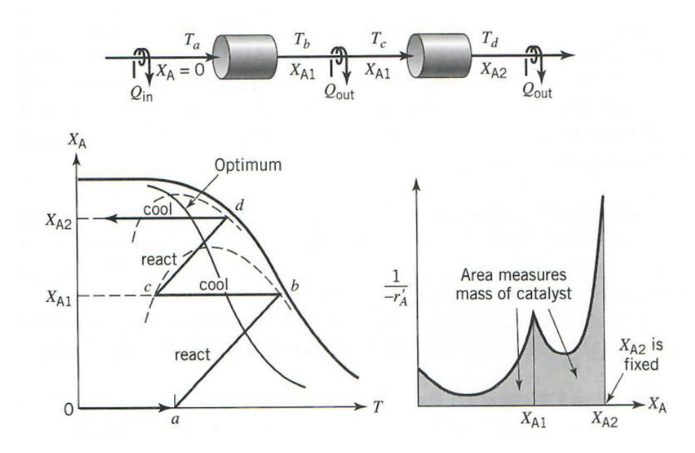

[Subject index](../README.md) · [Topic overview](README.md) · [Next](<RE-16 - Diesel desulfurisation and nonideal flow.md>)

<!-- note-content:start -->
# RE-15: Catalytic reactor types and staged beds

## Overview

Assume ideal PFR and CSTR balances. Real catalytic equipment is chosen to manage heat, contact between phases, pressure drop and catalyst replacement. Ideal flow models are approximations whose usefulness depends on the physical arrangement.

## Intuition

A fixed bed retains catalyst cheaply but allows temperature and concentration to vary along its length. Fluidising the particles promotes mixing and temperature uniformity, at the cost of a broader residence-time distribution, attrition and constraints on velocity. A three-phase reactor must additionally bring dissolved gas, liquid reagent and solid sites together.

## Equipment

| Arrangement | Physical behaviour | Main design consequence |
|---|---|---|
| Fixed or packed bed | Fluid crosses retained catalyst pellets | Simple containment; axial gradients and pressure drop; difficult rapid catalyst replacement |
| Multitubular fixed bed | Catalyst-filled tubes exchange heat with surrounding coolant | Large heat-transfer area for strongly exothermic reactions |
| Bed with internal exchange tubes | Heat-exchange fluid passes through tubes inside catalyst | Controls temperature while retaining catalyst |
| Radial-flow bed | Fluid crosses a short radial bed thickness | Reduces flow-path pressure drop; requires sound distribution |
| Moving bed | Used catalyst is withdrawn and replacement supplied | Accommodates deactivation without shutting down the whole process |
| Fluidised bed | Upflow suspends particles and mixes them | Good temperature control; nonideal flow, entrainment and attrition |
| Slurry reactor | Gas bubbles through catalyst suspended in liquid | Liquid provides reagent or heat sink; product–solid separation required |
| Trickle bed | Gas and liquid usually flow downward through retained particles | Wetting, phase distribution and liquid residence-time spread affect observed rate |

Fluid catalytic cracking couples a zeolite-containing reactor with a separate air-fed coke regenerator. Rapid coking makes continuous circulation useful. The regenerated hot catalyst also transfers energy; treating the regenerator as merely a catalyst cleaner misses the thermal coupling.

## Derivation

For staged adiabatic operation define $`F_{A0}`$ as inlet molar flow of reference reagent A, $`X`$ its conversion, $`\Delta H_A`$ the enthalpy per mole A consumed, and $`\dot C_p=\sum_iF_iC_{p,i}`$ the mixture heat-capacity flow. With constant $`\dot C_p`$ and $`\Delta H_A`$, the steady energy balance is


**Equation (41)**

```math
\dot C_p\,dT=-F_{A0}\Delta H_A\,dX.
```


The right side is heat liberated by conversion; it is positive for an exothermic reaction. Integrating between the stage entrance $`(X_0,T_0)`$ and an interior state gives


**Equation (42)**

```math
T-T_0=\frac{-F_{A0}\Delta H_A}{\dot C_p}(X-X_0).
```


An adiabatic stage is therefore a straight line on a temperature–conversion diagram under these approximations. Define $`c_p=\dot C_p/F_{A0}`$ if writing the line as $`X-X_0=c_p(T-T_0)/(-\Delta H_A)`$. This $`c_p`$ is heat-capacity flow per inlet molar flow of A, not an unspecified mass-specific heat capacity. Variable composition, heat capacities and reaction enthalpy require integrating the coupled balances instead.

Let $`-r_A(X,T)`$ be the disappearance rate per reactor volume. A PFR material balance gives


**Equation (43)**

```math
dV=F_{A0}\frac{dX}{-r_A(X,T)},\qquad
V_j=F_{A0}\int_{X_{j,\mathrm{in}}}^{X_{j,\mathrm{out}}}\frac{dX}{-r_A(X,T_j(X))}.
```


This is the area under an inverse-rate curve along the actual temperature path. It follows that maximising rate at each conversion minimises volume if the temperature can be chosen freely and other constraints are absent.

## Motivation and explanation

The temperature–conversion diagram is a map of successive material states, rather than a time-response plot. Within an adiabatic bed, every increase in conversion releases or absorbs reaction enthalpy and fixes the accompanying temperature change. An exchanger with negligible reaction changes temperature at the same conversion, allowing the next bed to start on a different rate contour without undoing the conversion already achieved.

Interstage cooling can improve a reversible exothermic reaction even though cooling reduces its forward rate constant. At sufficiently high conversion, reducing temperature improves the equilibrium driving force enough to raise the net forward rate. The relevant quantity in the sizing integral is that net rate along each actual stage path. Close to equilibrium it tends to zero, so the inverse-rate area becomes very expensive even when elementary forward and reverse reactions are individually fast.

For an irreversible exothermic reaction with an increasing Arrhenius rate, the best allowed temperature often lies at the imposed maximum. For a reversible exothermic reaction, heating accelerates kinetics but reduces equilibrium conversion. At increasing conversion, the rate-maximising temperature commonly falls. Adiabatic reaction heats the mixture in the opposite direction, so interstage cooling allows a sequence of rising-temperature reaction segments and cooling segments to follow the useful region. Cooling changes temperature without changing conversion when no reaction occurs in the exchanger.

For reversible endothermic reactions, heating favours both equilibrium and kinetics; an adiabatic stage cools, so reheating between stages is useful. The temperature ceiling, available heat exchange, pressure drop and side reactions restrict the mathematical optimum. A plotted locus of maximum rates is a design aid rather than a universally attainable trajectory.



The inverse-rate plot shown uses $`r_A'`$ per catalyst mass, so its area multiplied by $`F_{A0}`$ gives catalyst mass. The preceding balance uses rate per reactor volume and gives reactor volume. Converting between them requires catalyst mass per reactor volume.

A chain of $`N`$ identical CSTRs provides a simple nonideal flow model. If the measured RTD has mean $`\tau`$ and variance $`\sigma_t^2`$, then its model variance $`\tau^2/N`$ gives $`N=\tau^2/\sigma_t^2`$. Fitting tracer data is preferable to guessing from geometry. Estimates $`N\approx L/d_p`$ for well-mixed interparticle flow, $`L/(4d_p)`$ for some slow packed-bed flows and $`L/(20d_p)`$ for the illustrative slow trickle-bed model are empirical, configuration-dependent guides. Here $`L`$ is bed length and $`d_p`$ particle diameter; changing flow can change the appropriate $`N`$.

## Link to other topics

The residence-time distribution controls the fraction of fluid that leaves underreacted. Pellet transport and surface coverage determine the effective rate used in each idealised flow element.

## Conclusion

Choose equipment from heat, contact and catalyst-lifetime requirements, then justify its flow model. High conversion makes even small departures from plug flow consequential.
<!-- note-content:end -->

[Subject index](../README.md) · [Topic overview](README.md) · [Next](<RE-16 - Diesel desulfurisation and nonideal flow.md>)
