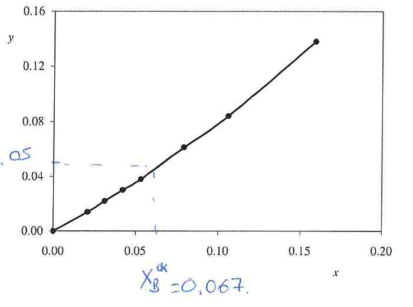

[Previous](<SEP-10 - Packed-column hydraulics and diameter.md>) · [Subject index](../README.md) · [Topic overview](README.md) · [Next](<../02 - Drying of solids/SEP-12 - Drying equipment and wet solids.md>)

<!-- note-content:start -->
# SEP-11: Designing an ammonia absorber

## Overview

Assumed background: operating lines, pinch limits and HTU–NTU design. This example combines equilibrium data, minimum solvent flow and a converged rate calculation. The supplied process data determine required packed volume; a separate hydraulic area is needed to determine height.

## Intuition

Fresh water keeps the clean-gas end's equilibrium ammonia concentration very low. That end nevertheless has a small actual ammonia concentration, so its absolute driving force is small and needs careful integration. Coarse spacing there can dominate the error in a numerical height estimate.

## Derivation

Treat $`G_m=0.0500\ \mathrm{kmol\,s^{-1}}`$ gas containing $`5.00\ \mathrm{mol\%}`$ ammonia by countercurrent water scrubbing at $`T=293\ \mathrm K`$ and total pressure $`P_T=110\ \mathrm{kPa}`$. Require an outlet containing $`0.0100\ \mathrm{mol\%}`$ ammonia. Thus $`y_B=0.0500`$, $`y_T=0.000100`$ and fresh-water $`x_T=0`$. Choose $`L_m=1.29(L_m)_{\min}`$. Assume dilute constant-flow, isothermal plug flow, ideal gas behaviour, and a gas-controlled volumetric coefficient $`K_ga\approx k_ga=1.50\ \mathrm{s^{-1}}`$. Here $`K_g,k_g`$ are overall/individual concentration-based gas coefficients and $`a`$ is effective contact area per packed volume.

Use the following ammonia–water equilibrium data; $`x`$ is liquid ammonia mole fraction and $`p`$ its equilibrium gas partial pressure:

| $`x`$ | $`p`$ ($`\mathrm{kPa}`$) | $`y^*=p/P_T`$ |
|---|---|---|
| $`0`$ | $`0`$ | $`0`$ |
| $`0.021`$ | $`1.6`$ | $`0.0145455`$ |
| $`0.031`$ | $`2.4`$ | $`0.0218182`$ |
| $`0.042`$ | $`3.3`$ | $`0.0300000`$ |
| $`0.053`$ | $`4.2`$ | $`0.0381818`$ |
| $`0.079`$ | $`6.7`$ | $`0.0609091`$ |
| $`0.106`$ | $`9.3`$ | $`0.0845455`$ |
| $`0.159`$ | $`15.2`$ | $`0.138182`$ |



The handwritten $`x_B^*\approx0.067`$ marks a graphical estimate of the equilibrium liquid composition for inlet gas. Compute it from the tabulated pressure interval without prematurely rounding $`y`$. The inlet partial pressure is $`P_Ty_B`$, lying between the entries at $`x=0.053`$ and $`0.079`$. Linear interpolation gives


**Equation (46)**

```math
x_B^*=0.053+(0.079-0.053)
\frac{P_Ty_B-4.2\ \mathrm{kPa}}{6.7\ \mathrm{kPa}-4.2\ \mathrm{kPa}}
=0.06652.
```


This equilibrium composition is the **limiting** bottom outlet, not the operating liquid outlet. Use the balance to obtain minimum and selected solvent flows:


**Equation (47)**

```math
(L_m)_{\min}=\frac{G_m(y_B-y_T)}{x_B^*-x_T}
=0.0375075\ \mathrm{kmol\,s^{-1}},
\qquad L_m=0.0483847\ \mathrm{kmol\,s^{-1}}.
```


The chosen line is steeper than the bottom-pinch line. Check its gap against every interpolation segment to ensure no interior pinch precedes the bottom one. The solute-transfer rate and actual liquid outlet follow from conservation:


**Equation (48)**

```math
Q_m=G_m(y_B-y_T)=0.00249500\ \mathrm{kmol\,s^{-1}},
\qquad x_B=x_T+\frac{Q_m}{L_m}=0.0515659.
```


For any trial $`y`$, solve the operating line before using equilibrium:


**Equation (49)**

```math
x(y)=x_T+\frac{G_m}{L_m}(y-y_T),
\qquad y^*(y)=f(x(y)),\qquad
\mathrm{NTU}_{og}=\int_{0.000100}^{0.0500}\frac{dy}{y-f(x(y))}.
```


Here $`f`$ is piecewise linear interpolation of the tabulated equilibrium values. Because both $`x(y)`$ and each interpolation segment are linear, the driving force on each segment has the form $`\alpha_jy+\beta_j`$. Integrate each segment analytically as $`\ln[(\alpha_jy_2+\beta_j)/(\alpha_jy_1+\beta_j)]/\alpha_j`$, using $`(y_2-y_1)/\beta_j`$ if its slope is zero. Split exactly where $`x(y)`$ reaches an equilibrium-data breakpoint, so no curvature change is overlooked.

The summed result is $`\mathrm{NTU}_{og}=17.6229916`$. An independent refined composite Simpson calculation gives $`17.6230369`$, $`17.6229917`$ and $`17.6229916`$ at successively finer grids, confirming the numerical integral for this interpolation model.

The gas molar density and required packed volume $`V_p=AZ`$ are


**Equation (50)**

```math
\rho_{mg}=\frac{P_T}{RT}=0.0451532\ \mathrm{kmol\,m^{-3}},
\qquad
V_p=\frac{G_m\mathrm{NTU}_{og}}{\rho_{mg}K_ga}
\approx13.01\ \mathrm{m^3},
```


using $`R=8314.5\ \mathrm{Pa\,m^3\,kmol^{-1}\,K^{-1}}`$ and pressure in pascals. The volume units follow from $`(\mathrm{kmol\,s^{-1}})/(\mathrm{kmol\,m^{-3}}\,\mathrm{s^{-1}})`$.

The calculation deliberately uses equilibrium twice for different purposes. First, equilibrium with the entering gas defines a limiting liquid loading and hence a minimum solvent flow. After selecting an actual flow, the operating balance supplies the actual liquid loading at each location. Only then does equilibrium supply the hypothetical gas counterpart used to calculate the local driving force. Substituting the pinch loading as the actual outlet would undo the chosen margin above minimum flow.

Numerical refinement concentrates attention where reciprocal driving force is large, rather than where the concentration axis spans the widest interval. The convergence check verifies integration of the chosen interpolation model. It cannot establish that the tabulated equilibrium, constant temperature or gas-controlled coefficient is accurate for a different operating condition.

## Motivation and explanation

There are two separate approximations to control. Approximating a curved equilibrium curve by one straight line permits an endpoint logarithmic mean, but changes the driving-force profile. With the same unrounded endpoint data, that shortcut gives approximately $`14.00\ \mathrm{m^3}`$ instead of $`13.01\ \mathrm{m^3}`$. Rounding the graphical bottom composition and endpoint equilibrium force more coarsely can shift the shortcut towards $`14.8\ \mathrm{m^3}`$.

Numerical quadrature also needs refinement. A coarse grid using reciprocals $`10000,5000,2500,625,323,161,127,97,79`$ at $`y=0.0001,0.0005,0.001,0.005,0.01,0.02,0.03,0.04,0.05`$ gives a trapezoid total $`19.355`$, implying approximately $`14.29\ \mathrm{m^3}`$. Agreement between two coarse approximations does not establish accuracy. The converged interpolation result avoids both premature rounding and coarse-grid error, while still relying on the physical model and available equilibrium measurements.

At $`5\%`$ inlet ammonia, the constant-total-flow approximation is useful for this introductory design but is not exact. A detailed design should use solute-free balances if that level of flow change matters, and should check ammonia speciation, heat of absorption and the assumed gas-side control. Numerical convergence does not remove those model limitations.

The transfer calculation supplies packed volume $`AZ`$, not height alone. Dividing it by an assumed area gives a conditional height, not a hydraulic design. Diameter still needs packing data, fluid properties, pressure-drop allowance and flooding checks; the transfer coefficient must also be appropriate at the resulting flows per unit area.

## Link to other topics

This calculation combines equilibrium thermodynamics, a material balance and mass-transfer kinetics. Hydraulic sizing completes the geometry, while non-isothermal or reactive absorption models extend the physical assumptions.

## Conclusion

Use the pinch to set solvent demand, the actual operating line to calculate composition, and a converged driving-force integral to obtain packed volume. Obtain height only after selecting and checking tower area.
<!-- note-content:end -->

[Previous](<SEP-10 - Packed-column hydraulics and diameter.md>) · [Subject index](../README.md) · [Topic overview](README.md) · [Next](<../02 - Drying of solids/SEP-12 - Drying equipment and wet solids.md>)
