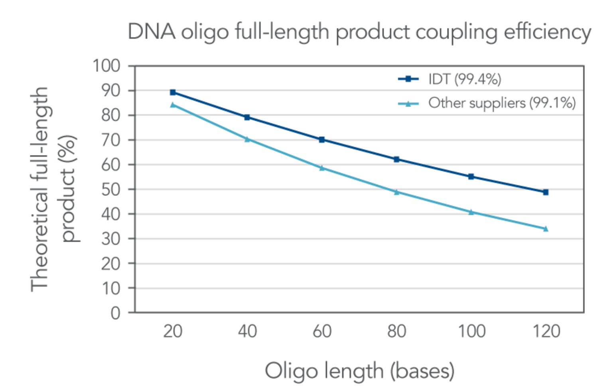

[Previous](<AB-06 - Solid-phase oligonucleotide synthesis by phosphoramidite chemistry.md>) · [Subject index](../README.md) · [Topic overview](README.md) · [Complete section](<Complete section.md>) · [Next](<AB-08 - Assembling genes from synthetic oligonucleotides.md>)

<!-- note-content:start -->
# Section 07: Yield against length in oligonucleotide synthesis

## Intuition

Each coupling is a coin toss that lands "success" with probability $`P`$. The full-length product needs *every* toss to succeed, so the probabilities multiply and the yield decays geometrically: a fixed *fraction* is lost per nucleotide, not a fixed amount. Halving the failure rate per step roughly doubles the length that can be made at a given yield.

## Derivation

Notation: $`n`$ is the oligo length (nt); $`P`$ is the coupling efficiency (probability that a chain adds the next monomer in one cycle); $`Y(n)`$ is the fraction of chains that are full length.

**Assumptions.** Every coupling succeeds independently with the same $`P`$, whatever the base or position. Capped failures never react again. Losses from depurination and deprotection are ignored. The first nucleoside is pre-attached to the bead, so an $`n`$-mer needs $`n-1`$ couplings.

**Step 1: full-length yield.** All $`n-1`$ couplings must succeed, and they are independent:

**Equation (19)**

```math
Y(n) = P^{\,n-1}
```


**Step 2: half-yield length.** Set $`Y = \tfrac12`$ and take logarithms. For $`P`$ close to 1, $`\ln P\approx -(1-P)`$:

**Equation (20)**

```math
n_{1/2} = 1+\frac{\ln 2}{-\ln P} \approx 1 + \frac{0.693}{1-P}
```

The usable length scales as $`1/(1-P)`$, the inverse of the failure rate.

Taking logarithms converts the product of many successful couplings into a sum of per-cycle losses: length is what accumulates the damage. The approximation uses a small failure probability, not a small total loss. A tiny loss in each cycle can still remove much of the product over a long synthesis, which is why improving coupling efficiency matters increasingly as the target length grows.

**Step 3: truncation spectrum (with capping).** A chain that is length $`k`$ when it fails is capped and stays length $`k`$. That requires $`k-1`$ successes and then one failure:

**Equation (21)**

```math
\Pr(\text{length } k) = P^{\,k-1}(1-P), \qquad k = 1,\dots,n-1
```

This is a geometric distribution. Summing (21) over $`k`$ gives $`1-P^{n-1}`$, so together with (19) the probabilities add up to 1.

**Step 4: deletions (without capping).** If failed chains are not capped, each continues in the next cycle. A chain then ends at full nominal length minus the number of failures. The number of failures in $`n-1`$ attempts is binomial, so the fraction with exactly one internal deletion is:

**Equation (22)**

```math
\Pr(\text{one deletion}) = (n-1)(1-P)P^{\,n-2}
```


## Motivation and explanation



- **Small differences in $`P`$ compound.** 99.4 % against 99.1 % looks like a trivial gap, but by (20) the half-yield length is 116 nt against 78 nt.
- **Capping does not raise the yield.** Equation (19) holds either way. What capping changes is *what the impurities are*. With capping, the impurities from (21) are spread over all lengths (mean about 28 nt for a 60-mer) and lack the final DMT. Without capping, (22) gives a large population of $`(n-1)`$-mers with an internal error that are nearly impossible to separate from the product.
- **When (19) is optimistic.** Purine-rich sequences depurinate more. Some monomers (modified bases, RNA) couple less well. Secondary structure on the bead can hinder coupling. Purification also loses product. Real yields of long oligos are therefore lower than (19).

## Link to other topics

Equation (19) is the same compounding that sets step-growth polymer chain lengths (Carothers) and the overall yield of any multi-step synthesis or separation train: overall yield is the product of the step yields.

## Summary

Full-length yield falls as $`P^{n-1}`$, so the usable length scales as $`1/(1-P)`$: about 100–200 nt at today's 99–99.5 % coupling. Capping does not raise the yield, but it makes the failures easy to remove.
<!-- note-content:end -->

[Previous](<AB-06 - Solid-phase oligonucleotide synthesis by phosphoramidite chemistry.md>) · [Subject index](../README.md) · [Topic overview](README.md) · [Complete section](<Complete section.md>) · [Next](<AB-08 - Assembling genes from synthetic oligonucleotides.md>)
