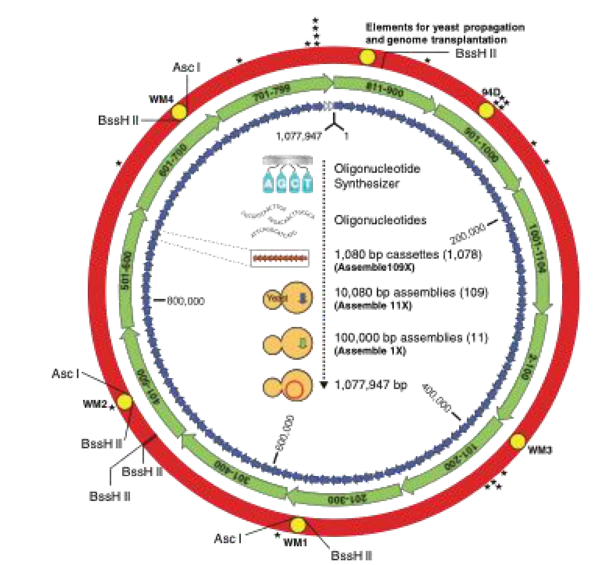

[Previous](<AB-08 - Assembling genes from synthetic oligonucleotides.md>) · [Subject index](../README.md) · [Topic overview](README.md) · [Complete section](<Complete section.md>)

<!-- note-content:start -->
# Section 09: Synthetic genomes

## Intuition

No single method spans six orders of magnitude. What works instead is a ladder: each rung uses a method suited to its own scale, and each rung's output becomes the next rung's input. Pieces are verified before being promoted, so errors are caught while the pieces are still small and cheap to remake.

*Analogy:* building a ship from plates, then sections, then blocks, rather than welding plate to plate along the whole hull. The analogy breaks down in an important way: ship sections are inspected visually, whereas DNA must be *sequenced* to be checked, and a single wrong base out of a million can be fatal to function.

## Mechanism

**The hierarchy.** The first complete synthetic bacterial genome, a 1.08 Mb *Mycoplasma mycoides* genome reported in 2010, was built in stages of roughly tenfold increase:

| Stage | Size | Number of pieces | Built by |
|---|---|---|---|
| Oligonucleotides | ~60 nt | thousands | chemical synthesis (Section 06) |
| Cassettes | ~1.08 kb | 1078 | enzymatic assembly (Section 08) |
| Intermediate assemblies | ~10 kb | 109 | assembly in yeast |
| Large assemblies | ~100 kb | 11 | assembly in yeast |
| Complete genome | 1.08 Mb | 1 | assembly in yeast |

**Why yeast for the top stages.** Yeast carries out homologous recombination efficiently and natively: given pieces with shared ends, the cell itself joins them in the correct order, and it will maintain a megabase construct as an artificial chromosome. Above roughly 100 kb, *in vitro* handling becomes impractical, because molecules that large shear under ordinary pipetting. Doing the final stages inside a cell avoids handling the intact molecule at all.

**Transplantation.** The assembled genome was transplanted into an intact recipient cell of a related species. Successful transplants subsequently lost the recipient chromosome and were controlled by the synthetic genome. The recipient's existing proteins and ribosomes ran the new genome until the cell had replaced its own contents through division. The result was a population whose genetic information was entirely synthetic.

**Watermarks.** Distinctive sequences were inserted at defined positions. They have no biological function and serve as unambiguous proof that the genome in the cell is the designed one rather than a contaminating natural genome. This is a control, not a decoration: without it, the claim could not be distinguished from contamination.

## Motivation and explanation

**What this demonstrated, and what it did not.** The genome was a near-copy of an existing one, so no new biology was designed. The result was a demonstration that genetic information is *transferable as chemical information*: a sequence read from one organism, written chemically, and installed in another cell, produces that organism. The division between hardware (the cell) and software (the genome) is real and crossable.

**Why the hierarchy, in terms of Section 08.** Error probability compounds exponentially with length. A megabase assembled in one pass would essentially never be correct. By verifying at the kilobase stage, the error-free fraction at each rung stays high, and a fault requires remaking one small piece rather than the whole construct. The hierarchy converts an exponential problem into a sequence of tractable ones, which is why the work needed sequencing (Sections 10–12) as much as it needed synthesis.

**Why eukaryotes are harder.** An effort to build a synthetic yeast genome has synthesised all sixteen chromosomes individually, but combining them into a single living strain has proved to be the slow step, and strains reported so far carry only part of the genome in synthetic form. The reasons are structural rather than chemical: eukaryotic genomes are larger, distributed across multiple chromosomes, contain repetitive sequence that defeats overlap-directed assembly, and depend on chromatin organisation and regulatory context that a correct sequence alone does not guarantee. A project to synthesise a human genome has been funded, on a timescale of decades.

**Minimisation.** A genome that can be written can also be edited systematically. Removing genes and testing which the cell can survive without converts the question "what is the minimal set of genes for life?" from speculation into an experiment, which is the subject of Section 55.

## Link to other topics

The hierarchy here is the standard engineering response to a process whose yield falls exponentially with scale: break it into stages, inspect between stages, and rework at the smallest unit possible. The same reasoning governs staged separations and multi-step reaction trains.

## Summary

Genome-scale construction needs no new chemistry, only a hierarchy of assembly stages with verification between them, using cells for the largest steps because megabase molecules cannot be handled intact. The first synthetic bacterial genome showed that a sequence is sufficient to specify an organism, given a cell to run it in.

## Conclusion

The per-step yield limits direct synthesis length; assembly and replication extend that chemistry to larger DNA constructs. The next unit develops sequencing i - sanger and short reads.
<!-- note-content:end -->

[Previous](<AB-08 - Assembling genes from synthetic oligonucleotides.md>) · [Subject index](../README.md) · [Topic overview](README.md) · [Complete section](<Complete section.md>)
