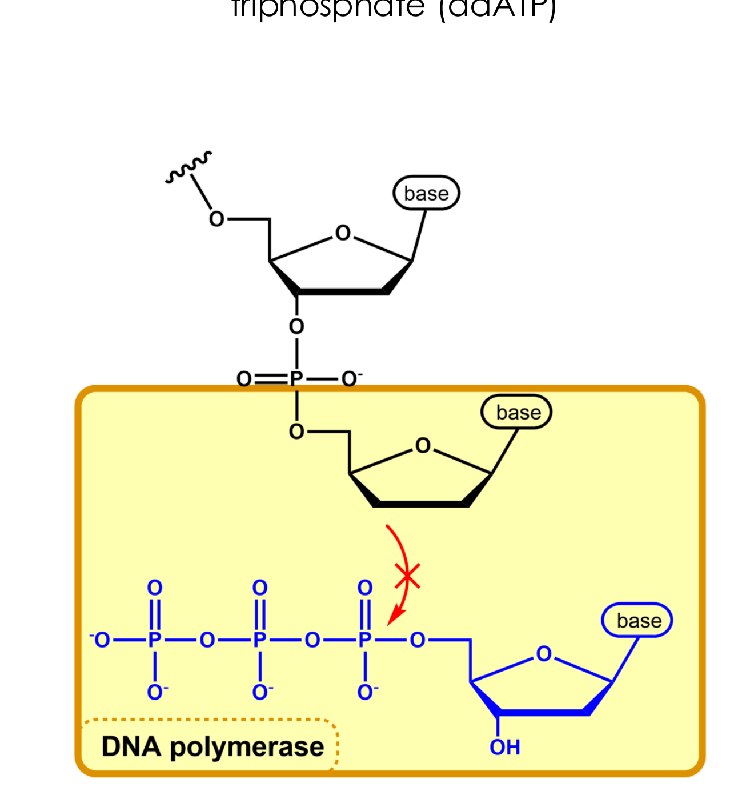
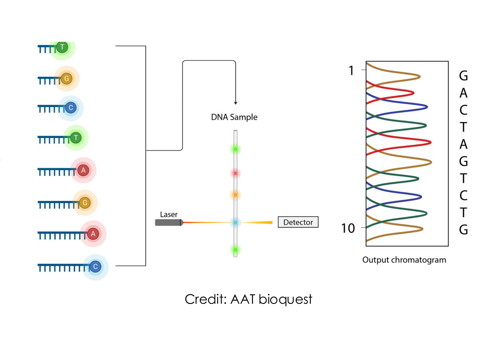
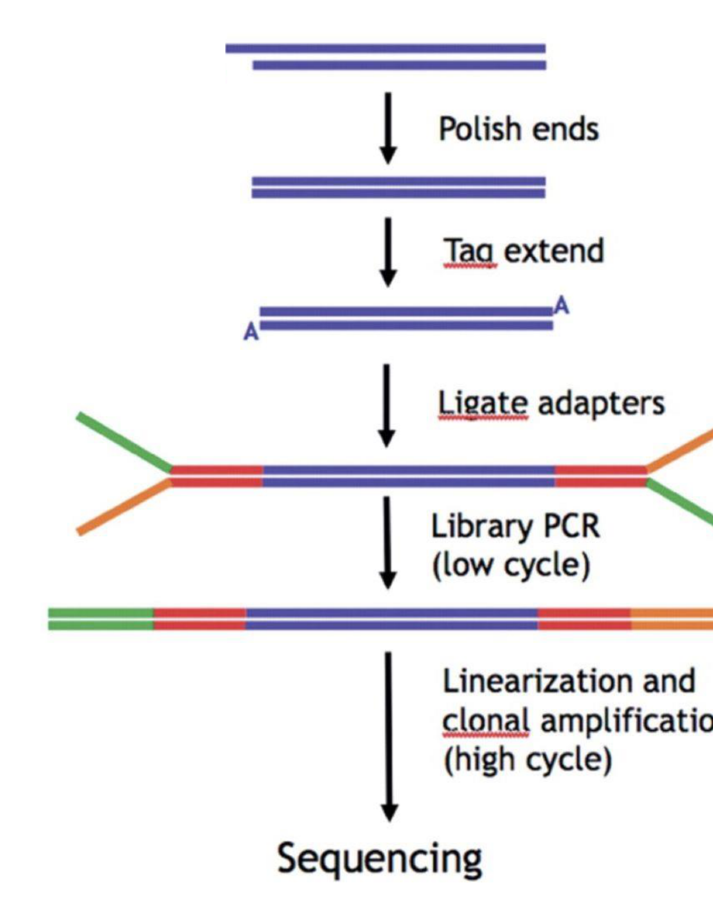
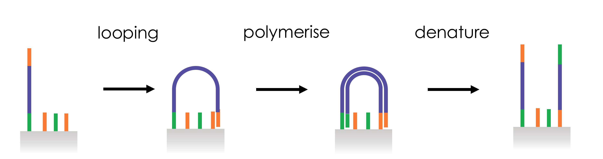

[Subject index](../README.md) · [Topic overview](README.md) · [Complete section](<Complete section.md>)

<!-- note-content:start -->
# Sequencing I - Sanger and short reads

## Overview

Sanger sequencing reads chain-terminated fragments, while Illumina reads large numbers of immobilised templates in parallel. Library preparation, cluster generation and reversible-terminator chemistry connect an original sample to short reads that must be assembled or mapped.

*Assumed throughout:* nucleotide polymerisation, PCR and sequence complementarity.

## Section 10: Sanger sequencing and the shotgun approach

### Intuition

The difficulty in reading a sequence is that the four bases are chemically similar and a polymer of them has no outward feature that reveals the order. Sanger's idea converts the problem of *reading* into a problem of *measuring length*, which was already solvable.

Suppose you could make a copy of the template that stops at a randomly chosen position, and suppose you could tell which base it stopped on. Do this many times and you obtain a collection of fragments of every possible length, each labelled with its own final base. Sort them by length, read off the labels in order, and you have the sequence.

*Analogy:* determining the order of carriages on a train you cannot see by releasing many copies of the train from a station and stopping each at a random carriage, then sorting the pieces by length. The analogy breaks down because the stopping here is chemical rather than chosen, so the termination positions are governed by probability, and the resulting fragment populations have to be numerous enough that every length is represented.

### Mechanism

**1. The chain terminator.** A *dideoxynucleotide* triphosphate (ddNTP) is a normal dNTP missing the 3′-OH on the sugar. A polymerase incorporates it normally, because the parts it recognises (the base and the triphosphate) are unchanged. But the chain now ends in a 3′-H instead of a 3′-OH, and there is nothing to attack the next nucleotide's phosphate. Extension stops permanently.

**2. Random termination.** The reaction contains template, primer, polymerase, all four dNTPs, and a *small* proportion of ddNTPs, of order 1 %. At each position the polymerase almost always adds a normal dNTP and occasionally adds a terminator. Over a large population of template copies, termination occurs at every position in some fraction of the chains, giving a ladder of fragments differing by one nucleotide.

**3. Identifying the final base.** Two implementations:
- *Original:* four separate reactions, each containing only one of ddATP, ddTTP, ddGTP, ddCTP. All fragments in a given reaction end in the same known base. The four reactions are run in adjacent gel lanes and the sequence read across them.
- *Modern (dye terminator):* each of the four ddNTPs carries a spectrally distinct fluorophore, so all four terminators can be used in one reaction. A fragment's final base is identified by the colour it emits.

**4. Separation and read-out.** Capillary electrophoresis separates the fragments by length as they migrate through a polymer. They pass a laser and detector in order of increasing length, producing a *chromatogram*: a series of coloured peaks, one per position. The sequence is the order of peak colours.

The horizontal coordinate is migration time, which is converted into fragment length; it is not the time at which the polymerase originally incorporated that base. Each peak represents many fragments terminating at the same position. Two unrelated templates in one capillary produce overlapping ladders, so their colours cannot generally be assigned to separate molecules. Physical or molecular separation of templates is therefore part of making a readable signal.

**5. Shotgun sequencing for long targets.** A single read covers under a kilobase, so a genome is handled statistically rather than sequentially:

- Fragment the genome randomly by mechanical shearing (sonication).
- Clone fragments into plasmids and transform into bacteria, so that each colony carries and amplifies one fragment. This is the *sequencing library*, and it serves two purposes: it provides enough identical copies of each fragment to sequence, and it physically separates fragments from each other.
- Sequence individual clones.
- Assemble the reads computationally by finding overlaps, which works because the fragmentation was random and the reads therefore overlap.

### Motivation and explanation

**Why about 1 % terminator.** The ratio sets a trade-off. Too much ddNTP and almost every chain terminates early, so no fragments reach the far end of the template and the read is short. Too little and terminations are so rare that short fragments are under-represented. A ratio of about 1:100 gives usable signal across several hundred bases.

**What limits the read length.** Not the chemistry, but the *separation*. Resolving fragments of length $`n`$ and $`n+1`$ requires distinguishing a relative length difference of $`1/n`$, which gets harder as $`n`$ grows. Beyond roughly 700–900 bases, adjacent peaks merge and the base calls become unreliable. This is a resolution limit, so it is not improved by running the reaction longer.

**Why the first bases are unreliable.** The primer occupies the first stretch of the template, and very short fragments run anomalously, so typically the first 15–40 bases after the primer cannot be called. Anything to be sequenced must therefore have known flanking sequence to prime from, and the region of interest must sit beyond this dead zone.

**Strengths and weaknesses.**
- *Accurate*, around 99.99 % per base, because each peak is an independent averaged measurement over many molecules.
- *Long reads* relative to short-read platforms, over 500 nt.
- *Low throughput*: one capillary reads one template population, and instruments can run roughly 96 in parallel. Cloning-based shotgun sequencing also needs separate clone preparation. Sanger sequencing of a purified PCR product or plasmid can be performed directly, so bacterial cloning is not a universal requirement of the sequencing chemistry.

It remains the method of choice when a small number of fragments must be read very accurately: verifying a synthetic gene (Section 08), checking a plasmid, or confirming a variant found by another method.

### Worked example

*Why Sanger alone could not keep pace with genome-scale sequencing.* All numbers computed in Python, using a human genome of $`G = 3.1\times10^9`$ bases.

**1. Cost of the Human Genome Project.** About \$3 billion for 3 billion bases is \$0.97 per base, roughly \$1/base. Modern short-read sequencing reaches about \$1000 per genome, which is $`3.2\times10^{-7}`$ per base, a reduction by a factor of about $`3\times10^{6}`$.

**2. How many reads?** With 700-base reads, covering the genome once needs $`G/L = 4.4\times10^{6}`$ reads. At 8-fold redundancy, $`3.5\times10^{7}`$ reads, which is $`3.7\times10^{5}`$ plates of 96. At two hours per plate on one instrument, that is $`7.4\times10^{5}`$ hours, or **84 years of continuous running on a single machine**. The project took 13 years across many centres, which is consistent.

**3. Why redundancy is needed at all.** If reads land at random positions, the number covering a given base is Poisson with mean equal to the coverage $`c`$, so the fraction of the genome left uncovered is $`e^{-c}`$:

| Coverage $`c`$ | Uncovered fraction | Bases missed in 3.1 Gb |
|---|---|---|
| 1 | 0.368 | $`1.1\times10^{9}`$ |
| 5 | $`6.7\times10^{-3}`$ | $`2.1\times10^{7}`$ |
| 10 | $`4.5\times10^{-5}`$ | $`1.4\times10^{5}`$ |
| 30 | $`9.4\times10^{-14}`$ | $`\ll 1`$ |

Sequencing a genome "once over" leaves 37 % of it unread. The gaps are the reason coverage of 8–30× is specified rather than 1×, and the exponential form means each additional fold of coverage removes a *fixed fraction* of the remaining gaps.

These two results together, the cost per base and the 84-machine-years, are what motivated massively parallel sequencing.

### Wider pathway

Reading sequence closes the design–build–test loop that Sections 06–09 opened: a construct is designed, synthesised, assembled, and then verified by sequencing before use. Beyond verification, sequencing underpins diagnostics, variant discovery and the reference genomes on which all of modern biology depends.

### Link to other topics

Coverage statistics here are the Poisson arrival problem familiar from residence-time distributions: random independent events scattered over a domain, with $`e^{-c}`$ the probability of none arriving in a given interval.

### Summary

Chain termination turns sequence reading into length measurement by exploiting a single missing hydroxyl, giving reads of several hundred bases at very high accuracy, with electrophoretic resolution setting the ceiling. Shotgun fragmentation and Poisson coverage extend it to genomes, at a redundancy cost.

## Section 11: Illumina sequencing, library preparation and cluster generation

### Intuition

Parallel reading needs two things that a mixture of fragments does not have.

First, **uniformity of handles**. Every fragment must be graspable in the same way: the same primer must prime all of them, and the same surface must capture all of them. Since the fragments differ in sequence, this is achieved by *attaching* common sequences to their ends. The interior stays unknown, which is the point; only the ends are standardised.

Second, **brightness**. A single molecule adding one fluorescent nucleotide emits far too little light to image reliably. The fix is to make roughly a thousand copies of each fragment, all at the same spot and all adding the same nucleotide in step. The spot then emits a thousandfold more light while still reporting one fragment's sequence.

*Analogy:* instead of reading one book at a time, photocopy each book a thousand times, stack each set in its own pigeonhole on a huge wall, and photograph the whole wall page by page. The analogy breaks down because the copies must stay *in step*: if some copies in a pigeonhole fall a page behind, the photograph blurs between two pages, which is exactly the error mode discussed in Section 12.

### Mechanism

#### Library preparation

1. **Fragment.** Sonication breaks the DNA into 100–200 bp pieces. The size matters: fragments must be short enough that the read covers a useful proportion of each.
2. **End repair (polishing).** Shearing leaves ragged ends with random single-stranded overhangs. A 3′→5′ exonuclease removes protruding 3′ overhangs and a polymerase extends recessed 3′ ends opposite 5′ overhangs, producing *blunt* ends. Ligation requires defined ends, so this makes an inhomogeneous population uniform.
3. **A-tailing.** A polymerase adds a single, non-templated adenine to each 3′ end.
4. **Adapter ligation.** Adapters carrying a complementary single T overhang are ligated on. The A/T pair is a minimal sticky end, and its purpose is to prevent the fragments from ligating to each other: a blunt-ended population would self-ligate into chimeras, whereas A-tailed fragments can only pair with T-overhang adapters.
   - The adapters are **Y-shaped**: double-stranded near the fragment and unpaired further out. Both ends receive the same adapter, yet because the two arms of the Y have *different* sequences, the two ends of the fragment end up carrying different sequences. This is the trick that makes one adapter give two distinguishable ends.
5. **Library PCR.** Primers matching the Y arms amplify the fragments and complete the distinct terminal sequences, conventionally called **P5** and **P7**. Every fragment in the library now ends in P5 at one end and P7 at the other.
   - The primers also add a short **index** or barcode, about 6 nt. Libraries from different samples get different indices, are pooled and sequenced together, then separated computationally afterwards. This is *multiplexing*, and it is how a run large enough for a human genome is shared economically between many small samples.

#### Cluster generation by bridge amplification

6. **The flow cell.** A glass surface bearing a dense lawn of two tethered oligonucleotides, P5′ and P7′, complementary to the fragment ends. It sits in a channel through which reagents are flowed, so every step can be delivered and washed automatically.
7. **Seeding.** Denatured library is flowed in at *low concentration*, so single strands hybridise to the lawn at well-separated random positions. The dilution is deliberate: clusters must not overlap, or their fluorescence cannot be assigned to one fragment.
8. **Covalent capture.** A polymerase extends the tethered oligo using the hybridised fragment as template. The copy is now covalently attached to the surface. Denaturation washes the original strand away, leaving a sparse field of surface-bound single strands.

9. **Bridge amplification.** The tethered strand is flexible enough to bend over and hybridise its free end to a nearby complementary lawn oligo, forming a *bridge*. The polymerase copies it, giving a double-stranded bridge; denaturation gives two tethered strands, both anchored within a short distance of the original. Repeating 25–35 times generates up to a thousand copies confined to a patch a few hundred nanometres across: a **cluster**.
10. **Linearisation.** One orientation is cleaved enzymatically and washed away, leaving every strand in the cluster pointing the same way. Without this, the cluster would contain both strands and the fluorescence signals of complementary sequences would superpose.

The finished flow cell carries millions to billions of clusters, each hundreds to thousands of identical copies of one library fragment, all identically oriented and all primed by the same adapter sequence.

### Motivation and explanation

**Why amplify on the surface rather than in solution.** Amplifying first and then depositing would let copies of different fragments land together, producing mixed spots. Because each cluster grows outward from a single seeded molecule and the copies stay tethered near their origin, spatial separation is guaranteed by the geometry rather than enforced afterwards. The surface does the sorting that cloning into bacteria did in Section 10, without any cells.

**What a cluster counts.** Copying one seed many times improves the brightness of one sequence measurement; it does not create many independent sampled molecules. In a counting experiment, amplification of a library molecule before seeding can instead give several clusters descended from that same original. Such clusters can inflate apparent abundance unless duplicates are accounted for. Optical signal amplification and independent biological sampling solve different problems.

**Why cluster density is the key design parameter.** Throughput scales with the number of clusters, so denser is better, but clusters that overlap cannot be resolved and are discarded. Loading concentration is therefore tuned to sit just below the density at which overlap becomes common. This is the same trade-off as colony density on an agar plate.

**Where the preparation introduces bias.**
- *PCR bias*: GC-rich and GC-poor fragments amplify with different efficiencies, in both the library PCR and bridge amplification, so coverage is uneven across a genome rather than uniformly Poisson.
- *Chimeras*: incompletely suppressed cross-ligation joins unrelated fragments, creating reads that map to two places.
- *Duplicates*: multiple clusters seeded from PCR copies of the same original molecule are not independent observations, which matters when counting.

**The cost.** This workflow is multi-step and takes a day or more before any sequence is produced, which is why the platform suits large batched jobs rather than single urgent samples.

### Worked example

*Scale of a human genome run at 30× coverage with 150-base reads.* Computed in Python, $`G = 3.1\times10^{9}`$.

- Reads required: $`cG/L = 30\times3.1\times10^{9}/150 = 6.2\times10^{8}`$, about 620 million.
- Each read is one cluster, so the flow cell needs of order $`10^{9}`$ resolvable spots. A high-output instrument producing about $`2\times10^{10}`$ reads per run therefore sequences roughly 32 human genomes per run.
- Sanger, at 96 capillaries, would need $`6.2\times10^{8}/96 = 6.5\times10^{6}`$ runs for the same data.

The throughput gain is about seven orders of magnitude, and it comes entirely from parallelism: the chemistry of adding one nucleotide is no faster than before.

### Wider pathway

Library preparation is where the sample meets the instrument, so it is also where most sample-specific design happens: the same cluster-generation and read-out chemistry serves genome sequencing, RNA sequencing (after reverse transcription), and methods that count binding sites, with only the library step changed.

### Link to other topics

Immobilising the reaction on a surface so reagents can be flowed past and washed away is the logic of solid-phase synthesis in Section 06, used here for reading instead of writing. In both cases the solid support converts a separation problem into a washing step.

### Summary

Library preparation gives every fragment identical P5 and P7 ends plus a sample index, so that one surface chemistry and one primer serve a heterogeneous mixture. Bridge amplification then converts each seeded molecule into a spatially isolated cluster of about a thousand identical copies, bright enough to image.

## Section 12: Sequencing by synthesis and read assembly

### Intuition

Sanger reads a sequence by making fragments of every length and sorting them (Section 10). Sequencing by synthesis does the opposite: it keeps the molecules still and advances them all together, one base at a time, watching what is added at each step. The sequence is read in time rather than in space.

For that to work, extension must be *stoppable and restartable*. If nucleotides were added freely, a cluster would run to the end of the template in one step and a single image would show only the last base. So each nucleotide is supplied with a removable block on its 3′ position: the polymerase adds one, then cannot add another until the block is taken off. Each cycle is a controlled single step, and the fluorophore attached to that nucleotide says which base it was.

The contrast with Section 10 is worth holding onto: Sanger uses an *irreversible* terminator in a small proportion, so that chains stop at random positions. Here the terminator is *reversible* and used exclusively, so that every chain stops at the same position every cycle.

*Analogy:* a ratchet that advances one tooth per turn of a handle, with the tooth colour read off at each click. The analogy breaks down because a real ratchet cannot slip; in a cluster, a small fraction of strands fail to extend or extend twice, and those errors accumulate.

### Mechanism

**One cycle:**

1. **Prime.** A sequencing primer anneals to the adapter sequence common to every cluster (Section 11). All clusters therefore start from the same point, which is why the fragments needed standardised ends.
2. **Extend by one.** All four nucleotides are supplied simultaneously, each carrying a spectrally distinct fluorophore and a 3′ blocking group. The polymerase incorporates whichever one is complementary at that position, and the block prevents any further addition. Supplying all four at once is what makes this different from stepwise chemistry: the *template* chooses, not the operator.
3. **Image.** The whole flow cell is scanned. Every cluster fluoresces in the colour of the single base it just added. All copies in a cluster added the same base, so their signals sum, which is what makes the spot visible.
4. **Deblock.** The fluorophore and the 3′ block are cleaved chemically and washed away, restoring a normal 3′-OH and leaving no label behind. The strand is now ready for the next cycle.

Repeating this gives, for each cluster, a sequence of colours over time: its read.

**Paired-end reading.** After the first read, one more round of bridge amplification regenerates the complementary strands on the surface, the already-read strands are cleaved away, and the process is repeated from the other end. Each fragment then yields two reads, one from each end, with a known approximate separation. This matters for assembly, below.

### Motivation and explanation

**Why the fluorophore and the block are on the same nucleotide.** The fluorophore identifies the base; the block enforces one addition per cycle. Removing both in the same chemical step means a single reagent restores the strand to a natural state. A residue left behind by imperfect cleavage ("scar") impedes the polymerase and is one of the reasons signal degrades along a read.

**Phasing: what limits the read length.** The cluster is read as a sum over about a thousand strands, and the method assumes they are all at the same position. In each cycle a small fraction fail to extend (*phasing*, falling behind) or lose their block and extend twice (*pre-phasing*, running ahead).

These errors are cumulative and irreversible. After $`n`$ cycles the population has spread over a range of positions, so the image at cycle $`n`$ is a blend of several positions, dominated by the intended one but increasingly contaminated. The signal-to-noise ratio falls monotonically with cycle number, which is why:
- reads are limited to roughly 50–300 bases;
- quality declines along the read, with the 3′ end worst;
- base-call errors are predominantly substitutions, not insertions or deletions.

This is a different limit from Sanger's. Sanger is limited by *electrophoretic resolution* between fragments; this is limited by *loss of synchrony* within a cluster. Neither is improved by running longer.

**Why accuracy is nevertheless high.** Each base call averages a thousand molecules, and each genomic position is covered by many independent reads. Both average away random error, which is why per-base accuracy reaches about 99.9 % and consensus accuracy is far higher still.

**The trade-off against Sanger.** Illumina wins overwhelmingly on throughput and cost per base, and loses on read length and on turnaround. For verifying a single plasmid, Sanger is faster and simpler; for anything requiring millions of reads, there is no comparison.

#### Assembly

Reads carry no positional information, so position must be recovered from sequence:
- **Mapping** to a known reference: each read is aligned to the position it matches. Fast and reliable, and used whenever a reference exists.
- **De novo assembly:** reads are overlapped with each other and merged into *contigs*, contiguous stretches built from overlapping reads. Contigs are then ordered and oriented into *scaffolds* using paired-end information, since the two reads of a pair are known to lie a certain distance apart and in opposite orientations.

**Why repeats are the fundamental problem.** A read shorter than a repeated element cannot be placed: it matches every copy of the repeat equally well. The assembly then breaks at that point, or collapses the copies together and loses the true structure. This is not a defect of the chemistry but a consequence of read length, and no amount of coverage fixes it. It is the main reason long-read platforms exist alongside short-read ones.

More reads of the same ambiguous internal repeat do not reveal which unique flanks it connects. The missing information is a molecular link across the repeat, rather than another observation of its interior. A paired fragment can help if its two ends anchor uniquely on opposite sides; if the repeated region exceeds the available linking distance, longer molecules or another source of linkage are required.

### Worked example

*Quality scores, coverage and consensus accuracy.* Computed in Python.

**1. Quality scores.** Base calls carry a Phred score $`Q = -10\log_{10}p`$, where $`p`$ is the probability that the call is wrong:

| $`Q`$ | Error probability | Meaning |
|---|---|---|
| 20 | $`10^{-2}`$ | 1 wrong base in 100 |
| 30 | $`10^{-3}`$ | 1 in 1000 |
| 40 | $`10^{-4}`$ | 1 in 10 000 |

At $`Q30`$, a 150-base read contains on average $`150\times10^{-3} = 0.15`$ errors, so about one read in seven has a miscalled base. Across $`6.2\times10^{8}`$ reads that is roughly $`10^{8}`$ wrong bases in a run, which only becomes acceptable because of redundancy.

**2. Why coverage rescues it.** For 30 independent observations with substitution-error probability $`p=10^{-3}`$, a conservative consensus-failure bound counts every case with at least 15 errors, including a possible tie, as failure: $`P_{\mathrm{fail}}\le\sum_{j=15}^{30}\binom{30}{j}p^j(1-p)^{30-j}\approx1.53\times10^{-37}`$. Fewer than 15 errors leave more than half the observations correct, guaranteeing the correct strict-majority base under this model. Counting only 16 or more errors gives $`1.44\times10^{-40}`$, but omits ties. Actual consensus also needs alignment and insertion/deletion handling, and correlated errors or mapping bias can dominate these tiny independent-error bounds.

**3. Coverage still has to reach every base.** From Section 10, uncovered fraction $`e^{-c}`$: at 30×, essentially none of the genome is missed by chance. Combined with the result above, this is why 30× is a standard specification for human genome sequencing: it is the point at which both random gaps and random miscalls stop being the limiting factor.

### Wider pathway

Together, Sections 10–12 give the two complementary reading technologies: one accurate and long but serial, the other short but massively parallel. Their shared weakness is read length, which is what the single-molecule platforms of Sections 13–14 address by reading one long molecule directly rather than many short amplified ones.

### Link to other topics

The cluster is a population of identical reactors intended to run in lockstep, and phasing is the gradual spread of their state distribution: the same loss of synchrony that broadens residence-time distributions, and the same reason that a signal averaged over a drifting population degrades with time.

### Summary

Reversible terminators turn polymerisation into a stepwise, readable process, with one imaged base per cycle across the whole flow cell at once. Loss of synchrony within each cluster, not chemistry, caps the read at a few hundred bases, and that short read length is what makes repeats the hard part of assembly.

## Conclusion

Parallel readout increases throughput, while amplification and assembly introduce distinct sources of bias and uncertainty. The next unit develops sequencing ii - long reads and applications.
<!-- note-content:end -->

[Subject index](../README.md) · [Topic overview](README.md) · [Complete section](<Complete section.md>)
