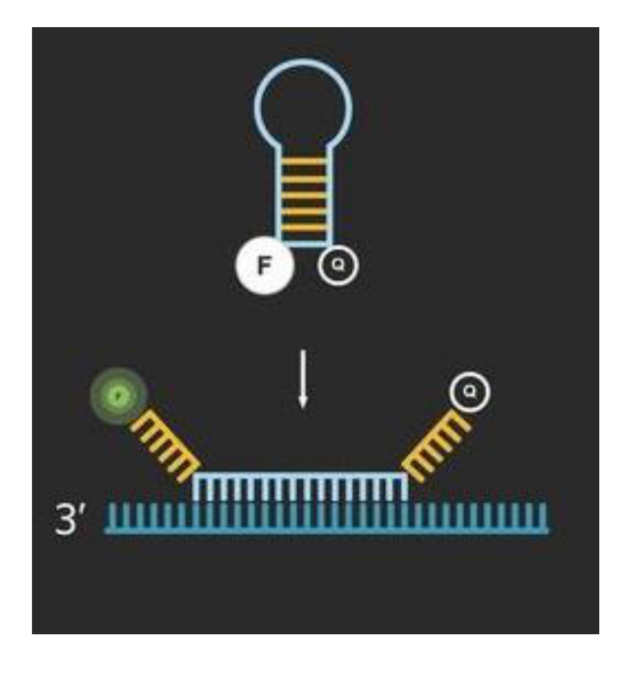

[Previous](<AB-17 - Absolute and relative quantification, and melt-curve control.md>) · [Subject index](../README.md) · [Topic overview](README.md) · [Complete section](<Complete section.md>)

<!-- note-content:start -->
# Section 18: Sequence-specific probes and RT-qPCR

## Intuition

Both designs solve the specificity problem the same way: add a *third* sequence-specific oligonucleotide besides the two primers, and arrange for it to fluoresce only when it has found its target. A primer dimer carries no probe site, so it amplifies invisibly. Specificity now rests on three independent recognition events rather than two.

The physical mechanism in both cases is **quenching**: a quencher near a fluorophore absorbs its energy and prevents emission, so fluorescence reports *distance*. The two designs differ in how the target changes that distance — TaqMan separates them irreversibly by cutting the probe in half, a beacon reversibly by unfolding.

*Analogy:* a lamp with a shade clamped over it. TaqMan smashes the clamp; a beacon swings the shade away on a hinge. Both let light out, but only one can be undone. The analogy breaks down because quenching is a distance-dependent energy transfer, not a physical blocking of light, so the signal rises smoothly as the two groups separate rather than switching on.

## Mechanism

### TaqMan probe (hydrolysis probe)


1. **The probe** is a short oligonucleotide complementary to the target *between* the two primer sites, carrying a **fluorophore at the 5′ end** and a **quencher at the 3′ end**. Intact, the two are close and fluorescence is suppressed. Its 3′ end is chemically blocked, so the polymerase cannot extend it: it is a reporter, not a primer.
2. **During annealing** the probe binds alongside the primers.
3. **During extension** the polymerase advances from the forward primer until it meets the probe. Taq has **5′→3′ exonuclease activity**, so it hydrolyses the probe as it goes, releasing the fluorophore as a free fragment that diffuses away from the quencher. **Fluorescence rises.**

Each new copy destroys one probe, so fluorescence tracks the product as the intercalating dye does — but only for the correct sequence.

**Requirements.** Probe cleavage requires a polymerase with 5′ nuclease activity, such as Taq. A proofreading enzyme's 3′→5′ exonuclease activity alone does not supply this function. The probe is a doubly modified oligonucleotide (Section 06) and so expensive, and its $`T_m`$ must exceed the primers' so that it is already bound when extension begins.

### Molecular beacon



The probe carries a fluorophore at one end and a quencher at the other, with the two ends complementary to each other so that it folds into a **stem-loop (hairpin)**. The stem holds fluorophore and quencher adjacent, so the free probe is dark. The **loop** is complementary to the target; when target is present the loop hybridises to it, and because that duplex is longer and more stable than the short stem, the hairpin is forced open, separating the two labels. **Fluorescence rises.**

**Against TaqMan:** the beacon is not consumed, since binding is reversible, and it needs no exonuclease activity. But it is harder to design — the stem must be stable enough to stay shut when free yet weak enough to open on binding, a narrow window set by the competition between two $`T_m`$ values (Section 04).

**Multiplexing.** Because specificity now resides in the probe rather than in a generic dye, several targets can be measured in one tube using probes with spectrally distinct fluorophores. This is impossible with an intercalating dye, which gives one undifferentiated signal.

### RT-qPCR


Polymerases used in PCR need a DNA template, so RNA must first be converted. **Reverse transcriptase** synthesises complementary DNA (cDNA) from an RNA template.

**Choice of priming.** **Poly-T primers** (12–18 T's) prime at the 3′ poly-A tail carried by most eukaryotic mRNAs, converting the whole messenger population in one step — what a gene-expression study needs. **Sequence-specific primers** restrict conversion to the RNA region of interest and are useful for viral assays, whether or not the genome carries a poly-A tail. Random primers offer another route for RNA without poly-A tails.

Once cDNA exists, qPCR proceeds as before. Both steps can share one tube (**one-step** RT-qPCR), reducing handling and contamination risk at the cost of control.

**Note on naming.** "RT-PCR" means *reverse transcription* PCR, not *real-time* PCR. RT-qPCR means both: reverse transcription followed by quantitative PCR.

## Motivation and explanation

**Why the extra recognition event matters so much.** A primer dimer satisfies two recognition events (both primers) and amplifies efficiently because it is short. With an intercalating dye it is indistinguishable from product and can dominate the $`C_t`$. A probe adds a third requirement that a dimer cannot satisfy, because the dimer contains no internal probe site. The failure mode is removed rather than detected.

**What the probes cost in return.** Three oligonucleotides must be designed to work together at one annealing temperature: two primers and a probe with a higher $`T_m`$. Design is harder and the reagents are more expensive, so intercalating dye remains the default for routine work where a melt curve is adequate, and probes are used for diagnostics, multiplexing, and anything where a false positive matters.

**Where RT-qPCR adds error.** Reverse transcription is the least reproducible step in the workflow. Its efficiency varies with RNA quality, secondary structure in the transcript, and the enzyme, and it is typically well below 100 %. It therefore adds variance to every measurement, and it sits *before* the amplification, so its variability is amplified along with the template. This is why the reference gene of Section 17 is so valuable: it passes through the same reverse transcription and absorbs much of that variability in the first subtraction.

**RNA degrades.** RNA is chemically fragile (the 2′-OH, Section 01) and RNases are ubiquitous, so sample handling dominates the error budget in practice.

## Worked example

*COVID-19 testing by RT-qPCR.* This is the canonical application and it illustrates every element of Sections 16–18.

**The workflow.**
1. **Sample.** The swab goes into a detergent buffer, which lyses the viral envelope — inactivating the virus and releasing its RNA in one step.
2. **RNA extraction** gives total RNA: viral if present, plus abundant human RNA.
3. **Reverse transcription** with primers chosen for the viral targets. SARS-CoV-2 genomic RNA does have a 3′ poly-A tail; target-specific priming is an assay-design choice.
4. **qPCR with TaqMan probes** against several viral genes independently — typically the envelope (E) gene to screen and the replicase (ORF1ab) or RdRp to confirm. Using more than one guards against a false negative from a mutation in any single primer or probe site, which matters for an evolving virus (Section 15).
5. **Controls**, which are what make the result interpretable:
   - An **internal positive control** against an abundant human RNA, usually RNase P. If it fails, the swab collected no cells or extraction failed, so the test is *invalid* rather than negative. Without it, a badly taken swab looks exactly like an uninfected patient.
   - A **no-template negative control** for contamination, essential given the single-copy sensitivity of Section 16.
6. **Interpretation.** A $`C_t`$ below a cutoff of 35 or 40, depending on protocol, is positive.

**Why the cutoff exists, quantitatively.** From Section 16, each cycle is a factor of two. The difference between $`C_t = 20`$ and $`C_t = 35`$ is

```math
2^{15} = 32\,768,
```

so a sample at the cutoff carries roughly 30 000 times less viral RNA than a strongly positive one. Beyond about 35 cycles two things happen: the copy number approaches one molecule, so Poisson sampling noise dominates and replicates disagree; and low-level non-specific amplification begins to cross the threshold on its own. The cutoff is where the measurement stops being reliable, not where the virus stops being present.

**Why $`C_t`$ is only a rough viral-load measure.** Since $`C_t \propto -\log\rho_0`$, a low $`C_t`$ means a high load, and this was used during the pandemic as a crude indicator of infectiousness. It is only semi-quantitative, because it also depends on how much material the swab happened to collect — which the RNase P control confirms was non-zero but does not normalise.

## Wider pathway

Sections 16–18 complete the quantification of a *known* sequence: design primers and a probe against something you can already name. Section 19 inverts the problem — finding a nucleic acid sequence that binds a chosen molecular target, when the sequence is not known in advance — and uses the PCR of this section as the amplification step in that search.

## Link to other topics

Both probes convert a binding event into an optical signal through a distance-dependent interaction, which is the design pattern behind most fluorescent biosensors. The internal control in the COVID assay is the same logic as a tracer in a process measurement: a known quantity carried through the whole procedure to confirm the procedure worked.

## Summary

Sequence-specific probes move the specificity from the primers alone to a third recognition event, so that primer dimers amplify without being seen: TaqMan by irreversible hydrolysis, beacons by reversible unfolding. Reverse transcription extends all of this to RNA, at the cost of the least reproducible step in the workflow.

## Conclusion

Threshold cycles become abundance estimates only when amplification efficiency, signal specificity and normalisation are controlled. The next unit develops aptamers and selex.
<!-- note-content:end -->

[Previous](<AB-17 - Absolute and relative quantification, and melt-curve control.md>) · [Subject index](../README.md) · [Topic overview](README.md) · [Complete section](<Complete section.md>)
