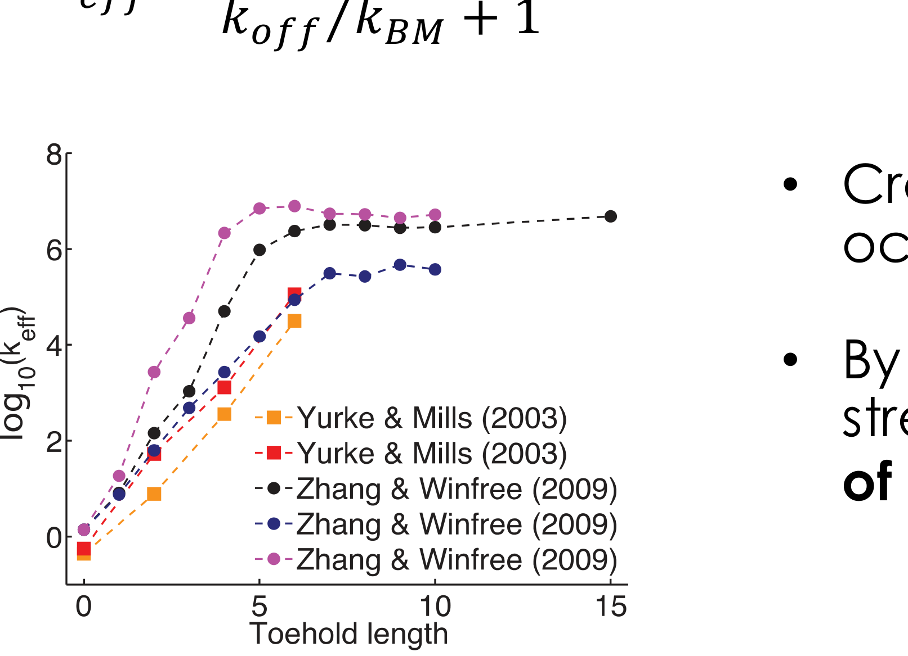
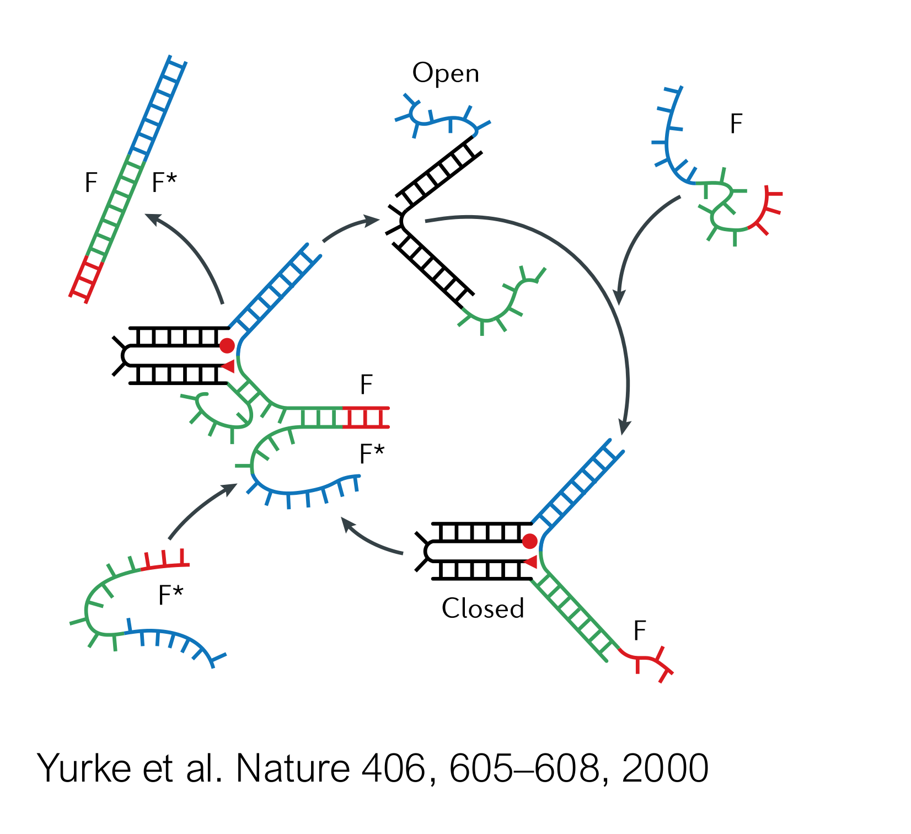

[Previous](<AB-21 - Structural DNA nanotechnology and DNA origami.md>) · [Subject index](../README.md) · [Topic overview](README.md) · [Complete section](<Complete section.md>)

<!-- note-content:start -->
# Section 22: Toehold-mediated strand displacement

## Intuition

To replace a strand in a duplex by complete thermal dissociation, the duplex must first separate. A sufficiently stable duplex can survive much longer than the intended operating time of a nanodevice, so waiting for spontaneous separation is impractical. The lifetime depends strongly on sequence, temperature and salt; duplex length alone does not specify a universal waiting time.

TMSD avoids it by never letting go. The incumbent strand is displaced *one base at a time*, and at every moment the invading strand has already formed whatever pairs the incumbent has given up. The number of base pairs stays roughly constant throughout, so there is no large free-energy barrier to climb.

The only cost is getting started, and that is what the toehold is for: a short single-stranded overhang on the target duplex, complementary to part of the invader. The invader binds the toehold first, which holds it in place long enough for displacement to begin.

*Analogy:* changing a rope on a loaded pulley by splicing the new rope in strand by strand rather than cutting the old one and re-threading. The load is never released, so no lifting is needed. The analogy breaks down because the splicing here is a random walk that can run backwards as easily as forwards.

## Mechanism


Notation: duplex **S** consists of the substrate strand (domains $`h^*`$ and $`b^*`$) paired with the **incumbent** strand **Y** (domain $`b`$). The **invader** strand **X** carries domains $`h`$ and $`b`$. The goal is to form duplex **L** ($`h^*b^*`$ paired with $`hb`$) and release Y.

**A.** S and X are in solution. S has a single-stranded **toehold** $`h^*`$, unpaired because Y has no $`h`$ domain.

**B.** Domain $`h`$ of X binds $`h^*`$ of S. This is ordinary hybridisation, reversible, with rate constants $`k_{\text{on}}`$ and $`k_{\text{off}}`$ set by the toehold length. Its purpose is **colocalisation**: X is now tethered beside the duplex it must invade.

**C–D.** X begins to displace Y, one base at a time. At each step one $`b`$–$`b^*`$ pair of Y breaks and one of X forms. The total number of base pairs is unchanged, so each step is roughly free-energy neutral. This is **three-way branch migration**, an unbiased random walk of the branch point that is equally likely to go either way — a *diffusive* process rather than a thermally activated one.

**E–F.** When the walk reaches the far end, Y is held by nothing and is released, completing duplex L.

**The final step is effectively irreversible on the designed operating timescale.** Once Y is released, it lacks an exposed toehold on L through which to begin rapid reinvasion: X already occupies $`h^*`$. Reverse displacement from a blunt end can still occur, but is much slower than toehold-assisted invasion. The random walk can reverse before release; after release the product is kinetically protected rather than absolutely unable to react.

**TMSD is thermodynamically downhill** because L has more base pairs than S: X pairs across both $`h^*`$ and $`b^*`$, whereas Y paired only across $`b^*`$. The toehold length sets both the driving force and the rate.

## Derivation

**The rate law.** Treating the branch-migration intermediate in steady state, the overall second-order rate constant is

**Equation (36)**

```math
k_{\text{eff}} \approx \frac{k_{\text{on}}}{k_{\text{off}}/k_{BM} + 1}
```

where $`k_{\text{on}}`$, $`k_{\text{off}}`$ are for the **toehold** and $`k_{BM}`$ is the branch-migration rate. The structure is a competition: once X has bound the toehold, it either falls off (rate $`k_{\text{off}}`$) or commits to displacement (rate $`k_{BM}`$).

The fraction of bound encounters that succeed is $`k_{BM}/(k_{BM}+k_{\text{off}})`$ in this reduced competition model. Multiplying that dimensionless probability by the bimolecular encounter rate constant $`k_{\text{on}}`$ gives (36), with the correct bimolecular units. A stronger toehold raises the probability of success per encounter; once that probability is near one, increasing binding strength cannot make new encounters happen faster.

**Short toehold, $`k_{\text{off}} \gg k_{BM}`$.** Most binding events fail, and (36) becomes

**Equation (37)**

```math
k_{\text{eff}} \approx \frac{k_{BM}k_{\text{on}}}{k_{\text{off}}} = \frac{k_{BM}}{\rho_0} \exp\!\left(-\frac{\Delta G^0}{RT}\right)
```

using $`k_{\text{off}} = k_{\text{on}}\rho_0\exp(\Delta G^0/RT)`$ from Section 05. The rate rises **exponentially** with toehold binding strength, hence with toehold length.

**Long toehold, $`k_{\text{off}} \ll k_{BM}`$.** Every binding event proceeds, and

**Equation (38)**

```math
k_{\text{eff}} \approx k_{\text{on}}
```

The rate **plateaus**: it is limited by how fast X finds S, which no further lengthening can improve.

**Crossover.** The two regimes meet where $`k_{\text{off}} = k_{BM}`$.

## Motivation and explanation



**Why this solves the original problem.** In (37) and (38), $`\Delta G^0`$ is that of the **toehold**, not of the $`b`$–$`b^*`$ duplex. The main duplex can be 20 bp and permanent while the toehold is 4 nt and transient. **Stability and rate are now set by different parts of the molecule and can be chosen independently** — which is exactly what Section 05 said was impossible by thermal melting.

**Why the plateau exists.** Once the toehold is strong enough that X essentially never escapes before committing, making it stronger changes nothing: the rate-limiting step has moved to diffusion. This is the same saturation seen in any mechanism where a binding step hands over to a committed step.

**What sets $`k_{BM}`$.** Branch migration is an unbiased random walk, so crossing $`n`$ steps takes a time scaling as $`n^2`$ rather than $`n`$. Longer branch-migration domains are therefore disproportionately slower, which is why displacement domains are kept short.

## Worked example

Tuning $`k_{\text{eff}}`$ with toehold length. Computed in Python, taking $`k_{\text{on}} = 3\times10^{6}`$ M⁻¹s⁻¹, $`k_{BM} = 1`$ s⁻¹, and $`-1.5`$ kcal/mol per toehold base pair at 25 °C ($`RT = 0.592`$ kcal/mol).

| Toehold (nt) | $`\Delta G^0`$ (kcal/mol) | $`k_{\text{off}}`$ (s⁻¹) | $`k_{\text{eff}}`$ (M⁻¹s⁻¹) |
|---|---|---|---|
| 0 | 0 | $`3.0\times10^{6}`$ | $`1.0`$ |
| 2 | −3.0 | $`1.9\times10^{4}`$ | $`1.6\times10^{2}`$ |
| 4 | −6.0 | $`1.2\times10^{2}`$ | $`2.5\times10^{4}`$ |
| 6 | −9.0 | $`0.76`$ | $`1.7\times10^{6}`$ |
| 8 | −12.0 | $`4.8\times10^{-3}`$ | $`3.0\times10^{6}`$ |
| 10+ | — | — | $`3.0\times10^{6}`$ (plateau) |

- **Each added base multiplies $`k_{\text{eff}}`$ by $`e^{1.5/RT} = 12.6`$** while in the exponential regime, close to one order of magnitude per base.
- The **crossover is at 5.9 nt**, matching the 5–7 nt quoted from experiment.
- The total span is **6.5 orders of magnitude**, matching the measured data.
- In practical terms, at 100 nM invader a zero-toehold reaction has a half-life of months, while a 6 nt toehold completes in seconds.

## Applications



- **DNA tweezers**, the first DNA nanomachine: a fuel strand F closes the tweezers by hybridising across the arms; an anti-fuel strand F\* removes it by TMSD, reopening them. The cycle is driven by the free energy of F–F\* hybridisation, and its by-product is F–F\* waste duplex, so the machine runs only while fuel is supplied.
- **Walkers** stepping along footholds on an origami surface, with each step a TMSD reaction.
- **Reconfigurable origami**, such as a Bennett linkage that changes conformation on addition of a strand.
- **Molecular computing**, where strand displacement cascades implement logic gates, since the output of one reaction can be the invader for the next.

## Link to other topics

Equation (36) is a steady-state competition between an unproductive reverse step and a productive forward step — the same algebra as Michaelis–Menten, and with the same consequence: a rate that is first-order in the controlling parameter at one extreme and saturated at the other.

## Summary

Strand displacement exchanges a bound strand without ever opening the duplex, so the free-energy barrier is small and the rate is governed by the toehold rather than by the duplex it invades. Equation (36) gives an exponential regime and a plateau, with the crossover near 6 nt and roughly 6 orders of magnitude of tunable rate — enough to make nanostructures that move, compute and respond.

## Conclusion

DNA nanotechnology combines addressable structure with programmable reaction kinetics. The next unit develops protein structure - determination and prediction.
<!-- note-content:end -->

[Previous](<AB-21 - Structural DNA nanotechnology and DNA origami.md>) · [Subject index](../README.md) · [Topic overview](README.md) · [Complete section](<Complete section.md>)
