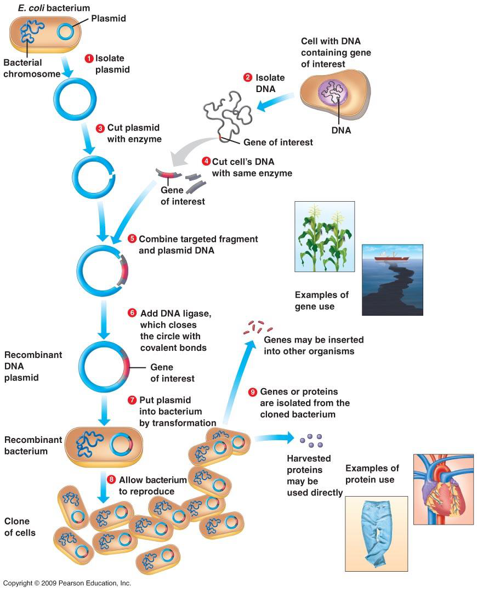

[Subject index](../README.md) · [Topic overview](README.md) · [Complete section](<Complete section.md>) · [Next](<AB-32 - Downstream processing — stages, logic and cost.md>)

<!-- note-content:start -->
# Section 31: Developing and scaling a bioprocess

## Intuition

A bioprocess is developed in stages of increasing size, and each stage exists to answer questions the previous one could not.

The reason is that biology does not scale geometrically. Doubling the diameter of a vessel multiplies its volume by eight but its surface area only by four, so oxygen transfer, heat removal and mixing all fall behind the demand of the cells inside. A culture that thrives in a shake flask may be starved of oxygen in a stirred tank of the same nominal composition.

Each scale therefore has a purpose: the microtitre plate screens *which organism*, the flask fixes *the medium*, the bench-top bioreactor measures *what the cells need*, and the pilot plant finds out *what breaks*.

*Analogy:* a recipe scaled from a domestic kitchen to a canteen. The ingredients are unchanged, but heating, stirring and timing all behave differently, and only cooking at the intermediate scale reveals it. The analogy breaks down because the cells here are alive and respond to the physical environment by changing their metabolism, so a scale-up failure can change the product, not just the yield.

## Mechanism

The route divides into three phases.

### 1. Developing the microorganism (steps 1–11)

The product, if a protein, is encoded in DNA:
- the **gene of interest** is identified in a cell or tissue and extracted;
- it is **cloned into a plasmid** (Section 08);
- cells — commonly *E. coli* — are **transformed** with the plasmid, so that they express the recombinant protein;
- the host is chosen for its ability to produce the product efficiently, which depends not only on expression level but on **how easy it is to culture, harvest and process**.

That last criterion matters more than it appears: a host that expresses well but lyses easily or secretes proteases creates problems in every downstream step. Engineering considerations enter at the organism-selection stage, not after it.

Development is done in **microtitre plates**, screening a few hundred microlitre cultures in parallel, then in **shake flasks** (250 mL to 1 L). At this stage the medium composition, pH, temperature and other environmental conditions are optimised for growth and productivity.

### 2. Scaling up (steps 12–14)

**Bench-top bioreactor (1–2 L).** The first vessel with instrumentation. Here one can control and measure stirrer speed, dissolved oxygen, pH and temperature, which a flask cannot. This allows the optimal growth conditions to be characterised properly and, importantly, reveals the culture's **shear sensitivity, oxygen requirement and foaming behaviour**. Process parameters — oxygen transfer rate, power number, Reynolds number, mixing time — can now be measured or computed.

**Pilot-scale bioreactor (100–1000 L).** Usually *geometrically similar* to the bench-top vessel, so that correlations can be carried across. Rates of air sparging and stirring must change to maintain adequate oxygen transfer, and productivity is often lost at this point and must be diagnosed.

### 3. Industrial operation (steps 15–17)

Large-scale fermentation, then **product recovery** — the downstream processing of Sections 32–47 — then packaging and marketing.

## Motivation and explanation

**Why geometric similarity is not enough.** Keeping the vessel's shape fixed does not keep the *physics* fixed, because different quantities scale differently with size:
- volume, hence oxygen demand, scales as $`L^3`$;
- surface area for heat transfer scales as $`L^2`$;
- impeller tip speed, hence shear, scales as $`L`$ at fixed stirrer speed.

No single operating rule holds all of these constant. Scale-up is therefore done by choosing **one** criterion to preserve — constant power per unit volume, constant oxygen transfer coefficient $`k_La`$, or constant tip speed — and accepting that the others change. Which to preserve depends on what limits the culture, which is why the bench-top stage must identify the limiting factor first.

**Why productivity falls on scale-up.** Mixing times grow with vessel size, so cells in a large fermenter experience a *fluctuating* environment, circulating between oxygen-rich regions near the sparger and oxygen-poor regions elsewhere. In a 1 L vessel the culture is effectively uniform; in a 10 m³ vessel it is not. Cells respond to these excursions by shifting metabolism, often towards by-products.

**Why the product dictates the host.** Bacteria grow fast and are cheap but cannot perform most post-translational modifications. A glycosylated therapeutic antibody (Section 28) is commonly made in mammalian cells, which grow relatively slowly, need complex media and can be shear-sensitive. The host must provide the required folding and glycosylation; alternative hosts need appropriate engineering. The choice propagates through the entire plant.

## Wider pathway

The organism is only the first half of the problem. Whatever is made must then be separated from a dilute, complex aqueous mixture, and that separation usually dominates the cost. Section 32 sets out why.

## Link to other topics

The scale-up problem is the familiar dimensional-analysis argument from transport processes: when several dimensionless groups cannot be matched simultaneously, one identifies the controlling mechanism and preserves the group that governs it, accepting distortion in the rest.

## Summary

A bioprocess is built in stages — plate, flask, bench-top, pilot, industrial — because biology does not scale geometrically: oxygen transfer, heat removal and mixing all fall behind volume as size grows. Each stage answers a question the previous one could not, with the bench-top reactor identifying the limiting factor that scale-up must then preserve.
<!-- note-content:end -->

[Subject index](../README.md) · [Topic overview](README.md) · [Complete section](<Complete section.md>) · [Next](<AB-32 - Downstream processing — stages, logic and cost.md>)
