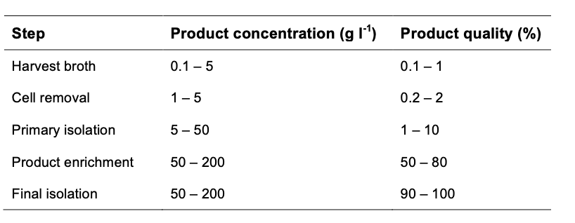

[Previous](<AB-31 - Developing and scaling a bioprocess.md>) · [Subject index](../README.md) · [Topic overview](README.md) · [Complete section](<Complete section.md>) · [Next](<AB-33 - Cell removal by filtration — equipment and operation.md>)

<!-- note-content:start -->
# Section 32: Downstream processing — stages, logic and cost

## Intuition

Downstream processing is governed by one ratio: how much of the broth is product. If that fraction is $`10^{-9}`$, then $`10^{9}`$ parts of everything else must be removed, and no single operation can do it. A train of separations is needed, and the order in which they are placed decides the cost.

The ordering principle is simple: **remove the most material earliest**. Every unit downstream of a given point must be sized for the flow reaching it, so a step that cuts the volume tenfold makes everything after it ten times smaller. Cheap, crude, high-capacity operations go first; expensive, selective, low-capacity ones go last, when little is left to process.

*Analogy:* sorting a landfill for a lost ring. You do not start with tweezers and a magnifying glass; you shift the bulk mechanically first, then sieve, then inspect. The analogy breaks down because biological products are labile — they denature, they are digested by proteases released from broken cells, and they are lost at every transfer — so speed matters as much as order.

## Mechanism

### What makes it difficult

- **Dilute.** Products are formed in dilute solution; both the medium and the cells are mostly water.
- **Labile.** Biological products tolerate only a narrow range of temperature, pressure, solvent and salt concentration, which rules out many conventional separation techniques.
- **Contamination control.** Hygienic or aseptic operation is designed around the product and its requirements. Short residence times can limit microbial growth, but do not replace suitable closed equipment, cleaning and aseptic controls where required.
- **Similar impurities.** The broth contains cells, proteins, sugars and other macromolecules **chemically similar to the desired product** — so the separation cannot rely on gross property differences.
- The main objective is separation, concentration and formulation. Changes of pH, solvent or salt can change protonation and conformation, so product stability still needs checking.

### The five stages

1. **Cell removal** — usually the first step after fermentation. Filtration or centrifugation, exploiting **particle size and density**. The product may be the cells themselves, inside them, or in the medium, and the flowsheet branches accordingly.
2. **Cell disruption** — only if the product is intracellular. Mechanical, physical, chemical or enzymatic (Sections 38–41). The debris released must then be removed by the same methods as step 1.
3. **Primary isolation** — removes components with **substantially different properties** from the product. Non-selective, high-capacity: solvent extraction, two-phase aqueous extraction, adsorption, precipitation (Sections 42–45).
4. **Product enrichment** — **highly selective** methods separating the product from impurities with *similar* properties. Chromatography in its various forms (Sections 46–47).
5. **Final isolation** — the finished form. Liquids may be concentrated by ultrafiltration; solids are crystallised, then centrifuged or filtered and dried.

The branching in the flowsheet is decided by one question asked at the start — *where is the product?* — because that determines whether the cells are the product, must be broken open, or can simply be discarded.

**Illustrative concentration and purity ranges through the train:** individual operations, including extraction and size-exclusion chromatography, can dilute the product.

| Step | Product concentration (g/L) | Product quality (%) |
|---|---|---|
| Harvest broth | 0.1–5 | 0.1–1 |
| Cell removal | 1–5 | 0.2–2 |
| Primary isolation | 5–50 | 1–10 |
| Product enrichment | 50–200 | 50–80 |
| Final isolation | 50–200 | 90–100 |

Two features are worth noting. **Cell removal barely improves purity** (0.1–1 % to 0.2–2 %) despite removing most of the mass — it removes bulk, not impurity. And **product enrichment does almost all the purification**, from about 10 % to 50–80 %, which is why the chromatography steps dominate cost.

## Motivation and explanation

**Why price tracks dilution.** The plot spans ten orders of magnitude in both axes and shows a clear inverse trend: the more dilute a product is in the starting material, the more it sells for. Ethanol and citric acid sit at high concentration and low price; factor VIII and urokinase at $`10^{-6}`$ kg/m³ and very high price.

Low starting concentration means a large volume must be processed per unit of product, and losses compound through the recovery train. That can make separation a large manufacturing cost. The plot illustrates a correlation; it does not show that separation cost alone sets selling price, which also depends on demand, development costs and market conditions.

**How much of the cost.** For well-characterised antibiotics such as penicillin, the ratio of fermentation cost to recovery cost is about **60:40**. For recombinant proteins and monoclonal antibodies the ratio **reverses, and can reach 20:80** — four times as much spent recovering the product as making it.

The reason is in the purity table. A small molecule such as penicillin is chemically distinct from everything else in the broth and can be extracted and crystallised. A therapeutic protein must be separated from thousands of *other proteins* of similar size, charge and solubility, which requires several chromatography steps, each with its own yield loss.

**Where the engineering opportunity lies.** Because initial concentration is so low for high-value products, recovery costs are high and so is the selling price. That leaves considerable room for innovation: improvements in downstream processing translate directly into cost reduction, and this is where chemical engineers have the clearest contribution to make in modern biological processes.

## Link to other topics

Placing the cheapest, least selective operation first and the most selective last is the standard ordering heuristic for any separation train, and it follows from the same argument as in distillation sequencing: each unit is sized for the flow it receives, so removing bulk early shrinks everything downstream.

## Summary

Downstream processing takes a dilute, labile, chemically similar mixture and concentrates the product through five stages ordered cheapest-and-crudest first. Cell removal takes out bulk without improving purity; enrichment by chromatography does the purification and dominates the cost.
<!-- note-content:end -->

[Previous](<AB-31 - Developing and scaling a bioprocess.md>) · [Subject index](../README.md) · [Topic overview](README.md) · [Complete section](<Complete section.md>) · [Next](<AB-33 - Cell removal by filtration — equipment and operation.md>)
