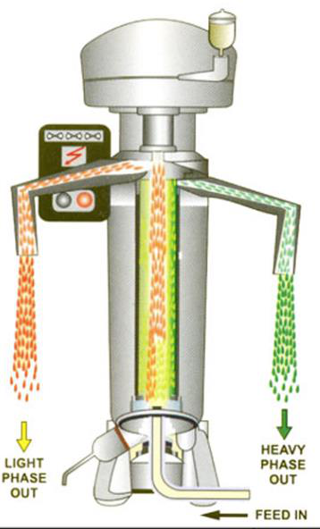
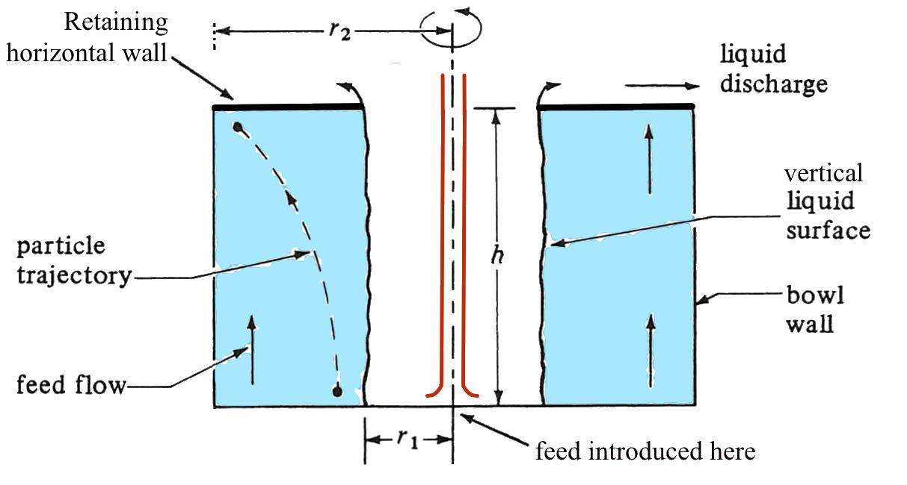

[Subject index](../README.md) · [Topic overview](README.md) · [Complete section](<Complete section.md>)

<!-- note-content:start -->
# Centrifugation

## Overview

Centrifuges accelerate density-driven settling and arrange the available separation area in compact geometries. Stokes settling and residence-time arguments give a cut-off throughput, while sigma theory separates feed properties from equipment performance for conditional scale-up.

*Assumed throughout:* force balances, low-Reynolds-number drag and residence time.

## Section 35: Centrifuge designs for cell removal

### Intuition

Left standing, a suspension of cells will settle under gravity, because the cells are denser than the medium. The trouble is that it takes days (Section 36 puts a number on it). A centrifuge replaces gravity with a far larger artificial acceleration by spinning the sample, so the same settling happens in minutes.

The quantity being exploited is the **density difference**, and that is exactly what makes biological separations difficult: cells are mostly water, so they are only slightly denser than the medium they grow in. Bacteria compound the problem by being small, and the medium is often dense and viscous. Centrifugation is most effective for **large particles, low liquid viscosity and a large density difference**, and a bacterial culture offers none of these.

The response is to build centrifuges that spin very fast and present a short settling distance, and to accept that they are expensive and mechanically demanding.

*Analogy:* separating sand from water by swinging a bucket. The analogy breaks down because a real centrifuge cannot simply be spun faster without limit — the bowl wall must contain the hoop stress, which rises with the square of the speed, and that is the binding engineering constraint.

### Mechanism

Centrifuges are classified by their internal geometry. Two designs matter here.

#### Tubular bowl centrifuge



- A **rotating tube** with a nozzle at the base where feed is introduced.
- As the liquid flows upwards, particles are spun outwards and collide with the wall of the bowl, where they are retained.
- Clarified liquid continues upwards and leaves over a **weir** at the top.
- Two timescales compete: the **residence time**, which decreases as the flow rate rises, and the **sedimentation time**, which is shorter for larger or denser particles, higher rotation speed and lower viscosity. **Particles are separated efficiently if the sedimentation time is shorter than the residence time** — the condition Section 36 turns into a maximum throughput.

The peak acceleration is measured near the outer radius, but a newly entering particle may begin farther inward, where acceleration is smaller, and must still cross a finite distance. A short settling path can therefore compensate for a lower peak g-factor. Comparing machines by maximum g alone ignores both the trajectory and the amount of liquid that must be clarified during the available residence time.

Liquid feed and clarification can be continuous, while retained solids accumulate on the wall and require periodic shutdown for removal. A separate heavy-liquid outlet can provide continuous liquid–liquid separation; it does not by itself remove deposited solids.

Tubular bowls reach very high centrifugal forces — up to about 16 000 g — so they suit difficult separations. They are easy to clean, but foaming can be a problem.

#### Disc-stack centrifuge


- The bowl contains **conical sheets of metal (discs) stacked on top of each other**, with clearances of approximately **0.3 mm**.
- As the bowl rotates, the discs **split the liquid into thin layers**. Denser liquid containing the solids is displaced outwards along the underside of each disc, while lighter liquid remains close to the centre.
- Both streams are withdrawn continuously.
- Solids discharge depends on the design: a solids-retaining bowl is opened for manual removal; a self-cleaning bowl ejects solids intermittently through peripheral ports; a nozzle separator discharges solids continuously. A heavy-liquid outlet separates a liquid phase and is not equivalent to a solids outlet.

The discs are the whole point of the design: they reduce the distance a particle must travel before it reaches a collecting surface from the full bowl radius to the 0.3 mm gap. Section 37 shows that this is what gives the disc stack its large effective area.

Foam can be controlled, and it is easier to run continuously than a tubular bowl, but it is **harder to clean** because of the stack.

#### Comparison


| | Bowl diameter (cm) | Speed (rpm) | Max force (×g) | Throughput (L/min) |
|---|---|---|---|---|
| Tubular bowl | 10 | 15 000 | 13 200 | 0.4–40 |
| | 13 | 15 000 | 15 900 | 0.8–80 |
| Disc stack | 18 | 12 000 | 14 300 | 0.4–40 |
| | 33 | 7 500 | 10 400 | 20–200 |
| | 61 | 4 000 | 5 500 | 80–800 |

The pattern is the important part. **Larger bowls run slower and generate less force, but handle far more throughput.** A 61 cm disc stack produces only 5 500 g — less than half the tubular bowl's force — yet processes up to 800 L/min against 80 L/min.

This is not a contradiction: throughput depends on the *total settling area* presented, not on the force alone, and a large stack of discs presents an enormous area. Section 37 makes this precise through the Σ factor.

### Motivation and explanation

**Why speed falls as diameter rises.** The bowl wall carries a hoop stress proportional to $`\rho r^2\omega^2`$. For a fixed allowable stress, the maximum angular velocity scales as $`1/r`$, so the maximum centrifugal acceleration $`r\omega^2`$ scales as $`1/r`$ as well. At the same allowable stress and comparable construction, bigger bowls therefore have a lower maximum g-force. The gain from building larger is area, not force, and the table shows exactly that trade.

**Centrifugation against filtration.**

| | Centrifugation | Filtration |
|---|---|---|
| Sterility | closed sanitary designs can support asepsis | exposed cake filters are difficult to keep aseptic; sealed sanitary membrane systems can support asepsis |
| Continuous operation | design-dependent; liquid flow can be continuous | rotary drums and cross-flow membrane systems can run continuously |
| Consumables | seals, cleaning agents and maintenance parts; no filter medium | filters, optional filter aids and cleaning agents |
| Capital cost | higher | **lower** |
| Small cells | difficult | **easier to separate** |
| Mechanical risk | many moving parts and seals that can fail; safety | few |

The decisive factor in therapeutic protein manufacture is usually **sterility**: a closed centrifuge can be cleaned and sterilised in place, whereas the rotary drum of Section 33 is open to the atmosphere. For large-volume, lower-value products such as antibiotics, filtration's lower capital cost and ability to handle fine cells generally wins.

**Why the conditions are unfavourable for cells.** Cell cultures are a hard case because cells may not be very dense, the medium can itself be dense, and bacterial cells are small. Since Section 36 shows that settling velocity scales with $`D_p^2`$ and with $`(\rho_p-\rho_l)`$, small size and low density difference are both directly punishing. The limitations are overcome by designing large centrifuges operating at high rotational speeds — with physical and safety limits capping how far this can go.

### Link to other topics

Replacing gravity with a much larger artificial body force to accelerate a transport process is the same device as using a pressure difference to drive filtration faster than capillarity would (Section 34), and in both cases the equipment, not the physics, sets the limit.

### Summary

Centrifuges separate by density, which is unfavourable for cells because they are small and nearly as dense as their medium, so bioprocessing relies on high-speed designs. Tubular bowls give the highest force and are easy to clean but run batchwise; disc stacks give far higher throughput by splitting the liquid into 0.3 mm layers and run continuously.

## Section 36: Stokes settling and the throughput of a tubular bowl centrifuge

### Intuition

A particle denser than the surrounding liquid sinks. Three forces act: gravity pulls it down, buoyancy pushes it up, and drag opposes whatever motion results. Because the particle is tiny, it reaches terminal velocity almost instantly, so the three forces balance at all times and the problem reduces to algebra rather than dynamics.

The result, Stokes' law, shows the velocity scales with the *square* of the diameter. Halving the particle size slows settling fourfold — which is why bacteria are so much harder to spin down than animal cells.

A centrifuge changes only one thing in that balance: it replaces $`g`$ with the much larger centrifugal acceleration $`r\omega^2`$. Everything else carries over unchanged.

Separation then becomes a race. A particle entering the bowl has a limited time before the flow carries it out, and it must reach the wall within that time. Capture requires **sedimentation time < residence time**, and that single inequality sets the maximum flow rate the machine can handle.

*Analogy:* crossing a moving walkway diagonally — you are captured by the far side only if you can walk across before the belt carries you off the end. The analogy breaks down because the centrifugal "walking speed" increases with radius, so the particle accelerates as it crosses, which is why the derivation produces a logarithm.

### Derivation

Notation: $`D_p`$ particle diameter, $`\rho_p`$ particle density, $`\rho_l`$ liquid density, $`\mu`$ liquid viscosity, $`u`$ velocity, $`\omega`$ angular velocity, $`r`$ radius, $`g`$ gravitational acceleration.

#### Sedimentation under gravity

**Step 1: the forces.** A spherical particle moving at velocity $`u`$ in a Newtonian fluid at low Reynolds number experiences a **frictional (drag) force**

**Equation (52)**

```math
F_d = 3\pi\mu D_p u
```

Gravity and buoyancy act in opposite directions:

**Equation (53)**

```math
F_g = -m_p g = -V_p\rho_p g, \qquad F_b = V_p\rho_l g
```


**Step 2: terminal velocity.** At low $`Re`$, **inertial effects are negligible**, so the net force on the particle is always zero. Balancing drag against the net of gravity and buoyancy:

**Equation (54)**

```math
3\pi\mu D_p u_g = V_p(\rho_p-\rho_l)g = \frac{\pi}{6}D_p^3(\rho_p-\rho_l)g
```

using $`V_p = \tfrac{\pi}{6}D_p^3`$ for a sphere.

**Step 3: solve for $`u_g`$.** Dividing through by $`3\pi\mu D_p`$:

**Equation (55)**

```math
\boxed{\;u_g = \frac{D_p^2(\rho_p-\rho_l)g}{18\mu}\;}
```


This is **Stokes' law** for the sedimentation velocity in a gravitational field. The particle sediments only if $`\rho_p > \rho_l`$; if the particle is lighter it rises.

#### Sedimentation in a centrifuge

**Step 4: replace the acceleration.** In a centrifuge the fluid rotates with the bowl at angular velocity $`\omega`$, so a particle at radius $`r`$ experiences a centrifugal acceleration

**Equation (56)**

```math
a_c = r\omega^2
```

The force balance is unchanged apart from the body force, so $`g`$ is simply replaced by $`a_c`$:

**Equation (57)**

```math
u_c = \frac{D_p^2(\rho_p-\rho_l)r\omega^2}{18\mu} = \frac{D_p^2(\rho_p-\rho_l)Gg}{18\mu}
```

where the **G-factor** $`G = a_c/g`$ is the ratio of centrifugal to gravitational acceleration. Note that $`u_c`$ depends on $`r`$: **the particle speeds up as it moves outwards.**


#### Throughput of a tubular bowl



**Step 5: the capture condition.** For a particle to be captured, it must hit the outer wall before the feed flow pushes it out of the tube:

**Equation (58)**

```math
t_{\text{sed}} < t_{\text{res}}
```


**Step 6: the cut-off time.** Define $`t_{\text{cut}}`$ as the time for a particle starting at the *mid-point* of the liquid layer, $`r = (r_1+r_2)/2`$, to reach the wall at $`r_2`$. Since $`dr/dt = u_c(r)`$ from (57), the variables separate:

```math
\int_{(r_1+r_2)/2}^{r_2}\frac{dr}{r} = \frac{D_p^2(\rho_p-\rho_l)\omega^2}{18\mu}\int_0^{t_{\text{cut}}}dt
```

The left side integrates to a logarithm, giving

**Equation (59)**

```math
t_{\text{cut}} = \frac{18\mu}{D_p^2(\rho_p-\rho_l)\omega^2}\ln\!\left(\frac{2r_2}{r_1+r_2}\right)
```


The logarithm follows from radial velocity being proportional to radius. Starting at $`(r_1+r_2)/2`$ defines a representative radial-midpoint criterion; particles starting closer to $`r_1`$ take longer. With uniform concentration and axial velocity across the annulus, the midpoint criterion corresponds to about 54 % capture in this geometry, not complete clarification.

The particle's radial speed increases as it moves outward because the local driving force increases, not because it stores appreciable momentum over the settling trajectory. The terminal-velocity approximation balances drag at each position. Integrating $`dr/u_c(r)`$ therefore adds the time spent in each small radial interval, including the slower inner part; using only the outer-wall speed would underestimate travel time.

**Step 7: the residence time.**

**Equation (60)**

```math
t_{\text{res}} = \frac{V_c}{Q}, \qquad V_c = \pi(r_2^2-r_1^2)h
```

with $`Q`$ the volumetric flow rate and $`h`$ the height of the liquid layer.

**Step 8: the maximum throughput.** Substituting (59) and (60) into the capture condition (58) gives $`V_c/Q > t_{\text{cut}}`$, so

**Equation (61)**

```math
Q < Q_{\text{cut}} = \frac{V_c}{t_{\text{cut}}} = \frac{D_p^2(\rho_p-\rho_l)\omega^2}{18\mu\,\ln\!\left(\dfrac{2r_2}{r_1+r_2}\right)}\,\pi(r_2^2-r_1^2)h
```


$`Q_{\text{cut}}`$ is the throughput corresponding to the chosen radial-midpoint capture criterion, not guaranteed complete cell removal. Under the same ideal plug-flow assumptions, capture from the innermost radius requires replacing the logarithm by $`\ln(r_2/r_1)`$.

### Motivation and explanation

**Reading equation (61).** Throughput rises with $`\omega^2`$, with $`D_p^2`$, with the density difference, and with the bowl volume; it falls with viscosity. Every one of these is unfavourable for a bacterial culture (Section 35), which is why such large machines are needed for such modest flows.

**What the criterion means.** Smaller particles settle more slowly, but entry radius also affects capture. Here the midpoint throughput is 0.343 L/min, whereas the innermost-radius ideal capture criterion gives 0.159 L/min. Actual recovery also depends on particle-size distribution, flow and hindered settling.

**Where the derivation fails.** It assumes laminar settling (low $`Re`$), spherical and non-interacting particles, uniform plug flow through the bowl, and no re-entrainment of deposited solids. Real feeds are concentrated enough that particles hinder one another, and flow in the bowl is not plug flow, so (61) is an optimistic estimate.

### Link to other topics

Equation (58) is a competition of timescales — a Damköhler-type comparison between the time for a process to complete and the time available in the vessel. The same reasoning sizes any flow-through separator, and the particle accelerating as it crosses is what distinguishes a centrifuge from a gravity settler.

### Summary

A force balance at negligible inertia gives Stokes' law, $`u \propto D_p^2(\rho_p-\rho_l)/\mu`$, and a centrifuge simply substitutes $`r\omega^2`$ for $`g`$ — worth a factor of $`10^4`$, turning a week of settling into a minute. Requiring sedimentation to beat residence time gives the maximum throughput, equation (61).

## Section 37: Sigma theory and centrifuge scale-up

### Intuition

To compare two centrifuges fairly, they must be compared on the same feed. If a figure of merit could be found that depends only on the machine, then the ratio of throughputs of any two centrifuges on *any* common sample would equal the ratio of those figures — and scale-up would reduce to matching one number.

The trick is to notice that the sample's properties enter $`Q_{\text{cut}}`$ only through the combination that forms the **gravitational settling velocity** $`u_g`$. Multiplying and dividing by $`u_g`$ therefore isolates everything else, and what remains is the machine.

The machine factor has units of area. With the convention used here, $`Q_{\text{cut}}=2\Sigma u_g`$, the corresponding ideal gravity-settler area is $`A_{\mathrm{eq}}=Q_{\text{cut}}/u_g=2\Sigma`$. Thus $`\Sigma=32.4`$ m² corresponds to about 64.8 m² of gravity-settling area for the same stated capture criterion.

*Analogy:* expressing a device's performance as the equivalent area of a simpler separator. The comparison is conditional on matching feed, capture criterion and ideal flow assumptions; it does not make real centrifuge scale-up exact.

### Derivation

**Step 1: start from the cut-off flow rate.** From Section 36, equation (61):

**Equation (62)**

```math
Q_{\text{cut}} = \frac{D_p^2(\rho_p-\rho_l)\omega^2}{18\mu\,\ln\!\left(\dfrac{2r_2}{r_1+r_2}\right)}\,\pi(r_2^2-r_1^2)h
```


**Step 2: multiply and divide by $`u_g`$.** The gravitational settling velocity of the same particle is

**Equation (63)**

```math
u_g = \frac{D_p^2(\rho_p-\rho_l)g}{18\mu}
```

Writing (62) as itself multiplied by $`u_g/u_g`$ and substituting (63) in the denominator, the whole group $`D_p^2(\rho_p-\rho_l)/18\mu`$ cancels, leaving $`g`$ behind:

**Equation (64)**

```math
Q_{\text{cut}} = \frac{\pi(r_2^2-r_1^2)h\,\omega^2}{g\,\ln\!\left(\dfrac{2r_2}{r_1+r_2}\right)}\;u_g
```


**Step 3: define $`\Sigma`$.** Writing (64) as $`Q_{\text{cut}} = 2\Sigma u_g`$:

**Equation (65)**

```math
\boxed{\;\Sigma(r_1,r_2,h,\omega) = \frac{\pi(r_2^2-r_1^2)h\,\omega^2}{2g\,\ln\!\left(\dfrac{2r_2}{r_1+r_2}\right)}\;}
```


Two properties follow immediately:
- **$`\Sigma`$ depends only on the centrifuge**, not on the sample. Every sample-dependent quantity has been collected into $`u_g`$.
- **$`\Sigma`$ has dimensions of area.** Dimensionally $`Q = 2\Sigma u_g`$ is (volume/time) = (area)(velocity), so the equivalent ideal gravity-settler area at this throughput is **$`2\Sigma`$**, under the stated $`Q_{\text{cut}}=2\Sigma u_g`$ convention.

**Step 4: the scale-up rule.** For two centrifuges processing the **same sample**, $`u_g`$ is common:

```math
Q_1 = 2\Sigma_1 u_g, \qquad Q_2 = 2\Sigma_2 u_g
```

Dividing, $`u_g`$ cancels:

**Equation (66)**

```math
\frac{Q_1}{Q_2} = \frac{\Sigma_1}{\Sigma_2}
```


Matching $`Q/\Sigma`$ matches the ideal settling challenge imposed on the feed under the same area convention. It is useful because the unknown particle settling velocity cancels from the comparison. That cancellation fails if upstream handling changes the cells: flocculation increases effective particle size, while disruption or a viscosity change alters settling. Such changes belong to the feed factor and cannot be absorbed into the geometric machine factor.

**To increase the throughput of a centrifuge by a factor $`X`$, $`\Sigma`$ must increase by the same factor $`X`$.** This ideal ratio requires the same feed settling properties, capture criterion and flow assumptions; real machines can need empirical efficiency corrections.

### Motivation and explanation

**The area factor depends on the design and convention.** Equation (65) uses $`Q=2\Sigma u_g`$. For a disc stack, state the full equivalent area $`A_{\mathrm{eq,disc}}`$, defined by $`Q=A_{\mathrm{eq,disc}}u_g`$:

**Equation (67)**

```math
A_{\mathrm{eq,disc}} = \frac{2\pi\omega^2(N-1)}{3g\tan\theta}\left(r_2^3-r_1^3\right)
```

with $`N`$ the number of discs, $`r_2`$ and $`r_1`$ the outer and inner disc radii and $`\theta`$ the disc angle to the rotation axis. Under the half-area convention of (65), use $`\Sigma_{\mathrm{disc}}=A_{\mathrm{eq,disc}}/2`$.


Equation (67) explains the throughput figures in Section 35. $`\Sigma`$ scales with $`(N-1)`$, so a stack of a hundred discs has roughly a hundred times the equivalent area of a single surface, and it scales with $`r^3`$ rather than $`r^2`$. That is how a disc stack delivers 800 L/min at only 5500 g while a tubular bowl at 15 000 g manages 80 L/min — **equivalent settling area, which includes the rotation speed, sets the ideal throughput for a given feed and capture criterion.**

**$`\Sigma`$ is convention-dependent.** The derivation of $`t_{\text{cut}}`$ took a particle starting at the mid-point of the liquid layer, which is somewhat arbitrary. Different conventions give different expressions; another in common use is

**Equation (68)**

```math
\Sigma = \frac{\pi\omega^2 h}{2g}\left(3r_2^2+r_1^2\right)
```

For the example below, (68) gives 35.4 m² against 32.4 m² from (65), about 9 % higher. Quote the value with its definition and capture criterion. Their difference is not merely a universal prefactor: it depends on the radius ratio, so scale-up ratios calculated from different geometric expressions need not agree for dissimilar bowls.

**When ratios are robust.** A common constant prefactor cancels from a ratio. Both tubular-bowl expressions also scale as $`L^3\omega^2`$ for geometrically similar bowls, so they give the same speed ratio in the doubled-size example. Dissimilar geometries require matched capture criteria, and real scale-up requires checking flow and separation-efficiency corrections.

### Link to other topics

Expressing a device's performance as an equivalent area of a simpler device is the same move as the HETP of a distillation column or the NTU of a heat exchanger: a dimensional figure of merit that separates equipment performance from the properties of what passes through it, so that scale-up becomes a matter of matching one number.

### Summary

Factorising $`Q_{\text{cut}}=2\Sigma u_g`$ separates the ideal machine factor from the feed settling velocity. In this convention the equivalent gravity-settler area is $`2\Sigma`$.

## Conclusion

Sigma theory supports scale-up when feed properties, separation criteria and geometric conventions remain consistent. The next unit develops cell disruption.
<!-- note-content:end -->

[Subject index](../README.md) · [Topic overview](README.md) · [Complete section](<Complete section.md>)
