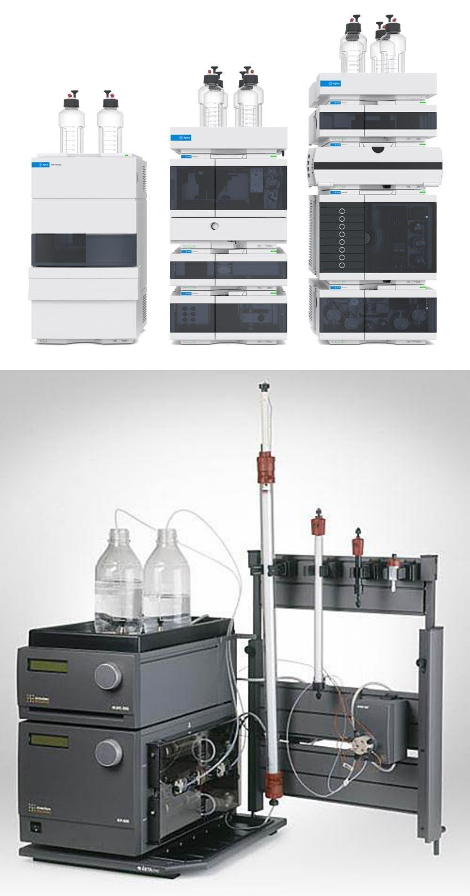
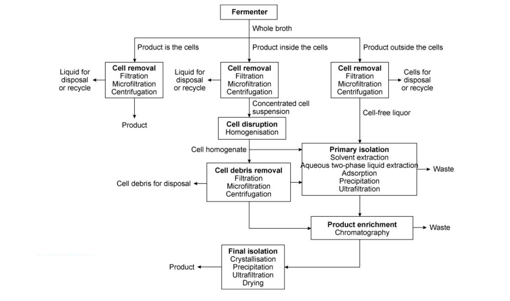

[Previous](<AB-46 - Types of liquid chromatography.md>) · [Subject index](../README.md) · [Topic overview](README.md) · [Complete section](<Complete section.md>)

<!-- note-content:start -->
# Section 47: Quantifying differential migration, and final isolation

## Intuition

A solute's position in the chromatogram is reported as the **elution volume** $`V_e`$: the volume of eluent that has passed when the solute emerges at peak concentration. Volume is used rather than time because it is independent of flow rate.

In general chromatography the reference is the hold-up volume of an unretained marker. For the size-exclusion treatment here, $`V_0`$ specifically denotes the interparticle void volume, measured using a fully excluded marker. A smaller non-binding molecule can enter pores and elute later than $`V_0`$ without adsorbing. The dimensionless quantity $`(V_e-V_0)/V_0`$ below uses this stated reference.

In ideal size exclusion, pore access rather than binding determines elution. A fully excluded molecule elutes at $`V_0`$, while a fully permeating noninteracting molecule elutes at $`V_0+V_i`$. Intermediate molecules have intermediate retention. These bounds assume ideal exclusion without adsorption or other nonideal matrix interactions; real retention is not exactly predictable from nominal pore size alone.

*Analogy:* a crowd moving through a corridor lined with alcoves. People too large to enter any alcove pass straight through; small ones that wander into every alcove take longest. The analogy breaks down because entry here is not a choice but a geometric constraint, which is why the limits are hard.

## Derivation

Notation: $`V_e`$ elution volume; $`V_0`$ void volume (between the particles); $`V_i`$ volume of empty space *within* the particles; $`V_s`$ volume of the material (hydrogel) making up the particles; $`V_t`$ total column volume.

### Capacity factor and retention ratio

**Step 1: capacity factor.** The retention of a solute beyond the void volume, normalised:

**Equation (85)**

```math
k = \frac{V_e-V_0}{V_0}
```

$`k = 0`$ means the solute is unretained and elutes with the void. Larger $`k`$ means more retention. The normalisation by $`V_0`$ makes $`k`$ a property of the solute and the chemistry, not of the column size.

**Step 2: retention ratio.** Comparing two solutes 1 and 2:

**Equation (86)**

```math
\delta = \frac{k_1}{k_2}
```

This is a ratio of retention factors, not chromatographic resolution. With the later peak labelled 2, the usual separation factor is $`\alpha=k_2/k_1`$ for $`k_1>0`$. Resolution also requires peak widths: using baseline widths $`w_1`$ and $`w_2`$ in elution-volume units, $`R_s=2(V_{e,2}-V_{e,1})/(w_1+w_2)`$. Equal retention factors imply equal peak positions under the stated conditions, but a ratio different from one does not establish resolved peaks.

Two peaks with the same centre spacing can give very different usable fractions if one pair is broad and the other narrow. Collecting only the middle of the target peak rejects overlapping impurity but sacrifices target in its tails; collecting more of the tails improves recovery while admitting more impurity. This is why an elution-volume calculation does not complete a preparative design: the collection window depends on the actual peak shapes and required purity.

### Gel chromatography

**Step 3: the column's volume budget.** The total column volume divides into three parts:

**Equation (87)**

```math
V_t = V_0 + V_i + V_s
```

liquid between particles, liquid inside particles, and the solid gel itself.

**Step 4: elution volume.** A solute travelling down the column has access to $`V_0`$ always, and to a *fraction* of $`V_i`$ depending on whether it fits into the pores:

**Equation (88)**

```math
V_e = V_0 + K_pV_i
```

where $`K_p`$ is the **partition coefficient**, defined as the fraction of the volume within the gel particles that is available to the solute.

**Step 5: rearrange for the measurable.**

**Equation (89)**

```math
K_p = \frac{V_e-V_0}{V_i}
```

So determining $`K_p`$ requires measuring $`V_e`$ and knowing $`V_0`$ and $`V_i`$.

**The two limits for ideal, noninteracting size exclusion:**
- **$`K_p = 0`$**: a large macromolecule that does not penetrate the gel particles at all. Then $`V_e = V_0`$ — it elutes in the void volume, *first*. This also gives the practical route to measuring $`V_0`$: run a molecule known to be excluded and record its elution volume.
- **$`K_p = 1`$**: a small solute with full access. Then $`V_e = V_0+V_i`$ — the latest anything can elute.

Hence $`V_0 \le V_e \le V_0+V_i`$ under ideal, noninteracting size exclusion. Combining (85) and (88), the capacity factor is

**Equation (90)**

```math
k = \frac{K_pV_i}{V_0}
```

so $`k`$ ranges from 0 to $`V_i/V_0`$ and cannot exceed it. **Gel chromatography has a bounded retention**, unlike the binding-based methods where strong binding can retain a solute arbitrarily long.

**Step 6: measuring $`V_i`$.** From the gel's properties:

**Equation (91)**

```math
V_i = a\,W_r
```

where $`W_r`$ is the **water retention value** — the volume of water taken up when rehydrating the gel, per unit dry mass, specified by the manufacturer — and $`a`$ is the dry mass of gel.

Often the gel is supplied already rehydrated, so $`a`$ is unknown. In that case:

**Equation (92)**

```math
V_i = \frac{W_r\rho_g}{1+W_r\rho_w}\left(V_t-V_0\right)
```

with $`\rho_g`$ the density of the rehydrated gel and $`\rho_w`$ the density of water. Note $`(V_t-V_0) = V_i+V_s`$ from (87): equation (92) splits the non-void volume into pore space and solid in the ratio the gel's water content implies.

## Instrumentation



Two systems carry out chromatographic separations of biomolecules:

**HPLC (high-performance liquid chromatography)** often uses fine particles and sufficiently high pressure to control band spreading. Analytical systems commonly use micrometre-scale particles and low flow rates, but pressure and throughput depend on the column and duty; preparative HPLC also exists. Oligonucleotide purification (Section 06) is one application.

**FPLC (fast protein liquid chromatography)** describes systems designed for protein purification with compatible wetted materials, aqueous buffers, gradient control and fraction collection. They are used from laboratory purification to process development. Resolution depends on the resin, column and operating conditions, rather than being intrinsically lower than HPLC; pressure and flow limits depend on the particular system and column.

The trade is the familiar one: smaller particles give more plates and better resolution but a far larger pressure drop, so resolution is bought with pressure and throughput.

## Final isolation



The product is already highly purified by chromatography. The objective of **final isolation** is possibly to **increase purity further**, and to **alter the physical form** of the product to make it suitable for storage and commercialisation.

Many products are packaged and sold as **solids or powders**. These go through either **precipitation or crystallisation** (Sections 43–44), followed by **filtration or centrifugation** (Sections 33–37), and the wet solids — crystals or amorphous precipitate — are then **dried**.

The operations are therefore ones already covered; what differs is the purpose. Earlier they were used to *separate*; here they are used to *formulate*.

## Link to other topics

The capacity factor is the chromatographic analogue of a retention or holdup time, and the resolution-versus-pressure trade in HPLC is the same relationship as plate count against pressure drop in a packed column: finer packing improves separation and costs pumping energy.

## Summary

The stated retention factor characterises elution relative to $`V_0`$, and $`\delta=k_1/k_2`$ compares retention rather than resolution. Ideal size exclusion gives $`V_e=V_0+K_pV_i`$ and a bounded elution window, governed by effective pore access under defined conditions.

## Conclusion

Retention describes migration, peak widths determine resolution, and final isolation sets the product form. The next unit develops gene regulation and synthetic circuits.
<!-- note-content:end -->

[Previous](<AB-46 - Types of liquid chromatography.md>) · [Subject index](../README.md) · [Topic overview](README.md) · [Complete section](<Complete section.md>)
