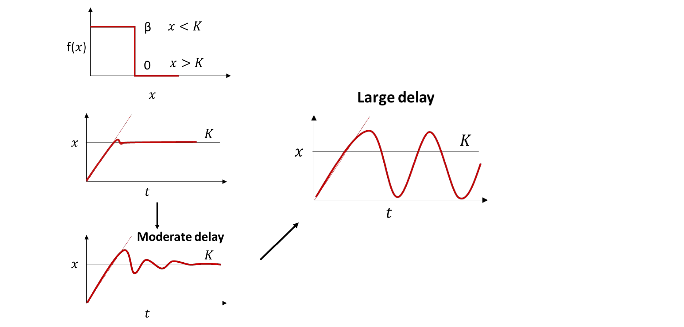
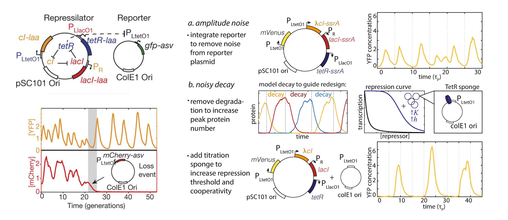

[Previous](<AB-51 - Stochastic gene expression and noise.md>) · [Subject index](../README.md) · [Topic overview](README.md) · [Complete section](<Complete section.md>)

<!-- note-content:start -->
# Section 52: Feedback, delay and the repressilator

## Intuition

If a promoter keeps responding to an earlier low repressor level, production continues after the present level is already high. Later, repression persists after the repressor has fallen. The result can be an overshoot, a damped oscillation, or sustained cycling if loop strength and delay destabilise the steady state.

*Analogy:* adjusting shower temperature using water that left the mixer several seconds ago can cause repeated overcorrection. The analogy has limits: gene-expression delays are distributions of molecular waiting times, and regulators are discrete molecules with noisy synthesis and loss.

The **repressilator** uses the sequence LacI represses TetR → TetR represses λ CI → λ CI represses LacI. Three inhibitions yield a negative loop; each intervening expression step adds response time. If LacI is high, TetR falls, CI rises, and CI eventually represses LacI. CI then falls after TetR recovers, allowing the cycle to restart. A TetR-controlled fluorescent reporter observes the circuit and is not one of its three core repressors.

## Derivation

**1. Make delay explicit.** A simplified fixed delay $`T`$ replaces current concentration in the production term by earlier concentration:


**Equation (117)**

```math
\frac{dx(t)}{dt}=f[x(t-T)]-\lambda x(t).
```


*Reason:* loss acts on the protein present now, while newly arriving active protein reflects the promoter state earlier. A delay equation requires an initial history over $`-T\leq t\leq0`$, not just one initial value. It is an approximation to several finite-duration biochemical steps.

At the steady balance $`f(x_{\mathrm{st}})=\lambda x_{\mathrm{st}}`$, write $`x=x_{\mathrm{st}}+y`$ and define $`a=-f'(x_{\mathrm{st}})>0`$. Taylor-expand production and cancel the steady terms:


**Equation (118)**

```math
\dot y(t)=-\lambda y(t)-a\,y(t-T).
```


*Reason:* $`a`$ is the local restoring production slope, with units inverse time. Try $`y=e^{st}`$, where $`s`$ is a possibly complex growth rate, and divide by $`e^{st}`$:


**Equation (119)**

```math
s+\lambda+a e^{-sT}=0.
```


Without delay this has $`s=-(\lambda+a)`$ and decays. To locate the first oscillatory instability, set $`s=i\omega`$, where $`i^2=-1`$ and $`\omega>0`$ is angular frequency. Expand $`e^{-i\omega T}=\cos(\omega T)-i\sin(\omega T)`$ and equate real and imaginary parts:


**Equation (120)**

```math
\lambda+a\cos(\omega T)=0,\qquad
\omega-a\sin(\omega T)=0.
```


Square both equalities and add. Using $`\sin^2+\cos^2=1`$ gives $`\omega^2+\lambda^2=a^2`$. The first positive crossing is therefore


**Equation (121)**

```math
\omega_c=\sqrt{a^2-\lambda^2},\qquad
T_c=\frac{\arccos(-\lambda/a)}{\sqrt{a^2-\lambda^2}},\qquad a>\lambda.
```


*Reason:* the first phase angle satisfying both signs lies between $`\pi/2`$ and $`\pi`$. The linear steady state is stable below this first crossing. If $`a<\lambda`$, a root with $`\mathrm{Re}s\geq0`$ would require $`|s+\lambda|=a e^{-T\mathrm{Re}s}\leq a<\lambda`$, while $`|s+\lambda|\geq\lambda`$: a contradiction. At $`a=\lambda`$ equality would force $`s=0`$, which fails (119), so no finite-delay instability occurs there either. Strong delay alone is insufficient. Crossing (121) predicts local instability; a stable finite-amplitude limit cycle still depends on the nonlinear production response.



**2. Represent intermediate steps instead of a fixed delay.** For each of the three repressors, let $`m_i`$ and $`p_i`$ be its mRNA and protein concentrations, with the preceding protein $`p_j`$ repressing its promoter. Let $`b_m`$ and $`\beta_m`$ be basal and additional transcription rates, $`k_p`$ the translation constant, $`\lambda_m`$ and $`\lambda_p`$ the removal constants, $`K`$ the repression threshold, and $`n`$ the Hill exponent. A symmetric model is


**Equation (122)**

```math
\dot m_i=b_m+\frac{\beta_m}{1+(p_j/K)^n}-\lambda_m m_i,
\qquad \dot p_i=k_p m_i-\lambda_p p_i.
```


*Reason:* mRNA production depends on the upstream repressor, while protein production depends on the transcript pool. For $`i=(\mathrm{LacI},\mathrm{TetR},\mathrm{CI})`$, $`j=(\mathrm{CI},\mathrm{LacI},\mathrm{TetR})`$. The six state variables supply distributed response times even without an explicit $`T`$.

A sudden decrease in an upstream repressor first changes transcription of the next gene. Its messages must accumulate before its protein rises substantially, and that protein must then influence the following promoter. Each intermediate begins responding gradually, so their combined lag is spread over time. Replacing this chain by a fixed delay is a modelling choice: the fixed-delay model postpones all feedback by the same interval, whereas the explicit intermediates give a distribution of response times.

To see the roles of promoter strength and lifetime, let $`u=\lambda_m t`$, $`P_i=p_i/K`$ and $`M_i=k_pm_i/(\lambda_pK)`$. Divide the two balances by their concentration scales and by $`\lambda_m`$:


**Equation (123)**

```math
\frac{dM_i}{du}=\alpha_0+\frac{\alpha}{1+P_j^n}-M_i,
\qquad \frac{dP_i}{du}=B(M_i-P_i),
```


where $`\alpha_0=k_pb_m/(\lambda_pK\lambda_m)`$, $`\alpha=k_p\beta_m/(\lambda_pK\lambda_m)`$ and $`B=\lambda_p/\lambda_m`$. Each is dimensionless. At a symmetric steady state $`M_i=P_i=P_*`$, so $`P_*=\alpha_0+\alpha/(1+P_*^n)`$. Repression slope, leak and both lifetimes jointly determine whether this equilibrium is stable. An odd repression ring provides the sign of feedback, but does not guarantee sustained oscillations. Eliminating mRNA as instantaneously equilibrated removes part of the delay and can change that prediction.

## Motivation and explanation


An alternative oscillator combines an AraC activation arm with a LacI repression arm: activation builds expression rapidly and the slower inhibitory response switches it off. Positive feedback can sharpen switching, but is not required in the three-repressor ring.

A molecular clock must be both oscillatory and reproducible. A small number of repressors near the derepression threshold can make the next transition depend on a few random loss events. Reporter plasmid fluctuations also change observed amplitude, and tagged reporter proteins can perturb the circuit through shared proteolysis. A reporter is therefore a biochemical load, not a perfectly passive measuring device.



Moving the reporter onto the circuit plasmid reduces independent copy-number variation. Removing degradation tags allows repressors to accumulate and makes dilution dominate their decline. Extra TetR-binding sites act as a titration sponge: they sequester repressor so that a larger total pool is required to sustain repression, avoiding transitions controlled by extremely few molecules. Raising peak abundance alone may leave the final low-copy threshold crossing noisy.

A mother-machine device traps cells in narrow channels while fresh medium removes newborn descendants, allowing long lineage records under steady conditions. Optical tweezers can transfer selected cells between growth and observation environments. These platforms distinguish circuit variation from changing culture conditions, but reporter maturation, phototoxicity and cell selection still affect measurement.

## Worked example

**Delay threshold.** Choose $`\lambda=0.020\ \mathrm{min^{-1}}`$ and restoring slope $`a=0.060\ \mathrm{min^{-1}}`$. Python gives $`\omega_c=0.05657\ \mathrm{min^{-1}}`$, $`T_c=33.78\ \mathrm{min}`$ and onset period $`2\pi/\omega_c=111.07\ \mathrm{min}`$. A 20 min fixed delay leaves this linearised model stable; increasing it beyond the first crossing permits growing oscillatory perturbations. These are illustrative local parameters, not a fitted repressilator period.

**Why dilution gives a generation counter.** During a strongly repressed decay phase, suppose synthesis and degradation are negligible, so a concentration $`x_0`$ declines only through growth. With generation count $`G=t/T_d`$ and dilution constant $`\lambda=\ln2/T_d`$, integration of $`\dot x=-\lambda x`$ gives $`x=x_0e^{-\lambda t}=x_0 2^{-G}`$. At the derepression threshold $`K`$, take logarithms to obtain


**Equation (124)**

```math
G_{\mathrm{switch}}=\frac{\ln(x_0/K)}{\ln2}=\log_2(x_0/K).
```


*Reason:* every generation halves concentration under this idealised growth balance. For $`x_0=1000\ \mathrm{nM}`$ and $`K=100\ \mathrm{nM}`$, Python gives 3.322 generations; doubling the peak to 2000 nM gives 4.322 generations. Peak variation affects the interval only logarithmically, while randomness at a low threshold can still dominate timing. Equation (124) describes one decay segment, not the period of the full circuit.

In a calibrated dilution-dominated repressilator, phase can therefore report elapsed generations. Fluorescent rings in a colony preserve the phase of its founding cell and have been used to infer growth variability in the mouse gut. Phase is measured modulo a cycle: without adequate sampling or cycle counting it cannot reveal how many complete cycles elapsed. A generation counter is not a universal clock in minutes, because doubling time varies with environment.

## Link to other topics

The same feedback that stabilises a steady expression level can destabilise it when biochemical steps postpone the correction. Expression noise becomes phase drift in oscillators, connecting molecular event statistics to the reliability of engineered cellular timers.

## Summary

An oscillation needs dynamical feedback with sufficient strength and response time. Designing a useful timer additionally requires control of reporter load, molecular abundance and threshold noise, together with a clear choice of whether it measures minutes or generations.

## Conclusion

Feedback controls average behaviour, while fluctuations and delays determine how reliably a circuit achieves it. The next unit develops cell-free systems and synthetic cells.
<!-- note-content:end -->

[Previous](<AB-51 - Stochastic gene expression and noise.md>) · [Subject index](../README.md) · [Topic overview](README.md) · [Complete section](<Complete section.md>)
