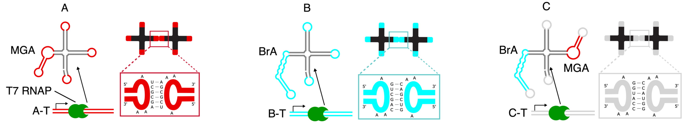

[Subject index](../README.md) · [Topic overview](README.md) · [Complete section](<Complete section.md>)

<!-- note-content:start -->
# Section 57: Synthetic DNA and RNA condensates

## Intuition

A **nanostar** is a branched nucleic-acid structure with several double-helical arms. A single bond joins two objects; several binding arms allow each object to join neighbours, building a network. If association becomes favourable enough to outweigh the entropy lost on concentrating the nanostars, a dense network-rich phase can coexist with a dilute solution.

*Analogy:* a gathering held together by people repeatedly joining and releasing hands. More hands and stronger grips favour a connected group. The analogy stops at the molecular physics: bonds fluctuate thermally, and a connected network need not be either a liquid or a separate phase. Networks can also become gels or ordered solids.

**Scaffold** molecules build the compartment; **clients** are recruited by affinity for that scaffold. A client can diffuse through a membrane-less boundary, so enrichment requires favourable interactions or sustained production, rather than an impermeable wall.

## Derivation

### From a sticky end to a material

For two complementary sticky ends $`S`$ and $`S^*`$, hybridisation gives $`S+S^*\rightleftharpoons SS^*`$. Define $`\Delta G^\circ_{\mathrm{bind}}`$ as the standard molar Gibbs energy change for this reaction, $`R`$ as the gas constant and $`T`$ as absolute temperature. The equilibrium constant $`K`$ is dimensionless because it uses activities relative to their standard states. At equilibrium, the reaction Gibbs energy vanishes:


**Equation (130)**

```math
0=\Delta G^\circ_{\mathrm{bind}}+RT\ln K
\quad\Longrightarrow\quad
\ln K=-\frac{\Delta G^\circ_{\mathrm{bind}}}{RT}
\quad\Longrightarrow\quad
K=\exp\!\left(-\frac{\Delta G^\circ_{\mathrm{bind}}}{RT}\right).
```


The first rearrangement subtracts the standard free energy and divides by $`RT`$; exponentiating then isolates $`K`$. A more negative binding free energy therefore favours bonded neighbours. Sequence changes alter base pairing and stacking, while salt affects electrostatic screening.

Equation (130) describes an individual association, **not the phase boundary of the whole network**. Condensate dissolution also depends on nanostar concentration, number of arms, competing structures and whether bonds can rearrange. A duplex melting calculation alone does not predict the material's melting temperature.

### Production versus loss of an expressed RNA scaffold

Let $`N(t)`$ be the mean number of counted RNA nanostars per cell, $`s`$ their constant production rate in nanostars per second, and $`\lambda`$ an effective first-order loss constant in inverse seconds. Counting arrivals and departures gives


**Equation (131)**

```math
\frac{dN}{dt}=s-\lambda N.
```


Each molecule has the same instantaneous loss probability per unit time in this model. At a stationary population, $`dN/dt=0`$, so $`s=\lambda N_{\mathrm{ss}}`$. Dividing by $`s\lambda`$ gives


**Equation (132)**

```math
\tau\equiv\frac{1}{\lambda}=\frac{N_{\mathrm{ss}}}{s},
```


where $`N_{\mathrm{ss}}`$ is the steady-state count and $`\tau`$ is the mean lifetime. The units are nanostars divided by nanostars per second, giving seconds.

To see the difference from a half-life, follow a labelled cohort after its production stops. Equation (131) becomes $`dN/dt=-\lambda N`$. Divide by $`N`$ and integrate from its initial count $`N_0`$ at time zero:


**Equation (133)**

```math
\int_{N_0}^{N(t)}\frac{dN'}{N'}=-\lambda\int_0^t dt'
\quad\Longrightarrow\quad
\ln\!\frac{N(t)}{N_0}=-\lambda t
\quad\Longrightarrow\quad
N(t)=N_0e^{-t/\tau}.
```


Here $`N'`$ and $`t'`$ are integration variables. Setting the remaining fraction to one-half gives $`-t_{1/2}/\tau=\ln(1/2)=-\ln 2`$, hence


**Equation (134)**

```math
t_{1/2}=\tau\ln 2.
```


For a growing culture, an effective per-cell loss can include dilution through cell division as well as degradation. In that case equation (132) is an effective residence time, rather than a pure chemical degradation lifetime.

## Motivation and explanation

### DNA: separate assembly, transport and function


**Sticky-end DNA nanostars** are assembled from complementary oligonucleotides into branched junctions. Short exposed ends then bind neighbouring stars. The main arms hold the building block together while the weaker terminal bonds control inter-star association. Reversible bond exchange can allow the dense phase to flow; sufficiently persistent bonds can arrest rearrangement.


**Amphiphilic DNA nanostars** use cholesterol groups at their arm tips. Hydrophobic groups gather into cholesterol-rich junctions, and DNA arms connect these junctions into a porous framework. Slow annealing can produce crystalline order; rapid annealing produces a different morphology. A spherical outline alone does not establish a liquid state. Arm length and framework geometry affect pore size, hence whether a client can enter, while affinity determines whether it remains enriched.

Structure can be made responsive by placing a strand-displacement site in a load-bearing connection, so an invading strand removes the bridge and breaks the network. G-quadruplex motifs provide a different control route through cation-dependent folding. Neither response applies to arbitrary DNA: the responsive motif must be incorporated into the relevant connection.

Two scaffold populations can also segregate into internal domains. In amphiphilic frameworks, differently sized nanostars can support compositionally distinct regions. Another route uses **reaction–diffusion patterning**: short patterning strands diffuse rapidly into a porous scaffold and occupy binding sites; slower, longer strands subsequently displace them near the outside. Competition between transport and strand displacement creates concentric functional domains, without requiring each shell to be a separate equilibrium liquid phase.


In this diagram, $`B`$ labels the scaffold's base binding strand, $`P`$ the core patterning strand, $`T`$ its associated transcription template, and $`C`$ the shell capture construct. RNA polymerase enters the framework and transcribes the core template (steps 1–2). The Broccoli RNA product diffuses outward and hybridises to capture strands in the shell (step 3). Broccoli binds the fluorogenic dye DFHBI, making the accumulated RNA visible. This spatially separates production and storage. Transcription still needs supplied ribonucleoside triphosphates, magnesium and suitable buffer ions; the scaffold itself supplies neither an enzyme nor an energy source.

### RNA: express the building block where it is needed



A single RNA transcript can fold into a branched nanostar as it is synthesized. Hairpin tips form **kissing-loop contacts**: complementary exposed loop bases pair between different nanostars. Orthogonal loop sequences favour contacts within each designed population, supporting distinct condensates; chimeric linkers bearing both loop types tune cross-population adhesion and mixing.

In the designs illustrated, MGA is a malachite-green-binding aptamer and BrA is the Broccoli aptamer. These RNA motifs fluoresce upon binding their respective dyes. Such fluorescence reports aptamer–dye complex formation, so brightness also depends on folding and dye availability. Dye exchange can produce fluorescence recovery without rapid scaffold rearrangement.

Recovery after bleaching can come from replacement of the fluorescent client, exchange of its dye, or motion and turnover of the scaffold itself. Those processes report different molecular timescales. Labelling the scaffold separately and comparing suitable binding controls helps identify which one was observed. Bright puncta and recovery of fluorescence therefore need a mechanistic interpretation before being used as evidence for an intact, fluid nanostar network.

Transcription inside water-in-oil droplets creates model organelles within synthetic cells. Protein-binding aptamers tethered to the scaffold recruit selected clients, with an aptamer-free control testing whether enrichment is specific. Genetic encoding supplies RNA synthesis; chemically installed cholesterol tags in the amphiphilic DNA platform still require external preparation.

### Expression in living cells needs structural checks

In experimental *E. coli* designs, plasmids supply nanostar templates and T7 RNA polymerase transcribes them. Binding loops enable assembly; scrambled-loop controls test whether intracellular puncta require the intended interactions. Protein-binding aptamers can additionally recruit fluorescent protein clients. These intracellular demonstrations are preliminary research examples; they do not establish a generally transferable cellular organelle platform.


The paired gels address different questions. **Denaturing polyacrylamide gel electrophoresis (PAGE)** disrupts base pairing and exposes the lengths of covalently continuous RNA fragments. **Native PAGE** retains more structural interactions, so mobility also reflects folding and association. Cleaved pieces could remain associated through base pairing and migrate together under native conditions. The comparison therefore motivates checking processing, rather than equating a native band or fluorescent punctum with an intact full-length nanostar. These gels alone neither identify the responsible nuclease nor measure a lifetime.

## Worked example

### Choosing stronger sticky ends

All sequences below are written from $`5'`$ to $`3'`$. Replace the original `CGATCG` end on every otherwise identical star. The replacement must pair with **another copy of itself**, which requires equality with its reverse complement. Python verifies the sequence lengths, GC fractions and complementarity:

| Sticky end | Length (nt) | GC fraction | Self-complementary? |
|---|---:|---:|---|
| `CGATCG` | 6 | 66.7% | Yes |
| `GGGGCCCC` | 8 | 100.0% | Yes |
| `CAGATCTG` | 8 | 50.0% | Yes |
| `CCGATGCG` | 8 | 75.0% | No: reverse complement is `CGCATCGG` |
| `CGCG` | 4 | 100.0% | Yes |

**`GGGGCCCC` is the best initial choice among these options:** it is longer than the original, entirely GC and self-complementary. `CAGATCTG` preserves self-complementarity but adds AT-rich sequence; its stability should be assessed with a nearest-neighbour model. `CCGATGCG` has substantial GC content but cannot make a fully matched duplex with an identical copy. `CGCG` is self-complementary but shorter, so GC percentage alone is insufficient grounds for choosing it.

This is a design judgement at comparable salt, concentration and scaffold geometry, not a calculated melting temperature. Self-folding, alternative association and slower bond exchange could undermine the intended benefit; a measured phase diagram must confirm it.

### Estimating the lifetime of an expressed nanostar

Take a T7 polymerase elongation speed $`k=250\ \mathrm{nt\,s^{-1}}`$, RNA length $`L=250\ \mathrm{nt}`$, plasmid copy number $`n_p=25`$, and stationary count $`N_{\mathrm{ss}}\approx30{,}000`$ nanostars per cell.

**Additional assumptions:** each plasmid has one active polymerase continuously making completed transcripts, with negligible initiation delay; each completed transcript contributes one counted nanostar; production balances first-order loss. Elongation speed and plasmid count alone do not establish the actual initiation rate or polymerase occupancy.

One transcript takes $`t_{\mathrm{tx}}=L/k=1.00\ \mathrm{s}`$, because its length is divided by the nucleotide addition rate. Under the assumed occupancy, production is $`s=n_p/t_{\mathrm{tx}}=25.0`$ nanostars per second. Substitution into equation (132) gives


```math
\tau=\frac{30{,}000\ \text{nanostars}}{25.0\ \text{nanostars}\,\mathrm{s^{-1}}}
\approx1{,}200\ \mathrm{s}=20.0\ \mathrm{min}.
```


The Python calculation gives **20 minutes** for the mean lifetime. Equation (134) gives a half-life of approximately **13.9 minutes**, so the two quantities must not be interchanged. Reduced initiation, multiple simultaneous polymerases per template, incomplete transcripts, processing or growth dilution change the inference. Without steady state, population size divided by production is an accumulation timescale rather than a measured molecular lifetime.

## Link to other topics

Hybridisation and strand displacement become material assembly and spatial patterning tools here, while aptamers turn sequence-defined binding into selective client recruitment. Expressed RNA scaffolds connect cell-free transcription and synthetic-cell construction to the same production–loss balance used for gene-expression kinetics.

## Summary

The design proceeds from scaffold assembly to material state, transport and client binding. DNA offers externally prepared frameworks with programmable connections; RNA adds in situ production, alongside folding and turnover constraints.

## Conclusion

Programmable nucleic-acid interactions connect molecular structure to collective organisation. This completes Advanced Biotechnology, including the optional condensates topic.
<!-- note-content:end -->

[Subject index](../README.md) · [Topic overview](README.md) · [Complete section](<Complete section.md>)
