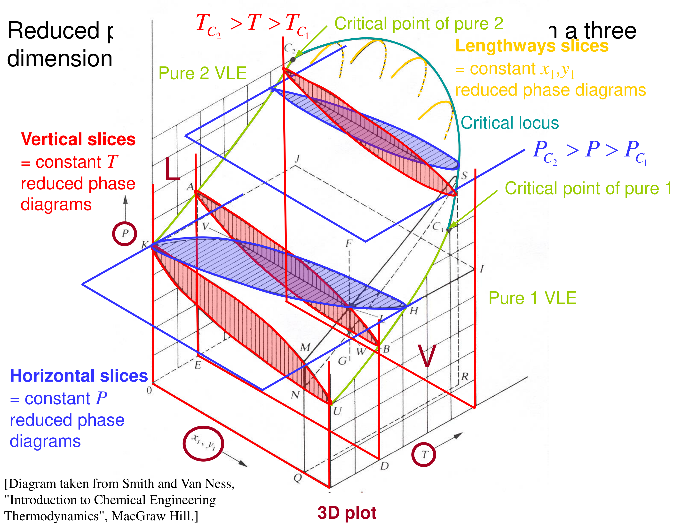
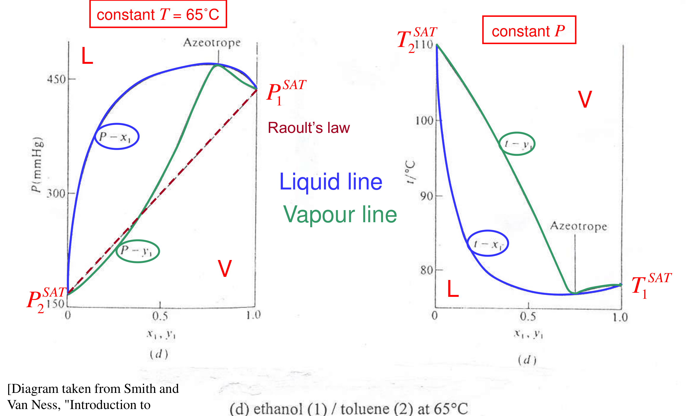

[Subject index](../README.md) · [Topic overview](README.md) · [Complete section](<Complete section.md>)

<!-- note-content:start -->
# Vapour–liquid equilibrium of real mixtures

## Overview

Vapour–liquid equilibrium of a binary is fixed by equal fugacities plus mass balances and drawn as constant-$`T`$ and constant-$`P`$ slices of a 3D surface, with bubble and dew curves joined by tie lines (Section 25). Writing each fugacity in measurable terms gives the γ–φ equation, which reduces at low pressure to modified Raoult's law and, for ideal liquids, Raoult's law (Section 26). Strong deviations bend the bubble curve until it turns over: an azeotrope, where vapour and liquid have the same composition and ordinary distillation stops (Section 27). Turned round, a measured azeotrope gives both activity coefficients and a complete van Laar model (Section 28).

*Assumed throughout:* fugacity and fugacity coefficients (Sections 07–08); activity coefficients and Gibbs–Duhem (Sections 10–11); the phase rule (Section 21); the models of Sections 17–20.

## Section 25: Binary vapour–liquid equilibrium and its phase diagrams

*Notation:* $`x_i`$ is the liquid mole fraction, $`y_i`$ the vapour mole fraction, and $`z_i`$ the overall (feed) mole fraction. $`L`$ and $`V`$ are the fractions of the total moles in the liquid and vapour.

### Intuition

When a liquid mixture partly boils, the vapour is richer in the more volatile component. That difference between $`y`$ and $`x`$ is what distillation exploits, stage after stage.

The phase rule says a binary in VLE has two degrees of freedom. Fix the temperature and you may still choose *either* the pressure *or* the liquid composition, but not both. Two compositions coexist at each pressure: the liquid on one curve, the vapour on another. Joining them gives a horizontal **tie line**.

### Derivation

**Step 1: the equations.** For each component $`i = 1,\dots,C`$:


**Equation (124)**

```math
T^{l} = T^{v}, \qquad P^{l} = P^{v}\ (\text{flat interface}), \qquad \bar f_i^{\,l} = \bar f_i^{\,v}
```


**Step 2: mass balances.** Per mole of feed of composition $`z_i`$:


**Equation (125)**

```math
Lx_i + Vy_i = z_i, \qquad \sum_i x_i = \sum_i y_i = 1, \qquad L + V = 1
```


Equations (124)–(125) are the entire framework. What changes between problems is only how $`\bar f_i`$ is written: activity coefficients for the liquid and fugacity coefficients for the vapour (next section).

**Step 3: the lever rule.** For a binary, (125) gives


**Equation (126)**

```math
\frac{L}{V} = \frac{y_1 - z_1}{z_1 - x_1}
```


The feed point splits the tie line in inverse proportion to the amounts of the two phases. A feed close to the liquid curve is mostly liquid.

Eliminate $`L`$ using $`L=1-V`$ in the component balance. The remaining equation is $`z_1-x_1=V(y_1-x_1)`$: the feed's enrichment above the liquid composition equals the vapour fraction times the vapour–liquid composition gap. This gives the lever rule and explains why $`z_1`$ must lie between $`x_1`$ and $`y_1`$ whenever both phase amounts are positive.

At the bubble point, the vapour amount tends to zero, so the liquid composition equals the feed composition. At the dew point the liquid amount tends to zero, so the vapour composition equals the feed composition. That is why the same $`z_i`$ enters two different equations in part (a). Between these limits the feed fixes the phase amounts; it is neither phase composition.

**Step 4: reduced phase diagrams.** The equilibrium states of a binary fill a 3D space ($`P`$, $`T`$, composition). The liquid and vapour surfaces bound a lens-shaped two-phase region, which ends at the critical locus joining the two pure-component critical points. Slicing it gives:
- Constant $`T`$ ($`P`$–$`x`$–$`y`$): the upper curve is the bubble-point (liquid) line, the lower the dew-point (vapour) line, running from $`P_2^{\mathrm{SAT}}`$ to $`P_1^{\mathrm{SAT}}`$.
- Constant $`P`$ ($`T`$–$`x`$–$`y`$): the curves are inverted. The liquid (bubble) line is now lower, running from $`T_1^{\mathrm{SAT}}`$ (the more volatile component boils first) to $`T_2^{\mathrm{SAT}}`$.




### Motivation and explanation

**Reading a $`T`$–$`x`$–$`y`$ diagram.** Heat a subcooled liquid of composition $`z_1`$ at constant $`P`$ (the vertical arrow).
1. It first boils where it meets the liquid line: the **bubble point**. The first bubble has the vapour composition on the same tie line, enriched in component 1.
2. On further heating, the liquid becomes poorer in 1 and both compositions slide along their curves.
3. The last drop disappears at the **dew point**, where the vapour has the feed composition.

Between the two, the lever rule (126) gives how much has vaporised.

**Why pressure-composition and temperature-composition curves differ.** At constant $`T`$, more volatile material raises the pressure. At constant $`P`$, it lowers the boiling temperature. So the diagrams are near mirror images, curved because vapour pressure depends exponentially on temperature.

**Limits.** These pictures assume a flat interface and that only two phases are present. Liquid immiscibility (a third phase) and near-critical behaviour change the topology; both are treated later.

### Worked example

**Problem.** A 50:50 benzene (1)–toluene (2) liquid is heated at 1 atm. Using Raoult's law with accurate vapour pressures, find (a) the bubble and dew temperatures, and (b) the phase compositions and fraction vaporised at 95 °C.

**(a)** The bubble point is where $`\sum_i z_iP_i^{\mathrm{SAT}}(T) = P`$. The dew point is where $`\sum_i z_i/P_i^{\mathrm{SAT}}(T) = 1/P`$. Solving numerically:
- bubble point 92.1 °C;
- dew point 98.7 °C.

Pure benzene boils at 80.1 °C and pure toluene at 110.6 °C.

**(b)** At 95 °C the equilibrium ratios are $`K_i = P_i^{\mathrm{SAT}}/P`$: $`K_1 = 1.550`$ and $`K_2 = 0.628`$. For a binary, $`x_1 = (1 - K_2)/(K_1 - K_2) = 0.404`$ and $`y_1 = K_1x_1 = 0.625`$. From (126), $`V = (z_1 - x_1)/(y_1 - x_1) = 0.43`$.

**Interpretation.** Partially vaporising the mixture at 95 °C gives a vapour of 62.5 % benzene from a 50 % feed, and the liquid that remains is 40 % benzene. Each such equilibrium stage enriches the vapour. The ratio $`K_1/K_2 = 2.47`$ (the relative volatility) measures how easily the pair separates, and it is what sets the number of stages in a column.

### Link to other topics

Equations (124)–(126) are exactly the "flash" calculation done by every process simulator, and the $`T`$–$`x`$–$`y`$ diagram is the starting point of McCabe–Thiele and other distillation design methods. Section 26 shows how the fugacities in (124) are written in practice, reducing to Raoult's law in the ideal limit.

### Summary

VLE of a binary is fixed by equal fugacities plus mass balances. Graphically it is a 3D surface whose constant-$`T`$ and constant-$`P`$ slices show bubble and dew curves joined by tie lines. The lever rule then gives the phase amounts, and the gap between vapour and liquid compositions is what makes distillation work.

## Section 26: The γ–φ formulation and Raoult's law

### Intuition

Each side of the equality is an "escaping tendency".
- *Liquid side:* the pure liquid's escaping tendency (its vapour pressure, slightly corrected), scaled by how much of it there is ($`x_i`$) and how unhappy it is in the mixture ($`\gamma_i`$).
- *Vapour side:* the partial pressure, corrected for non-ideal gas behaviour.

At low pressure the gas corrections are tiny and the liquid term is all that matters. That is why one non-ideality, $`\gamma_i`$, dominates ordinary distillation.

### Derivation

**Step 1: vapour side.** Assume the vapour is an ideal *mixture* (Lewis–Randall) but not necessarily an ideal *gas*:


**Equation (127)**

```math
\bar f_i^{\,v} = y_if_i^{\,v}(T,P) = y_i\phi_i^{v}P
```


where $`\phi_i^{v}`$ is the fugacity coefficient of pure $`i`$ vapour at $`T`$, $`P`$. A full mixture equation of state could replace this, at the cost of much more algebra.

**Step 2: liquid side.** By the definition of $`\gamma_i`$, $`\bar f_i^{\,l} = \gamma_ix_if_i^{\,l}(T,P)`$, with $`f_i^{\,l}`$ the pure liquid at the mixture's $`T`$ and $`P`$.

**Step 3: pure-liquid fugacity.** Start from saturation, where liquid and vapour fugacities are equal ($`f_i^{\mathrm{SAT}} = \phi_i^{\mathrm{SAT}}P_i^{\mathrm{SAT}}`$). Then compress the incompressible liquid to $`P`$ (the Poynting factor):


**Equation (128)**

```math
f_i^{\,l}(T,P) = \phi_i^{\mathrm{SAT}}P_i^{\mathrm{SAT}}\exp\!\left[\frac{\underline{V}_i^{l}(P - P_i^{\mathrm{SAT}})}{RT}\right]
```


**Step 4: equate.**


**Equation (129)**

```math
\gamma_ix_i\,\phi_i^{\mathrm{SAT}}P_i^{\mathrm{SAT}}\exp\!\left[\frac{\underline{V}_i^{l}(P - P_i^{\mathrm{SAT}})}{RT}\right] = y_i\phi_i^{v}P
```


**Step 5: low pressure.** Set $`\phi_i^{\mathrm{SAT}}\approx\phi_i^{v}\approx 1`$ and drop the Poynting factor. This gives **modified Raoult's law**:


**Equation (130)**

```math
\gamma_ix_iP_i^{\mathrm{SAT}} = y_iP
```


**Step 6: ideal liquid mixture.** Setting $`\gamma_i = 1`$ gives **Raoult's law**. Summing over components, with $`\sum y_i = 1`$, gives the bubble pressure:


**Equation (131)**

```math
x_iP_i^{\mathrm{SAT}} = y_iP, \qquad P = \sum_i x_iP_i^{\mathrm{SAT}}
```


On a $`P`$–$`x`$–$`y`$ diagram at constant $`T`$, the bubble line is then straight: the sum of the two straight partial-pressure lines $`x_1P_1^{\mathrm{SAT}}`$ and $`x_2P_2^{\mathrm{SAT}}`$. The dew line, $`1/P = \sum y_i/P_i^{\mathrm{SAT}}`$, is curved.

A bubble calculation starts with liquid composition and sums the predicted vapour fractions to unity. A dew calculation starts with vapour composition, writes $`x_i=y_iP/P_i^{\mathrm{SAT}}`$, and instead sums the liquid fractions to unity. This change of which phase is known produces the reciprocal-pressure dew equation; it is not an independent equilibrium law.

The use of pure-vapour $`\phi_i^{v}`$ in (127) is also a modelling step. A full vapour-mixture coefficient depends on the composition of that vapour because unlike gas molecules interact. At sufficiently low density those interactions disappear and both versions approach unity. Low pressure simplifies the vapour description without requiring ideal mixing in the dense liquid.


### Motivation and explanation

**Hierarchy of approximations.**

| Equation | Neglects | Valid when |
|---|---|---|
| (129) | vapour-mixture non-ideality (Lewis–Randall) | up to moderate pressure, chemically similar vapours |
| (130) | gas non-ideality and the Poynting factor | $`P`$ ≲ a few bar |
| (131) | liquid non-ideality | chemically similar liquids (isomers, homologues) |

**Why $`\phi^{\mathrm{SAT}}`$ and $`\phi^{v}`$ partly cancel.** At the same $`T`$ and similar pressures, the two vapour-phase fugacity coefficients in (129) are similar. Their ratio is closer to 1 than either is alone. So (130) is often better than the individual corrections suggest.

**Deviations from Raoult.**
- $`\gamma_i > 1`$: total pressure above the straight Raoult line (positive deviation).
- $`\gamma_i < 1`$: below it (negative deviation).

These are the curved bubble lines of real mixtures (next section).

### Worked example

**Problem.** For an equimolar benzene (1)–toluene (2) liquid at 90 °C, find the Raoult's-law bubble pressure and vapour composition, and the size of each correction in (129). Data: $`P_1^{\mathrm{SAT}} = 1.362`$ bar, $`P_2^{\mathrm{SAT}} = 0.543`$ bar; $`\underline{V}_1^{l} = 97.4`$ and $`\underline{V}_2^{l} = 115.2`$ cm³ mol⁻¹; $`\phi_1^{\mathrm{SAT}} = 0.960`$, $`\phi_2^{\mathrm{SAT}} = 0.975`$.

**Raoult's law (131).** $`P = 0.5(1.362) + 0.5(0.543) = 0.953`$ bar, and $`y_1 = 0.5\times1.362/0.953 = 0.715`$.

**Corrections.**
- *Poynting factor at 0.953 bar:* benzene 0.9987, toluene 1.0016. Both differ from 1 by under 0.2 %, with opposite signs, because benzene's liquid is *below* and toluene's *above* its own saturation pressure.
- *Saturation fugacity coefficients:* 4 % and 2.5 % below 1, but they are largely cancelled by $`\phi_i^{v}`$ at a similar pressure in (129).

**Interpretation.** For similar, non-polar liquids near atmospheric pressure, every correction in (129) is at the percent level or below, so Raoult's law is a good first estimate. For chemically different liquids, $`\gamma_i`$ easily reaches 2–20, an order of magnitude larger than all the other corrections. Getting $`\gamma`$ right is what matters.

### Link to other topics

Equation (130) is the default VLE model in distillation design, combined with any of the activity-coefficient models in Sections 17–20. At high pressure or near critical points, the γ–φ approach is replaced by a single equation of state for both phases, discussed later.

### Summary

Equating fugacities gives the γ–φ equation (129). At low pressure it reduces to modified Raoult's law, $`\gamma_ix_iP_i^{\mathrm{SAT}} = y_iP`$, and for ideal liquids to Raoult's law with a straight bubble line. Gas-phase and Poynting corrections are usually small, and the activity coefficient carries the important non-ideality.

## Section 27: Deviations from Raoult's law and azeotropes

### Intuition

With positive deviation, each component "wants out" of the liquid more than Raoult predicts, so the mixture's vapour pressure exceeds the straight line. If the two pure vapour pressures are close, this bulge can rise above *both* end points. Then the curve must have a maximum somewhere in between.

At that maximum, adding a little of either component lowers the pressure. The vapour therefore cannot be richer in either component than the liquid: it has the same composition. Distilling such a mixture drives the products towards the azeotrope, not towards the pure components.

*Molecular picture.*
- A *maximum-pressure* (minimum-boiling) azeotrope comes from unlike molecules disrupting each other's attractions, e.g. toluene breaking up ethanol's hydrogen-bond network.
- A *minimum-pressure* (maximum-boiling) azeotrope comes from unlike molecules attracting strongly, e.g. the hydrogen bond between chloroform's C–H and tetrahydrofuran's oxygen.

### Derivation

**Step 1: pressure–composition slope.** For a binary at constant $`T`$, (130) of Section 26 summed over components gives $`P = x_1\gamma_1P_1^{\mathrm{SAT}} + x_2\gamma_2P_2^{\mathrm{SAT}}`$. Differentiate with respect to $`x_1`$, using $`dx_2 = -dx_1`$:


```math
\frac{dP}{dx_1} = \gamma_1P_1^{\mathrm{SAT}}\left(1 + x_1\frac{d\ln\gamma_1}{dx_1}\right) + \gamma_2P_2^{\mathrm{SAT}}\left(-1 + x_2\frac{d\ln\gamma_2}{dx_1}\right)
```


**Step 2: Gibbs–Duhem.** Substitute $`x_2\,d\ln\gamma_2/dx_1 = -x_1\,d\ln\gamma_1/dx_1`$:


**Equation (132)**

```math
\frac{dP}{dx_1} = \left(\gamma_1P_1^{\mathrm{SAT}} - \gamma_2P_2^{\mathrm{SAT}}\right)\left(1 + x_1\frac{d\ln\gamma_1}{dx_1}\right)
```


**Step 3: turning points.** $`dP/dx_1 = 0`$ requires one of two conditions.
- (a) $`\gamma_1P_1^{\mathrm{SAT}} = \gamma_2P_2^{\mathrm{SAT}}`$: an **azeotrope**.
- (b) $`1 + x_1\,d\ln\gamma_1/dx_1 = 0`$, i.e. $`d\ln(\gamma_1x_1)/dx_1 = 0`$. The activity of component 1 stops increasing with its own mole fraction. This marks the spinodal, the limit of local liquid stability. Equilibrium splitting begins at the binodal; between binodal and spinodal the homogeneous liquid is metastable (later sections).

The second factor in (132) is the thermodynamic factor: it measures whether increasing a component's concentration raises its chemical potential. For a locally stable homogeneous liquid it is positive. A pressure maximum or minimum on that stable branch must therefore come from equality of the two corrected volatilities, the first factor. Setting the second factor to zero instead reaches the limit of local stability and cannot by itself identify an ordinary homogeneous azeotrope.

At an azeotrope the liquid and vapour are still distinct phases, but transferring an equilibrium increment into the vapour does not change its composition relative to the liquid. The enrichment that drives ordinary distillation vanishes. The close-boiling example needs only a modest correction to make the two corrected volatilities equal because their uncorrected saturation pressures were already close.

**Step 4: $`x = y`$ at an azeotrope.** From modified Raoult's law, $`y_1P = x_1\gamma_1P_1^{\mathrm{SAT}}`$ and $`P = x_1\gamma_1P_1^{\mathrm{SAT}} + x_2\gamma_2P_2^{\mathrm{SAT}}`$. With condition (a), $`P = \gamma_1P_1^{\mathrm{SAT}}(x_1 + x_2) = \gamma_1P_1^{\mathrm{SAT}}`$, so


**Equation (133)**

```math
y_1 = x_1
```


**Step 5: phase-rule consequence.** Equation (133) is an extra constraint. An azeotropic binary therefore has only $`F = 2 - 2 + 2 - 1 = 1`$ degree of freedom: at a given pressure the azeotrope has one temperature and one composition, like a pure substance.

**Step 6: will an azeotrope form? (one-constant Margules).** With $`RT\ln\gamma_1 = Ax_2^2`$ and $`RT\ln\gamma_2 = Ax_1^2`$, condition (a) becomes $`A(x_2^2 - x_1^2) = RT\ln(P_2^{\mathrm{SAT}}/P_1^{\mathrm{SAT}})`$. Since $`x_2^2 - x_1^2 = 1 - 2x_1`$:


**Equation (134)**

```math
x_1^{\mathrm{az}} = \frac12\left[1 - \frac{RT}{A}\ln\frac{P_2^{\mathrm{SAT}}}{P_1^{\mathrm{SAT}}}\right]
```


A candidate homogeneous azeotrope exists if $`0 < x_1^{\mathrm{az}} < 1`$, i.e. if $`|A|/RT > |\ln(P_1^{\mathrm{SAT}}/P_2^{\mathrm{SAT}})|`$; the liquid at that composition must also be stable against liquid–liquid splitting. Strong non-ideality, or *close* vapour pressures, makes azeotropes likely.

### Motivation and explanation

**The four behaviours, at 30–65 °C.**
1. **Mild negative deviation** (tetrahydrofuran–CCl₄): the curves sag slightly below Raoult's line and lie close together. Distillation is possible but difficult.
2. **Strong negative deviation** (chloroform–THF): a minimum-pressure, maximum-boiling azeotrope near $`x_1 = 0.5`$, matching the 1:1 hydrogen bond.
3. **Mild positive deviation** (furan–CCl₄): the curves lie above Raoult's line and wide apart. Distillation is easy.
4. **Strong positive deviation** (ethanol–toluene): a maximum-pressure, minimum-boiling azeotrope.




**Distillation and azeotropes.** On a $`T`$–$`x`$–$`y`$ diagram, a minimum-boiling azeotrope is a low point. Feeds on either side distil towards it overhead; only one pure component can be recovered as bottoms from each side. Past the azeotrope the vapour is *richer* in the less volatile component.


**Breaking an azeotrope** needs an extra degree of freedom:
- *Change the pressure* (pressure-swing distillation): the azeotropic composition shifts with $`P`$.
- *Add a component:* an entrainer forming a ternary heterogeneous azeotrope (e.g. benzene or cyclohexane for ethanol–water), or a heavy solvent that changes the $`\gamma`$'s (extractive distillation).

### Worked example

**Problem.** Benzene (1) and cyclohexane (2) boil at 80.1 °C and 80.7 °C. Use regular solution theory (Section 17) and (134) to decide whether they form an azeotrope at 1 atm, and estimate its temperature and composition.

**Model.** RST at 25 °C gave $`\ln\gamma^{\infty}`$ = 0.171 and 0.140 for this pair. Average them into a one-constant Margules parameter:


```math
A = \tfrac12 RT(0.171 + 0.140) = 385\ \text{J mol}^{-1}
```


This is treated as independent of temperature, as a regular solution assumes.

**At 78 °C.** $`P_1^{\mathrm{SAT}} = 0.944`$ bar and $`P_2^{\mathrm{SAT}} = 0.927`$ bar, so $`|\ln(P_1^{\mathrm{SAT}}/P_2^{\mathrm{SAT}})| = 0.018 \ll A/RT = 0.132`$. An azeotrope must exist. Equation (134) gives $`x_1^{\mathrm{az}}\approx 0.57`$.

**At 1 atm.** Solving (134) together with $`P = \gamma_1P_1^{\mathrm{SAT}} = 1.01325`$ bar for $`T`$ gives a minimum-boiling azeotrope at about **79.3 °C** and $`x_{\mathrm{benzene}}\approx 0.57`$. The tabulated value is 77.8 °C.

**Interpretation.** Starting from pure-component data only (heats of vaporisation and densities), we correctly predict that two liquids boiling 0.6 K apart form a minimum-boiling azeotrope about 1–2 K below both. RST underestimates the non-ideality here, so the predicted azeotrope is not deep enough. The discrepancy shows the limits of a random-mixing model based on a single cohesive-energy parameter; identifying its detailed molecular cause would require additional evidence. The lesson is general. Close-boiling pairs with even modest non-ideality almost always azeotrope.

### Link to other topics

Azeotropes set the feasible products of distillation columns and are central to separation-sequence design (residue curve maps, entrainer selection). The second factor in (132) reappears in the liquid–liquid equilibrium sections as the stability condition.

### Summary

Positive and negative deviations from Raoult's law bend the bubble curve. If the bend exceeds the difference in pure-component volatilities, $`\gamma_1P_1^{\mathrm{SAT}} = \gamma_2P_2^{\mathrm{SAT}}`$ somewhere: an azeotrope, with $`x = y`$ and one fewer degree of freedom, which ordinary distillation cannot cross.

## Section 28: Worked example, van Laar parameters from an azeotrope

*Components:* n-pentane (1), propanal (2).

### Intuition

At an azeotrope, modified Raoult's law collapses. The $`y_i`$ and $`x_i`$ cancel, leaving $`\gamma_i = P/P_i^{\mathrm{SAT}}`$: one measured pressure gives both activity coefficients. Two numbers fix two model constants. Everything else on the curve is then a *prediction*, and its accuracy depends on how well the model's shape matches the real mixture away from the single point used.

### Derivation

**Step 1: $`\gamma`$'s at the azeotrope.** From $`\gamma_ix_iP_i^{\mathrm{SAT}} = y_iP`$ with $`x_i = y_i`$:


**Equation (135)**

```math
\gamma_1^{\mathrm{az}} = \frac{P^{\mathrm{az}}}{P_1^{\mathrm{SAT}}}, \qquad \gamma_2^{\mathrm{az}} = \frac{P^{\mathrm{az}}}{P_2^{\mathrm{SAT}}}
```


**Step 2: van Laar.**


**Equation (136)**

```math
\ln\gamma_1 = \frac{\alpha}{\left(1 + \dfrac{\alpha x_1}{\beta x_2}\right)^2}, \qquad \ln\gamma_2 = \frac{\beta}{\left(1 + \dfrac{\beta x_2}{\alpha x_1}\right)^2}
```


**Step 3: invert for the constants.** Let $`u = \alpha x_1/(\beta x_2)`$. Then (136) reads $`\ln\gamma_1 = \alpha/(1+u)^2`$ and $`\ln\gamma_2 = \beta u^2/(1+u)^2`$. Dividing the second by the first gives $`\ln\gamma_2/\ln\gamma_1 = (\beta/\alpha)u^2 = u\,x_1/x_2`$, so $`u = x_2\ln\gamma_2/(x_1\ln\gamma_1)`$. Substituting back into the two expressions:

Introducing $`u`$ gives the two activity-coefficient equations the same denominator. Taking their ratio cancels that denominator, reducing the coupled fit to a directly calculable ratio followed by two substitutions. The choice is useful because trying to solve separately for each constant leaves the other constant inside its denominator.

Although this uses one azeotropic composition, it supplies two component conditions: each component's activity is fixed by its own saturation pressure and the common measured pressure. Those conditions determine the constants *within the chosen model*. They do not determine every possible Gibbs-energy curve, which is why matching the azeotrope exactly still leaves a substantive error at the propanal-rich test composition.


**Equation (137)**

```math
\alpha = \ln\gamma_1\left(1 + \frac{x_2\ln\gamma_2}{x_1\ln\gamma_1}\right)^2, \qquad \beta = \ln\gamma_2\left(1 + \frac{x_1\ln\gamma_1}{x_2\ln\gamma_2}\right)^2
```


*Check:* substituting (137) back into (136) reproduces the input $`\gamma`$'s. The fitted model's $`P`$–$`x`$ curve also has zero slope at $`x_1^{\mathrm{az}}`$, as it must; both were verified numerically.

**Step 4: predict.** At any other $`x_1`$, compute $`\gamma_1`$ and $`\gamma_2`$ from (136), then the bubble pressure


**Equation (138)**

```math
P = x_1\gamma_1P_1^{\mathrm{SAT}} + x_2\gamma_2P_2^{\mathrm{SAT}}, \qquad y_1 = \frac{x_1\gamma_1P_1^{\mathrm{SAT}}}{P}
```


### Worked example

**Data (40 °C).** $`P_1^{\mathrm{SAT}} = 1.1541`$ bar (n-pentane), $`P_2^{\mathrm{SAT}} = 0.7609`$ bar (propanal). Azeotrope at $`x_1 = 0.682`$, $`P = 1.364`$ bar. Measured bubble pressure at $`x_1 = 0.1647`$: 1.1622 bar.


**(135) Azeotropic $`\gamma`$'s.** $`\gamma_1 = 1.364/1.1541 = 1.182`$ and $`\gamma_2 = 1.364/0.7609 = 1.793`$.

**(137) Constants.** $`\alpha = 1.155`$, $`\beta = 1.520`$, so $`\gamma_1^{\infty} = 3.17`$ and $`\gamma_2^{\infty} = 4.57`$. This is a strongly positive deviation: polar propanal and non-polar pentane dislike each other.

**(138) Prediction at $`x_1 = 0.1647`$.** $`\gamma_1 = 2.395`$, $`\gamma_2 = 1.026`$, so


```math
P = 0.1647(2.395)(1.1541) + 0.8353(1.026)(0.7609) = 1.107\ \text{bar}, \qquad y_1 = 0.41
```


**Comparison.** Measured 1.1622 bar, so the prediction is 4.7 % low. As a fraction of the pressure range of the diagram ($`P^{\mathrm{az}} - P_2^{\mathrm{SAT}} = 0.603`$ bar), the error is 9 %.

**Cross-check with a different model.** A two-constant Margules model fitted to the same azeotrope gives 1.102 bar (5.2 % low). Both models, fitted to the same single point, err in the same direction.

### Motivation and explanation

**Why the error?**
1. *One data point.* Both constants come from the azeotrope at $`x_1 = 0.68`$; the prediction is far away at $`x_1 = 0.16`$. Any model fitted at one point is only an interpolation scheme with an assumed shape. Two different shapes (van Laar, Margules) both under-predict, so the real $`\gamma_1`$ in the propanal-rich region must be larger than either shape allows.
2. *Polar component.* Propanal's dipole gives specific interactions with orientational (non-random) structure. Van Laar's random-mixing, van der Waals origin is poorly suited to that. A local-composition model (Wilson, NRTL) fitted to several points would do better.
3. *Small effects.* At about 1 bar, the vapour-phase and Poynting corrections are around 1 %. They are not the main cause.

**How to do better.** Fit to data spread across the composition range, or add infinite-dilution values (ebulliometry, Section 14) at both ends.

**Strength of the method.** Despite its limits, one azeotrope measurement gave a model correct to about 5 % in pressure, with no composition analysis of the vapour at all. That is useful for screening.

### Link to other topics

The same calculation (activity coefficients from measured $`P`$–$`x`$ data, then a fitted model) is how binary interaction parameters in process simulators are generated. Predicting $`y_1`$ (0.41 here, against a liquid of 0.16) gives the relative volatility needed for distillation design.

### Summary

At an azeotrope, $`\gamma_i = P/P_i^{\mathrm{SAT}}`$, which fixes both van Laar constants from a single measurement ($`\alpha = 1.155`$, $`\beta = 1.520`$ for pentane–propanal at 40 °C). The resulting model predicts the bubble pressure elsewhere to about 5 %. The residual error reflects fitting a two-parameter shape at one point to a polar mixture, not the low-pressure approximations.

## Conclusion

At low pressure, vapour–liquid equilibrium is $`y_iP = x_i\gamma_iP_i^{\mathrm{SAT}}`$, and the activity coefficient carries the important non-ideality. Large enough deviations produce azeotropes, which limit distillation but also provide a cheap measurement of $`\gamma`$. The next part deals with components that cannot exist as pure liquids at the conditions of interest: supercritical gases dissolved in liquids.
<!-- note-content:end -->

[Subject index](../README.md) · [Topic overview](README.md) · [Complete section](<Complete section.md>)
