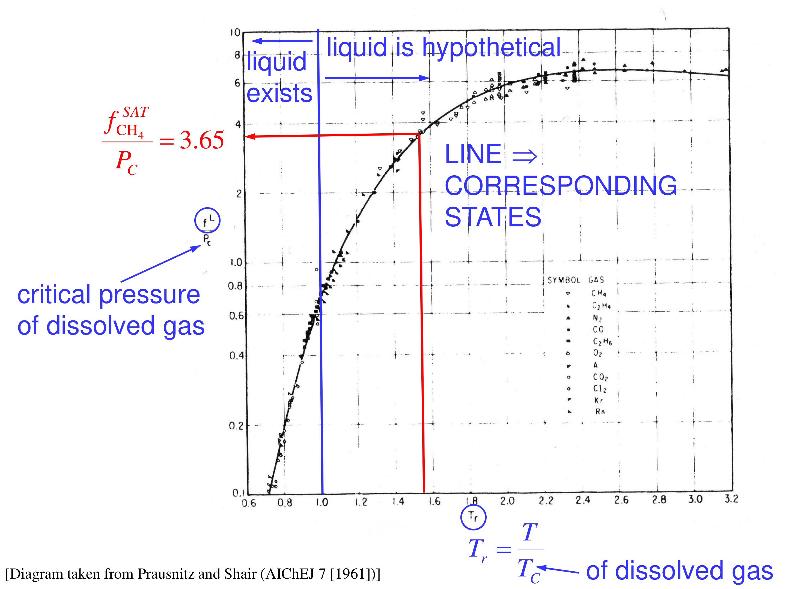

[Previous](<ET-29 - Gas solubility, the hypothetical liquid and ideal solubility.md>) · [Subject index](../README.md) · [Topic overview](README.md) · [Complete section](<Complete section.md>) · [Next](<ET-31 - Henry's law and the Henry standard state.md>)

<!-- note-content:start -->
# Section 30: Worked example, solubility of methane

## Intuition

Methane at 25 °C is far above its critical temperature (−82.6 °C), so its hypothetical liquid is extremely "volatile". Even ideally, it dissolves only at the parts-per-thousand level at 10 bar. The solvents are all non-polar, so methane should be modestly unhappy in each ($`\gamma > 1`$), most so in the solvent least like itself.

## Derivation

**Problem.** At $`T = 25`$ °C and $`P = 10.13`$ bar, a gas of $`y_{\mathrm{CH_4}} = 0.1`$ (rest nitrogen) is in equilibrium with each solvent. Measured methane mole fractions: benzene $`2.07\times10^{-3}`$, CCl₄ $`2.86\times10^{-3}`$, cyclohexane $`2.83\times10^{-3}`$. Critical constants: CH₄ $`T_c = 190.6`$ K, $`P_c = 46.0`$ bar; N₂ $`T_c = 126.2`$ K, $`P_c = 33.9`$ bar.

**Step 1: vapour fugacity.** Both gases have $`T\gg T_c`$ and $`P\ll P_c`$, so treat the vapour as an ideal-gas mixture:

```math
\bar f^{\,v}_{\mathrm{CH_4}} = y_{\mathrm{CH_4}}P = 1.013\ \text{bar}.
```

Nitrogen is assumed not to affect methane's solubility (each gas dissolves independently at these dilutions).

The gas supplies methane according to its partial fugacity, not according to the pressure gauge alone. In the ideal-gas approximation, increasing nitrogen at fixed methane partial pressure raises total pressure without increasing methane's dissolution driving force. Increasing total pressure at fixed gas composition does increase that force. Stating what is fixed is essential when using the example to predict the effect of pressurisation.

All three solvent measurements use the same gas-side methane fugacity and the same hypothetical-liquid reference. Their different dissolved mole fractions therefore isolate the solvent effect in $`\gamma`$. A common uncertainty in the chart shifts all the inferred coefficients together; it cannot account for the measured ordering of the solvents.

**Step 2: hypothetical liquid fugacity.** $`T_r = 298.2/190.6 = 1.56`$. The chart gives $`f^{\,l}/P_c\approx 3.65`$, so $`f^{\,l}_{\mathrm{CH_4}}\approx 3.65\times46.0 = 168`$ bar. This is a value read from a graph.



**Step 3: ideal solubility.**

```math
x^{\mathrm{ideal}}_{\mathrm{CH_4}} = \frac{1.013}{167.9} = 6.03\times10^{-3}
```


**Step 4: activity coefficients and Henry's constants.** $`\gamma = x^{\mathrm{ideal}}/x`$, and $`\bar f^{\,v}/x`$ is the apparent Henry's constant (Section 31):

| Solvent | $`x_{\mathrm{CH_4}}`$ | $`\gamma_{\mathrm{CH_4}}`$ | $`\bar f^{\,v}/x`$ (bar) |
|---|---|---|---|
| benzene | $`2.07\times10^{-3}`$ | 2.91 | 489 |
| CCl₄ | $`2.86\times10^{-3}`$ | 2.11 | 354 |
| cyclohexane | $`2.83\times10^{-3}`$ | 2.13 | 358 |

## Motivation and explanation

**All $`\gamma > 1`$.** Methane is less soluble in every solvent than an ideal mixture would allow. As small, weakly attracting molecules, methane pays to break the stronger solvent–solvent attractions in order to fit in.

**Why benzene is the worst solvent.** In regular-solution terms, $`\ln\gamma\propto(\delta_{\mathrm{CH_4}} - \delta_{\mathrm{solvent}})^2`$. Methane's (hypothetical-liquid) solubility parameter is low. Benzene has the highest $`\delta`$ of the three (18.7 MPa^½ against 16.8 for cyclohexane, Section 17), so it is the most unlike methane and dissolves it least. Cyclohexane and CCl₄ have similar, lower $`\delta`$'s and almost equal $`\gamma`$'s.

**Accuracy.** $`f^{\,l}`$ comes from a correlation read off a log-scale chart, so the absolute $`\gamma`$'s carry several percent uncertainty. The *ratios* between solvents do not depend on $`f^{\,l}`$ at all, since they come straight from the measured $`x`$'s. The ranking is therefore robust.

**Assumptions to check.**
- Ideal-gas vapour: at 10 bar and $`T_r = 1.56`$, a representative pure-methane fugacity coefficient is about 0.98, suggesting a correction of a few percent. The methane fugacity coefficient in the nitrogen-rich mixture requires a mixture EOS.
- No nitrogen effect: reasonable at mole fractions of $`10^{-3}`$.
- Solvent vapour in the gas phase: neglected. Benzene's vapour pressure at 25 °C is about 0.13 bar, small compared with 10 bar.

## Link to other topics

The same calculation sizes absorbers for natural-gas processing. The apparent Henry's constants in the table are what designers usually tabulate, which is the motivation for the Henry's-law standard state in the next section.

## Summary

At 25 °C and 1.01 bar partial pressure, methane's hypothetical liquid fugacity of about 168 bar gives an ideal solubility of $`6.0\times10^{-3}`$. Measured solubilities are 2–3 times lower, giving $`\gamma_{\mathrm{CH_4}}`$ = 2.1–2.9, with benzene the least favourable solvent because its cohesive energy differs most from methane's.
<!-- note-content:end -->

[Previous](<ET-29 - Gas solubility, the hypothetical liquid and ideal solubility.md>) · [Subject index](../README.md) · [Topic overview](README.md) · [Complete section](<Complete section.md>) · [Next](<ET-31 - Henry's law and the Henry standard state.md>)
