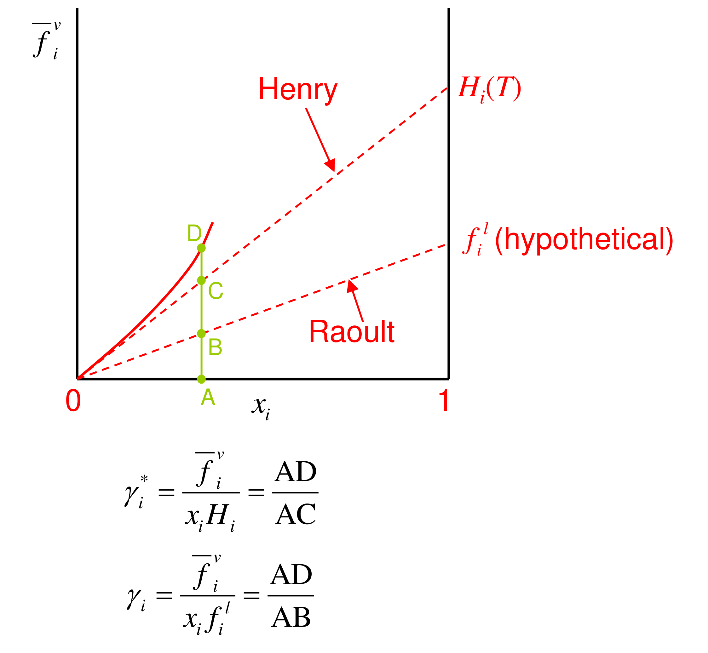

[Previous](<ET-30 - Worked example, solubility of methane.md>) · [Subject index](../README.md) · [Topic overview](README.md) · [Complete section](<Complete section.md>)

<!-- note-content:start -->
# Section 31: Henry's law and the Henry standard state

## Intuition

A dilute solute molecule is surrounded entirely by solvent. Adding a few more solute molecules does not change that environment, so each behaves the same, and the escaping tendency is simply proportional to how many there are. The proportionality constant reflects how comfortable one solute molecule is among solvent molecules. That is exactly the infinite-dilution activity coefficient times the pure-liquid fugacity.

Raoult's law is the opposite limit: the *solvent*, nearly pure, behaves as if it were alone. Every dilute binary obeys Raoult for the solvent and Henry for the solute at the same time, and Gibbs–Duhem guarantees the two are consistent.

## Derivation

**Step 1: dilute limit.** As $`x_i\to 0`$, $`\gamma_i\to\gamma_i^{\infty}`$, a constant at fixed $`T`$ (and pressure, to a good approximation). Then


**Equation (142)**

```math
\bar f_i = \gamma_ix_if_i^{\,l}\;\to\;x_i\,\gamma_i^{\infty}f_i^{\,l}\equiv x_iH_i(T)
```


**Equation (143)**

```math
H_i = \gamma_i^{\infty}f_i^{\,l}
```


$`H_i`$ has units of pressure and depends on $`T`$ and on both the solute and the solvent. It can be measured directly as $`\lim_{x_i\to0}\bar f_i/x_i`$, without ever constructing $`f_i^{\,l}`$.

**Step 2: a new standard state.** The conventional activity uses the pure liquid as reference, $`a_i = x_i\gamma_i = \bar f_i/f_i^{\,l}`$, so $`a_i = 1`$ for pure $`i`$. Instead, use $`H_i`$ as the reference fugacity:


**Equation (144)**

```math
a_i^{*} = x_i\gamma_i^{*} = \frac{\bar f_i}{H_i} \qquad\Rightarrow\qquad \bar f_i = \gamma_i^{*}x_iH_i
```


**Step 3: how the two activity coefficients relate.** Dividing (144) by $`\bar f_i = \gamma_ix_if_i^{\,l}`$ and using (143):


**Equation (145)**

```math
\gamma_i^{*} = \frac{\gamma_i}{\gamma_i^{\infty}}
```


So $`\gamma_i^{*}\to 1`$ as $`x_i\to 0`$, while $`\gamma_i\to 1`$ as $`x_i\to 1`$. The two conventions are normalised at opposite ends.

Normalising the dilute coefficient to unity does not remove the solute–solvent interactions. It puts their dilute-limit effect into $`H_i`$ and the corresponding standard chemical potential. A poorly soluble gas can therefore obey Henry's law very accurately while having a large Henry constant: every solute molecule experiences the same unfavourable environment, so the response is linear even though dissolution is difficult.

For the pressure-over-mole-fraction convention used here, $`x_i=\bar f_i/H_i`$ at fixed temperature. A larger $`H_i`$ means less dissolved gas at a given fugacity. Other tabulations use the reciprocal convention, so the stated units and defining relation matter as much as the name of the constant.

**Step 4: graphical meaning.** On a plot of $`\bar f_i`$ against $`x_i`$:
- Henry's law is the tangent at $`x_i = 0`$, reaching $`H_i`$ at $`x_i = 1`$;
- Raoult's law (ideal mixture) is the straight line to $`f_i^{\,l}`$.

At any composition A, with the real curve at D, the Henry line at C and the Raoult line at B: $`\gamma_i^{*} = AD/AC`$ and $`\gamma_i = AD/AB`$.



## Motivation and explanation

**Why switch reference.** For a supercritical gas, $`f_i^{\,l}`$ is hypothetical and must come from an extrapolation or correlation (Section 29). $`H_i`$ is measured directly in the dilute region where the gas actually lives, and then $`\gamma_i^{*}\approx 1`$. Any standard state is allowed, as long as it is used consistently.

**Temperature dependence.** $`\ln H_i`$ usually varies with $`1/T`$ through the enthalpy of solution (a van 't Hoff form). For permanent gases in water near room temperature, dissolution is exothermic, so $`H`$ falls and solubility rises as temperature falls. That is why cold water holds more oxygen.

**Limits.** Henry's law is a limiting law. It fails as $`x_i`$ grows (then $`\gamma_i^{*}\neq 1`$) and for gases that react or ionise in the solvent: CO₂, NH₃ and SO₂ in water dissolve far beyond the Henry value because of the chemistry. At high pressure, the gas-phase fugacity and the pressure dependence of $`H`$ (through the partial molar volume of the solute) must be included.

## Link to other topics

Henry's constants are the standard input for absorber and stripper design and for gas–liquid mass transfer in bioreactors, where the oxygen saturation concentration sets the transfer driving force. The infinite-dilution activity coefficient in (143) links back to ebulliometry (Section 14), which measures it for condensable solutes.

## Summary

In the dilute limit the solute fugacity is linear in mole fraction, $`\bar f_i = x_iH_i`$, with $`H_i = \gamma_i^{\infty}f_i^{\,l}`$. Using $`H_i`$ as the standard state removes the need for a hypothetical liquid and gives an activity coefficient $`\gamma_i^{*}`$ that is 1 at infinite dilution. Applied to air and water, it predicts the familiar ~9 mg L⁻¹ of dissolved oxygen and its rise on cooling.

## Conclusion

Gas solubility is ordinary phase equilibrium with an awkward reference state. The hypothetical liquid gives an ideal solubility and activity coefficients; Henry's constant avoids the hypothetical state and is the standard design input, predicting for example about 9 mg L⁻¹ of dissolved oxygen in water at 25 °C. The next part moves to high pressure, where vapour and liquid approach each other near critical points.
<!-- note-content:end -->

[Previous](<ET-30 - Worked example, solubility of methane.md>) · [Subject index](../README.md) · [Topic overview](README.md) · [Complete section](<Complete section.md>)
