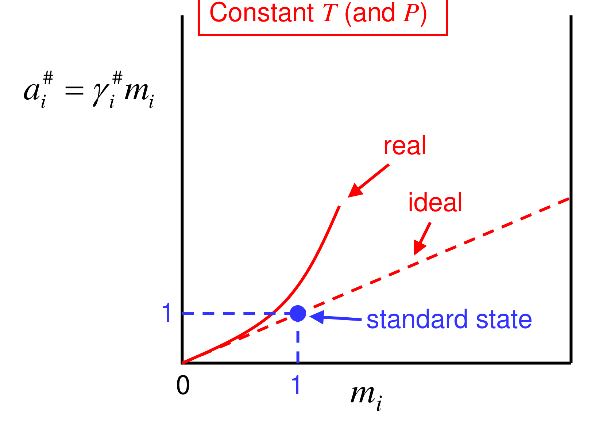

[Subject index](../README.md) · [Topic overview](README.md) · [Complete section](<Complete section.md>) · [Next](<ET-35 - Ionic solutions, mean activity coefficients and Debye–Hückel theory.md>)

<!-- note-content:start -->
# Section 34: Dissolved solids and the molality standard state

*Notation:* $`m_i`$ is the molality of solute $`i`$ (mol per kg of solvent), $`m^{\circ}=1`$ mol kg⁻¹ is the standard molality, and $`M_s`$ is the solvent molar mass in kg mol⁻¹. $`\gamma_i^{\#}`$ is the molality-scale activity coefficient and $`a_i^{\#}=\gamma_i^{\#}m_i/m^{\circ}`$ the dimensionless molality-scale activity. $`\mu_i^{\circ}`$ is the standard chemical potential on this scale.

## Intuition

For a solute, the natural "ideal" behaviour is the dilute one: each molecule is surrounded only by solvent, so its escaping tendency is proportional to its concentration (Henry-like). Molality is used rather than mole fraction because it is easy to make up by weighing, and it does not change with temperature (unlike molarity, which changes as the solution expands).

The standard state is then: *the solute at 1 mol kg⁻¹, but behaving as if it were still infinitely dilute.* It is reached by extending the dilute straight line to $`m = 1`$, so it is hypothetical. A real 1 mol kg⁻¹ solution is generally not ideal.

## Derivation

**Step 1: the definition.**


**Equation (147)**

```math
\mu_i = \mu_i^{\circ} + RT\ln\left(\gamma_i^{\#}\,\frac{m_i}{m^{\circ}}\right), \qquad \gamma_i^{\#}\to 1 \text{ as } m_i\to 0
```


with $`m^{\circ} = 1`$ mol kg⁻¹, so the logarithm's argument is dimensionless. $`\mu_i^{\circ}`$ is the chemical potential the solute would have at unit molality if it stayed ideally dilute.

**Step 2: link to mole fraction.** For solvent of molar mass $`M_s`$, $`x_i = m_iM_s/(1 + \sum_jm_jM_s)`$, so in the dilute limit $`x_i\approx M_sm_i`$. Dilute ideality in molality is therefore the same physics as Henry's law: $`\bar f_i\propto x_i\propto m_i`$.

**Step 3: relation between conventions.** Equal chemical potentials require $`\mu_i^{\circ}=\mu_i^{*}+RT\ln(M_sm^{\circ})`$ and $`\gamma_i^{\#}=\gamma_i^{*}x_i/(M_sm_i)=\gamma_i^{*}/(1+M_s\sum_jm_j)`$. The activity coefficients approach 1 together at infinite dilution, but at a finite molality the same solution cannot have both coefficients exactly 1. The pure-liquid $`\gamma_i`$ is normalised at the opposite end:

Insert the exact relation between $`x_i`$ and $`m_i`$ into $`RT\ln(\gamma_i^{*}x_i)`$. The logarithm separates into a constant $`RT\ln(M_sm^{\circ})`$, a molality term, and the remaining composition-dependent factor. Absorb only the constant into the standard chemical potential; the composition-dependent factor belongs in $`\gamma_i^{\#}`$. This is the reason for the two simultaneous changes in Step 3.

The example's different activity numbers therefore express the same chemical potential measured from different reference levels. A large numerical activity on one scale is not evidence of a stronger driving force than a small activity on another scale. Compare chemical potentials, or activities expressed with the same convention, when deciding equilibrium or transfer direction.

| Symbol | Standard state | $`\to 1`$ when |
|---|---|---|
| $`\gamma_i`$ | pure liquid $`i`$ at $`T`$, $`P`$ | $`x_i\to 1`$ |
| $`\gamma_i^{*}`$ | Henry's constant (extrapolated from $`x_i\to 0`$ to $`x_i = 1`$) | $`x_i\to 0`$ |
| $`\gamma_i^{\#}`$ | ideal dilute solute at 1 mol kg⁻¹ | $`m_i\to 0`$ |



## Motivation and explanation

**Why change standard state again?** Only convenience, but it is decisive. A pure-liquid reference for sucrose or NaCl at 25 °C would need properties of a supercooled melt, far from anything measurable. The dilute reference uses only measurements on solutions. Equilibrium constants for reactions in solution (acid dissociation, solubility products) are tabulated on this scale.

**Getting answers right.** Chemical potentials and fugacities are physical, so they do not depend on the convention. The *numbers* $`\gamma`$, $`a`$ and $`\mu^{\circ}`$ do depend on it, and must not be mixed: an equilibrium constant defined with molality activities must be used with $`\gamma^{\#}`$, not $`\gamma`$.

**Limits.** At high concentrations the dilute reference is far from the real state, and $`\gamma^{\#}`$ can depart greatly from 1. For electrolytes the dilute region itself is very narrow, because charged ions interact over long distances. That is the subject of the next section.

## Worked example

**Problem.** For a 0.5 mol kg⁻¹ aqueous solution of a non-electrolyte that is ideal on the mole-fraction scale at 25 °C ($`\gamma^{*}=1`$), find the solute mole fraction and compare its Henry and molality activities. Then express the solvent activity on the pure-liquid scale.

**Mole fraction.** $`x_i = 0.5\times0.018015/(1 + 0.5\times0.018015) = 8.93\times10^{-3}`$, against the dilute approximation $`M_sm_i = 9.01\times10^{-3}`$. The two differ by 0.9 %, the factor $`1/(1 + m_iM_s)`$.

**Solute.** On the Henry mole-fraction scale, $`a^{*}=x_i=8.93\times10^{-3}`$ and $`\gamma^{*}=1`$. The exact conversion gives $`\gamma^{\#}=1/(1+M_sm_i)=0.9911`$ and $`a^{\#}=\gamma^{\#}m_i/m^{\circ}=0.4955`$. Thus $`a^{\#}/a^{*}=1/(M_sm^{\circ})=55.51`$, a dimensionless constant absorbed into the different standard chemical potentials. The chemical potential itself is unchanged. Setting $`\gamma^{\#}=1`$ instead would define a different ideal model at this finite concentration.

**Solvent.** Water stays on the pure-liquid scale: $`a_{\mathrm{w}} = x_{\mathrm{w}} = 0.9911`$ (ideal). This is the quantity that sets freezing-point depression and osmotic pressure (Sections 15 and 22).

**Interpretation.** In a solution, solvent and solute naturally use *different* conventions (pure liquid for the solvent, dilute solute for the solute), and both are consistent through Gibbs–Duhem. The size of "activity" depends entirely on the scale chosen. That is why the standard state must always be stated.

## Link to other topics

The molality scale is used for all aqueous chemistry: pH, buffer design, solubility products in crystallisation, and the protein-solubility (salting-out) behaviour met in bioprocessing. Next, ionic solutes introduce mean activity coefficients and Debye–Hückel theory.

## Summary

Dissolved solids are referred to a hypothetical ideal-dilute solution at 1 mol kg⁻¹, giving $`\mu_i = \mu_i^{\circ} + RT\ln(\gamma_i^{\#}m_i/m^{\circ})`$ with $`\gamma_i^{\#}\to 1`$ at infinite dilution. This is essentially Henry's convention on a molality scale. Three conventions ($`\gamma`$, $`\gamma^{*}`$, $`\gamma^{\#}`$) are now in use, and correct calculations depend only on applying each one consistently with its own standard state.
<!-- note-content:end -->

[Subject index](../README.md) · [Topic overview](README.md) · [Complete section](<Complete section.md>) · [Next](<ET-35 - Ionic solutions, mean activity coefficients and Debye–Hückel theory.md>)
