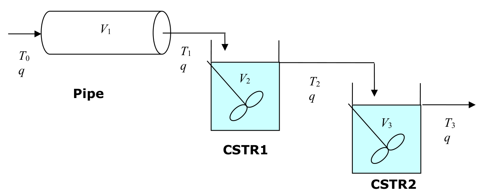

[Previous](<../04 - Second-order dynamics and damping/PDC-12 - Second-order step response, overshoot and decay ratio.md>) · [Subject index](../README.md) · [Topic overview](README.md) · [Next](<PDC-14 - Summing contributions and duplicating signals.md>)

<!-- note-content:start -->
# PDC-13: Series blocks and the pipe–two-tank response

## Overview

Assumed: a plug-flow delay and perfectly mixed tank energy balances.

A pipe followed by two insulated tanks combines transport delay with two first-order lags. Multiplying blocks preserves each element's physical role and produces a delayed second-order response.

## Intuition

The pipe postpones the arrival of a hot front. The first tank dilutes it into stored liquid; the second smooths that already changing temperature. The outlet stays unchanged until the front arrives, then initially changes very gently.

## Derivation

**Step 1: construct each element.** For pipe length $`L`$, diameter $`D`$, constant volumetric flow $`q`$ and uniform velocity $`u=4q/(\pi D^2)`$, the delay is $`t_d=L/u`$. Let temperatures along the sequence be $`T_0,T_1,T_2,T_3`$, and tank volumes be $`V_2,V_3`$.



For ideal plug flow, $`\bar T_1=e^{-t_ds}\bar T_0`$. With constant liquid properties and no heat losses, each tank balance is $`\rho V_ic_p\dot T_i=\rho qc_p(T_{i-1}-T_i)`$, so its deviation transfer function is $`1/(\tau_is+1)`$, $`\tau_i=V_i/q`$.

*Reason:* the pipe preserves the input waveform after transit, whereas tank storage gives a lag.

**Step 2: substitute through the series.** For blocks $`G_1,G_2,G_3`$, $`\bar T_1=G_1\bar T_0`$, $`\bar T_2=G_2\bar T_1`$, $`\bar T_3=G_3\bar T_2`$. Therefore


**Equation (43)**

```math
\frac{\bar T_3}{\bar T_0}=\frac{e^{-t_ds}}{(\tau_2s+1)(\tau_3s+1)}.
```


*Reason:* the output of one element is the next element's input; repeated substitution multiplies their SISO transfer functions.

**Step 3: invert equal lags.** For $`\tau_2=\tau_3=\tau`$ and inlet step $`\Delta T_0`$, first remove the delay and decompose


```math
\frac{1}{s(\tau s+1)^2}
=\frac1s-\frac{\tau}{\tau s+1}-\frac{\tau}{(\tau s+1)^2}.
```


*Reason:* multiplying by the common denominator verifies the coefficients. The inverse transforms of the last two terms are $`e^{-t/\tau}`$ and $`(t/\tau)e^{-t/\tau}`$. Restore the delay by shifting the complete causal response:


**Equation (44)**

```math
T_3'(t)=\begin{cases}
0,&t<t_d,\\
\Delta T_0\left[1-\left(1+\frac{t-t_d}{\tau}\right)e^{-(t-t_d)/\tau}\right],&t\geq t_d.
\end{cases}
```


*Reason:* the pipe postpones the entire two-tank response. The rational part has a repeated pole $`-1/\tau`$ and is critically damped.

The delay and lags answer different questions. The delay says when the response can first appear. The two tank states say how it develops after that arrival. Immediately after arrival, tank 1 starts warming, but tank 2 still has almost no inlet–contents temperature difference, so its initial slope is zero. For every positive elapsed time after arrival the outlet does change; the initially flat tangent does not add another interval of dead time.

Multiplying the zero-frequency gains gives one: with no heat loss, every element ultimately reaches the new inlet temperature. The repeated pole supplies the $`t e^{-t/\tau}`$ term, which changes the rise shape without changing that endpoint. Shift both occurrences of time in the causal response when reinstating the pipe delay; shifting only the exponential would violate the starting conditions.

## Motivation and explanation

Scalar LTI series multiplication commutes, so reordering these ideal blocks leaves the overall input–output transfer function unchanged. Their intermediate signals do change. Reordering real equipment may also change heat losses, mixing, flows or the relevant model; the algebra does not establish physical interchangeability.

Two lags produce a zero initial slope after the delay. They create a smooth rise, not extra exact dead time. The final gain remains one because the insulated system eventually passes the changed temperature through unchanged.

## Worked example

Let $`q=1.00\times10^{-3}`$ m$`^3`$ s$`^{-1}`$, $`D=0.0400`$ m, $`L=20.0`$ m and $`V_2=V_3=0.100`$ m$`^3`$. The calculated velocity is $`0.795775`$ m s$`^{-1}`$, $`t_d=25.1327`$ s and both time constants are $`100`$ s. Thus


```math
G(s)=\frac{e^{-25.1327s}}{(100s+1)^2}.
```


For a $`1.00`$ K inlet step, $`T_3'(125)=0.263753`$ K. Rounding the transit time to $`25`$ s is reasonable for a coarse estimate, but the calculation here retains the value from the specified geometry.

## Link to other topics

Series-block algebra extends to sensor and actuator lags. Parallel paths instead require signed addition of contributions to an output.

## Conclusion

Build the overall response from physically derived elements. The delay sets its onset; the repeated tank pole sets its subsequent smooth approach.
<!-- note-content:end -->

[Previous](<../04 - Second-order dynamics and damping/PDC-12 - Second-order step response, overshoot and decay ratio.md>) · [Subject index](../README.md) · [Topic overview](README.md) · [Next](<PDC-14 - Summing contributions and duplicating signals.md>)
