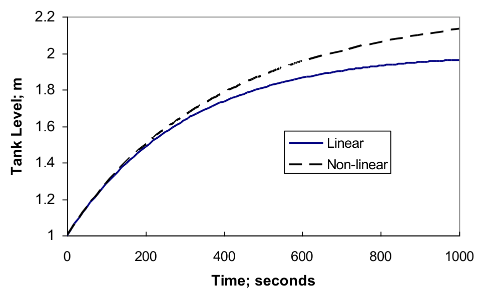

[Previous](<PDC-20 - Local linearisation and reaction-order comparison.md>) · [Subject index](../README.md) · [Topic overview](README.md) · [Next](<PDC-22 - Three-tank mixing: valve linearisation and step response.md>)

<!-- note-content:start -->
# PDC-21: Gravity-draining tank: linear model and exact response

## Overview

Assumed: a volume balance and square-root outflow from Bernoulli's law.

Unlike a tank with prescribed pumped withdrawal, a gravity-draining tank has a restoring outflow. Linearisation makes it a local first-order lag; solving the nonlinear step reveals the approximation's limits.

## Intuition

A higher level increases the driving head and therefore increases outflow. That feedback in the physics opposes accumulation without a controller. Because outflow increases as a square root, its slope weakens at larger levels; a single tangent model cannot predict every new equilibrium exactly.

## Derivation

**Step 1: write and linearise the balance.** Let area be $`A`$, level $`h>0`$, inlet flow $`q_0`$, and outlet $`q=k\sqrt h`$ with fixed valve/outlet coefficient $`k>0`$. Assume constant density and area, quasi-steady outflow, no overflow, and no other inflows. Then


**Equation (64)**

```math
A\dot h=q_0-k\sqrt h,\qquad q_{0s}=k\sqrt{h_s}.
```


*Reason:* increasing level stores volume and increases the gravity-driven loss. Define deviations and expand $`\sqrt{h_s+h'}\approx\sqrt{h_s}+h'/(2\sqrt{h_s})`$. Cancel the steady terms:


**Equation (65)**

```math
A\dot h'=q_0'-\frac{k}{2\sqrt{h_s}}h',\qquad
\tau\dot h'+h'=K_pq_0',
\quad\tau=\frac{2A\sqrt{h_s}}k,\quad K_p=\frac{2\sqrt{h_s}}k.
```


*Reason:* the outflow slope supplies a restoring term. The transfer function is $`G=K_p/(\tau s+1)`$, with pole $`-k/(2A\sqrt{h_s})`$. Gain has units s m$`^{-2}`$, equivalent to level per volumetric-flow change.

**Step 2: compare new equilibria.** After a step $`\Delta q_0`$, the local model gives


**Equation (66)**

```math
h'_{lin}=K_p\Delta q_0(1-e^{-t/\tau}),\qquad
h'_{exact,\infty}=K_p\Delta q_0+(\Delta q_0/k)^2.
```


*Reason:* the exact equilibrium is $`h_\infty=[(q_{0s}+\Delta q_0)/k]^2`$; subtract $`h_s=(q_{0s}/k)^2`$ and expand the square. The missing quadratic term reveals the finite-step error.

**Step 3: integrate the exact nonlinear step.** Let $`z=\sqrt h`$, $`z_0=\sqrt{h_s}`$ and $`z_f=(q_{0s}+\Delta q_0)/k`$. Since $`\dot h=2z\dot z`$,


```math
2Az\dot z=k(z_f-z),\qquad
 dt=\frac{2A}{k}\frac{z}{z_f-z}\,dz.
```


*Reason:* substituting the square-root state makes the equation separable. Use $`z/(z_f-z)=-1+z_f/(z_f-z)`$ and integrate from $`z_0`$:


**Equation (67)**

```math
t=\frac{2A}{k}\left[z_0-z+z_f\ln\left|\frac{z_f-z_0}{z_f-z}\right|\right].
```


*Reason:* the logarithm comes from integrating $`1/(z_f-z)`$ with its negative derivative. This implicit exact solution applies along a positive-level trajectory before reaching the new equilibrium; a zero step simply gives constant $`h`$. For a positive inlet step, $`z_0<z<z_f`$.

**Step 4: linearise in the transformed state too.** Write $`z=z_0+z'`$ in $`2Az\dot z=q_0-kz`$. To first order,


```math
2Az_0\dot z'+kz'=q_0',\qquad
h'=2z_0z'+O((z')^2).
```


*Reason:* $`z'\dot z'`$ is a second-order perturbation, and the output transformation must also be expanded. Together these recover exactly the earlier local $`h'`$ model. Squaring the approximate $`z(t)`$ without dropping $`(z')^2`$ gives a different finite-step approximation, not the first-order linear level model.

## Motivation and explanation

The tangent approximation needs $`|h'|/h_s`$ small. It fails near an empty tank, where the square-root derivative is singular. The coefficient $`k`$ has units m$`^{5/2}`$ s$`^{-1}`$, so both the original flow law and the derived time constant are dimensionally consistent.

The exact transient approaches equilibrium asymptotically. A numerical solution of the implicit equation or direct integration can quantify deviations from the local lag without inventing a constant time constant for the nonlinear process.

## Worked example

Take $`A=3.00`$ m$`^2`$, $`k=0.0200`$ m$`^{5/2}`$ s$`^{-1}`$, $`q_{0s}=0.0200`$ m$`^3`$ s$`^{-1}`$ and $`\Delta q_0=0.0100`$ m$`^3`$ s$`^{-1}`$. Then $`h_s=1.00`$ m, $`\tau=300`$ s and $`K_p=100`$ s m$`^{-2}`$. The linear final level is $`2.00`$ m; the exact final level is $`2.25`$ m.



At $`1000`$ s, the linear model gives $`h=1.96433`$ m and direct nonlinear integration gives $`h=2.13198`$ m. The implicit solution returns the same nonlinear value. The figure is qualitative; these values are computed from the balances, not read from the plotted lines. The large inlet change demonstrates why local linearisation must be checked for the intended excursion.

## Link to other topics

Gravity outflow turns an otherwise integrating level into a self-regulating lag. Its steady gain is the derivative of the nonlinear equilibrium relation at the chosen point.

## Conclusion

Linearisation preserves the local restoring physics. The exact equilibrium and implicit transient quantify what it loses for a large change.
<!-- note-content:end -->

[Previous](<PDC-20 - Local linearisation and reaction-order comparison.md>) · [Subject index](../README.md) · [Topic overview](README.md) · [Next](<PDC-22 - Three-tank mixing: valve linearisation and step response.md>)
