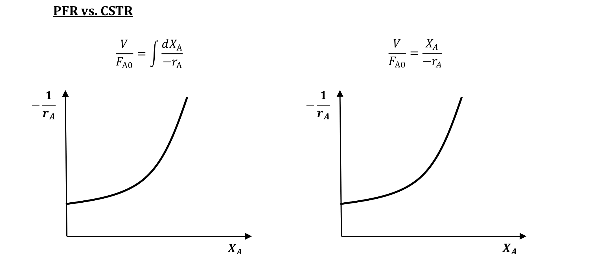

[Previous](<RE-01 - Rate bases and stoichiometry.md>) · [Subject index](../README.md) · [Topic overview](README.md) · [Next](<RE-03 - Conversion and changing gas volume.md>)

<!-- note-content:start -->
# RE-02: Ideal CSTR and PFR balances

## Overview

Assumed: steady species balances and first-order kinetics.

Model assumptions come first: a continuous stirred tank reactor (CSTR) has uniform composition and temperature, with the outlet at those conditions; a plug flow reactor (PFR) has uniform conditions across each section and no axial mixing. Both are steady here. Their different concentration histories explain their different design volumes.

## Intuition

In a CSTR, incoming reactant immediately encounters the dilute outlet composition. Every part of the vessel reacts at that same rate. A PFR retains the high reactant concentration near its inlet, so early sections may react faster. Neither name guarantees the assumed flow pattern in a real tank or bed.

## Derivation

Let $`F_{A0}`$ and $`F_A`$ be inlet and outlet molar flow of reactant A in mol s$`^{-1}`$, $`V`$ reactor volume, and $`r_A`$ its signed production rate per reactor volume. Define conversion $`X_A=(F_{A0}-F_A)/F_{A0}`$.

**Step 1: one uniform tank.** At steady state, inlet plus production equals outlet:


**Equation (3)**

```math
F_{A0}+r_AV=F_A=F_{A0}(1-X_A),
\qquad V=\frac{F_{A0}X_A}{-r_A}.
```


*Reason:* accumulation is zero, and ideal mixing lets us replace the volume integral of production by $`r_AV`$. Evaluate $`r_A`$ at the tank/outlet composition and temperature. No constant-density assumption is needed for (3).

**Step 2: use concentration only when flow is constant.** If volumetric flow $`Q`$ is the same at inlet and outlet, $`F_{A0}=QC_{A0}`$ and $`F_A=QC_A`$, where $`C_{A0}`$ and $`C_A`$ are inlet and outlet concentrations. Substituting and dividing by $`Q`$ gives


**Equation (4)**

```math
C_A=C_{A0}+r_A\tau,\qquad
\tau=\frac{V}{Q},\qquad
X_A=1-\frac{C_A}{C_{A0}}.
```


*Reason:* a constant flow cancels from the molar-flow ratio. Here $`\tau`$ is space time; this identification with mean residence time needs constant flow and accessible, swept volume.

**Step 3: one plug-flow slice.** For an infinitesimal volume $`dV`$, write inlet plus local production equals outlet:


```math
F_A+r_A\,dV=F_A+dF_A
\quad\Rightarrow\quad
\frac{dF_A}{dV}=r_A.
```


*Reason:* there is no axial mixing flux; each slice passes material downstream. Since $`dF_A=-F_{A0}\,dX_A`$, separating variables and integrating from the unreacted inlet gives


**Equation (5)**

```math
\frac{dX_A}{dV}=\frac{-r_A}{F_{A0}},\qquad
V=F_{A0}\int_0^{X_{A,\mathrm{out}}}\frac{dx}{-r_A(x)}.
```


Here $`x`$ is a dummy conversion variable and $`X_{A,\mathrm{out}}`$ the outlet conversion. The rate depends on the local concentrations, temperature and pressure; supply their relationships before evaluating the integral. For constant $`Q`$, the equivalent equation is $`dC_A/dV=r_A/Q`$.

## Motivation and explanation

A small conversion increment consumes $`F_{A0}\,dX_A`$ moles per second. Dividing that demand by the local consumption per unit volume gives the volume needed for the increment. This is why the PFR design is an integral of reciprocal rate: slow sections cost more volume. In the CSTR, mixing imposes the final low rate throughout the vessel, so the whole conversion is paid for at the outlet rate.

The worked comparison holds feed flow, kinetics, temperature and target conversion fixed. Its smaller PFR volume comes from preserving fast inlet reaction, rather than from a different chemical constant. The divergence near complete conversion has the same cause: first-order consumption becomes arbitrarily slow as the remaining concentration vanishes. Finite residence time therefore gives a nonzero surviving fraction in both ideal models.



The area beneath a plot of $`1/(-r_A)`$ against conversion is $`V/F_{A0}`$ for a PFR. For a CSTR, it is a rectangle of width $`X_A`$ and height equal to the outlet reciprocal rate. The sketch shows an increasing reciprocal rate, for which the rectangle is larger. The units are m$`^3`$ s mol$`^{-1}`$ on the vertical axis and dimensionless conversion on the horizontal axis.

The conclusion “PFR needs less volume” is conditional. It holds when the reciprocal rate increases along the relevant comparison path. Heating, autocatalysis or inhibition can make the curve fall, and non-isothermal reactors may follow different temperature paths. Compare rates under the actual assumptions.

For constant-density fluid, replacing $`V/Q`$ by time makes the PFR concentration balance identical to the fixed-volume batch balance. With changing flow, the material travel time is instead $`\int dV/Q(V)`$; inlet space time $`V/Q_0`$ is not that integral.

## Link to other topics

These balances remain the building blocks for heterogeneous reactors, provided the rate and volume basis are consistent. Gas expansion changes the concentration–conversion relationship, while heat release changes the temperature and therefore the local rate.

## Conclusion

The balance expresses conservation; the mixing model determines where the rate is evaluated. Next, close that balance when gas composition and volumetric flow change together.
<!-- note-content:end -->

[Previous](<RE-01 - Rate bases and stoichiometry.md>) · [Subject index](../README.md) · [Topic overview](README.md) · [Next](<RE-03 - Conversion and changing gas volume.md>)
