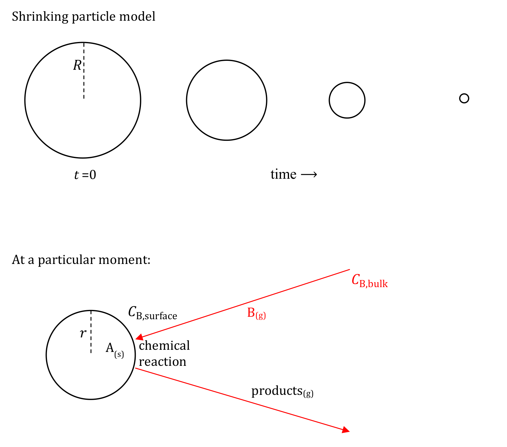

[Subject index](../README.md) · [Topic overview](README.md) · [Next](<RE-08 - Reaction-controlled shrinking particles.md>)

<!-- note-content:start -->
# RE-07: Shrinking particles under film control

## Overview

Assumed: film mass-transfer coefficients, Sherwood-number correlations and species balances.

In a non-catalytic fluid–solid reaction the solid is a reagent: it is consumed, not regenerated. Each particle therefore behaves like a small batch reactor even inside a continuous vessel, and the design question becomes *how long a particle of a given size needs to react completely*. This note treats a solid that reacts to give only fluid products, so the particle shrinks until it disappears. When supply of the fluid reagent through the surrounding film is the slowest step, the radius obeys $`r/R=\sqrt{1-t/\tau_c}`$, conversion obeys $`X=1-(1-t/\tau_c)^{3/2}`$, and the time for complete reaction grows as the square of initial radius in a stagnant gas.

Some solids react by heating alone, without a second reagent, as in cooking or thermal decomposition. Heat transport then controls the overall rate. The models here instead require a fluid reagent to reach the solid.

## Intuition

Picture a carbon particle burning in air. Oxygen diffuses from the bulk gas across a boundary layer to the surface, reacts at once, and carbon dioxide diffuses away. If the surface chemistry is very fast, every oxygen molecule arriving is consumed, so the surface concentration is nearly zero and the supply rate alone sets the burning rate. The chemistry could go faster, but it is starved.

As the particle shrinks, two effects compete. Its surface area falls as $`r^2`$, reducing the area through which oxygen arrives. In a stagnant gas the diffusion film also becomes thinner, roughly in proportion to $`r`$, so the flux per unit area rises. The net supply to the whole particle therefore falls only in proportion to $`r`$, while the amount of solid left falls as $`r^3`$.



The upper sequence shows the same particle at successive times: it keeps its spherical shape but loses radius until it vanishes. The lower sketch is one instant: reagent B travels from bulk concentration $`C_{\mathrm{B,bulk}}`$ to the surface value $`C_{\mathrm{B,surface}}`$, reacts with solid A, and gaseous products leave. No solid product layer forms, which is what distinguishes this case from the shrinking core treated later.

## Derivation

Write the overall reaction as


```math
\nu_A\,\mathrm{A(s)}+\nu_B\,\mathrm{B(g)}\longrightarrow\text{products(g)},
```


with $`\nu_A,\nu_B>0`$ the stoichiometric numbers as written. This positive convention differs from the signed coefficients used in species balances; consuming one mole of B consumes $`\nu_A/\nu_B`$ moles of A. Examples are $`\mathrm{C(s)+O_2(g)\to CO_2(g)}`$ and $`\mathrm{C(s)+H_2O(g)\to CO(g)+H_2(g)}`$.

Assume a spherical, non-porous particle of initial radius $`R`$ and current radius $`r`$, molar density of solid A $`\rho_m`$ in $`\mathrm{mol\,m^{-3}}`$, a gas reagent (a liquid reagent is treated in the same way), constant bulk concentration $`C_{\mathrm{B,bulk}}`$ and constant temperature.

**Step 1: treat the particle as quasi-steady.** Calculate the instantaneous rate at fixed $`r`$, then use it to update $`r`$.

*Reason:* the gas-side concentration profile relaxes on a timescale of order $`r^2/D`$, where $`D`$ is the diffusivity of B in the gas. The particle shrinks on a timescale longer by roughly the factor $`\rho_m/C_{\mathrm{B,bulk}}`$, which is large for a solid in a gas: about $`6.5\times10^4`$ for a carbon particle of density $`2000\ \mathrm{kg\,m^{-3}}`$ burning in air at 1000 K. The film therefore sees an almost stationary surface. For a dense liquid reagent this ratio can be much smaller, and the assumption must be checked.

**Step 2: write the film supply of B.** With film mass-transfer coefficient $`k_g`$ in $`\mathrm{m\,s^{-1}}`$, the molar flow of B to the surface is


**Equation (21)**

```math
\dot n_B=4\pi r^2k_g\left(C_{\mathrm{B,bulk}}-C_{\mathrm{B,surface}}\right).
```


*Reason:* flux equals coefficient times concentration difference, multiplied by the current exterior area. If chemical reaction is fast relative to this supply, $`C_{\mathrm{B,surface}}\approx0`$ and $`\dot n_B\approx4\pi r^2k_gC_{\mathrm{B,bulk}}`$.

**Step 3: balance the remaining solid.** The particle contains $`\tfrac43\pi r^3\rho_m`$ moles of A. Its loss rate equals the stoichiometric share of the B supply:


**Equation (22)**

```math
-\frac{d}{dt}\left(\tfrac43\pi r^3\rho_m\right)=\frac{\nu_A}{\nu_B}4\pi r^2k_gC_{\mathrm{B,bulk}}
\quad\Longrightarrow\quad
\frac{dr}{dt}=-\frac{\nu_A}{\nu_B}\frac{k_gC_{\mathrm{B,bulk}}}{\rho_m}.
```


*Reason:* differentiating the volume gives $`4\pi r^2\rho_m\,dr/dt`$. The area factor $`4\pi r^2`$ then appears on both sides and cancels: the surface recedes at a speed set by flux per area divided by moles of solid per volume.

**Step 4: close $`k_g`$.** For mass transfer to a sphere, a common correlation is


```math
\mathrm{Sh}=\frac{k_gd}{D}=2+0.6\,\mathrm{Sc}^{1/3}\mathrm{Re}^{1/2},
```


with $`d=2r`$, Schmidt number $`\mathrm{Sc}`$ and particle Reynolds number $`\mathrm{Re}`$; it is typically quoted for $`\mathrm{Re}<200`$ and $`\mathrm{Sc}<250`$. Because $`d`$ changes, $`k_g`$ changes during reaction. In a stagnant gas or for very small particles (the Stokes regime), the convective term vanishes, $`\mathrm{Sh}=2`$ and $`k_g=D/r`$. Substitution in (22) gives


```math
\frac{dr}{dt}=-\frac{\nu_A}{\nu_B}\frac{DC_{\mathrm{B,bulk}}}{\rho_m r}.
```


**Step 5: integrate.** Separate variables and integrate from $`r=R`$ at $`t=0`$: $`\int_R^r(-r')\,dr'=\tfrac12(R^2-r^2)=(\nu_A/\nu_B)DC_{\mathrm{B,bulk}}t/\rho_m`$. Setting $`r=0`$ gives the time for complete reaction, called the burn-out time for combustion:


**Equation (23)**

```math
\tau_c=\frac{\rho_mR^2}{2DC_{\mathrm{B,bulk}}}\frac{\nu_B}{\nu_A}.
```


Dividing the integrated result by $`\tau_c`$ and defining conversion as the fraction of the initial solid consumed,


**Equation (24)**

```math
\frac rR=\sqrt{1-\frac t{\tau_c}},\qquad
X=1-\frac{\tfrac43\pi r^3\rho_m}{\tfrac43\pi R^3\rho_m}=1-\left(\frac rR\right)^3=1-\left(1-\frac t{\tau_c}\right)^{3/2}.
```


*Reason:* normalising by $`\tau_c`$ removes all the property values, leaving a curve whose shape belongs to the controlling mechanism alone.

## Motivation and explanation

The $`R^2`$ dependence of (23) is a ratio of inventory to supply. The moles of solid scale as $`R^3`$, while the stagnant-film supply to the whole particle scales as area times $`k_g`$, that is $`R^2\times R^{-1}=R`$. Doubling the particle size therefore quadruples the burn-out time. At larger Reynolds number the convective term dominates, $`k_g\propto d^{-1/2}`$, and $`\tau_c`$ scales closer to $`R^{3/2}`$. Measuring how $`\tau_c`$ depends on particle size is therefore a practical test for film control, with an exponent between about 1.5 and 2.

Differentiating (24) gives $`dX/dt=\tfrac32(1-t/\tau_c)^{1/2}/\tau_c`$. Conversion starts at a finite rate and slows towards the end because the total supply, proportional to $`r`$, falls to zero with the particle. It does not stop abruptly or speed up at the end.

Raising the gas velocity increases $`\mathrm{Re}`$ and $`k_g`$, so a film-controlled particle burns faster in a faster stream. Raising temperature changes $`D`$ only weakly. A strong response to gas velocity and a weak response to temperature together point to film control.

The model fails where its fixed assumptions are violated. As the particle shrinks, $`k_g=D/r`$ grows without limit, so near the end the surface reaction can no longer keep $`C_{\mathrm{B,surface}}`$ near zero and chemistry takes over control. Combustion releases heat, so particle temperature rises above the gas temperature and an energy balance is needed. A large outward product flow (Stefan flow), a porous solid, or non-spherical particles each alter the supply term in Step 2.

## Link to other topics

The same film coefficient governs supply to the outside of a catalyst pellet; here, however, the solid is consumed, so the area and $`k_g`$ change with time. The Sherwood correlation is the same type used for mass transfer to particles in separation equipment.

## Conclusion

Film control makes the receding speed of the surface proportional to $`k_g`$, giving a burn-out time that scales as $`R^2`$ in a stagnant gas. The next note asks what happens when surface chemistry, rather than supply, is slow.
<!-- note-content:end -->

[Subject index](../README.md) · [Topic overview](README.md) · [Next](<RE-08 - Reaction-controlled shrinking particles.md>)
