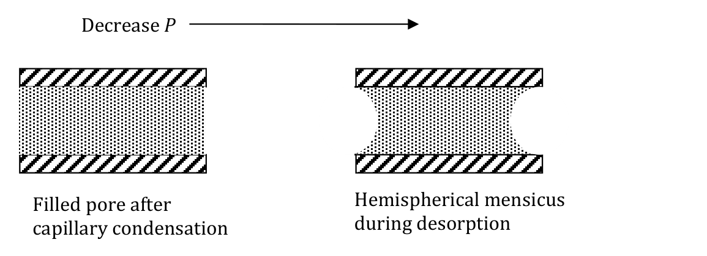

[Previous](<RE-S4-03 - BET adsorption and surface area.md>) · [Subject index](../README.md) · [Topic overview](README.md)

<!-- note-content:start -->
# Capillary condensation and adsorption enthalpy

## Overview

Assume chemical-potential equality and the Kelvin effect. Curved interfaces allow liquid to fill pores below flat-interface saturation pressure. Measurements at several temperatures also reveal how adsorption enthalpy changes with loading.

## Intuition

A concave meniscus places the liquid at lower pressure than the vapour, reducing its chemical potential. It can therefore coexist with vapour at a pressure below the flat-surface saturation value. A pore may fill and empty along different metastable interface configurations, producing hysteresis.

## Derivation

At temperature $`T`$, let $`P_v`$ and $`P_l`$ be vapour and liquid pressure, $`V_l`$ liquid molar volume and $`\sigma`$ surface tension. For ideal vapour and approximately incompressible liquid, integrating their chemical-potential differentials from flat coexistence gives


**Equation (50)**

```math
\mathcal RT\ln(P_v/P^{\mathrm{sat}})=V_l(P_l-P^{\mathrm{sat}}).
```


For a concave interface with principal curvature radii $`r_1,r_2`$ expressed as positive magnitudes, the pressure jump is $`P_l-P_v=-\sigma(1/r_1+1/r_2)`$. When the vapour-pressure correction inside the liquid term is small relative to capillary pressure, substitution gives


**Equation (51)**

```math
\ln\frac{P_{\mathrm{cond}}}{P^{\mathrm{sat}}}
\approx-\frac{\sigma V_l}{\mathcal RT}\left(\frac1{r_1}+\frac1{r_2}\right)
=-\frac{2\sigma V_l}{\mathcal RT r_K},\qquad
\frac1{r_K}=\frac12\left(\frac1{r_1}+\frac1{r_2}\right).
```


Here $`r_K`$ is the harmonic mean curvature radius of the **actual interface**. Contact angle enters when relating that curvature to a geometric pore radius: for a spherical meniscus in an ideal cylindrical pore of available radius $`a_p`$, $`r_K=a_p/\cos\alpha`$ and the exponent becomes $`-2\sigma V_l\cos\alpha/(\mathcal RTa_p)`$. Do not include $`\cos\alpha`$ again if it has already been absorbed into the actual curvature radius. Perfect wetting has $`\alpha=0`$.

If the pore has radius $`r_p`$ and adsorbed-film thickness $`t`$, the available radius is $`a_p=r_p-t`$. A cylindrical interface has $`r_1=a_p`$, $`r_2\to\infty`$, so $`r_K=2a_p`$. A hemispherical meniscus has $`r_1=r_2=a_p`$, so $`r_K=a_p`$. The ideal cylindrical-film filling picture and hemispherical emptying picture therefore predict different transition pressures, with emptying at lower pressure. Real loops can also involve delayed nucleation, pore blocking and network connectivity; the geometric cartoon is not a unique pore reconstruction.

For nitrogen near 77 K with perfect wetting, representative liquid properties give a Kelvin coefficient about 0.959 nm, so $`\ln(P_{\mathrm{cond}}/P^{\mathrm{sat}})\approx-(0.959\ \mathrm{nm})/r_K`$. The radius and coefficient must use the same units. An additional adsorbed-film estimate is required before converting $`r_K`$ into pore size.



## Motivation and explanation

Smaller concave radii increase the capillary pressure difference and lower the liquid chemical potential further. The vapour must then have lower pressure to match it. This gives the negative exponent its physical meaning and recovers flat-interface saturation as curvature tends to zero. Film thickness matters because the remaining vapour core determines interface curvature, while the full pore radius includes the film already present.

Holding loading fixed in an isostere keeps the amount adsorbed comparable while temperature changes. For exothermic adsorption, heating weakens retention, so pressure must rise to maintain that same loading. Following an isobar would instead let loading change and mix the binding-energy information with movement along the isotherm. On a heterogeneous surface, matching loading is especially useful because different loading levels can sample different populations of binding sites.

Micropores have widths below about 2 nm; their filling requires molecular adsorption models rather than a bulk-liquid meniscus. Mesopores have widths around 2–50 nm and commonly show capillary condensation. Macropores are wider and approach flat-interface behaviour. These are **width or diameter** classifications, not interchangeable radius thresholds. A continuum Kelvin construction becomes questionable at molecular dimensions.

Liquid pressure can be negative relative to vacuum in a tensile metastable state. With $`\sigma=0.07\ \mathrm{N\,m^{-1}}`$, perfect wetting and an illustrative spherical curvature radius 14 nm, Python gives capillary pressure magnitude $`10^7\ \mathrm{Pa}`$, or 100 bar. This is a tensile stress sustained by cohesion and adhesion; cavitation is restricted by nucleation and pore geometry. It does not imply negative molecular density. Such forces can damage weak porous solids.

## Adsorption enthalpy derivation

For a Langmuir surface, fit $`K`$ at several temperatures. Van't Hoff gives $`d\ln K/d(1/T)=-\Delta H_{\mathrm{ads}}/\mathcal R`$, so a positive slope corresponds to negative adsorption enthalpy. This enthalpy is independent of coverage only under the Langmuir assumptions.

For heterogeneous binding, hold loading $`q`$ fixed and measure the equilibrium pressures at different temperatures. Treating the gas as ideal and the adsorbed-phase volume as negligible, equality of chemical potentials gives the isosteric relation


**Equation (52)**

```math
\Delta H_{\mathrm{ads},q}=-\mathcal RT^2\left(\frac{\partial\ln P}{\partial T}\right)_q
=\mathcal R\left(\frac{\partial\ln P}{\partial(1/T)}\right)_q.
```


The sign differs from the $`\ln K`$ slope because greater affinity requires lower gas pressure to maintain the same coverage. The positive isosteric heat released is often defined as $`q_{\mathrm{st}}=-\Delta H_{\mathrm{ads},q}`$; declare the convention. At dilute **molecular** adsorption, the Henry constant gives the zero-loading enthalpy through van't Hoff. Dissociative atomic coverage need not follow a linear pressure law at low pressure.

## Worked example

For a fixed-loading pressure that rises from 0.10 bar at 300 K to 0.20 bar at 320 K, the two-point slope gives $`\Delta H_{\mathrm{ads},q}\approx-27.663\ \mathrm{kJ\,mol^{-1}}`$ and positive released heat about $`27.663\ \mathrm{kJ\,mol^{-1}}`$. This finite-difference estimate assumes approximately constant enthalpy over that interval and genuinely matched loading.

## Link to other topics

Curvature-induced coexistence is the counterpart of the elevated vapour pressure of a convex droplet. Adsorption enthalpies enter the observed activation energy of a surface reaction.

## Conclusion

Pore geometry and metastability influence uptake, while matched-loading temperature measurements reveal binding energetics. Curvature, pressure and enthalpy sign conventions must stay explicit.
<!-- note-content:end -->

[Previous](<RE-S4-03 - BET adsorption and surface area.md>) · [Subject index](../README.md) · [Topic overview](README.md)
