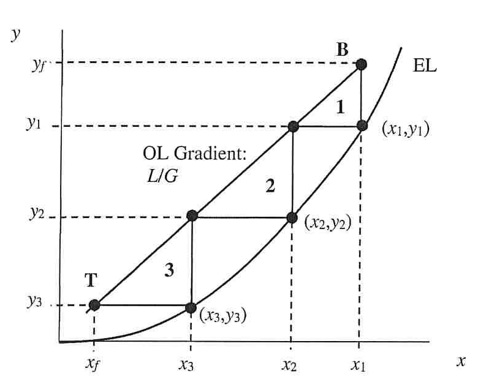

[Subject index](../README.md) · [Topic overview](README.md) · [Next](<SEP-02 - Absorption-column equipment.md>)

<!-- note-content:start -->
# SEP-01: Separation choices and continuous contacting

## Overview

Assumed background: material balances and equilibrium-stage separations. A separation selectively moves feed components into different locations. Thermodynamics tells us which redistribution is possible; mass transfer tells us how much equipment and contact time are needed to approach it.

## Intuition

A solvent can strongly prefer a solute without immediately removing it from a gas. Molecules must still travel through the gas, cross the interface and diffuse into the liquid. *A favourable destination does not make the journey instantaneous.* In a real contactor, the fluids leave before their bulk compositions reach equilibrium.

Separation usually surrounds a reactor: upstream units purify reactants and remove catalyst poisons; downstream units purify products and recover unreacted feed for recycle. Recovery and purity are separate objectives: a very pure product can still represent poor recovery if most product leaves with a waste stream.

## Derivation

Choosing a separation starts with the property difference that can discriminate between components:

| Method | Physical discrimination | Typical operation |
|---|---|---|
| Create a phase | Different volatility or solid–liquid equilibrium | Distillation or crystallisation |
| Add a phase | Different solubility in a chosen second fluid | Absorption or liquid extraction |
| Add a selective barrier | Different permeation rates | Membrane separation |
| Add a solid agent | Different adsorption affinity | Adsorption |
| Apply a force or gradient | Different charge, density or mobility | Electrophoresis or centrifugation |

First identify the species and required purity/recovery, because an operation must distinguish the particular pair of components. Then compare equilibrium selectivity, because no increase in contact time repairs a solvent that lacks the required preference. Finally examine rate, energy demand, regeneration and handling, because the preferred phase or agent must be recovered or disposed of after use. Molecular mass, charge, polarity and hydrophobicity help explain the property differences; tabulated solubility, diffusivity and volatility quantify them.

For gas–liquid contacting, define $`x`$ as solute mole fraction in liquid and $`y`$ as solute mole fraction in gas. Absorption transfers solute from gas to liquid; stripping reverses the transfer. In the usual countercurrent tower the gas rises and the liquid falls. Thus absorption decreases $`y`$ upwards and increases $`x`$ downwards, whereas stripping enriches the gas upwards and depletes the liquid downwards.

An ideal equilibrium stage assumes that the two **leaving** streams obey the equilibrium relationship. A material balance relates the **passing** streams between adjacent stages. Keeping these two relationships separate explains the graphical staircase:

In this schematic, $`y_f`$ is feed-gas mole fraction, $`x_f`$ is fresh-liquid mole fraction, and $`x_j,y_j`$ are the liquid and gas leaving stage $`j`$, counted upwards from the bottom. OL and EL denote operating and equilibrium lines; $`L/G`$ is the liquid/gas molar-flow ratio. Starting from the bottom operating point, move vertically to EL at fixed $`x`$: this imposes equilibrium for the two streams leaving one stage. Move horizontally to OL at fixed $`y`$: the balance supplies the liquid composition associated with the next stage. Repeat to the top specification. Each vertical–horizontal pair represents one ideal stage. The illustrated three steps are schematic, not a numerical design.

## Motivation and explanation

A packed tower continuously renews contact rather than dividing it into distinct trays. Its bulk streams generally remain away from equilibrium at every height. The useful idealisations are steady operation, axial plug flow without dispersion, approximately constant temperature and dilute solute so that total gas and liquid molar flows barely change. Local equilibrium may still hold at the interface even while the bulk fluids remain out of equilibrium.

Physical absorption primarily dissolves a species; reactive absorption also consumes it chemically. Acetone uptake into water is a physical model example, while carbon dioxide uptake into sodium hydroxide needs reaction chemistry. Ammonia in water can be treated with an effective equilibrium relationship over specified conditions, but aqueous speciation should not be ignored when pH changes appreciably. The simple physical model must then be extended.

## Worked example

Consider recovering a volatile organic compound from a gas. Adding a low-volatility solvent is attractive if the compound dissolves much more strongly than the carrier gas. The rich liquid then needs regeneration, often by stripping into another gas or steam. A stronger solvent can reduce the absorber's liquid demand while increasing regeneration difficulty. The relevant choice is the complete recovery cycle, not the absorber alone.

## Link to other topics

Chemical potential and phase equilibrium determine the partitioning used in absorption. Diffusion and convective transfer determine the size of continuous contactors; the same distinction between equilibrium preference and transport rate reappears in membranes and adsorption.

## Conclusion

Select the property difference first, establish feasible partitioning second, and size the contactor from the finite rate of transfer. Absorption-column hardware must provide both interfacial area and reliable countercurrent flow.
<!-- note-content:end -->

[Subject index](../README.md) · [Topic overview](README.md) · [Next](<SEP-02 - Absorption-column equipment.md>)
