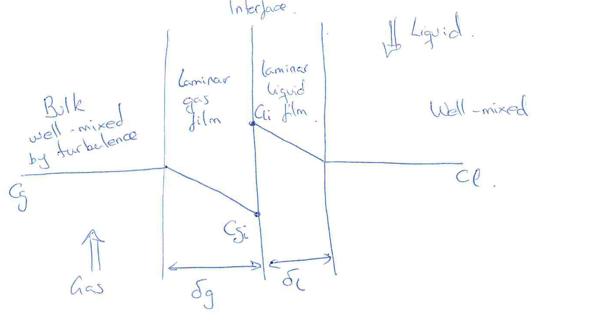

[Previous](<SEP-05 - Two-film resistances and overall coefficients.md>) · [Subject index](../README.md) · [Topic overview](README.md) · [Next](<SEP-07 - Packed-column height and transfer units.md>)

<!-- note-content:start -->
# SEP-06: Film models and coefficient measurement

## Overview

Assumed background: Fick's law and gas–liquid resistance addition. The Whitman two-film model represents each phase's transfer resistance by a thin stagnant layer. It connects diffusivity to transfer coefficients and gives a controlled way to extrapolate measurements between dilute solutes.

## Intuition

Turbulent fluid motions mix the bulk efficiently, but molecular diffusion still carries solute through the immediate interfacial region. A fictitious film concentrates this distributed resistance into a single thickness. It is a useful model of resistance, not necessarily a literal stationary layer visible in the equipment.

## Derivation

Let $`s`$ measure distance across one film, with thickness $`\delta`$, constant diffusivity $`D`$ and no reaction. Steady dilute diffusion gives constant flux $`N=-D\,dC/ds`$. Integrate because the flux and diffusivity do not vary across the film:


**Equation (18)**

```math
\int_0^\delta N\,ds=-D\int_{C_1}^{C_2}dC,
\qquad N=\frac D\delta(C_1-C_2).
```


Comparing with $`N=k(C_1-C_2)`$ identifies


**Equation (19)**

```math
k=\frac D\delta,\qquad k_g=\frac{D_g}{\delta_g},\qquad k_l=\frac{D_l}{\delta_l}.
```


Here $`k`$ is a concentration-based coefficient in $`\mathrm{m\,s^{-1}}`$, $`D`$ is diffusivity in $`\mathrm{m^2\,s^{-1}}`$, and $`\delta`$ is film thickness in metres. The film concentration profile is linear because a constant flux requires a constant gradient.



The diagram uses $`C_g,C_l`$ for bulk gas/liquid concentrations, $`C_{gi},C_{li}`$ for interfacial concentrations, and $`\delta_g,\delta_l`$ for film thicknesses. Interfacial equilibrium relates the concentrations across the discontinuity; there is no assumption that they are equal.

For characteristic length $`\ell`$, velocity $`u`$ and kinematic viscosity $`\nu`$, define $`\mathrm{Sh}=k\ell/D`$, $`\mathrm{Re}=u\ell/\nu`$, $`\mathrm{Sc}=\nu/D`$, and the mass Stanton number $`\mathrm{St}'=k/u`$. Direct multiplication gives


**Equation (20)**

```math
\mathrm{Sh}=\mathrm{Re}\,\mathrm{Sc}\,\mathrm{St}',
\qquad \mathrm{Sh}=\frac\ell\delta.
```


In the simple film analogy, $`C_f/2=\mathrm{St}'\mathrm{Sc}`$, with $`C_f`$ the skin-friction coefficient under that convention. Substitute into equation (20) to get $`\mathrm{Sh}/\mathrm{Re}=C_f/2`$. If hydrodynamics fixes $`C_f`$ as a function of Reynolds number, the model fixes $`\delta/\ell`$ independently of solute diffusivity. Thus at unchanged hydrodynamics,


**Equation (21)**

```math
\frac{k_A}{k_{\mathrm{ref}}}=\frac{D_A}{D_{\mathrm{ref}}}.
```


The subscript $`A`$ identifies the target solute; “ref” identifies a calibration solute. This proportionality belongs to the film approximation: real interface renewal can produce a different diffusivity exponent.

In a wetted-wall device with known contact area $`A_s`$, measured solute transfer $`Q_m`$ determines an overall coefficient through


**Equation (22)**

```math
Q_m=K_gA_s(\Delta C_g)_{\mathrm{lm}}
=K_lA_s(\Delta C_l)_{\mathrm{lm}}.
```


Here $`\Delta C_g=C_g-C_g^*`$ and $`\Delta C_l=C_l^*-C_l`$ are positive absorption driving forces. For linear profiles generated by linear equilibrium and constant flows, their logarithmic mean is $`(\Delta_1-\Delta_2)/\ln(\Delta_1/\Delta_2)`$, with the common value used when endpoints are equal. Curved equilibrium requires integration instead.

The inferred film thickness is the diffusion distance that would reproduce the measured resistance under this model. Keeping that distance fixed while changing solute leaves diffusivity as the only changing factor in $`k=D/\delta`$, explaining the proportional extrapolation. A different diffusivity exponent in another model represents a different account of exposure and renewal, rather than a unit conversion error.

An overall measurement supplies one combined resistance. To identify an individual film from it, the calibration experiment must suppress or independently establish the other resistance. Otherwise several pairs of film coefficients can reproduce the same total uptake, so the separate coefficients cannot be recovered from that measurement alone.

## Motivation and explanation

A weakly soluble calibration gas has $`K_l\approx k_l`$ if liquid resistance dominates. Measure it, combine with its diffusivity to infer $`\delta_l`$, and estimate another solute's $`k_l`$ from equation (21). A strongly soluble gas can similarly give $`K_g\approx k_g`$. Both limiting assumptions must first be checked using the series-resistance equations. Measuring one overall coefficient generally does not identify both individual film coefficients.

The estimate transfers only when flow pattern, viscosity, wetting and geometry remain similar. Changing composition enough to change fluid properties invalidates the shared-film argument. Chemical consumption near the interface may also enhance uptake, so a reaction-controlled measurement cannot automatically calibrate a purely physical liquid-film coefficient.

## Worked example

An illustrative liquid-film measurement gives $`k_{l,\mathrm{ref}}=2.00\times10^{-4}\ \mathrm{m\,s^{-1}}`$ for a diffusivity $`D_{l,\mathrm{ref}}=2.00\times10^{-9}\ \mathrm{m^2\,s^{-1}}`$. Equation (19) gives an effective film thickness $`\delta_l=1.00\times10^{-5}\ \mathrm m`$. At identical hydrodynamics, a solute with $`D_{l,A}=1.50\times10^{-9}\ \mathrm{m^2\,s^{-1}}`$ has estimated $`k_{l,A}=1.50\times10^{-4}\ \mathrm{m\,s^{-1}}`$. Its overall coefficient still requires its Henry constant and gas-film contribution.

## Link to other topics

Film coefficients and effective wetted area enter the height of a transfer unit. Penetration and surface-renewal models refine the microscopic picture when interfacial exposure time matters.

## Conclusion

The film model makes resistance explicit through $`D/\delta`$ and supports conditional calibration. Use its diffusivity scaling as a model assumption, with hydrodynamics and reaction effects checked.
<!-- note-content:end -->

[Previous](<SEP-05 - Two-film resistances and overall coefficients.md>) · [Subject index](../README.md) · [Topic overview](README.md) · [Next](<SEP-07 - Packed-column height and transfer units.md>)
