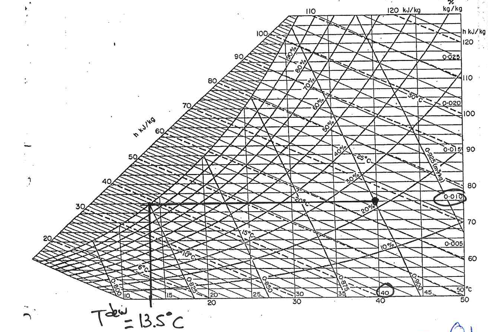

[Previous](<SEP-14 - Humid enthalpy and adiabatic saturation.md>) · [Subject index](../README.md) · [Topic overview](README.md) · [Next](<SEP-16 - Wet bulb and simultaneous heat and mass transfer.md>)

<!-- note-content:start -->
# SEP-15: Dew point and cooling moist gas

## Overview

The dew point is the temperature at which cooling first causes a moist gas to condense. It determines whether a gas can be cooled without liquid formation and is distinct from an evaporatively cooled wet-bulb temperature.

Assumptions: fixed total pressure and composition before condensation, ideal gas and a pure condensable liquid.

## Intuition

Before droplets form, cooling removes energy but no vapour mass. The saturation pressure falls until it equals the vapour partial pressure already present. At that point the gas has reached its dew point.

## Derivation

Let $`H`$ be kg vapour/kg dry gas, $`P`$ total pressure and $`\epsilon=M_v/M_g`$ the vapour/carrier molar-mass ratio. Since neither component has yet condensed or escaped, $`H`$ remains fixed. The ideal-mixture relation gives


**Equation (63)**

```math
p_v=\frac{PH}{\epsilon+H}.
```


At first condensation the vapour and liquid are in equilibrium. Hence the dew-point temperature $`T^{\mathrm{dew}}`$ solves


**Equation (64)**

```math
p^{\mathrm{sat}}(T^{\mathrm{dew}})
=p_v,
\qquad
H^*(T^{\mathrm{dew}},P)=H.
```


Dew point is an endpoint determined by the vapour already present. Two unsaturated gas samples at different initial temperatures but the same humidity and pressure have the same dew point; they need different sensible-cooling duties to reach it. Increasing their initial temperature changes that duty without changing the first-condensation condition.

Once condensation starts, further cooling removes vapour as well as energy, so the fixed-humidity construction must stop. A downstream equilibrium cooler calculation follows the saturation boundary and includes the condensed-liquid stream. This change in the mass balance is the reason the pre-condensation path cannot simply be extended below dew point.

After condensation begins, the gas humidity no longer stays fixed. If it leaves a cooler at equilibrium temperature $`T_c<T^{\mathrm{dew}}`$, conservation gives liquid condensed per kg dry gas:


**Equation (65)**

```math
m_{\mathrm{cond}}=H_{\mathrm{in}}-H^*(T_c,P).
```


The cooler duty then includes both sensible cooling and condensation energy.

## Motivation and explanation



Locate the inlet $`(T,H)`$ on the chart. Follow the line of unchanged humidity toward decreasing dry-bulb temperature until it reaches saturation. Read the temperature there. This construction follows a mass constraint, rather than an adiabatic energy constraint; external heat must be removed to follow it.

For unsaturated air/water under ordinary conditions, dew point lies below wet bulb, which lies below dry bulb. All three coincide at saturation. Compression can raise dew point even without adding vapour because it raises the vapour partial pressure.

## Worked example

At 40°C, $`H=0.010`$ kg water/kg dry air and $`P=100`$ kPa, equation (63) and a water saturation correlation give $`T^{\mathrm{dew}}\approx13.84`$°C. The chart construction gives approximately 13.5°C; this is a graphical estimate.

Cooling initially proceeds at $`H=0.010`$. Continuing below the dew point requires accounting for a declining gas humidity and a liquid outlet. Following a constant-enthalpy line would describe evaporation into the gas and would answer a different physical question.

## Link to other topics

Dew point is a bubble/dew equilibrium calculation expressed on a dry-carrier basis. It also determines whether cooling or heat recovery from dryer exhaust creates condensate.

## Conclusion

Dew point comes from constant-composition cooling to saturation. Wet bulb instead results from simultaneous evaporation and heat transfer at a wet surface.
<!-- note-content:end -->

[Previous](<SEP-14 - Humid enthalpy and adiabatic saturation.md>) · [Subject index](../README.md) · [Topic overview](README.md) · [Next](<SEP-16 - Wet bulb and simultaneous heat and mass transfer.md>)
