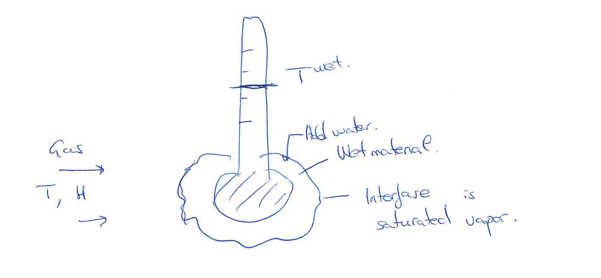
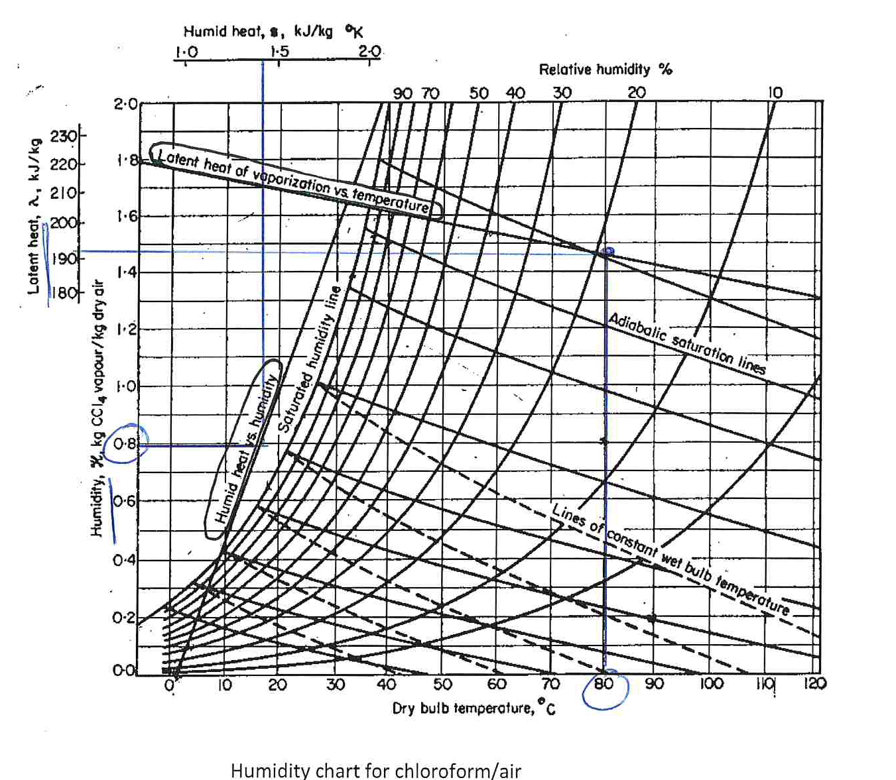

[Previous](<SEP-15 - Dew point and cooling moist gas.md>) · [Subject index](../README.md) · [Topic overview](README.md) · [Next](<SEP-17 - Equilibrium moisture and drying periods.md>)

<!-- note-content:start -->
# SEP-16: Wet bulb and simultaneous heat and mass transfer

## Overview

A completely wet surface exposed to moving gas cools until convective heat supply balances the energy consumed by evaporation. This wet-bulb balance supplies the gas-side drying rate and explains why wet-bulb and adiabatic-saturation lines nearly coincide for air/water.

Assumptions: steady wet surface, negligible radiation/conduction through the support, pure surface liquid, dilute vapour and coefficients evaluated at a representative film state.

## Intuition

*Evaporation cools the surface, which increases heat flow into it.* Cooling also reduces the surface saturation pressure and slows evaporation. These opposing changes establish a surface temperature below the dry-bulb gas temperature.



## Derivation

Let $`T`$ be bulk-gas temperature and $`T^W`$ wet-bulb temperature. The heat flux into the surface is $`q''=U(T-T^W)`$, with $`U`$ in W/(m² K). If $`k_g`$ is a gas-film mass-transfer coefficient in m/s and $`c_i,c_b`$ are surface/bulk vapour molar concentrations,


**Equation (66)**

```math
N_w=M_vk_g(c_i-c_b).
```


Here $`N_w`$ is kg vapour/(m² s), and $`M_v`$ uses kg/mol if concentration uses mol/m³. At the pure-liquid interface $`p_i=p^{\mathrm{sat}}(T^W)`$. Using a common film temperature $`T_f`$ in kelvin gives $`c_i-c_b\approx(p_i-p_v)/(RT_f)`$.

For dilute vapour, $`H\approx M_vp_v/(M_gP)`$; likewise $`H^W\approx M_vp_i/(M_gP)`$. Substitution converts the partial-pressure difference to a humidity difference:


**Equation (67)**

```math
N_w\approx\frac{PM_g}{RT_f}k_g(H^W-H)
=\rho_gk_g(H^W-H)
=k^\dagger(H^W-H).
```


$`\rho_g\approx PM_g/(RT_f)`$ is dry-carrier density, and $`k^\dagger=\rho_gk_g`$ has units kg dry gas/(m² s). The surface humidity is $`H^W=H^*(T^W,P)`$, not saturation humidity at bulk temperature.

At steady state no heat accumulates in the wet bulb. All supplied heat vaporises liquid, so


**Equation (68)**

```math
U(T-T^W)=\lambda(T^W)k^\dagger(H^W-H).
```


Rearranging gives a line joining the bulk state to the saturated surface state:


**Equation (69)**

```math
\frac{H^W-H}{T^W-T}
=-\frac{U}{\lambda k^\dagger}.
```


To compare heat and mass transport, assume the Chilton–Colburn analogy applies. Define $`u`$ as gas speed, $`s`$ humid heat, $`\mathrm{St}=U/(\rho_gus)`$ and $`\mathrm{St}'=k_g/u`$. With $`\mathrm{Pr}=\nu/\alpha_{\mathrm{th}}`$ and $`\mathrm{Sc}=\nu/D`$ (kinematic viscosity $`\nu`$, thermal diffusivity $`\alpha_{\mathrm{th}}`$, vapour diffusivity $`D`$),


**Equation (70)**

```math
\mathrm{St}\,\mathrm{Pr}^{2/3}
=\mathrm{St}'\,\mathrm{Sc}^{2/3}
\quad\Longrightarrow\quad
\frac{U}{k^\dagger}
=s\left(\frac{\mathrm{Sc}}{\mathrm{Pr}}\right)^{2/3}.
```


The speed and density cancel because both coefficients describe transport through the same film. When $`\mathrm{Sc}/\mathrm{Pr}\approx1`$, the wet-bulb slope is approximately $`-s/\lambda`$, close to the adiabatic-saturation slope.

The surface temperature is selected by competing rates. If it falls, the temperature difference supplying heat grows, while its saturation humidity falls and reduces evaporation demand. If it rises, the opposite changes occur. Their intersection fixes the steady wet-bulb temperature; it is not the saturation temperature of the unchanged bulk humidity.

Adiabatic saturation is instead an overall stream-energy and equilibrium construction. The two temperatures are close for air/water because the relevant heat and mass transport properties approximately match, not because every wet surface must reproduce an ideal saturator. The chloroform example makes the limit of that analogy visible.

## Motivation and explanation

The near equality is a transport-property approximation for air/water, not a thermodynamic identity for every solvent. A chart can therefore determine humidity from measured dry- and wet-bulb temperatures: find their two labelled lines and read $`H`$ at the intersection. Wet-bulb humidity means saturation humidity at the wet surface; it is not the bulk humidity.



For chloroform/air the two line families differ and can curve as physical properties vary. Additional heating or an incompletely wet surface also invalidates (3). At high vapour fractions, the dilute conversion and a linear gas-film flux need refinement.

## Link to other topics

The wet-bulb surface balance is the local version of simultaneous heat and mass transfer in a direct dryer. The transport analogy also connects to gas-film correlations used in absorption.

## Conclusion

Use surface saturation at the wet-bulb temperature to form the gas-side driving force. Whether the solid can keep supplying liquid to that surface determines the next drying regime.
<!-- note-content:end -->

[Previous](<SEP-15 - Dew point and cooling moist gas.md>) · [Subject index](../README.md) · [Topic overview](README.md) · [Next](<SEP-17 - Equilibrium moisture and drying periods.md>)
