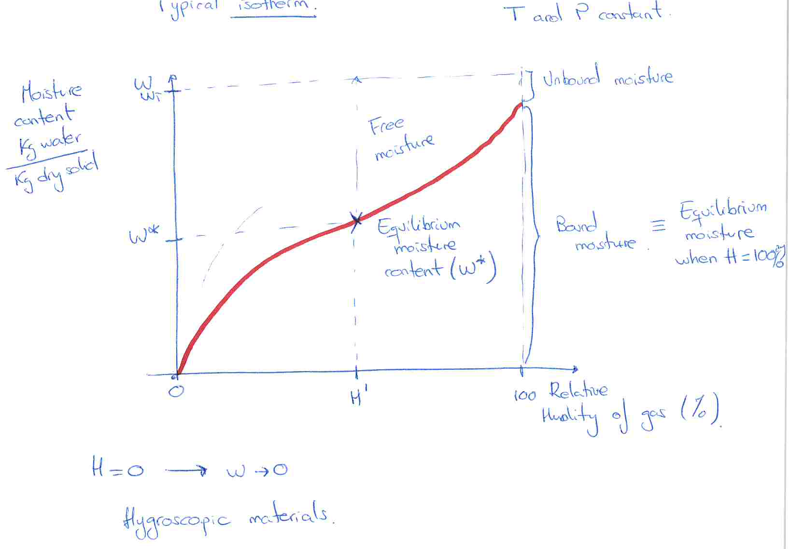
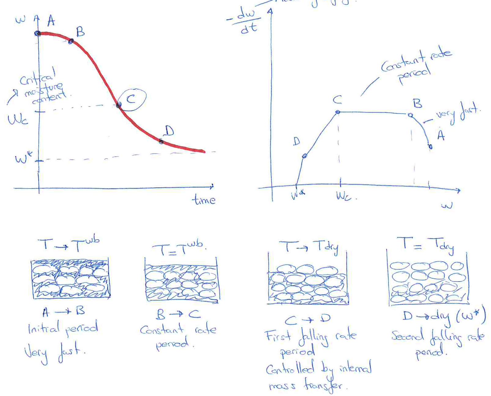

[Previous](<SEP-16 - Wet bulb and simultaneous heat and mass transfer.md>) · [Subject index](../README.md) · [Topic overview](README.md) · [Next](<SEP-18 - Countercurrent drying and minimum gas flow.md>)

<!-- note-content:start -->
# SEP-17: Equilibrium moisture and drying periods

## Overview

The drying rate depends on whether liquid can keep the surface wet. A constant-gas experiment distinguishes an initial adjustment, a surface-controlled period and falling-rate periods controlled increasingly by movement within the material. Equilibrium moisture defines the limiting endpoint.

Assumed background: the wet-bulb surface balance. Use moisture content $`w`$ in kg liquid/kg bone-dry solid throughout.

## Intuition

*A wet surface evaporates like a small pool until its internal supply cannot keep up.* After that, dry patches or a receding evaporation region develop. Moisture must travel through the solid, and the material warms because less supplied energy is spent on vaporisation.

## Derivation

At fixed temperature and pressure, let $`w^*(H)`$ be the equilibrium moisture content for a given gas humidity $`H`$. There is no net drying at that state. The removable **free moisture** under those gas conditions is


**Equation (71)**

```math
w_{\mathrm{free}}=w-w^*.
```


This is distinct from **unbound moisture**, which exerts the vapour pressure of pure liquid. Bound moisture has a lower equilibrium vapour pressure due to its interaction with the solid. Some bound moisture can still be free relative to a sufficiently dry gas.



Let $`A`$ be exposed area, $`m_s`$ dry-solid mass and $`a_w=A/m_s`$. With moisture flux $`N_w`$ in kg/(m² s), the solid balance gives $`m_s\,dw/dt=-AN_w`$. Therefore the positive specific drying rate is


**Equation (72)**

```math
r=-\frac{dw}{dt}=a_wN_w.
```


When the surface is fully wet, the gas-side model gives


**Equation (73)**

```math
r=k^\dagger a_w(H^W-H)=\beta\Delta H,
\qquad
\Delta H=H^W-H.
```


Here $`k^\dagger`$ is kg dry gas/(m² s), $`H^W`$ surface saturation humidity at wet bulb, and $`\beta=k^\dagger a_w`$. Under unchanged gas conditions, coefficients and area, (3) is independent of $`w`$. Its heat-transfer form follows from $`N_w\lambda=U(T-T^W)`$:


**Equation (74)**

```math
t_{\mathrm{const}}
=\frac{m_s(w_1-w_2)\lambda}{UA(T-T^W)}.
```


To obtain (4), integrate $`-m_sdw/dt=UA(T-T^W)/\lambda`$ with constant right-hand side. The numerator is the liquid mass removed times its latent heat; the denominator is the heat-supply rate.

Below a critical moisture $`w_c`$, empirical falling-rate laws might be


**Equation (75)**

```math
r=\alpha(w-w^*),
\qquad\text{or}\qquad
r=\gamma(w-w^*)\Delta H.
```


$`\alpha`$ has units inverse time, while $`\gamma`$ also incorporates the humidity basis. If $`w^*`$ is negligible over the measured range, these reduce to $`\alpha w`$ and $`\gamma w\Delta H`$. They are fitted descriptions, not universal constitutive laws.

## Motivation and explanation



Read the moisture–time plot from left to right, but the rate–moisture plot from high to low $`w`$. During initial adjustment A–B the solid approaches wet-bulb temperature. During B–C it remains sufficiently wet for external heat/mass transport to control. During C–D the wet area decreases or the evaporation region recedes; later internal transport can slow further.

$`w_c`$ is not solely a material constant. It depends on sample thickness, geometry and imposed external demand. A stronger gas-side drying rate can exhaust surface supply at a higher moisture content. Capillary flow, diffusion and pressure-driven movement can each matter; their relative roles vary with the material and stage of drying.

The term “constant-rate period” describes a regime observed at fixed gas conditions. In a continuous dryer the local gas humidity and temperature may change, so a fully wet material need not have a constant rate along its path. Near equilibrium, fitted laws must give $`r\to0`$; extrapolating $`r=\alpha w`$ to a nonzero $`w^*`$ would violate that requirement.

## Worked example

For a completely wet specimen, remove 0.20 kg water while $`A=2.0`$ m², $`U=40`$ W/(m² K), gas temperature 50°C, wet bulb 25°C and $`\lambda=2.4\times10^6`$ J/kg stay fixed. Equation (74) gives $`t=240`$ s.

This is a specified model example. It applies only while enough liquid reaches the surface to maintain the assumed area and wet-bulb temperature. If the endpoint lies below $`w_c`$, a separate falling-rate integral is required.

## Link to other topics

The equilibrium moisture isotherm connects drying to sorption equilibria. Internal diffusion and external-film resistance also appear in porous catalyst models, although a drying solid need not retain a fixed structure.

## Conclusion

Measure rate laws under representative gas and material conditions, identify the equilibrium limit and determine the regime transition. Continuous-dryer design then combines those local rates with a gas–solid operating line.
<!-- note-content:end -->

[Previous](<SEP-16 - Wet bulb and simultaneous heat and mass transfer.md>) · [Subject index](../README.md) · [Topic overview](README.md) · [Next](<SEP-18 - Countercurrent drying and minimum gas flow.md>)
