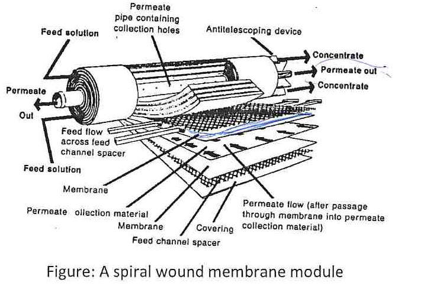

[Previous](<SEP-23 - Membrane mechanisms and structure.md>) · [Subject index](../README.md) · [Topic overview](README.md) · [Next](<SEP-25 - Flux, rejection, recovery and resistances.md>)

<!-- note-content:start -->
# SEP-24: Membrane modules and operating modes

## Overview

Assumed knowledge: steady material balances and the membrane feed, retentate and permeate streams.

A membrane module packages a large selective area into a manageable volume. Its flow channels influence pressure loss, cleaning and concentration polarisation. This note compares module geometries and derives the volume concentration ratio for batch and continuous operation.

## Intuition

Making channels narrow increases membrane area per equipment volume and can produce high tangential velocity without a huge vessel. The same narrow channels are easier to block. The practical choice balances compactness against the feed's solids content, viscosity and cleaning requirements.

Crossflow sends feed along the membrane and removes permeate across it. Tangential flow helps carry retained material away from the surface. Dead-end filtration directs feed towards the barrier, so retained solids accumulate until removed. Crossflow reduces accumulation but does not eliminate fouling.

## Derivation

Let $`Q_1`$ be fresh-feed volumetric flow, $`Q_2`$ permeate flow and $`Q_3`$ retentate withdrawal. Assume steady operation, negligible accumulation and approximately additive liquid volumes. An overall balance gives


**Equation (102)**

```math
Q_1=Q_2+Q_3.
```


Define total permeate recovery, or stage cut, $`S=Q_2/Q_1`$. The fraction left as retentate is consequently $`1-S=Q_3/Q_1`$.

The **volume concentration ratio** is the initial feed volume divided by the remaining retentate volume in a batch, or the corresponding flow ratio in continuous operation:


**Equation (103)**

```math
\mathrm{VCR}=\frac{Q_1}{Q_3}=\frac{1}{1-S}.
```


This definition measures volume reduction. To identify it with a solute concentration increase, let $`C_1`$ and $`C_3`$ be feed and retentate solute concentrations and assume complete solute rejection, $`C_2=0`$. The solute balance gives $`Q_1C_1=Q_3C_3`$, hence


**Equation (104)**

```math
\frac{C_3}{C_1}=\mathrm{VCR}.
```


Recycle changes how often liquid passes the membrane, while net recovery measures how much fresh feed ultimately leaves as permeate. They answer different questions because the recycle crosses only an internal process boundary. A large circulating flow can sustain useful wall shear even when net feed and product rates are modest.

The equality of concentration ratio and VCR follows from retained solute mass staying fixed while solvent volume falls. If solute crosses the membrane, both numerator inventory and denominator volume change. The same volume reduction then produces less concentration than complete retention predicts, even if the module hydrodynamics are unchanged.

## Motivation and explanation

| Module | Arrangement and representative area density | Design consequence |
|---|---|---|
| Flat sheet, plate-and-frame | Stacked sheets with feed and permeate spacers; roughly $`300`$–$`500\,\mathrm{m^2\,m^{-3}}`$ | Accessible flow passages and support; larger equipment volume for a given area |
| Spiral wound | Membrane envelopes wound around a permeate collection tube; roughly $`600`$–$`1000\,\mathrm{m^2\,m^{-3}}`$ | Compact; spacers establish channels but can trap deposits |
| Hollow fibre | Many small membrane tubes in a shell; representative area density around $`1200\,\mathrm{m^2\,m^{-3}}`$ | Very large area; narrow passages increase plugging sensitivity |

These area densities describe example configurations, rather than universal limits. Feed can occupy the fibre lumen or shell, depending on membrane design.



Feed moves along a spiral-wound module; retentate leaves downstream. Permeate crosses into the membrane envelope and travels to the collection tube. Keeping these paths separate prevents a nonselective hydraulic short circuit.

Single-pass operation has no retentate recycle. Batch operation recirculates a finite charge while withdrawing permeate: retentate volume falls and its concentration rises. Fed-batch operation adds fresh feed during recirculation, sustaining production but increasing the number of pump passages. Continuous operation supplies fresh feed and withdraws both product streams at steady rates. Repeated pumping can damage shear-sensitive biological material even when membrane contact itself is mild.

Modules in parallel increase throughput. Retentate stages in series increase overall removal or concentration; different membrane cut-offs can separate successively smaller species. Staging increases concentration in later retentate streams, so those stages need fresh checks of flux and mass transfer.

## Worked example

A batch protein solution is circulated while solvent permeates and the protein is completely retained. As the retentate volume falls, its protein concentration increases according to Equation (104). If the membrane is only partly rejecting, a solute balance must include the protein lost in the permeate: dividing initial protein mass by remaining volume would overestimate the final concentration.

Even with complete rejection, the flux need not remain constant. Rising concentration increases viscosity, concentration polarisation and osmotic opposition, so the time needed for each additional volume reduction commonly grows.

## Link to other topics

The distinction between internal recycle and net throughput is the same one used in reactor balances. The next step is to quantify membrane productivity, rejection and the resistances responsible for a measured flux.

## Conclusion

Module geometry sets available area and hydrodynamics, while operating mode sets how concentration evolves. VCR follows directly from volume reduction; it equals the solute concentration ratio only when solute is completely retained.
<!-- note-content:end -->

[Previous](<SEP-23 - Membrane mechanisms and structure.md>) · [Subject index](../README.md) · [Topic overview](README.md) · [Next](<SEP-25 - Flux, rejection, recovery and resistances.md>)
