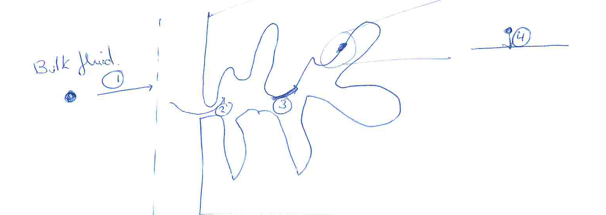

[Previous](<SEP-36 - Langmuir and Freundlich equilibrium models.md>) · [Subject index](../README.md) · [Topic overview](README.md) · [Next](<SEP-38 - Batch adsorption design and physical roots.md>)

<!-- note-content:start -->
# SEP-37: Adsorption transport and uptake kinetics

## Overview

Assumed: diffusion and transfer coefficients.

A measured adsorption rate combines transport through the fluid film, movement within pores and binding at sites. An overall driving-force model is useful only when its area basis and equilibrium reference are defined.

## Intuition

A molecule reaches the bead, enters a pore, moves toward an available site and binds. Increasing stirring helps the first step, but may scarcely affect a long intraparticle diffusion path. Increasing equilibrium affinity does not necessarily speed the slowest step.



## Derivation

**Step 1: define a total transfer rate.** Let $`C`$ be bulk liquid concentration and $`C^*(q)`$ the liquid concentration in equilibrium with current average solid loading $`q`$. With overall coefficient $`K_c`$ in m/s and effective interface area $`A_i`$,


**Equation (157)**

```math
\dot m_A=K_c A_i[C-C^*(q)].
```


*Reason:* an overall coefficient combines unresolved transport contributions against an equilibrium-based driving force. If using specific area $`a=A_i/V`$, then $`K_ca(C-C^*)`$ is a rate per liquid volume, not a total rate.

**Step 2: connect fluid and solid inventories.** For constant liquid volume $`V`$ and adsorbent mass $`M`$ in a closed, well-mixed batch,


**Equation (158)**

```math
-V\frac{dC}{dt}=M\frac{dq}{dt}=K_c A_i[C-C^*(q)].
```


*Reason:* solute leaving the fluid enters the solid; there is no other source or sink. For Langmuir equilibrium, inversion gives $`C^*(q)=K_dq/(Q_m-q)`$ for $`0\le q<Q_m`$.

**Step 3: examine a simpler uptake approximation.** If a fixed surrounding fluid concentration maintains an equilibrium target $`q_{\mathrm{eq}}`$, a linear driving-force approximation is $`dq/dt=k_u(q_{\mathrm{eq}}-q)`$, where $`k_u`$ has inverse-time units. Separating variables gives $`dq/(q_{\mathrm{eq}}-q)=k_u dt`$; integrate from $`q_0`$ at zero time:


**Equation (159)**

```math
q(t)=q_{\mathrm{eq}}-(q_{\mathrm{eq}}-q_0)e^{-k_ut}.
```


*Reason:* the difference from equilibrium decays exponentially under this closure. The target cannot be held constant in a finite closed batch unless its changing concentration is negligible.

In a closed batch, uptake changes both sides of the driving force. Liquid concentration falls as the adsorbent loads; meanwhile the fluid concentration in equilibrium with that increasing loading rises. Their difference narrows from both directions. A model with a fixed target loading omits the first feedback unless an external reservoir maintains the surrounding concentration.

Improving stirring primarily changes the path through the external film, whereas changing particle size also changes internal diffusion distance. A faster initial uptake after stirring therefore identifies a rate effect, not additional equilibrium capacity. Distinguishing those experiments helps choose whether more mixing or more accessible adsorbent is useful.

## Motivation and explanation

Pore-fluid diffusion and surface diffusion can provide alternative paths inside the same bead. They should not automatically be treated as four simple resistors in series. A fitted overall coefficient can depend on loading, particle size and conditions.

Reducing bead size shortens diffusion distances but raises packed-bed pressure drop. Stirring increases fluid-film transfer. Neither change alters the equilibrium isotherm at fixed temperature and composition.

## Link to other topics

The transport sequence resembles porous catalyst transport, but the stored adsorbate now changes continuously during loading. Its conservation balance is the foundation of both batch design and moving adsorption fronts.

## Conclusion

Keep rate and capacity separate. A transfer model predicts approach to equilibrium only after its inventory and area conventions are fixed.
<!-- note-content:end -->

[Previous](<SEP-36 - Langmuir and Freundlich equilibrium models.md>) · [Subject index](../README.md) · [Topic overview](README.md) · [Next](<SEP-38 - Batch adsorption design and physical roots.md>)
