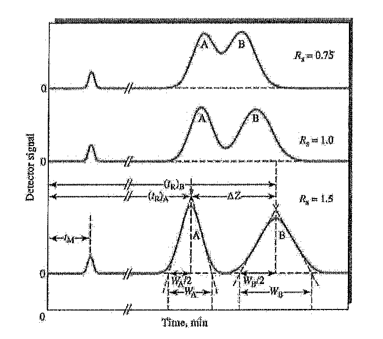

[Previous](<SEP-42 - Column efficiency and band broadening.md>) · [Subject index](../README.md) · [Topic overview](README.md)

<!-- note-content:start -->
# SEP-43: Chromatographic resolution and design tradeoffs

## Overview

Assumed: retention factors and Gaussian plate numbers.

Resolution measures separation of peak centres relative to their widths. It connects three design levers: efficiency, equilibrium selectivity and retention. Those levers have different effects on analysis time and pressure drop.

## Intuition

Two peaks are easier to distinguish if their centres move apart or their widths shrink. Delaying both equally does little if they also broaden proportionally. Changing selectivity can therefore be more effective than simply adding column length.



## Derivation

**Step 1: define the measured quantity.** For later-eluting species2, retention times $`t_{r,2}>t_{r,1}`$ and baseline widths $`w_2,w_1`$,


**Equation (175)**

```math
R_s=\frac{2(t_{r,2}-t_{r,1})}{w_1+w_2}.
```


*Reason:* centre separation is scaled by mean baseline width. This definition is directly measurable and does not assume a retention model.

**Step 2: substitute an equal-efficiency model.** Let both Gaussian peaks have the same theoretical plate number $`n`$, so $`w_j=4t_{r,j}/\sqrt n`$. Use $`t_{r,j}=t_m(1+k'_j)`$ and collect the common $`t_m`$:


**Equation (176)**

```math
R_s=\frac{\sqrt n}{2}\frac{k'_2-k'_1}{2+k'_1+k'_2}.
```


*Reason:* substituting both widths retains their difference rather than silently treating them as identical. This result is exact within the equal-$`n`$, Gaussian baseline-width model.

**Step 3: obtain the common design approximation.** For close peaks, take $`w_1\approx w_2`$ and use the later peak width. Then $`R_s\approx\sqrt n(t_{r,2}-t_{r,1})/(4t_{r,2})`$. Define selectivity $`\alpha=k'_2/k'_1>1`$; since $`k'_2-k'_1=k'_2(\alpha-1)/\alpha`$,


**Equation (177)**

```math
R_s\approx\frac{\sqrt n}{4}\frac{\alpha-1}{\alpha}\frac{k'_2}{1+k'_2}.
```


*Reason:* the centre difference depends on differential retention; dividing by later retention produces the selectivity factor. Use theoretical $`n`$ based on total retention time, not adjusted-time effective plates.

## Motivation and explanation

Efficiency enters as $`\sqrt n`$. At constant plate height, a longer column improves resolution only as the square root of its length while increasing transit time and pressure drop. Selectivity tends to zero as $`\alpha\to1`$: even an efficient column cannot readily separate species with identical retention.

The retention factor term saturates at high $`k'_2`$, while $`t_{r,2}=t_m(1+k'_2)`$ continues to grow. Changing mobile-phase composition, stationary-phase chemistry or temperature can alter selectivity, but these changes may also alter efficiency and recovery.

A value near $`R_s=1.5`$ is a common baseline-separation guide for similar Gaussian peaks. Strongly unequal peak heights, tailing, trace analysis or detector requirements may demand a different acceptance criterion. Check the actual chromatogram rather than treating the number as universal.

## Worked example

For illustrative $`t_m=2.00\ \mathrm{min}`$, $`k'_1=2.00`$, $`k'_2=2.50`$ and $`n=10000`$, the peak times are $`6.00`$ and $`7.00\ \mathrm{min}`$ and their baseline widths are $`0.240`$ and $`0.280\ \mathrm{min}`$. Equation (175) gives **$`R_s=3.84615`$**. Equation (177) gives **$`3.57143`$**; the difference reflects its equal-width approximation.

Holding retention factors fixed, the approximate equation predicts that $`n=1764`$ would give $`R_s=1.50`$. This is a design estimate to check against actual peak shapes and operating conditions.

## Link to other topics

Resolution combines equilibrium selectivity with transport efficiency. Across absorption, drying, membranes and adsorption, a favourable equilibrium must still be paired with enough area, time or effective contacting to achieve the desired separation.

## Conclusion

Design for centre separation and band width together. Choose the most effective equilibrium and transport changes, then verify the resulting separation experimentally or with a validated model.
<!-- note-content:end -->

[Previous](<SEP-42 - Column efficiency and band broadening.md>) · [Subject index](../README.md) · [Topic overview](README.md)
