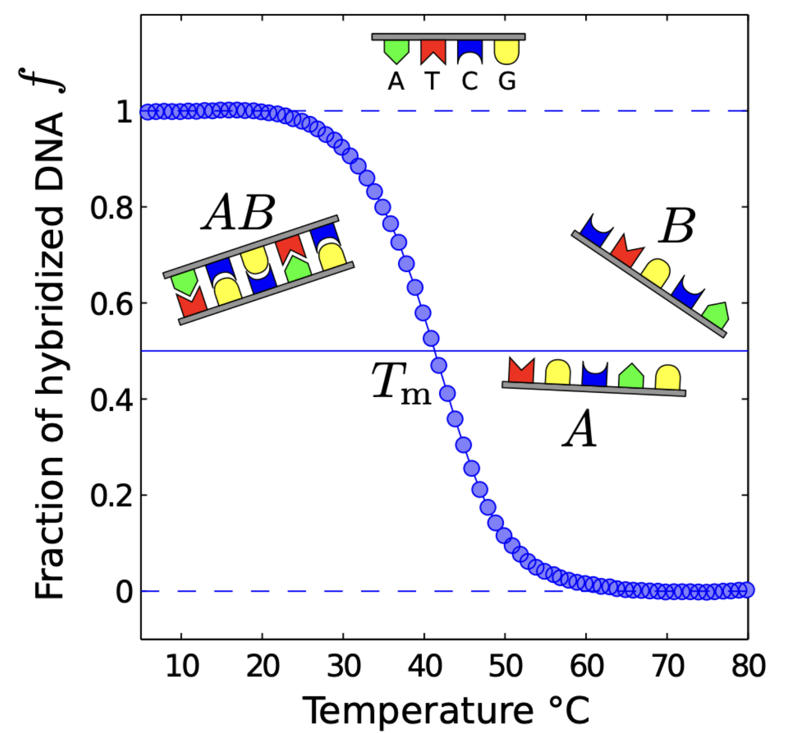
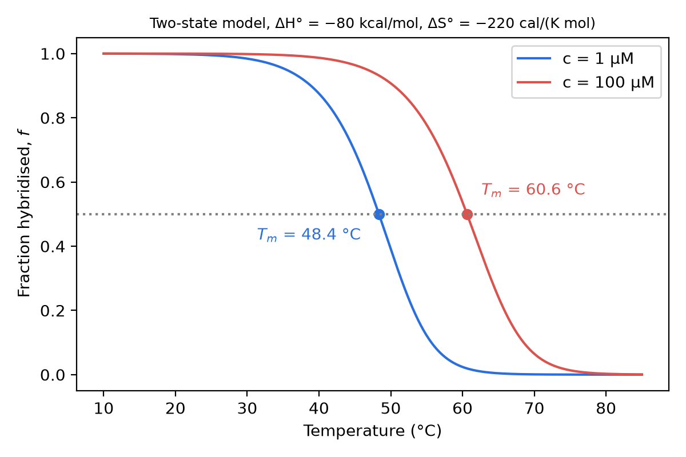

# Nucleic acids - structure, thermodynamics and kinetics — reading 01.2

[Previous](01-01-nucleic-acids-structure-thermodynamics-and-kinetics.md) · [Subject index](README.md) · [Next](01-03-nucleic-acids-structure-thermodynamics-and-kinetics.md)

<!-- reading-content:start -->
## Section 02: Polymer physics of DNA and the worm-like chain

### Intuition

Follow the chain along its contour. Thermal kicks bend it a little at every point. Over a short distance the bends are small and the chain still "remembers" which way it was pointing. Over a long distance the small bends add up and the direction is forgotten. The persistence length is the distance over which the memory fades. A stiff chain (dsDNA) remembers over about 50 nm; a floppy one (ssDNA) over about 1–2 nm.

*Analogy:* a cooked spaghetti strand (ssDNA) against a garden hose (dsDNA). Both are straight over short lengths and curve over long ones; the hose just needs a longer length before it turns round. The analogy breaks down because the bending here is driven by thermal motion, not gravity or handling, and the stiffness measured as $`l_P`$ scales with $`1/T`$.

### Derivation

Notation: $`s`$ is the arc length along the chain, $`\hat t(s)`$ is the unit tangent at $`s`$, $`L`$ is the contour length, and $`\vec R = \int_0^L \hat t\,ds`$ is the end-to-end vector.

**Step 1: bending energy.** A rod with bending stiffness $`\kappa`$ (units J·m) stores energy proportional to the square of its curvature, just as a spring stores energy proportional to the square of its extension:

**Equation (1)**

```math
E_{\text{bend}} = \frac{\kappa}{2}\int_0^L\left|\frac{d\hat t}{ds}\right|^2 ds
```


**Step 2: one short segment.** Over a short length $`\Delta s`$, the tangent turns by a small angle $`\theta`$ and the curvature is $`\theta/\Delta s`$. From (1), the segment's energy is $`E = \kappa\theta^2/(2\Delta s)`$. The deflection has two independent transverse components ($`\theta_x`$, $`\theta_y`$), each a quadratic term, so equipartition gives each $`\tfrac12 k_BT`$:

**Equation (2)**

```math
\frac{\kappa}{2\Delta s}\langle\theta^2\rangle = 2\cdot\tfrac12 k_BT \;\Rightarrow\; \langle\theta^2\rangle = \frac{2\,k_BT\,\Delta s}{\kappa}
```


**Step 3: correlation across one segment.** For a small angle, $`\cos\theta \approx 1-\theta^2/2`$. Using (2):

**Equation (3)**

```math
\langle \hat t(s+\Delta s)\cdot\hat t(s)\rangle = \langle\cos\theta\rangle \approx 1 - \frac{k_BT}{\kappa}\Delta s = 1-\frac{\Delta s}{l_P}, \qquad l_P \equiv \frac{\kappa}{k_BT}
```


**Step 4: many segments.** Each segment's bend is independent of the others, and its azimuth is random. Only the component of $`\hat t`$ along the previous direction survives on average, so the correlations multiply. Splitting $`s`$ into $`N = s/\Delta s`$ segments and letting $`\Delta s\to 0`$:

**Equation (4)**

```math
\langle \hat t(s)\cdot\hat t(0)\rangle = \left(1-\frac{\Delta s}{l_P}\right)^{s/\Delta s} \to e^{-s/l_P}
```

This is the defining property of the WLC: orientation decays exponentially, and $`l_P`$ is the decay length.

**Step 5: end-to-end distance.** Square $`\vec R`$ and average. The correlation depends only on the separation $`|s-s'|`$:

```math
\langle R^2\rangle = \int_0^L\!\!\int_0^L \langle\hat t(s)\cdot\hat t(s')\rangle\,ds\,ds' = \int_0^L\!\!\int_0^L e^{-|s-s'|/l_P}\,ds\,ds'
```

Do the inner integral for fixed $`s`$, splitting it at $`s'=s`$; this gives $`l_P\left(2 - e^{-s/l_P} - e^{-(L-s)/l_P}\right)`$. Then integrate over $`s`$:

**Equation (5)**

```math
\langle R^2\rangle = 2l_PL\left[1 - \frac{l_P}{L}\left(1-e^{-L/l_P}\right)\right]
```


**Limits (sanity checks).**
- *Rod*, $`L\ll l_P`$: expand $`e^{-x}\approx 1-x+x^2/2`$ with $`x=L/l_P`$. The bracket becomes $`L/(2l_P)`$, so $`\langle R^2\rangle \to L^2`$. The ends are a full contour length apart.
- *Coil*, $`L\gg l_P`$: the bracket tends to 1, so $`\langle R^2\rangle\to 2l_PL`$. This is a freely jointed chain with $`N=L/b`$ links of length $`b = 2l_P`$ (the *Kuhn length*), since $`Nb^2 = 2l_PL`$. Size grows as $`\sqrt L`$, the random-walk scaling.

### Motivation and explanation

**Why ds and ss differ so much.**


- **dsDNA:** $`l_P \approx 40`$–$`60`$ nm, which at 0.34 nm/bp is about 120–180 bp (about 150 bp for 50 nm). Bending a duplex compresses the base stack on the inside of the bend and stretches it on the outside. It also squeezes the charged backbones together. Both cost energy, so $`\kappa`$ is large. The duplex also resists twisting (it "sustains torsion"), which matters for supercoiling.
- **ssDNA:** $`l_P\approx 1`$–$`2`$ nm, a few nucleotides. Without a partner strand, the backbone bonds rotate almost freely (a "free swivel"), so there is little to resist bending.
- **Salt dependence.** Part of $`\kappa`$ is electrostatic repulsion along the backbone. Lowering the salt concentration screens the charges less and *raises* $`l_P`$. This is most visible for ssDNA, where reported values range from about 1 nm to several nm depending on ionic strength.

**When the model fails.**
- It ignores the volume the chain occupies (*excluded volume*), so it underestimates the size of very long coils.
- It ignores sequence-dependent intrinsic curvature (A-tracts bend DNA).
- It does not capture sharp kinks under strong bending.
- It describes single-stranded DNA only roughly, because ssDNA also forms transient internal base pairs.

### Worked example

$`\sqrt{\langle R^2\rangle}`$ for dsDNA with $`l_P = 50`$ nm, from (5), computed in Python:

| Length (bp) | $`L`$ (nm) | $`R_{\text{rms}}`$ (nm) | $`R_{\text{rms}}/L`$ |
|---|---|---|---|
| 20 | 6.8 | 6.65 | 0.98 |
| 150 | 51 | 43.6 | 0.86 |
| 1000 | 340 | 170 | 0.50 |
| 48 502 (λ phage) | 16 490 | 1282 | 0.078 |

- A 20 bp duplex is effectively a rigid rod. DNA nanotechnology (Section 21) depends on this: short duplexes act as straight struts.
- Once $`L`$ reaches about $`l_P`$ (around 150 bp), the duplex is noticeably bent.
- A whole λ genome (16.5 µm of contour) forms a coil only about 1.3 µm across.
- A 20 nt single strand ($`l_P\approx 1`$–$`2`$ nm) is already a coil. This is the source of the entropy lost on hybridisation in Section 03.

### Link to other topics

The exponential-correlation argument is the same one used for any Markov process. Turning a stiffness into a length scale by dividing by $`k_BT`$ is the same move as a Debye length or a capillary length.

### Summary

Thermal bending makes the orientation of DNA decay as $`e^{-s/l_P}`$, with $`l_P=\kappa/k_BT`$. This gives rod-like behaviour below $`l_P`$ and a random coil of Kuhn length $`2l_P`$ above it. dsDNA ($`l_P\approx 50`$ nm) is about 30 times stiffer than ssDNA ($`\approx`$1–2 nm).

## Section 03: Two-state hybridisation and DNA melting

### Intuition

Pairing releases enthalpy: stacking and hydrogen bonds form ($`\Delta H^0<0`$). It also costs entropy: two floppy coils (Section 02) become one stiff duplex, and two independent molecules become one ($`\Delta S^0<0`$). At low $`T`$ the enthalpy term wins and the strands are paired. At high $`T`$ the $`-T\Delta S^0`$ penalty wins and they separate. Because $`\Delta H^0`$ and $`-T\Delta S^0`$ are both large (tens of kcal/mol) and nearly cancel near body temperature, a change of a few degrees tips the balance. That is why DNA melts over a narrow range.

Concentration matters because binding requires two strands to meet. In a more dilute solution, partners meet less often, so the duplex has to be more stable (cooler) for half the strands to be paired.

### Derivation

Notation: $`[A]`$, $`[B]`$, $`[AB]`$ are equilibrium concentrations; $`\rho_0 = 1`$ M is the standard concentration; $`\Delta G^0 = \Delta H^0 - T\Delta S^0`$ is the standard Gibbs energy of hybridisation (duplex minus single strands); $`f`$ is the fraction of strands hybridised.

**Two-state assumption.** Each strand is either fully paired or fully free. Partially zipped states are neglected. This is reasonable for short oligos (up to about 20–30 bp), where a partly open duplex is much less stable than either end state.

**Step 1: equilibrium constant.** For an ideal dilute solution, the chemical potential of each species is $`\mu_i = \mu_i^0 + RT\ln([i]/\rho_0)`$. Setting $`\mu_{AB} = \mu_A+\mu_B`$ at equilibrium gives:

**Equation (6)**

```math
K = \frac{[AB]}{[A][B]} = \frac{1}{\rho_0}\exp\left(-\frac{\Delta G^0}{RT}\right)
```

The factor $`1/\rho_0`$ gives $`K`$ units of M⁻¹ and makes clear that $`\Delta G^0`$ refers to 1 M. $`\Delta G^0`$ alone does not decide whether strands are paired; the concentration does too.

**Step 2: mass balance.** Take equal total concentrations $`[A]_0=[B]_0=c`$. Each duplex uses one A and one B, so:

**Equation (7)**

```math
[AB]=fc,\qquad [A]=[B]=c(1-f)
```


**Step 3: substitute (7) into (6).**

**Equation (8)**

```math
\frac{f}{c(1-f)^2} = \frac{1}{\rho_0}\exp\left(-\frac{\Delta H^0 - T\Delta S^0}{RT}\right)
```

Writing $`a = Kc`$, (8) is a quadratic, $`a(1-f)^2 = f`$. Its physical root (the one with $`0\le f\le 1`$) is:

**Equation (9)**

```math
f = \frac{(2a+1)-\sqrt{4a+1}}{2a}
```

Checks: as $`a\to\infty`$ (cold, or concentrated) $`f\to 1`$; as $`a\to 0`$, $`f\approx a\to 0`$.

**Step 4: melting temperature.** Define $`T_m`$ by $`f=\tfrac12`$. Then $`f/(1-f)^2 = 2`$, and (8) gives $`2/c = (1/\rho_0)\exp(-\Delta G^0/RT_m)`$:

**Equation (10)**

```math
\frac{c}{2} = \rho_0\exp\left(\frac{\Delta H^0}{RT_m} - \frac{\Delta S^0}{R}\right)
```

Take logarithms and solve for $`T_m`$:

**Equation (11)**

```math
T_m = \frac{\Delta H^0}{\Delta S^0 + R\ln\!\left(\dfrac{c}{2\rho_0}\right)}
```

Both $`\Delta H^0`$ and the denominator are negative, so $`T_m>0`$.

**Step 5: self-complementary strand** ($`A + A \rightleftharpoons A_2`$, total strand concentration $`c`$). Here $`[A_2] = fc/2`$ and $`[A] = c(1-f)`$. At $`f=\tfrac12`$, $`K = (c/4)/(c/2)^2 = 1/c`$. Hence:

**Equation (12)**

```math
T_m^{\text{self}} = \frac{\Delta H^0}{\Delta S^0 + R\ln(c/\rho_0)}
```

In terms of the *total* strand concentration $`C_T`$, (11) uses $`C_T/4`$ (since $`C_T = 2c`$) and (12) uses $`C_T`$. That is the form in which the formula is usually quoted.

**Step 6: sharpness of the transition.** Take the logarithm of $`f/(1-f)^2 = cK`$ and differentiate with respect to $`T`$. On the right, $`d\ln K/dT = \Delta H^0/RT^2`$ (van 't Hoff). On the left, $`d\ln[f/(1-f)^2]/df = 1/f + 2/(1-f) = (1+f)/[f(1-f)]`$. So:

**Equation (13)**

```math
\frac{df}{dT} = \frac{\Delta H^0}{RT^2}\,\frac{f(1-f)}{1+f}, \qquad \left.\frac{df}{dT}\right|_{T_m} = \frac{\Delta H^0}{6RT_m^2}
```

A larger $`|\Delta H^0|`$ (a longer duplex) gives a sharper transition. Fitting the slope of a measured melting curve is therefore one way to obtain $`\Delta H^0`$.

### Motivation and explanation



- **Why the temperature dependence is captured by constants.** Over the melting range, $`\Delta H^0`$ and $`\Delta S^0`$ are roughly independent of temperature: the heat-capacity change on hybridisation is small enough to neglect. All the temperature dependence then comes through $`T`$ in $`\Delta H^0 - T\Delta S^0`$.
- **Concentration dependence.** $`\ln(c/2\rho_0)`$ is negative and large (about −14 for µM strands). It makes the denominator of (11) more negative and so lowers $`T_m`$ below $`\Delta H^0/\Delta S^0`$. This "translational" entropy penalty for bringing two molecules together is what the $`1/\rho_0`$ in (6) accounts for. Unimolecular transitions, such as a hairpin closing, have no such term, and their $`T_m = \Delta H^0/\Delta S^0`$ does not depend on concentration.
- **How measured curves are obtained.** The curve is usually measured by UV absorbance at 260 nm, which rises about 20–40 % on melting because stacked bases absorb less (*hyperchromicity*). Absorbance therefore tracks $`f`$ directly.
- **Where the model fails:**
  - long duplexes melt in domains through partly open intermediates;
  - single strands with internal secondary structure (hairpins) compete with the duplex;
  - unequal strand concentrations change (7): with $`[A]_0 > [B]_0`$, the term $`c/2`$ is replaced by $`[A]_0 - [B]_0/2`$;
  - $`\Delta S^0`$ depends on salt (Section 04).

### Worked example

A 12-mer duplex with $`\Delta H^0 = -80`$ kcal/mol (−334.7 kJ/mol) and $`\Delta S^0 = -220`$ cal K⁻¹ mol⁻¹ (−920.5 J K⁻¹ mol⁻¹). All numbers were computed in Python.

| | $`c = 1`$ µM | $`c = 100`$ µM |
|---|---|---|
| $`T_m`$ from (11) | 48.4 °C | 60.6 °C |
| $`f`$ from (9) at that $`T_m`$ | 0.500 | 0.500 |

- **Concentration.** A 100-fold increase in concentration raises $`T_m`$ by 12.3 °C. Concentration therefore has to be specified whenever a $`T_m`$ is quoted.
- **Stability at body temperature.** At 37 °C, $`\Delta G^0 = -80 - 310.15\times(-0.220) = -11.77`$ kcal/mol, so $`K = 1.96\times10^{8}`$ M⁻¹. At 1 µM, $`Kc \approx 196`$, so the duplex is almost fully formed.
- **Width.** At 1 µM, $`f`$ falls from 0.9 to 0.1 between 38.9 and 55.7 °C, a window of about 17 °C. The slope at $`T_m`$ is −0.065 K⁻¹, matching (13) exactly.



### Link to other topics

Equation (6) is the standard-state chemical equilibrium of Equilibrium Thermodynamics, applied to a bimolecular reaction in dilute solution. The concentration term in (11) is the same $`RT\ln x`$ ideal-mixing entropy that lowers a freezing point.

### Summary

Treating hybridisation as a two-state bimolecular equilibrium gives a sigmoidal melting curve, (9). The melting temperature, (11), depends on $`\Delta H^0`$, $`\Delta S^0`$ and the strand concentration, and the sharpness of the transition, (13), scales with $`|\Delta H^0|`$.
<!-- reading-content:end -->

[Previous](01-01-nucleic-acids-structure-thermodynamics-and-kinetics.md) · [Subject index](README.md) · [Next](01-03-nucleic-acids-structure-thermodynamics-and-kinetics.md)
