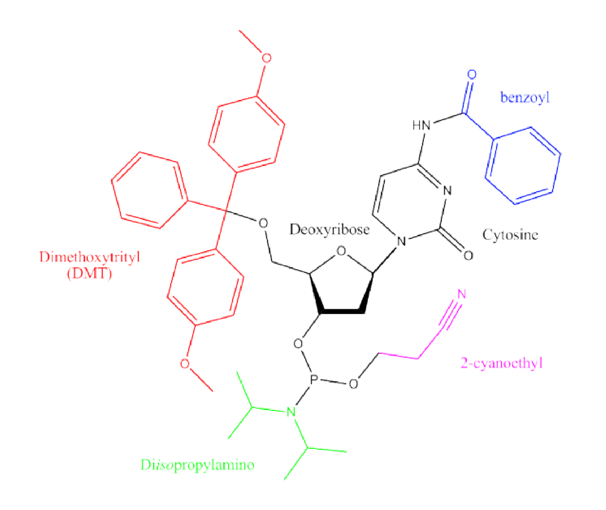

# DNA synthesis and gene assembly — reading 02.1

[Previous](01-03-nucleic-acids-structure-thermodynamics-and-kinetics.md) · [Subject index](README.md) · [Next](02-02-dna-synthesis-and-gene-assembly.md)

<!-- reading-content:start -->
## Overview

Chemical synthesis builds short oligonucleotides one nucleotide at a time, so modest losses at each coupling accumulate into a strong length limit. Overlapping fragments can then be assembled into genes and whole genomes, separating chemical manufacture from biological replication.

*Assumed throughout:* covalent bonding, nucleotide structure and PCR.

## Section 06: Solid-phase oligonucleotide synthesis by phosphoramidite chemistry

### Intuition

Joining nucleotides in solution would give a mess: every nucleotide has several reactive groups and could add in any order. The solution is to make each step do exactly one thing:
- **anchor** the growing chain to a solid bead, so excess reagent can simply be washed away;
- **block** every reactive group except the one end that should react;
- **add** one activated, fully protected nucleotide;
- **unblock** the end ready for the next nucleotide.

Repeat $`n-1`$ times.

*Analogy:* building a bead necklace one bead at a time, with the string tied to the table. Each new bead has a cap on its far hole, so only one can go on per round, and you remove the cap before adding the next. The analogy breaks down because the chemistry is not perfect: about 0.5 % of chains miss a bead each round, and those failures have to be dealt with (capping).

### Mechanism

**The monomer.** A *phosphoramidite* is a nucleoside with every unwanted reactive site blocked:
- **5′-OH → DMT (dimethoxytrityl).** Bulky and acid-labile, so it can be removed selectively each cycle. It is always used.
- **3′-O → P(III)** carrying a **2-cyanoethyl** group, which protects the phosphate oxygen until the end, and a **diisopropylamino** group, which becomes the leaving group when activated.
- **Exocyclic amines of A, C and G → acyl groups** (benzoyl, isobutyryl), so the bases do not react. T and U have no amine and need no protection.
- **RNA:** the 2′-OH is also protected (a silyl group), otherwise it would react or later attack the backbone (Section 01).

**Why 3′→5′?** The 5′-OH is a primary alcohol: less hindered and more reactive, so it is the easiest group to protect selectively with bulky DMT and to deprotect cleanly. The phosphorus is therefore placed on the 3′-oxygen. The first nucleoside is fixed to the bead through its 3′ end, and the chain grows at the free 5′ end. Polymerases do the opposite (5′→3′), so the two methods are complementary.

**The cycle.** One cycle adds one nucleotide. All steps run in dry organic solvent (acetonitrile), on beads (controlled-pore glass or resin) at scales from nmol to mmol (µmol is typical).

1. **Deblocking (detritylation).** Mild acid (di- or trichloroacetic acid) removes DMT and exposes the 5′-OH of the bead-bound chain.
   - The released DMT cation is bright orange. Measuring its absorbance each cycle reports how many chains coupled in the previous cycle, which is how coupling efficiency is monitored.
   - The acid must be brief: prolonged acid removes purine bases (*depurination*), and the chain later breaks at those sites.
2. **Coupling.** The next phosphoramidite is added in excess, together with an **activator** (a weakly acidic tetrazole).
   - The activator protonates the diisopropylamino nitrogen, turning it into a good leaving group.
   - The free 5′-OH attacks the phosphorus and forms a **phosphite triester** (P(III)) linkage.
   - P(III) is far more reactive than a phosphate P(V), so coupling takes only tens of seconds and exceeds 99 %.
   - Water must be excluded, because it would compete with the 5′-OH for the activated monomer.
3. **Capping.** The 0.5–1 % of chains that failed to couple still have a free 5′-OH. Acetic anhydride with N-methylimidazole acetylates these chains, so they can never react again. Without capping, they would couple in the *next* cycle and become chains missing one internal nucleotide (*deletion defects*, see Motivation).
4. **Oxidation.** Iodine in water/pyridine oxidises the unstable P(III) phosphite triester to a stable P(V) **phosphate triester**: the natural phosphodiester, still carrying its cyanoethyl group. The phosphite would not survive the acid of the next deblocking step.
5. **Wash.** Excess reagents are rinsed away; this is the advantage of working on a solid support. Then the cycle repeats.

**Finishing.**
- **Cleavage and deprotection.** Concentrated aqueous ammonia (or methylamine) cleaves the linker to the bead, removes the cyanoethyl groups (leaving the natural negatively charged phosphodiesters) and removes the base acyl groups.
- **Desalting.** Size exclusion, precipitation or diafiltration removes small molecules (salts, cleaved protecting groups), but **not truncated oligos**.
- **Removing truncations** needs HPLC or PAGE. One common trick, *DMT-on* purification, leaves the final 5′-DMT in place. Only full-length chains carry it, because capped failures were acetylated, not tritylated. The hydrophobic DMT then lets reverse-phase HPLC pull the full-length product out.

**Modifications.** Because the process is chemical, any group that can be made as a phosphoramidite (or attached to the support) can be inserted at the 5′ end, the 3′ end or internally:
- fluorophores and quenchers (used in qPCR probes, Section 18);
- reactive handles (amines, thiols, azides and alkynes for click chemistry) for attaching oligos to surfaces or proteins;
- flexible spacers;
- modified nucleotides (methylated, phosphorothioate, locked nucleic acid), which change stability or nuclease resistance.

### Motivation and explanation

**Why capping matters.** The point is not how much product is made, but what the impurities look like. With capping, a chain that fails at coupling $`k`$ stops at length $`k`$. The impurities are spread over all shorter lengths and lack the final DMT, so they are easy to remove. Without capping, a chain that misses one coupling carries on, ending one nucleotide short with the error somewhere in the middle *and* a final DMT. It is chemically almost identical to the product, and DMT-on purification cannot separate it. The numbers are in Section 07.

**Limits.**
- Coupling is never 100 %, so full-length yield falls geometrically with length (Section 07).
- Depurination adds a further length-dependent loss.
- Together these keep practical oligos below about 200 nt. Genes have to be assembled from pieces (Section 08).
- The process uses expensive reagents in organic solvent and makes considerable chemical waste. Enzymatic (template-independent, TdT-based) synthesis in water is being developed as an alternative, but phosphoramidite chemistry remains the standard.

### Wider pathway

Oligos made this way are the raw material for:
- PCR and qPCR primers and probes (Sections 16–18);
- gene and genome assembly (Sections 08–09);
- sequencing adapters (Section 11);
- aptamer libraries (Section 19);
- DNA nanotechnology (Sections 20–22);
- therapeutic RNAs.

### Link to other topics

Separating the product from failure sequences by HPLC or PAGE is a downstream-processing problem of the same kind as protein purification (chromatography, Sections 46–47): the impurity closest in properties to the product sets the difficulty.

### Summary

Phosphoramidite synthesis grows a chain 3′→5′ on a solid support through a four-step cycle: deblock, couple, cap, oxidise. Protecting groups ensure that exactly one nucleotide adds per cycle.
<!-- reading-content:end -->

[Previous](01-03-nucleic-acids-structure-thermodynamics-and-kinetics.md) · [Subject index](README.md) · [Next](02-02-dna-synthesis-and-gene-assembly.md)
