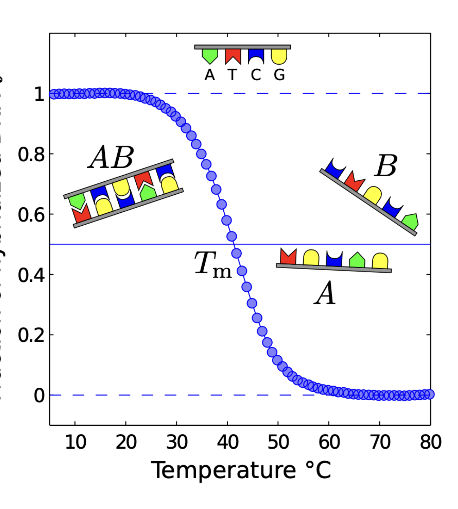
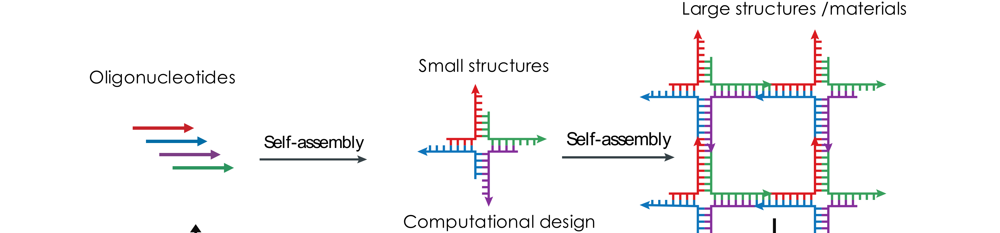
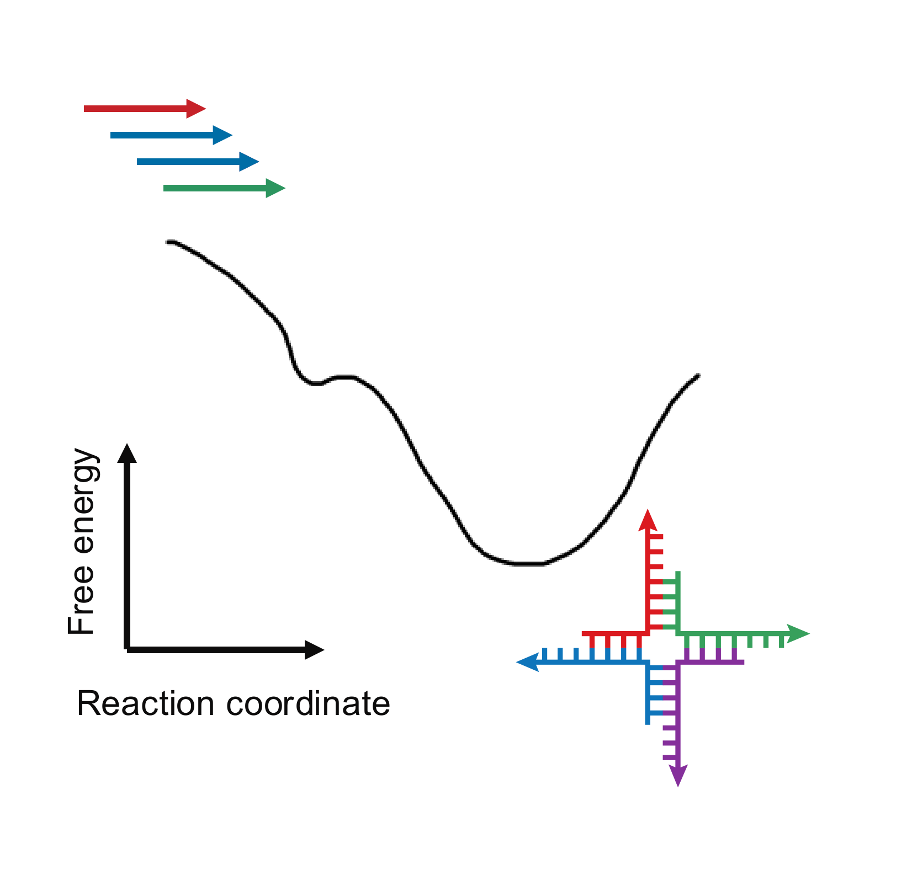
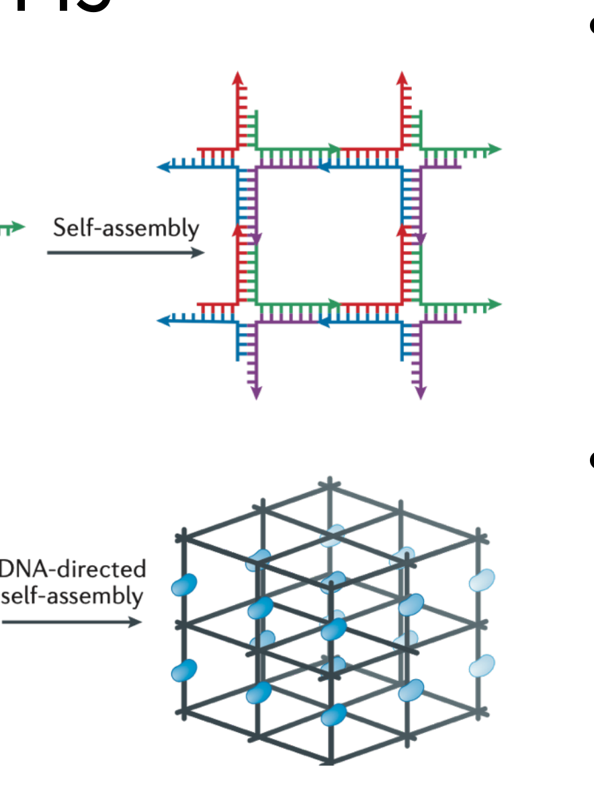
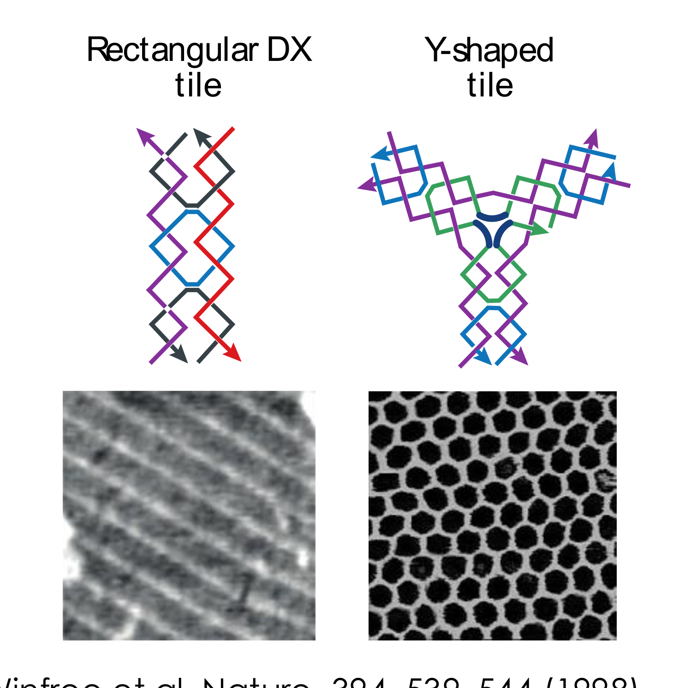
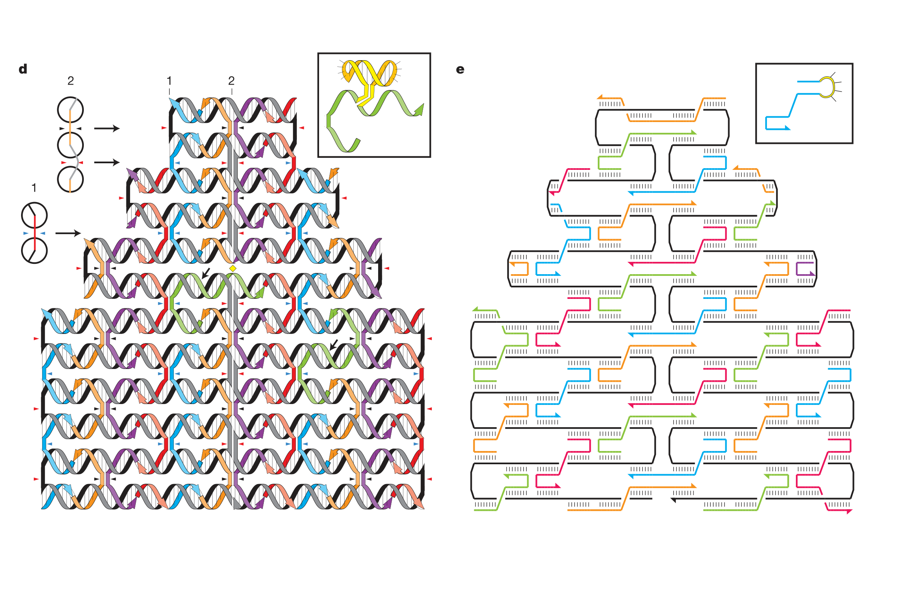

# DNA nanotechnology — reading 07.1

[Previous](06-01-aptamers-and-selex.md) · [Subject index](README.md) · [Next](07-02-dna-nanotechnology.md)

<!-- reading-content:start -->
## Overview

Sequence-dependent hybridisation makes DNA a programmable connector. Structural assemblies use that selectivity to organise objects, while toehold-mediated strand displacement provides controlled reactions that rearrange structures or process molecular signals.

*Assumed throughout:* hybridisation thermodynamics and nucleic-acid polymer physics.

## Section 20: DNA as a material

### Intuition

A useful construction material needs bonds that are *specific* (part A joins only to part B) and *reversible* (a mistake can be undone rather than frozen in). Most materials offer one or the other. Covalent bonds are specific but permanent; van der Waals contacts are reversible but indiscriminate.

Base pairing gives both at once, and it adds something neither offers: the bond strength is **programmable**. Choosing a sequence sets $`\Delta G^0`$, and $`\Delta G^0`$ sets both the stability and, through Section 05, the lifetime. The designer specifies which parts stick, how strongly, and how fast, by typing letters.

*Analogy:* a construction kit where every connector is cut to a code and you can order as many distinct codes as you like. The analogy breaks down because the connectors are not rigid — the strength is statistical, set by temperature and concentration, so "will these two bind?" has no answer without saying at what temperature and how dilute.

### Mechanism

**The properties that matter for construction:**

- **Chemically stable.** Unlike RNA, DNA has no 2′-OH to attack its own backbone (Section 01), so structures survive for months.
- **Arbitrary sequences are cheap.** Phosphoramidite synthesis (Section 06) makes any sequence to order, at steadily falling cost.
- **Easily functionalised.** Fluorophores, quenchers, thiols, biotin and click handles attach at either end or internally (Section 06), so DNA can be the connector between non-DNA components.
- **Known polymer physics.** ssDNA is flexible ($`l_P \approx 1`$–2 nm) and dsDNA is stiff ($`l_P \approx 50`$ nm, Section 02). Short duplexes act as rigid struts and single strands as hinges, and the designer chooses which by choosing where to pair.
- **Predictable thermodynamics.** $`\Delta G^0`$ and $`T_m`$ follow from the sequence (Section 04), so a design can be checked before it is made.
- **Thermally reversible near ambient conditions.** Melting temperatures sit in a convenient range, so structures can be assembled by cooling and disassembled by heating.



### Derivation

**Selectivity.** From Section 04, a complementary 12-mer has $`\Delta H^0 = -87.2`$ kcal/mol and $`\Delta S^0 = -240.3`$ cal K⁻¹ mol⁻¹. At 20 °C:

```math
\Delta G^0 = \Delta H^0 - T\Delta S^0 = -87.2 + 293.15\times0.2403 = -16.8\ \text{kcal/mol} \tag{33}
```


Two *random* 12-mers share only short accidental stretches of complementarity, giving $`\Delta G^0 \approx -2.9`$ kcal/mol. The gap is $`\approx 14`$ kcal/mol, which at $`RT = 0.58`$ kcal/mol is a binding-constant ratio of

```math
\frac{K_{\text{complementary}}}{K_{\text{random}}} = \exp\!\left(\frac{13.9}{0.58}\right) \approx 3\times10^{10} \tag{34}
```


In temperature terms the same gap appears as $`T_m = 53`$ °C against $`T_m = -31`$ °C: the designed pair needs heating past 50 °C to separate, while the random pair would need cooling far below freezing to associate at all. **There is a wide temperature window in which intended bonds are fully formed and unintended ones are entirely absent.**

**Orthogonality.** The number of distinct $`N`$-mers is $`4^N`$. For $`N = 12`$:

```math
4^{12} = 1.7\times10^{7} \tag{35}
```

Almost all pairs drawn from this set interact at the random level of (34) rather than the complementary level. A designer can therefore pick a large set of sequences that are mutually non-interacting — *orthogonal* — and use each as an independent, addressable bond type.

This is the property that makes complex structures possible. With one bond type you can make a polymer; with hundreds of orthogonal bond types you can specify which particular component goes in which particular position.

### Motivation and explanation

**Why the gap in (34) is so large.** Both $`\Delta H^0`$ and $`T\Delta S^0`$ scale with the number of base pairs formed, and they nearly cancel (Section 04). A mismatched pair forms far fewer base pairs, so it loses the enthalpy but keeps most of the entropic cost of association. Selectivity is a *difference of two large numbers*, which is why it is so sharp, and also why it is sensitive to temperature.

**Why orthogonality is not simply $`4^N`$.** Equation (35) counts sequences, not usable ones. Sequences that are each other's partial complements must be excluded, as must those that fold on themselves, and GC content must be matched so that all pairs share a common $`T_m`$ (Section 04). The usable orthogonal set is far smaller than $`4^N`$ — but it is still in the hundreds or thousands, which is more than any structure needs.

**Where it fails.** Selectivity degrades as structures grow: with hundreds of strands in one pot, there are hundreds of thousands of pairwise combinations, so even a one-in-a-million spurious interaction becomes likely. This is why design is done computationally, by software that evaluates all pairings rather than just the intended ones.

**The limits of the material.** DNA is not strong — a duplex is held by a few tens of $`k_BT`$ — so DNA objects are soft, and they require salt to screen the backbone charge (Section 01). They are also expensive per unit mass. DNA is not a structural material in the engineering sense; it is a material for *arranging other things with nanometre precision*.

### Link to other topics

The selectivity argument is the same one behind any chromatographic separation: a useful separation needs a large ratio of affinities between the wanted and unwanted species, and that ratio is exponential in the free-energy difference.

### Summary

DNA is a good construction material because sequence sets bond strength, giving a free-energy gap of about 14 kcal/mol between designed and accidental pairing, a factor of $`10^{10}`$ in binding constant. With $`4^{12} = 1.7\times10^7`$ sequences available, many mutually orthogonal bonds can be specified at once.

## Section 21: Structural DNA nanotechnology and DNA origami

### Intuition

Natural DNA is linear, so a duplex can only extend end to end. The founding insight of the field (Seeman, 1982) was that a *branched* junction — four strands meeting at a point, with each arm a duplex — turns DNA from a thread into a connector. Give each arm a single-stranded "sticky end" and junctions link into networks.

The design problem is then the same as any self-assembly: the target structure must be the free-energy minimum, and the system must be able to reach it. Annealing slowly from above $`T_m`$ does both, because every incorrect bond formed on the way down has time to melt and re-form.

*Analogy:* crystallising a solid from a hot solution. Cool slowly and you get a single good crystal; quench and you get a glassy mess. The analogy breaks down because each DNA "bond" here is *different* from every other, so the structure is not periodic by necessity — it is addressable, and every position can be unique.

### Mechanism



**The design workflow.** Start from the target structure, use software to find a set of oligonucleotides whose minimum-free-energy configuration is that structure, synthesise them, mix, and anneal.



**Why slow annealing.** The target is designed to be the global free-energy minimum, dominated by base pairing and so predictable from Section 04. The landscape also contains shallower local minima — partially correct structures, misbonded intermediates. Cooling slowly from above $`T_m`$ keeps the system equilibrated, so it escapes these **kinetic traps**. Rapid cooling freezes them in.

#### Junctions and tiles



Junctions with complementary sticky ends tile into periodic networks. The intended application was to arrange *other* molecules on a lattice — scaffolding proteins into a crystal so they could be solved by diffraction (Section 24).

**It did not work, and the reason is instructive.** Simple junctions are **floppy**: the arms pivot about the branch point, so the structure has no defined geometry and cannot pack into a crystal. The assemblies form hydrogels and liquid-like materials instead of ordered solids. Crystallisation required rigid motifs — *tensegrity triangles* — and took 27 years from the original proposal.



**The fix is crossovers.** A **double crossover (DX) tile** has two duplexes joined at two points rather than one. Two crossovers fix the relative orientation of the helices, removing the pivot. DX tiles are rigid enough to sustain 2D crystallisation and to arrange nanoparticles on a surface.


**3D.** A DNA cube came early but was floppy for the same reason. Rigid polyhedra followed from crossover motifs, and the assembled shape can be selected by tuning flexibility and concentration: the same three-point-star motif gives a tetrahedron, a dodecahedron or a buckyball depending on loop length and DNA concentration.

#### DNA origami



Rothemund's method (2006) changed the scale of what could be built.

1. Take one **long single-stranded scaffold**, about 7 knt, from the M13 bacteriophage genome.
2. Route it back and forth to raster-fill the target shape.
3. Design **hundreds of short staple strands**, each complementary to two or more separated regions of the scaffold. Where a staple binds two regions, it pulls them together: a **crossover** linking adjacent helices.
4. Mix scaffold with excess staples and anneal. The structure folds in one step.


Structures are about 100 nm across with roughly 6 nm resolution. Each staple is independently addressable, so any staple can carry a modification and act as a **6 nm pixel** — which is how patterns and words are written on the surface.

Later work extended this to 3D (stacked helical bundles), to wireframe designs generated automatically from a mesh, and to gigadalton assemblies built by polymerising origami units.

### Motivation and explanation

**Why origami beats tiles, in one idea: stoichiometry.** In a tile assembly, every component must be present in matched amounts, because the structure is built from many copies of a few species. An error in concentration leaves unincorporated tiles or truncated lattices, and yields are poor.

In origami there is **one scaffold molecule per structure**. The scaffold sets the size and the fold, and staples are supplied in excess so that every binding site is occupied. The assembly is unimolecular in the component that matters. Yields are high, the product is monodisperse, and purification is a matter of removing surplus staples.

**Why the staples need not be purified.** Each staple occupies a unique position, so a truncated staple (Section 07) simply fails to bind one site, leaving a small defect rather than a wrong structure. Origami is remarkably tolerant of the impurity profile that phosphoramidite synthesis produces.

**Limits.** Structures are soft and require millimolar Mg²⁺. They are degraded by nucleases, limiting biological use without protection. The scaffold length caps a single origami at roughly 100 nm, so larger objects must be built hierarchically. Cost scales with the number of distinct staples.

### Worked example

*Scale of a standard origami.* Computed in Python.

- The M13 scaffold is 7249 nt. With staples of about 32 nt, the design needs $`7249/32 \approx 227`$ distinct strands — consistent with Rothemund's "over 200".
- Total mass is $`7249\times2\times330 \approx 4.8`$ MDa, about 30 times a typical protein.
- A duplex is about 2.5 nm wide including its hydration shell, so a 100 nm square packs about 40 parallel helices, each about 100 nm (294 bp) long. Total duplex length $`40\times100 = 4000`$ nm $`= 11\,760`$ bp, consistent with 7249 nt of scaffold paired along its full length.
- The 6 nm resolution follows from the geometry: a crossover can be placed about every 16 bp (1.5 helical turns, 5.4 nm) along a helix, and helices sit 2.5 nm apart. **The pixel size is set by the helical repeat, not by the synthesis.**

### Link to other topics

Annealing through a rugged landscape to reach the global minimum is the same problem as crystallisation or protein folding, and the same solution — slow cooling — applies for the same reason: the system must stay equilibrated as the free-energy surface changes with temperature.

### Summary

Branched junctions make DNA a connector rather than a thread, but simple junctions are too floppy to order, and crossovers are what supply rigidity. Origami then solves the stoichiometry problem by using a single scaffold strand per structure, giving addressable 100 nm objects at 6 nm resolution in one annealing step.
<!-- reading-content:end -->

[Previous](06-01-aptamers-and-selex.md) · [Subject index](README.md) · [Next](07-02-dna-nanotechnology.md)
