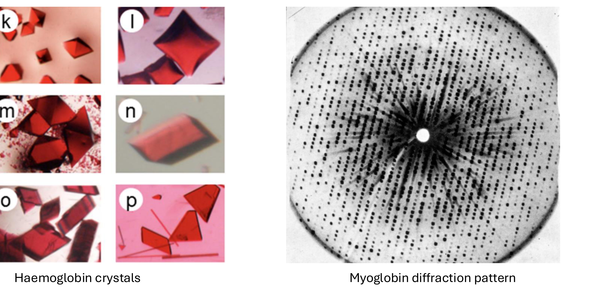
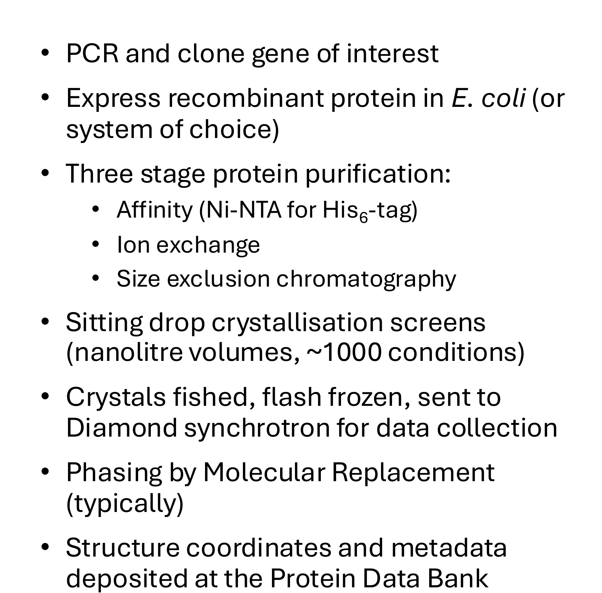
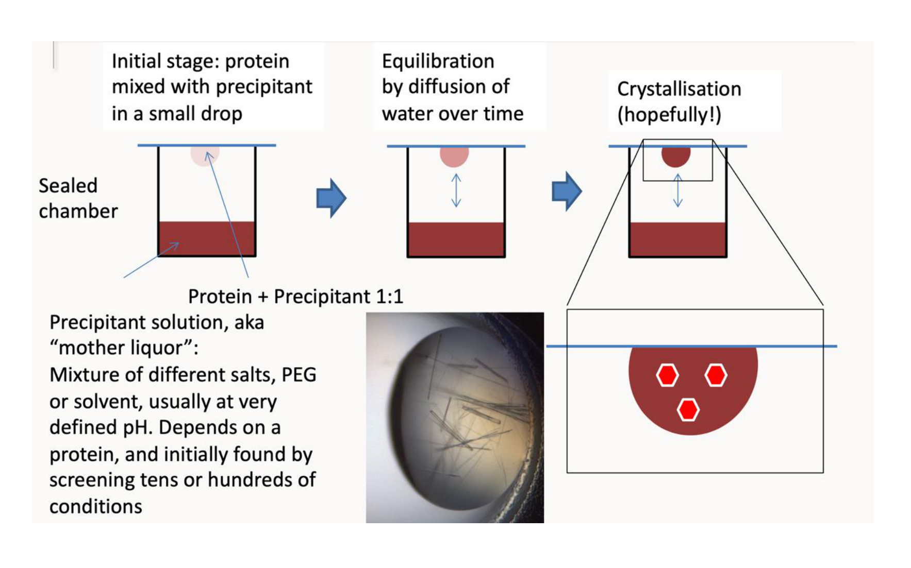

# Protein structure - determination and prediction — reading 08.2

[Previous](08-01-protein-structure-determination-and-prediction.md) · [Subject index](README.md) · [Next](08-03-protein-structure-determination-and-prediction.md)

<!-- reading-content:start -->
## Section 24: X-ray crystallography and the phase problem

### Intuition

To see something you must illuminate it with radiation whose wavelength is comparable to its features. Atoms are about 1.5 Å apart, so imaging them needs X-rays of about 1 Å. But there is no lens for X-rays: they cannot be focused to form an image directly.

What *can* be done is to record the scattered radiation and reconstruct the image computationally. Scattering from a single molecule is far too weak to detect, so the molecule is placed in a **crystal** — a periodic array of millions of identical copies in identical orientations. Their scattered waves then interfere constructively in specific directions, concentrating a weak signal into measurable spots.

The crystal is an amplifier, and it is also the main obstacle: proteins are large, flexible and reluctant to pack into ordered lattices.

*Analogy:* hearing one voice in a stadium by having everyone chant in unison. The analogy breaks down in exactly the way that creates the central difficulty: a detector records *intensity*, not the wave itself, and the timing information in the chant — the phase — is thrown away.

### Mechanism



**The relationship being exploited.** The electron density in the unit cell and the diffraction pattern are **Fourier transforms of each other**. Each spot corresponds to one spatial frequency component of the density. So:

- *Forward:* electron density → diffraction pattern, which the crystal does physically.
- *Reverse:* diffraction pattern → electron density, by inverse Fourier transform.

The objective is to determine the arrangement of protein atoms in space, and the electron density is what is reconstructed. A model is then built into that density.

#### The phase problem

A wave has an **amplitude** and a **phase**. The inverse Fourier transform needs both. But a detector measures only the *number of photons* arriving at each spot, which is the intensity:

**Equation (41)**

```math
I \propto |F|^2 \qquad\Longrightarrow\qquad |F| = \sqrt{I}
```


The amplitude is recoverable as the square root of the intensity. **The phase is lost entirely.** This is the phase problem, and it is not a technical limitation but a consequence of detecting intensity. Phases carry most of the structural information: a map computed from correct amplitudes with wrong phases shows the wrong molecule.

**Perutz's solution: multiple isomorphous replacement (MIR).** Soak a few **heavy atoms** (mercury, platinum) into the crystal without disturbing the lattice. The heavy atoms scatter strongly, so every spot shifts in intensity. Comparing the native and derivative datasets locates the heavy atoms, and their known positions give a reference wave against which the phases of all other reflections can be inferred. Several derivatives are needed to resolve ambiguities — hence *multiple*.

Perutz applied this to haemoglobin; his student **John Kendrew** used it to solve **myoglobin**, the first protein structure, at 6 Å, later extended to 2 Å once computation allowed.

**Molecular replacement**, the modern routine method, sidesteps MIR. If a structurally similar protein is already known, its model is positioned and oriented in the new unit cell to generate *calculated* phases, which are combined with the measured amplitudes. This works only when a sufficiently close model exists — which is why Section 26 matters so much to this field.

#### Modern workflow



1. **PCR and clone** the gene of interest.
2. **Express** the recombinant protein in *E. coli* or another system.
3. **Purify** in three stages: affinity (Ni-NTA against a His₆ tag), ion exchange, then size-exclusion chromatography. Milligram quantities of homogeneous protein are needed.
4. **Crystallise** by sitting- or hanging-drop vapour diffusion.



The drop contains protein mixed 1:1 with a *precipitant* ("mother liquor": salts, PEG or solvent at defined pH). Sealed against a more concentrated reservoir, water leaves the drop by vapour diffusion, slowly raising the protein concentration until it crystallises. The right conditions cannot be predicted, so **about 1000 conditions are screened** in nanolitre drops.

5. **Collect data.** Crystals are fished out, flash-frozen (which limits radiation damage) and taken to a synchrotron such as Diamond. The crystal is rotated to capture reflections from many angles, since a full three-dimensional density map needs reflections in all directions.
6. **Phase**, usually by molecular replacement.
7. **Build and refine** a model into the density, and deposit coordinates in the Protein Data Bank.

### Motivation and explanation

**Why a synchrotron.** An in-house rotating-anode source (Cu Kα, 1.54 Å) gives data in a few hours to about 1.8 Å. A synchrotron provides a far brighter, tunable beam, giving better resolution from smaller and weaker crystals.

**What resolution means.** Resolution is the smallest spacing distinguishable, and it is set by how far out from the centre the spots extend. From Bragg's law, $`\lambda = 2d\sin\theta`$ with $`\lambda = 1.54`$ Å: 2 Å data requires reflections out to $`\theta = 23°`$, while 0.8 Å requires 74°. **High-resolution information sits at high angle**, where intensities are weakest — so resolution is limited by how well-ordered the crystal is, not by the instrument.

At 2 Å, individual atoms are not separated (C–C is 1.54 Å) but the backbone and side chains are unambiguous. Below about 1.2 Å, individual atoms resolve.

**Strengths and limitations:**
- **Atomic resolution, 0.5–2 Å** — the benchmark against which other methods are judged.
- **No size limit in principle**, but larger proteins are increasingly hard to crystallise.
- *Bottlenecks:* milligrams of homogeneous protein; crystal growth and quality, which is unpredictable and often the step that fails; membrane proteins, which resist crystallisation because their hydrophobic surfaces need detergent.
- The structure is of a molecule in a **crystal lattice**, at cryogenic temperature — not necessarily its solution conformation.

### Link to other topics

Recovering an object from the magnitude of its Fourier transform while the phase is lost is a general inverse problem, and the standard solution is the one used here: supply the missing information from a known reference, whether a heavy atom or an existing model.

### Summary

A crystal turns undetectable single-molecule scattering into measurable spots, and the density is recovered by inverse Fourier transform — except that detection destroys the phases, which carry most of the information. Heavy-atom replacement and, now, molecular replacement supply them.
<!-- reading-content:end -->

[Previous](08-01-protein-structure-determination-and-prediction.md) · [Subject index](README.md) · [Next](08-03-protein-structure-determination-and-prediction.md)
