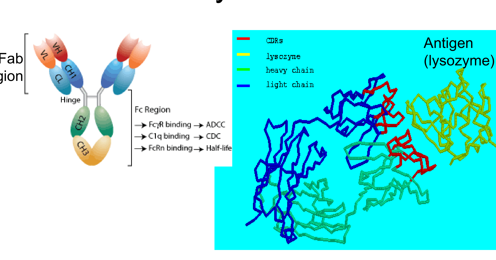
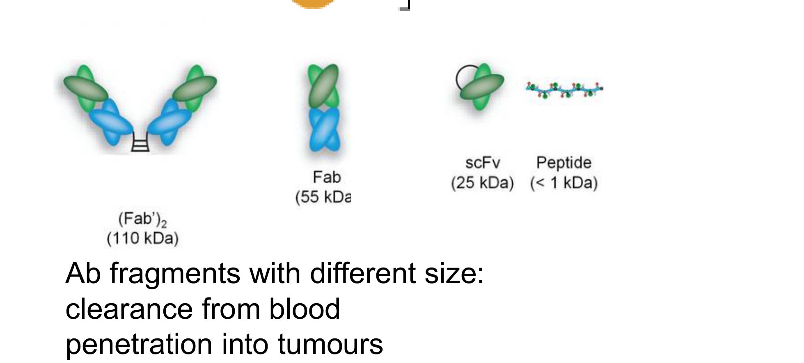
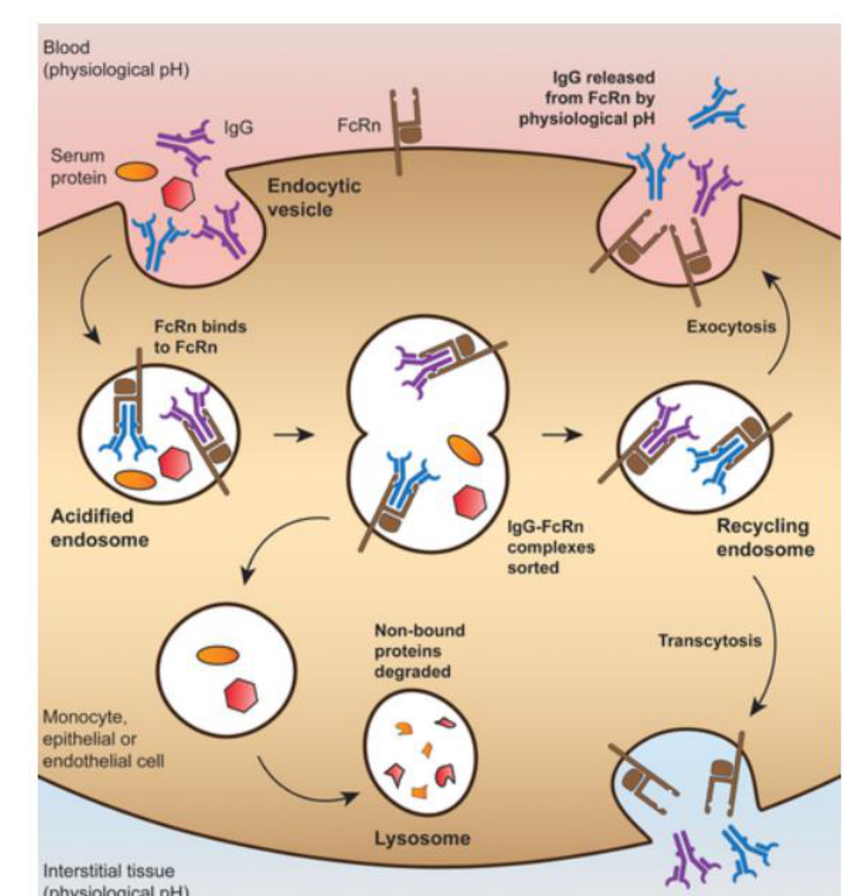
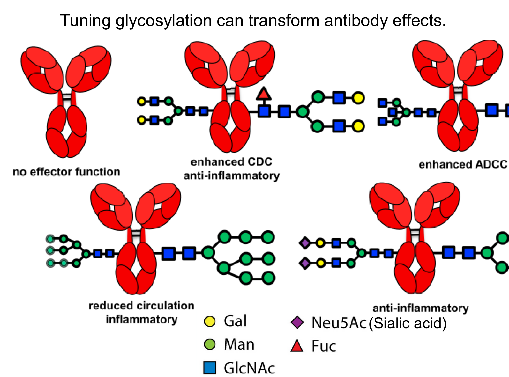

# Protein engineering — reading 09.1

[Previous](08-03-protein-structure-determination-and-prediction.md) · [Subject index](README.md) · [Next](09-02-protein-engineering.md)

<!-- reading-content:start -->
## Overview

Protein engineering changes function, stability or behaviour in the body by altering sequence, architecture and chemical modifications. Mutagenesis and non-canonical amino acids supply the changes, while antibody-generation and screening methods identify useful variants.

*Assumed throughout:* protein structure, genetic coding and molecular recognition.

## Section 27: What to engineer about a protein

### Intuition

A natural protein is optimised by evolution for *its own* purpose in *its own* context. A therapeutic or reagent is used for a different purpose in a different context, so the properties evolution settled on are rarely the ones wanted. Engineering is the business of changing one property without destroying the others.

Antibodies make the point well. Evolution shaped them to find almost any target with high specificity, which is exactly what a drug needs. But they are also large, slow to clear, unable to enter cells, and carry effector functions that may be unwanted. Almost all antibody engineering is an attempt to keep the binding and change everything else.

*Analogy:* a general-purpose vehicle adapted for a specific job — the engine is what you want, so the body is cut down or extended around it. The analogy breaks down because a protein's parts are not modular in the way a vehicle's are: Section 23's marginal stability means a change intended to affect one property frequently destabilises the whole fold.

### Mechanism



**Antibody architecture.** An IgG is roughly 150 kDa, built from two heavy and two light chains:
- the two **Fab** arms bind antigen;
- the **Fc** stem carries the functional interactions — FcγR binding (antibody-dependent cell-mediated cytotoxicity, ADCC), C1q binding (complement-dependent cytotoxicity, CDC) and FcRn binding (half-life, Section 28).

Crucially, **variation is limited to three loops at the tip of each chain**, the complementarity-determining regions (CDRs). The rest of the molecule is a near-constant scaffold. This separation is why antibodies are so engineerable: the binding site is a small, variable, structurally isolated part of a fixed framework.

#### Size



Cutting the antibody down gives a series of fragments:

| Format | Mass |
|---|---|
| IgG | 150 kDa |
| (Fab′)₂ | 110 kDa |
| Fab | 55 kDa |
| scFv (single-chain variable fragment) | 25 kDa |
| Peptide | <1 kDa |

Size controls three things at once: **clearance from blood**, **penetration into tumours** and **resistance to misfolding and proteolysis**. Smaller fragments penetrate tissue better but are cleared faster (Section 28), so the choice of format is a trade-off rather than an optimisation.

**Why the CDR loops cannot simply be used as peptides.** An obvious idea is to synthesise the binding loops alone. It fails because an isolated peptide is **too flexible**. Binding requires the loops to be held in a defined conformation; free in solution they sample many conformations, and the entropy lost on binding cancels the enthalpy gained. The framework is not inert packaging — it pays the conformational entropy cost in advance.

#### Fusions

Joining the antibody to something else gives function the antibody does not have.


**(i) To other proteins.** A **bispecific T-cell engager (BiTE)** is two single-chain antibodies joined: one binds CD3 on a cytotoxic T cell, the other a tumour-associated antigen. The construct physically forces a synapse between T cell and tumour cell, redirecting the T cell to kill a target it would otherwise ignore. The engineered molecule supplies not binding but **proximity**.

**(ii) To other biomolecules.** Linking DNA to an antibody allows the binding event to be amplified by PCR (immuno-PCR) or by rolling-circle amplification, so a single binding event becomes an exponentially amplified signal. This gives far greater sensitivity than reading a fluorophore, and the DNA sequence also acts as a barcode for multiplexed detection.

**(iii) To non-biological molecules.** Dyes or particles for lateral-flow assays; chelated radionuclides for PET imaging; and drugs.


**Antibody–drug conjugates (ADCs)** combine antibody specificity with small-molecule potency. The antibody delivers a cytotoxic drug to cells carrying the target antigen, killing them by a mechanism far more potent than natural effector function. Three parameters are optimised: **where the drug attaches**, **how many copies** per antibody, and **how the linker releases** the drug — ideally only inside the target cell. ADCs are correspondingly expensive: a course of the anti-HER2 ADC Kadcyla costs of order £90 000.

### Motivation and explanation

**Why antibodies rather than small molecules.** Small molecules are cheaper to manufacture, simpler to administer (usually oral), and can reach intracellular targets. Antibodies are limited to surface-exposed targets and must be injected. But they are **stable, well expressed, highly specific and multi-functional**, and crucially they can be raised against almost any target, whereas a small-molecule binder may not exist. In practice antibodies have a more reliable development pipeline and a higher success rate in trials.

**What makes a binder good enough.** For therapy, a dissociation constant of 1 µM is workable and 100 pM is excellent. That is a factor of $`10^4`$ in $`K_d`$, which from $`\Delta G^0 = RT\ln K_d`$ is only **5.7 kcal/mol at 37 °C** — a handful of hydrogen bonds. Affinity maturation is a matter of small energetic changes, which is why it is tractable but also why it is easily lost when something else is altered.

Affinity is not the whole requirement: the binder must be **tight *and* specific**, and these are improved by different means. Selecting harder for affinity does not improve specificity (Section 19).

### Link to other topics

The size trade-off — penetration against residence time — is a transport problem of the same kind as catalyst particle sizing: smaller particles give better internal diffusion but are harder to retain in the reactor.

### Summary

Antibodies are engineerable because binding is confined to six variable loops on an otherwise constant framework, which can be truncated for penetration or extended by fusion to add proximity, amplification or cytotoxicity. The loops cannot be used alone, because the framework pays their conformational entropy.

## Section 28: Antibody pharmacokinetics, glycosylation and switchable function

### Intuition

Most injected proteins disappear quickly. Small ones are filtered by the kidney; larger ones are taken up by cells and digested in lysosomes. An IgG escapes both, and persists for weeks. The reason is a dedicated **recycling receptor** that rescues IgG from the degradation pathway and returns it to the surface. Long antibody half-life is not a passive property of being large and stable: it is an active salvage mechanism, and because it depends on the Fc region, it can be transferred to other proteins by fusing them to Fc.

Glycosylation raises a different issue. The sugar is added by the producing cell, not encoded in the sequence, so it varies with cell line and culture conditions. It also changes effector function. A manufacturer therefore cannot fully specify the product from its gene — a problem with no analogue in small-molecule manufacture.

*Analogy for FcRn:* a parcel sorting office where most items go to the incinerator, but parcels with the right label are picked out and returned to the sender. The analogy breaks down because the sorting signal is pH-dependent rather than fixed — which is precisely what makes it work.

### Mechanism

#### Pharmacokinetics


After intravenous delivery, serum concentration falls in **two phases** (note the log axis, so a straight line is exponential decay):

1. **Distribution** — rapid, as antibody moves from blood into the tissue interstitial space. This is redistribution, not loss.
2. **Elimination** — slow, by lysosomal degradation after cellular uptake. Log-linear, so first order.

**There is no renal clearance.** The kidney filters below about 20 kDa; IgG is 150 kDa. This is the first reason for the long half-life, and it explains the size trade-off of Section 27 directly: an scFv at 25 kDa sits near the filtration cut-off and is cleared in hours instead of weeks.

Clearance is increased by:
- **anti-drug antibodies** — the patient's immune system recognising the therapeutic, which is why immunogenicity matters;
- **target-mediated clearance** — antibody removed along with the antigen it is bound to, so the dose is consumed by the target itself.



**The salvage pathway.** Cells continuously take up extracellular fluid by endocytosis. The endosome acidifies, and most contents pass to the lysosome and are degraded.

**FcRn** (the neonatal Fc receptor) binds IgG **at endosomal pH but not at physiological pH**. So:
- in the acidified endosome, FcRn captures IgG;
- the FcRn–IgG complex is sorted into the recycling pathway, away from the lysosome;
- at the cell surface, neutral pH releases the IgG back into circulation.

The pH dependence is what makes this a cycle rather than a one-way trap: binding must be strong where rescue is needed and weak where release is needed.

**This is transferable.** Fusing any protein to IgG Fc confers the same salvage and extends its half-life. **Etanercept** is the extracellular domain of the TNF receptor fused to Fc, used for rheumatoid arthritis: the TNFR domain neutralises TNF, and the Fc keeps it in circulation. The engineered molecule combines a binding function from one protein with a pharmacokinetic function from another.

#### Glycosylation



IgG carries a glycan on **each C_H2 domain** of the Fc. Its structure varies, and it depends on:
- the protein sequence,
- the **cell line**,
- the **growth conditions**.

For a drug one needs to know exactly what is being delivered and to deliver the same thing each time. Glycosylation makes this difficult, because the same gene in a different bioreactor gives a different product. Glycans are characterised by mass spectrometry, and glycan profile becomes a release specification.

**Glycans are not cosmetic — they switch effector function.** Different glycan structures give: no effector function; enhanced CDC and anti-inflammatory behaviour; enhanced ADCC; reduced circulation with inflammatory behaviour; or anti-inflammatory behaviour with sialic acid. **Removing a single fucose markedly increases ADCC**, which is exploited deliberately in afucosylated therapeutic antibodies. So the same polypeptide can be a cell-killing drug or an anti-inflammatory one depending on a sugar the cell line happened to add.

#### Switchable function


Many cancer targets are also expressed on normal tissue, so toxicity limits the dose rather than efficacy. The idea is a **logic gate**: an antibody that binds only if the target antigen is present **AND** a cancer-associated protease is present.

A **pro-antibody** carries a peptide mask over its binding site, tethered by a linker. The masked antibody cannot bind. Tumours over-express certain proteases; these cleave the linker, the mask is released, and the antibody becomes active — only in the tumour environment. Specificity now requires two independent conditions rather than one, which is the same strategy as the probe-plus-primers design in Section 18.

### Motivation and explanation

**Reading the half-life from the graph.** From the elimination phase, concentration falls from about 100 to 20 µg/mL between days 5 and 50 (values read from a graph, so ≈). For first-order decay,

```math
k = \frac{\ln(100/20)}{45} = 0.036\ \text{day}^{-1}, \qquad t_{1/2} = \frac{\ln 2}{k} \approx 19\ \text{days}.
```

That is consistent with the three-week dosing intervals typical of therapeutic antibodies, and it is roughly 100 times longer than a protein of similar size without FcRn binding.

**What "linear PK" means.** Dose-proportional pharmacokinetics means concentration scales with dose, with approximately dose-independent clearance; a straight elimination segment on a log plot alone does not establish dose proportionality. For antibodies with target-mediated clearance, nonlinearity is often strongest at low or intermediate concentrations. At sufficiently high concentrations, target binding and uptake saturate, so nonspecific first-order clearance can dominate and PK can approach linearity. The simple half-life estimate applies only over the approximately exponential segment used here.

**The common thread.** All three sections are about the Fc, not the binding site. Half-life, effector function and manufacturing consistency are properties of the constant region, while specificity lives in the CDRs (Section 27). This is why the two can be engineered almost independently — and why Fc engineering is a field in itself.

### Link to other topics

The FcRn cycle is a pH-swing separation: bind the product at one pH, release it at another, and run the two conditions at different points in a loop. It is the same principle as pH elution in affinity chromatography (Section 45), operating here inside a cell.

### Summary

Antibodies persist for weeks because they are too large to filter and because FcRn actively rescues them from lysosomal degradation by pH-dependent binding — a property transferable to any protein by Fc fusion. Glycosylation, added by the cell rather than encoded, varies with manufacturing and switches effector function.
<!-- reading-content:end -->

[Previous](08-03-protein-structure-determination-and-prediction.md) · [Subject index](README.md) · [Next](09-02-protein-engineering.md)
