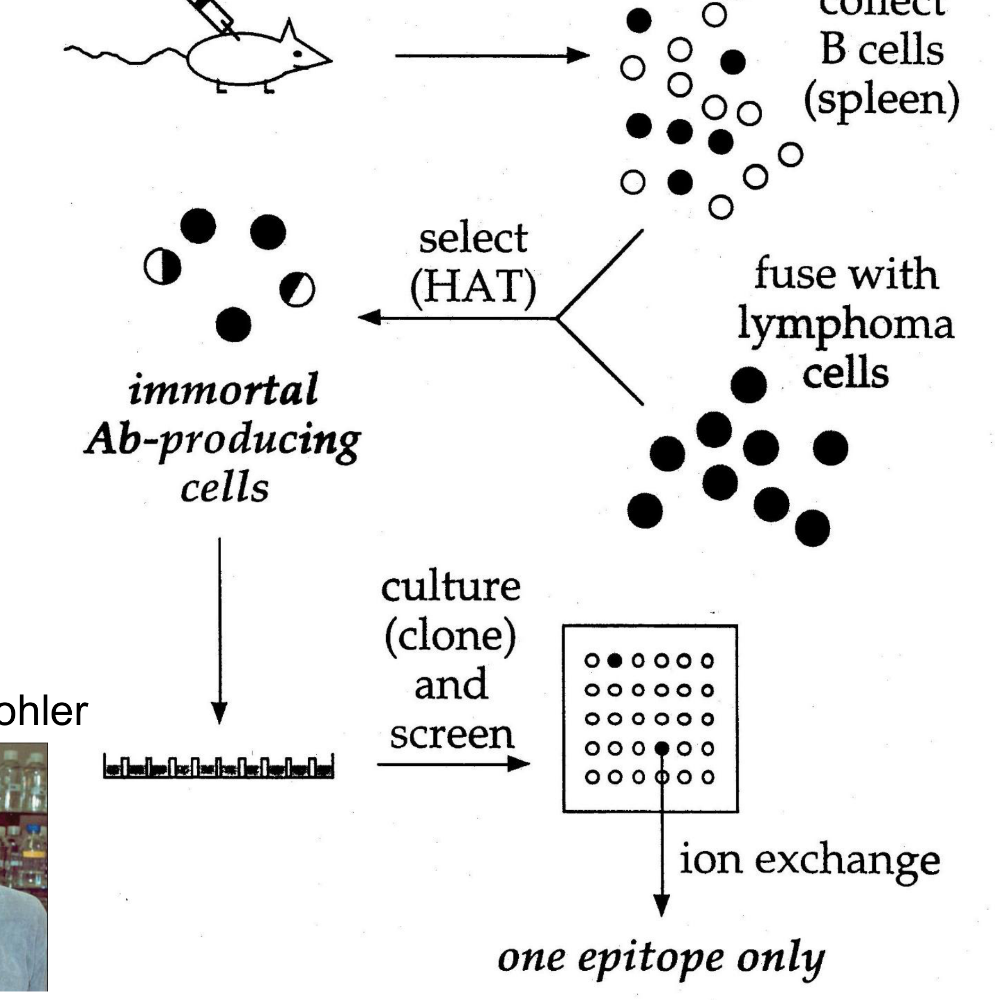
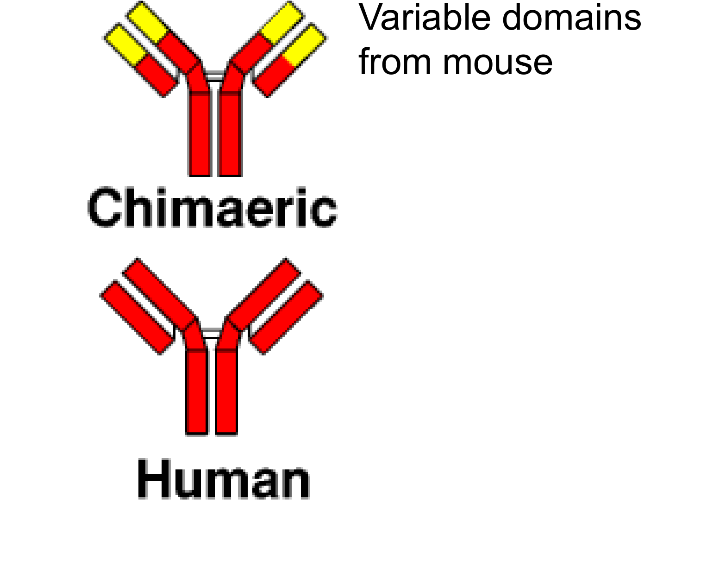

# Protein engineering — reading 09.3

[Previous](09-02-protein-engineering.md) · [Subject index](README.md) · [Next](10-01-bioprocessing-overview-and-filtration.md)

<!-- reading-content:start -->
## Section 30: Generating antibodies, from animals to algorithms

### Intuition

Section 19 established the principle for nucleic acids: make a huge library, select, amplify, repeat. Proteins cannot do this, because **a protein cannot copy itself**. Any protein selection method must therefore physically tie each protein to the gene encoding it, so that selecting the protein also recovers its sequence.

Every method below is a different solution to that one problem:
- a **cell** keeps protein and gene together naturally;
- a **phage** displays the protein on its coat while carrying the gene inside;
- a **droplet** confines both in one compartment;
- **computation** sidesteps it, since the sequence is known by construction.

*Analogy:* judging a baking competition where you must also know the recipe. You can watch each baker (cell), label each cake with its recipe (phage), keep each in its own numbered box (droplet), or compute from the recipe what the cake will be like (design). The analogy breaks down for the last one — a computed prediction is a hypothesis, not a measurement, so it still needs testing.

### Derivation

**Why libraries, not design.** With 20 amino acids, a modest 200-residue protein has

**Equation (42)**

```math
20^{200} = 1.6\times10^{260}
```

possible sequences — against roughly $`10^{80}`$ atoms in the universe. Even a phage library of $`10^{9}`$ covers $`10^{-251}`$ of this.

Two conclusions follow, and they shape the whole field:
- exhaustive search is impossible by any physical means, so the library must be **designed to sample a useful region**, not sample uniformly;
- antibody libraries work because they vary only the **six CDR loops** on a fixed framework (Section 27), so the search is restricted to the part that determines binding.

### Mechanism



**1. Polyclonal antibodies** — antiserum from an immunised animal, or human plasma. A mixture recognising many epitopes, cheap but undefined and finite.

**2. Hybridoma (monoclonal).** Immunise a mouse, collect B cells from the spleen, and fuse them with immortal lymphoma cells. **HAT medium** selects the fusions: unfused lymphoma cells die in the selection, unfused B cells die of their own accord, so only hybrids survive. Each hybridoma is cloned, giving an immortal line secreting a single antibody against **one epitope only**. Here the cell links genotype to phenotype.



**3. Humanisation.** Mouse antibodies fail as human therapeutics: patients raise anti-mouse antibodies that block repeated dosing (the anti-drug antibodies of Section 28), and mouse Fc engages human effector machinery poorly. The fix is to replace mouse sequence progressively:
- **chimaeric** — mouse variable domains on human constant regions;
- **humanised** — only the mouse CDRs grafted onto a human framework;
- **human** — no mouse sequence at all.

This is only possible because of the modularity in Section 27: binding is confined to the CDRs, so everything else can be swapped.


**4. Phage display.** No animals, faster, and no concern about self-reactivity.

A library of human scFv sequences is fused to a coat protein (p3) of filamentous M13 phage. Each phage **displays the antibody fragment on its surface while carrying its gene inside** — genotype linked to phenotype in one particle.

1. **Pan** a library of at least $`10^{9}`$ phage against immobilised target.
2. **Wash hard** and recover the good binders.
3. **Amplify** the recovered phage in *E. coli*. Repeat 3–4 cycles.
4. **Sequence** to identify good scFv.
5. **Reformat as IgG**, since the therapeutic format is a full antibody, not a fragment.

This is Section 19's cycle exactly — select, amplify, repeat — with the phage particle supplying the link that nucleic acids get for free.


**5. In vitro compartmentalisation (IVC).** Display methods select for **binding**. Selecting for **catalysis** is harder, because the product of an enzymatic reaction diffuses away and is not attached to the gene that made it.

IVC solves this with a water-in-oil emulsion:
- **(a)** droplets contain **0 or 1 gene** each;
- **(b)** *in vitro* transcription and translation inside the droplet;
- **(c)** the enzyme turns over a **fluorogenic substrate**, so an active enzyme makes its own droplet fluoresce;
- **(d)** **FACS** sorts the brightest droplets;
- **(e)** the recovered genes are expressed at scale or re-mutated for another round.

The droplet is an artificial cell: it keeps gene, enzyme and product together so that the product reports on the gene.

**6. Transgenic mice.** Mice with the mouse immunoglobulin locus replaced by human antibody germline sequence. Conventional immunisation then produces fully human antibodies, with the animal's own affinity maturation doing the optimisation. The platform is extremely valuable commercially.

**7. Direct from people.** Isolate B cells from humans with strong immune responses and recover the sequences — no immunisation, and the antibodies are already human and already affinity-matured *in vivo*. Screening unusually resilient individuals ("élite controllers") can reveal unexpected targets and self-protein mechanisms.

**8. Computational design.** Generative models such as RFdiffusion, trained on structures in the PDB, design binders directly. Current performance: for an influenza target, roughly **1 % of designs bound, with moderate affinity** — not yet clinical, but improving quickly. Designed interfaces work better on flat surfaces than on the loop-dominated interfaces antibodies use.

### Motivation and explanation

**The trade-off across methods.** Animal methods give affinity-matured antibodies, since evolution does the optimisation, but are slow, cannot target toxins or conserved self-proteins (the animal is tolerant to them), and need humanisation. *In vitro* methods are fast, avoid self-tolerance, and allow stringency to be set by the experimenter, but start from a naïve library with no maturation.

**Where design sits.** *De novo* design needs no existing binder and no bait, applies to difficult targets such as membrane-bound or toxic proteins, and the "library size" has no experimental limit — over $`10^{18}`$ sequences can be evaluated with publicly available software. Against that, it needs substantial computer time, still requires wet-lab optimisation, and struggles when substantial conformational change is involved. Accuracy requirements are severe: **1 or 2 Å out can abolish binding**, consistent with the 5.7 kcal/mol that separates a mediocre binder from an excellent one (Section 27).

**The pattern across all eight.** Each either exploits a natural compartment (cell, phage, mouse), builds an artificial one (droplet), or dispenses with physical selection entirely (computation). The trend is away from animals and towards *in vitro* and *in silico* methods — faster, more controllable, and not limited by what an immune system will tolerate.

### Link to other topics

IVC is compartmentalisation used as a separation: confining a reaction so its product stays with its catalyst, exactly as a cell does. The same principle, in bulk, is what emulsion polymerisation uses to keep growing chains isolated.

### Summary

Protein sequence space, $`20^{200}`$, cannot be searched, so every method restricts the library and links each protein to its gene — by cell, phage particle or droplet. Display selects binding, IVC selects catalysis, animals supply affinity maturation at the cost of speed and self-tolerance, and computational design is beginning to bypass selection at a current hit rate near 1 %.

## Conclusion

Sequence changes and screening connect molecular recognition to useful biological performance. The next unit develops bioprocessing overview and filtration.
<!-- reading-content:end -->

[Previous](09-02-protein-engineering.md) · [Subject index](README.md) · [Next](10-01-bioprocessing-overview-and-filtration.md)
