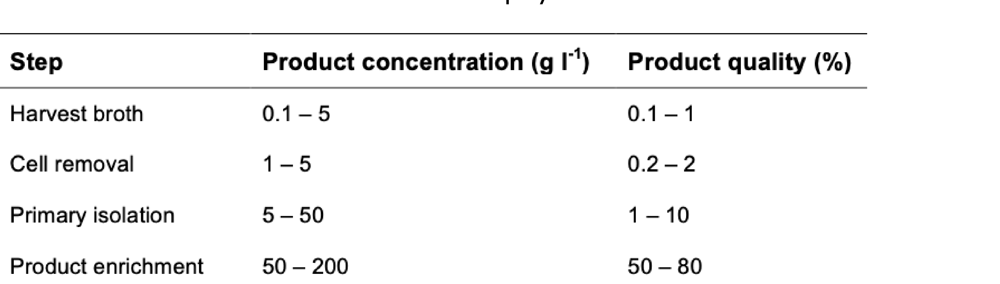
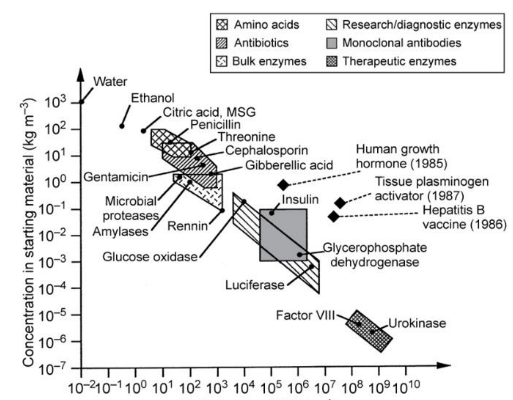

# Bioprocessing overview and filtration — reading 10.1

[Previous](09-03-protein-engineering.md) · [Subject index](README.md) · [Next](10-02-bioprocessing-overview-and-filtration.md)

<!-- reading-content:start -->
## Overview

A bioprocess must deliver a useful product at scale, with upstream production and downstream recovery designed together. The recovery train first separates cells from liquid; filtration illustrates how equipment choice, cake growth and compressibility determine throughput and area.

*Assumed throughout:* material balances, transport and basic microbial cultivation.

## Section 31: Developing and scaling a bioprocess

### Intuition

A bioprocess is developed in stages of increasing size, and each stage exists to answer questions the previous one could not.

The reason is that biology does not scale geometrically. Doubling the diameter of a vessel multiplies its volume by eight but its surface area only by four, so oxygen transfer, heat removal and mixing all fall behind the demand of the cells inside. A culture that thrives in a shake flask may be starved of oxygen in a stirred tank of the same nominal composition.

Each scale therefore has a purpose: the microtitre plate screens *which organism*, the flask fixes *the medium*, the bench-top bioreactor measures *what the cells need*, and the pilot plant finds out *what breaks*.

*Analogy:* a recipe scaled from a domestic kitchen to a canteen. The ingredients are unchanged, but heating, stirring and timing all behave differently, and only cooking at the intermediate scale reveals it. The analogy breaks down because the cells here are alive and respond to the physical environment by changing their metabolism, so a scale-up failure can change the product, not just the yield.

### Mechanism

The route divides into three phases.

#### 1. Developing the microorganism (steps 1–11)

The product, if a protein, is encoded in DNA:
- the **gene of interest** is identified in a cell or tissue and extracted;
- it is **cloned into a plasmid** (Section 08);
- cells — commonly *E. coli* — are **transformed** with the plasmid, so that they express the recombinant protein;
- the host is chosen for its ability to produce the product efficiently, which depends not only on expression level but on **how easy it is to culture, harvest and process**.

That last criterion matters more than it appears: a host that expresses well but lyses easily or secretes proteases creates problems in every downstream step. Engineering considerations enter at the organism-selection stage, not after it.

Development is done in **microtitre plates**, screening a few hundred microlitre cultures in parallel, then in **shake flasks** (250 mL to 1 L). At this stage the medium composition, pH, temperature and other environmental conditions are optimised for growth and productivity.

#### 2. Scaling up (steps 12–14)

**Bench-top bioreactor (1–2 L).** The first vessel with instrumentation. Here one can control and measure stirrer speed, dissolved oxygen, pH and temperature, which a flask cannot. This allows the optimal growth conditions to be characterised properly and, importantly, reveals the culture's **shear sensitivity, oxygen requirement and foaming behaviour**. Process parameters — oxygen transfer rate, power number, Reynolds number, mixing time — can now be measured or computed.

**Pilot-scale bioreactor (100–1000 L).** Usually *geometrically similar* to the bench-top vessel, so that correlations can be carried across. Rates of air sparging and stirring must change to maintain adequate oxygen transfer, and productivity is often lost at this point and must be diagnosed.

#### 3. Industrial operation (steps 15–17)

Large-scale fermentation, then **product recovery** — the downstream processing of Sections 32–47 — then packaging and marketing.

### Motivation and explanation

**Why geometric similarity is not enough.** Keeping the vessel's shape fixed does not keep the *physics* fixed, because different quantities scale differently with size:
- volume, hence oxygen demand, scales as $`L^3`$;
- surface area for heat transfer scales as $`L^2`$;
- impeller tip speed, hence shear, scales as $`L`$ at fixed stirrer speed.

No single operating rule holds all of these constant. Scale-up is therefore done by choosing **one** criterion to preserve — constant power per unit volume, constant oxygen transfer coefficient $`k_La`$, or constant tip speed — and accepting that the others change. Which to preserve depends on what limits the culture, which is why the bench-top stage must identify the limiting factor first.

**Why productivity falls on scale-up.** Mixing times grow with vessel size, so cells in a large fermenter experience a *fluctuating* environment, circulating between oxygen-rich regions near the sparger and oxygen-poor regions elsewhere. In a 1 L vessel the culture is effectively uniform; in a 10 m³ vessel it is not. Cells respond to these excursions by shifting metabolism, often towards by-products.

**Why the product dictates the host.** Bacteria grow fast and are cheap but cannot perform most post-translational modifications. A glycosylated therapeutic antibody (Section 28) must therefore be made in mammalian cells, which grow slowly, need complex media and are shear-sensitive. The choice propagates through the entire plant.

### Wider pathway

The organism is only the first half of the problem. Whatever is made must then be separated from a dilute, complex aqueous mixture, and that separation usually dominates the cost. Section 32 sets out why.

### Link to other topics

The scale-up problem is the familiar dimensional-analysis argument from transport processes: when several dimensionless groups cannot be matched simultaneously, one identifies the controlling mechanism and preserves the group that governs it, accepting distortion in the rest.

### Summary

A bioprocess is built in stages — plate, flask, bench-top, pilot, industrial — because biology does not scale geometrically: oxygen transfer, heat removal and mixing all fall behind volume as size grows. Each stage answers a question the previous one could not, with the bench-top reactor identifying the limiting factor that scale-up must then preserve.

## Section 32: Downstream processing — stages, logic and cost

### Intuition

Downstream processing is governed by one ratio: how much of the broth is product. If that fraction is $`10^{-9}`$, then $`10^{9}`$ parts of everything else must be removed, and no single operation can do it. A train of separations is needed, and the order in which they are placed decides the cost.

The ordering principle is simple: **remove the most material earliest**. Every unit downstream of a given point must be sized for the flow reaching it, so a step that cuts the volume tenfold makes everything after it ten times smaller. Cheap, crude, high-capacity operations go first; expensive, selective, low-capacity ones go last, when little is left to process.

*Analogy:* sorting a landfill for a lost ring. You do not start with tweezers and a magnifying glass; you shift the bulk mechanically first, then sieve, then inspect. The analogy breaks down because biological products are labile — they denature, they are digested by proteases released from broken cells, and they are lost at every transfer — so speed matters as much as order.

### Mechanism

#### What makes it difficult

- **Dilute.** Products are formed in dilute solution; both the medium and the cells are mostly water.
- **Labile.** Biological products tolerate only a narrow range of temperature, pressure, solvent and salt concentration, which rules out many conventional separation techniques.
- **Contamination control.** Hygienic or aseptic operation is designed around the product and its requirements. Short residence times can limit microbial growth, but do not replace suitable closed equipment, cleaning and aseptic controls where required.
- **Similar impurities.** The broth contains cells, proteins, sugars and other macromolecules **chemically similar to the desired product** — so the separation cannot rely on gross property differences.
- No further chemical transformation occurs. This is purely separation and concentration.

#### The five stages

1. **Cell removal** — usually the first step after fermentation. Filtration or centrifugation, exploiting **particle size and density**. The product may be the cells themselves, inside them, or in the medium, and the flowsheet branches accordingly.
2. **Cell disruption** — only if the product is intracellular. Mechanical, physical, chemical or enzymatic (Sections 38–41). The debris released must then be removed by the same methods as step 1.
3. **Primary isolation** — removes components with **substantially different properties** from the product. Non-selective, high-capacity: solvent extraction, two-phase aqueous extraction, adsorption, precipitation (Sections 42–45).
4. **Product enrichment** — **highly selective** methods separating the product from impurities with *similar* properties. Chromatography in its various forms (Sections 46–47).
5. **Final isolation** — the finished form. Liquids may be concentrated by ultrafiltration; solids are crystallised, then centrifuged or filtered and dried.

The branching in the flowsheet is decided by one question asked at the start — *where is the product?* — because that determines whether the cells are the product, must be broken open, or can simply be discarded.

**Illustrative concentration and purity ranges through the train:** individual operations, including extraction and size-exclusion chromatography, can dilute the product.

| Step | Product concentration (g/L) | Product quality (%) |
|---|---|---|
| Harvest broth | 0.1–5 | 0.1–1 |
| Cell removal | 1–5 | 0.2–2 |
| Primary isolation | 5–50 | 1–10 |
| Product enrichment | 50–200 | 50–80 |
| Final isolation | 50–200 | 90–100 |

Two features are worth noting. **Cell removal barely improves purity** (0.1–1 % to 0.2–2 %) despite removing most of the mass — it removes bulk, not impurity. And **product enrichment does almost all the purification**, from about 10 % to 50–80 %, which is why the chromatography steps dominate cost.

### Motivation and explanation

**Why price tracks dilution.** The plot spans ten orders of magnitude in both axes and shows a clear inverse trend: the more dilute a product is in the starting material, the more it sells for. Ethanol and citric acid sit at high concentration and low price; factor VIII and urokinase at $`10^{-6}`$ kg/m³ and very high price.

This is not a coincidence of market pricing. A product present at $`10^{-6}`$ kg/m³ requires enormous volumes to be processed per unit of product, and recovery losses compound across many steps. **The selling price is largely set by the cost of the separation**, not by the cost of the fermentation.

**How much of the cost.** For well-characterised antibiotics such as penicillin, the ratio of fermentation cost to recovery cost is about **60:40**. For recombinant proteins and monoclonal antibodies the ratio **reverses, and can reach 20:80** — four times as much spent recovering the product as making it.

The reason is in the purity table. A small molecule such as penicillin is chemically distinct from everything else in the broth and can be extracted and crystallised. A therapeutic protein must be separated from thousands of *other proteins* of similar size, charge and solubility, which requires several chromatography steps, each with its own yield loss.

**Where the engineering opportunity lies.** Because initial concentration is so low for high-value products, recovery costs are high and so is the selling price. That leaves considerable room for innovation: improvements in downstream processing translate directly into cost reduction, and this is where chemical engineers have the clearest contribution to make in modern biological processes.

### Link to other topics

Placing the cheapest, least selective operation first and the most selective last is the standard ordering heuristic for any separation train, and it follows from the same argument as in distillation sequencing: each unit is sized for the flow it receives, so removing bulk early shrinks everything downstream.

### Summary

Downstream processing takes a dilute, labile, chemically similar mixture and concentrates the product through five stages ordered cheapest-and-crudest first. Cell removal takes out bulk without improving purity; enrichment by chromatography does the purification and dominates the cost.
<!-- reading-content:end -->

[Previous](09-03-protein-engineering.md) · [Subject index](README.md) · [Next](10-02-bioprocessing-overview-and-filtration.md)
