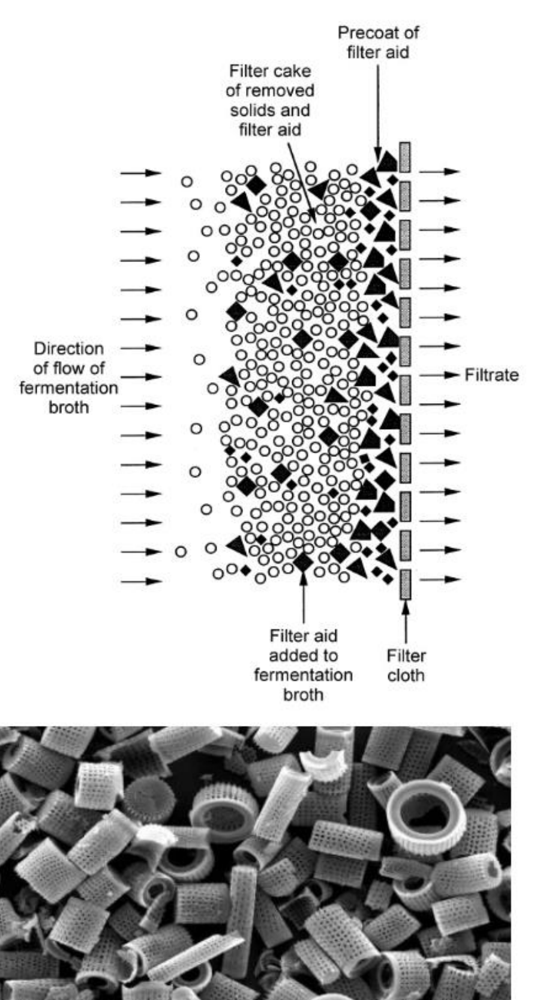
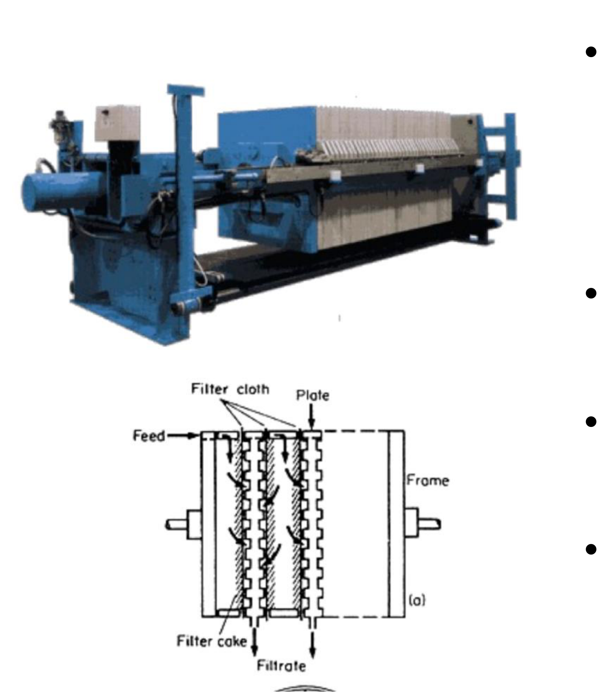
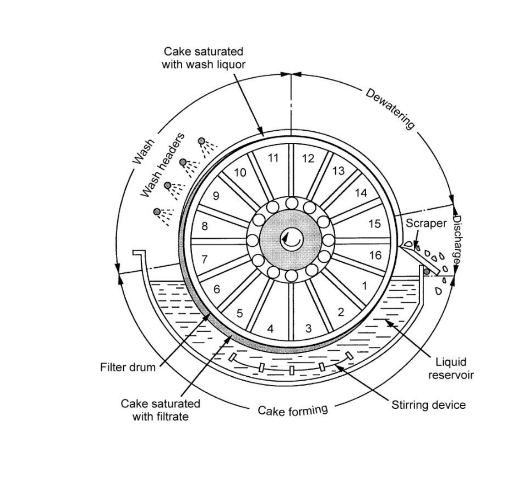

# Bioprocessing overview and filtration — reading 10.2

[Previous](10-01-bioprocessing-overview-and-filtration.md) · [Subject index](README.md) · [Next](11-01-centrifugation.md)

<!-- reading-content:start -->
## Section 33: Cell removal by filtration — equipment and operation

### Intuition

Dead-end filtration is the simplest solid–liquid separation: a barrier with openings smaller than the particles. Liquid passes, particles do not, and the two phases separate. Flow is driven by gravity or by an imposed pressure drop.

The difficulty is that the method destroys its own performance as it operates. Retained particles accumulate on the cloth as a **filter cake**, and that cake is itself a porous medium through which the liquid must now flow. Every particle removed makes the next one harder to remove. Flow declines as resistance increases. In the ideal finite-permeability Darcy model it remains positive at finite time; practical runs end when flux or capacity reaches an operating limit.

This is the defining feature of dead-end filtration and the reason for everything else in the note: filter aids exist to make the cake more porous, plate-and-frame presses are built to be opened and scraped, and rotary vacuum drums exist to remove the cake continuously.

*Analogy:* a sink strainer that slowly blocks with tea leaves. The analogy breaks down in an important way — the cake is not simply blockage. It is also an *active filter*, often finer than the cloth beneath it, so a filtration can improve in selectivity as it worsens in rate.

### Mechanism


**Dead-end filtration.** A physical barrier with openings smaller than the suspended particles impedes their motion while liquid flows past, separating the phases. The flow is driven by gravity or by a pressure drop across the filter.

**The cake problem.** The major issue is cake formation. As the cake builds, it imposes a greater resistance to liquid flow, so the throughput deteriorates during the run. At fixed pressure difference, flux decreases towards zero asymptotically in the ideal cake-filtration model. A practical run ends earlier at a throughput or capacity limit. Section 34 makes this quantitative.



**Two fixes for the cake**, both aimed at increasing its porosity:
- **Pre-coating.** The cloth is covered with a layer of filter aid before the run. This protects the cloth from blinding and improves efficiency, though it adds its own flow resistance.
- **Filter aids** added to the broth. **Kieselguhr** (diatomaceous earth) is the usual choice: naturally occurring, highly porous, irregular particles. Mixed into the broth, they are deposited along with the cells and hold the cake open, so the cake is more porous and less resistant.

The filter cloth itself is progressively covered by the cake, so after a short time it is the cake, not the cloth, that is doing the filtration.

#### Equipment



**Batch: plate-and-frame filter press.** Cloth is spread over plates and supported along ridges, which leave a free area for the filtrate to flow. Many plates in series give a large area in a compact unit, and cake builds on the upstream side of each cloth. When the space between plates is filled with cake, the press must be **dismantled and scraped**.

That is the limitation: it is laborious, must be serviced frequently, and cannot be operated aseptically. It suits small batch fermentations.



**Continuous: rotary drum vacuum filter.** For large fermentations, the standard choice.

- A horizontal cylindrical drum, **0.5–3 m in diameter**, rotates slowly at **0.1–2 rpm**.
- A **vacuum is applied inside the drum**, drawing liquid from the immersed portion into the interior.
- As the drum rotates out of the reservoir, the cake on its surface is **sprayed with wash liquid**, recovering product held in the cake.
- Continued vacuum **dewaters** the washed cake.
- A **scraper** removes the cake before the surface re-enters the reservoir.

Each element of the drum therefore passes through cake formation, washing, dewatering and discharge once per revolution. The cake is removed continuously rather than accumulating, which is precisely what the batch press cannot do.

It handles large volumes, suits separation of organisms, and is cheap and easy to operate — **but it is difficult to operate aseptically**, since the drum surface is open to the atmosphere.

### Motivation and explanation

**Why rotation speed is the key variable.** Cake thickness at the scraper is set by how long each element spends immersed, which is fixed by the rotation rate. Rotating faster gives a thinner cake and so a higher flux per unit area, but less time for washing and dewatering, so more product is lost in the wet cake and the discharged solids are wetter. Rotating slower gives better washing and drier cake at lower throughput. The 0.1–2 rpm range is the compromise, and the right value depends on whether product recovery or throughput dominates the economics.

**Why filter aids are a compromise.** Kieselguhr increases cake porosity and so raises the flow rate, but it also adds solid mass to be filtered and must be disposed of with the cells. If the product is *inside* the cells (Section 38), the filter aid ends up mixed with the material to be processed further, which is a nuisance. Filter aids are therefore used when the cells are waste, less readily when they are the product.

**Why asepsis is hard to maintain.** Both the plate-and-frame press and the rotary drum expose the cake to the atmosphere — one on dismantling, the other continuously. Where sterility matters, as in therapeutic protein manufacture, centrifugation in a closed vessel (Sections 35–37) or membrane filtration in a sealed module is used instead. The equipment described here belongs to large-volume, lower-value production such as antibiotics and enzymes.

### Link to other topics

The cake acting as a filter finer than the cloth that supports it is the same effect as a precoat layer in water treatment or a filter-aid body feed in clarification: the medium's role is to retain the first layer of solids, after which the solids do the separating.

### Summary

Dead-end filtration separates by size but degrades as it runs, because the retained cake becomes the dominant flow resistance. Filter aids and pre-coating keep the cake porous; plate-and-frame presses accept the cake and are dismantled to remove it; rotary drum vacuum filters remove it continuously with a scraper and so handle large volumes, at the cost of asepsis.

## Section 34: Dead-end filtration theory and filter sizing

### Intuition

Flow through the filter is driven by the pressure drop and opposed by two resistances in series: the **filter medium** (the cloth, constant) and the **cake** (growing). Flow rate is driving force over resistance, as in any transport problem.

The crucial feature is that the cake resistance is proportional to how much cake there is, and the amount of cake is proportional to how much filtrate has already passed. So the resistance grows in proportion to the volume collected, and the flow rate falls as that volume rises. Integrating a rate that decays with the amount already produced gives a time that scales as **volume squared** — the key result.

*Analogy:* paying off a debt where each payment increases the interest rate. The analogy breaks down because the cake also compresses under pressure, so pushing harder makes the obstacle worse — an effect with no financial equivalent, and the one that produces the surprising result at the end.

### Derivation

Notation: $`A`$ filter area (m²), $`V_f`$ filtrate volume (m³), $`t`$ filtration time (s), $`\Delta p`$ pressure drop (Pa), $`\mu_f`$ filtrate viscosity (Pa s), $`M_c`$ total mass of solids in the cake (kg), $`\phi`$ average specific cake resistance, $`R_M`$ filter medium resistance, $`c`$ mass of solids deposited per unit volume of filtrate (kg m⁻³).

**Step 1: the governing equation.** The filtrate flux (volumetric flow per unit area) equals the driving force divided by the total resistance:

```math
\frac{1}{A}\frac{dV_f}{dt} = \frac{\Delta p}{\mu_f\left[\phi\left(\dfrac{M_c}{A}\right) + R_M\right]} \tag{43}
```

The two resistances add because they are **in series**: the liquid passes through the cake and then the medium. The cake term carries $`M_c/A`$, the mass of solids per unit area, because resistance scales with cake thickness.

**Step 2: relate cake mass to filtrate volume.** Every unit volume of filtrate deposits a fixed mass of solids, so

```math
M_c = cV_f \tag{44}
```

This assumes the feed concentration is constant through the run. Substituting into (43):

```math
\frac{1}{A}\frac{dV_f}{dt} = \frac{\Delta p}{\mu_f\left[\phi\left(\dfrac{cV_f}{A}\right) + R_M\right]} \tag{45}
```


**Step 3: separate variables.** Rearranging (45) to put $`V_f`$ on one side and $`t`$ on the other:

```math
dt = \frac{\mu_f}{A\Delta p}\left(\frac{\phi c}{A}V_f + R_M\right)dV_f \tag{46}
```


**Step 4: integrate** from $`t=0`$, $`V_f=0`$ to $`t`$, $`V_f`$. The right-hand side is linear in $`V_f`$, so the integral gives a quadratic:

```math
t = \frac{\mu_f}{A\Delta p}\left(\frac{\phi c}{2A}V_f + R_M\right)V_f \tag{47}
```

The factor of 2 arises from integrating the linear term: the *average* cake resistance over the run is half its final value.

**Step 5: neglect the medium.** Once an appreciable cake has formed, the cloth contributes very little, so $`R_M \ll \dfrac{\phi c}{2A}V_f`$ and

```math
t = \frac{\phi\,c\,\mu_f\,V_f^{\,2}}{2A^2\Delta p} \tag{48}
```


**Checks on (48).** Time rises as $`V_f^2`$, not $`V_f`$ — doubling the volume quadruples the time, because the later filtrate passes through a thicker cake. Time falls as $`A^2`$: doubling the area halves the required filtrate volume per unit area *and* halves the final cake thickness, so the gain is quadratic. More viscous or more concentrated broth takes proportionally longer.

**Step 6: cake compressibility.** Biological cakes are soft, so the cake compacts under pressure and its specific resistance rises:

```math
\phi = \phi'\Delta p^{\,s} \tag{49}
```

with $`\phi'`$ a constant set by particle size and morphology, and $`s`$ the **cake compressibility** ($`s = 0`$ incompressible, $`s = 1`$ fully compressible). Substituting (49) into (48):

```math
\boxed{\;t = \frac{\phi'\,c\,\mu_f\,V_f^{\,2}}{2A^2\,\Delta p^{\,1-s}}\;}\tag{50}
```


Rearranged for the design variable, the area:

```math
A = \sqrt{\frac{\phi'c\,\mu_f\,V_f^{\,2}}{2t}}\;\Delta p^{\,(s-1)/2} \tag{51}
```


### Motivation and explanation

**What compressibility does to the pressure dependence.** In (50) the pressure appears as $`\Delta p^{1-s}`$, not $`\Delta p`$. The exponent on area in (51) is $`(s-1)/2`$:

| $`s`$ | Area exponent | Area increase on halving $`\Delta p`$ |
|---|---|---|
| 0 (incompressible) | −0.5 | ×1.41 |
| 0.5 | −0.25 | ×1.19 |
| 0.8 | −0.10 | ×1.07 |
| 1 (fully compressible) | 0 | ×1.00 |

At $`s = 1`$ the pressure drops out of the equation entirely: **raising the pressure gains nothing at all**, because the cake compresses in exact proportion to the extra driving force. Real biological cakes sit between these limits, and the weak dependence means pressure is a poor design variable — area is the one that matters, which is why (43) labels $`A`$ the key parameter.

**The physical picture.** A higher pressure drop squeezes the cake, closing the pores between particles and raising its resistance. The extra driving force is partly cancelled by the extra obstruction. For a soft mycelial or cellular cake this cancellation is substantial.


**When (50) fails.** It assumes constant $`\Delta p`$, constant feed concentration, a cake of uniform properties, and negligible medium resistance. The last fails at the start of a run, when there is no cake, and that is exactly when (48) predicts infinite flux. It also assumes no particles penetrate the medium; if they do, the cloth blinds and $`R_M`$ rises rather than staying constant.

### Worked example

*Scaling a penicillin broth filtration from the laboratory to a pilot plant.* All numbers computed in Python.

**Given.** A 30 mL sample of *Penicillium chrysogenum* broth is filtered on a 3 cm² filter at $`\Delta p = 0.35`$ bar, taking 4.5 min. The cake compressibility is $`s = 0.5`$. Medium resistance is negligible. 500 L of broth must be filtered in 1 hour at (a) 0.7 bar and (b) 0.35 bar.

**Step 1: find the broth property group from the lab test.** The quantities $`\phi'`$, $`c`$ and $`\mu_f`$ are not known individually, but (50) only ever needs their product. Rearranging (50):

```math
\phi'c\,\mu_f = \frac{t\,2A^2\Delta p^{\,1-s}}{V_f^{\,2}}
```


```math
= \frac{(4.5\times60\ \mathrm{s})\times2\times(3\times10^{-4}\ \mathrm{m^2})^2\times(0.35\times10^5\ \mathrm{Pa})^{0.5}}{(3\times10^{-5}\ \mathrm{m^3})^2} = 1.0\times10^{7}\ \mathrm{s\,m^{-2}\,Pa^{0.5}}
```


This is the point of the lab test: a single small-scale measurement collapses three unmeasurable properties into one group that transfers to any scale.

**Step 2: size the pilot filter** from (51), with $`V_f=0.5`$ m³ and $`t=3600`$ s. Use the unrounded laboratory group, $`\phi'c\mu_f=1.0102475\times10^7\ \mathrm{s\,m^{-2}\,Pa^{0.5}}`$, in both calculations.

(a) At $`\Delta p = 0.7\times10^5`$ Pa:

```math
A = \sqrt{\frac{10^{7}\times(0.5)^2}{2\times3600}}\,(0.7\times10^5)^{-0.25} = 1.15\ \mathrm{m^2}
```


(b) At $`\Delta p = 0.35\times10^5`$ Pa:

```math
A = 1.37\ \mathrm{m^2}
```


**Step 3: interpret.** Halving the pressure increases the required area by only **19 %**, not the 41 % an incompressible cake would need. The ratio is exactly $`2^{0.25} = 1.189`$, which is (51) with $`s = 0.5`$.

Two readings of the same result:
- *Mathematically*, area depends on pressure only as $`\Delta p^{-0.25}`$ — a weak dependence.
- *Physically*, increasing the pressure compresses the cake and makes filtration more difficult, so most of the extra driving force is wasted.

The design consequence is **diminishing benefit from pressure**. Going from 0.35 to 0.7 bar saves about 0.21 m² in this example, while changing pumping and equipment costs. More area may be preferable for a compressible cake, but the optimum requires an economic comparison. As $`s \to 1`$, increasing pressure gives no improvement in the cake-dominated model; more area still increases capacity.

### Link to other topics

Equation (47) is the standard series-resistance result: a driving force divided by the sum of resistances, integrated when one resistance grows with the extent of the process. Compressibility makes the resistance depend on the driving force itself, which is the same self-limiting feedback seen in fouling and in flow through deformable porous media.

### Summary

Filtration time rises as $`V_f^2/A^2`$ because cake resistance grows in proportion to the filtrate already collected, so area is the dominant design variable. Cake compressibility weakens the pressure dependence to $`\Delta p^{1-s}`$, and for the penicillin example at $`s = 0.5`$ halving the pressure costs only 19 % more area — a strong argument for large, low-pressure filters.

## Conclusion

Cell removal links broth properties to equipment duty, and cake compressibility makes added filtration area more reliable than added pressure. The next unit develops centrifugation.
<!-- reading-content:end -->

[Previous](10-01-bioprocessing-overview-and-filtration.md) · [Subject index](README.md) · [Next](11-01-centrifugation.md)
