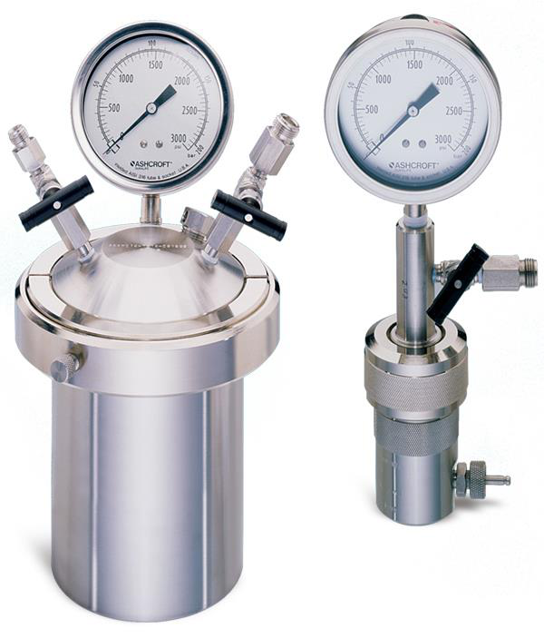
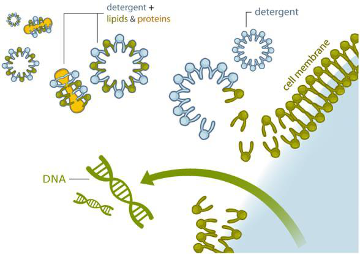

# Cell disruption — reading 12.3

[Previous](12-02-cell-disruption.md) · [Subject index](README.md) · [Next](13-01-primary-isolation.md)

<!-- reading-content:start -->
## Section 40: Worked example — fitting and using homogeniser kinetics

### Intuition

The model has two unknowns multiplied together inside an exponential, which cannot be read off directly. The standard route is to linearise twice.

First, at **fixed pressure**, equation (72) is linear in $`N`$ through the origin, so the slope of $`\ln[R_{\max}/(R_{\max}-R)]`$ against $`N`$ gives the product $`kp^{\,a}`$ for that pressure. Doing this for each pressure gives one slope per pressure.

Second, taking logarithms of those slopes, $`\ln(kp^{\,a}) = \ln k + a\ln p`$, which is linear in $`\ln p`$. The gradient is $`a`$ and the intercept is $`\ln k`$.

Two straight-line fits, each extracting one constant. This is the general recipe whenever a power law sits inside an exponential.

### Worked example

**Problem.** A production strain of *E. coli* is disrupted at 5 °C in a Gaulin homogeniser between 200 and 550 kg$`_f`$ cm⁻². Percentage protein release $`R/R_{\max}`$ as a function of the number of passes is:

| Passes $`N`$ | 200 | 300 | 400 | 500 | 550 |
|---|---|---|---|---|---|
| 1 | 5.0 | 13.5 | 23.3 | 36.0 | 42.0 |
| 2 | 9.5 | 23.5 | 40.0 | 58.5 | 66.0 |
| 3 | 14.0 | 33.5 | 52.5 | 75.0 | 83.7 |
| 4 | 18.0 | 43.0 | 66.6 | 82.5 | 88.5 |
| 5 | 22.0 | 47.5 | 73.0 | 88.5 | 94.5 |
| 6 | 26.0 | 55.0 | 79.5 | 91.3 | — |

(% protein release; pressure in kg$`_f`$ cm⁻².)

**(a)** How many passes are required for 80 % release at 460 kg$`_f`$ cm⁻²?
**(b)** What pressure delivers 70 % recovery in only two passes?

All numbers below were computed in Python.

#### Step 1: convert the data

The table gives $`R/R_{\max}`$, but the model needs $`\ln[R_{\max}/(R_{\max}-R)]`$. Dividing numerator and denominator by $`R_{\max}`$:

**Equation (74)**

```math
\ln\!\left(\frac{R_{\max}}{R_{\max}-R}\right) = \ln\!\left(\frac{1}{1-R/R_{\max}}\right)
```


So 42.0 % becomes $`\ln[1/(1-0.42)] = 0.54`$.

#### Step 2: slope at each pressure


Plotting the converted data against $`N`$ for each pressure gives straight lines through the origin, confirming the first-order form. Their slopes are $`kp^{\,a}`$:

| $`p`$ (kg$`_f`$ cm⁻²) | 200 | 300 | 400 | 500 | 550 |
|---|---|---|---|---|---|
| slope $`kp^{\,a}`$ | 0.0500 | 0.1337 | 0.2633 | 0.4264 | 0.5691 |

#### Step 3: extract $`a`$ and $`k`$

Taking logarithms, $`\ln(kp^{\,a}) = \ln k + a\ln p`$. A straight-line fit of $`\ln(\text{slope})`$ against $`\ln p`$ gives

```math
a = 2.37420, \qquad k = 1.73301\times10^{-7}\ (\mathrm{kg_f\,cm^{-2}})^{-a}
```

with $`R^2 = 0.9994`$ — the power law holds well across the range.

**Check.** Predicted release at $`p = 550`$, $`N = 5`$ is 93.8 % against 94.5 % measured; at $`p = 200`$, $`N = 6`$ it is 26.1 % against 26.0 %. The fit reproduces both ends of the data.

#### Step 4: (a) passes for 80 % at 460 kg$`_f`$ cm⁻²

Rearranging (72) of Section 39 for $`N`$:

```math
N = \frac{1}{kp^{\,a}}\ln\!\left(\frac{1}{1-R/R_{\max}}\right) = \frac{1}{1.73301\times10^{-7}\times460^{2.37420}}\ln\!\left(\frac{1}{1-0.8}\right) = 4.4
```


Passes are whole numbers and 4.4 would fall short, so **$`N = 5`$**.

#### Step 5: (b) pressure for 70 % in two passes

Rearranging for $`p`$:

```math
p = \left[\frac{1}{Nk}\ln\!\left(\frac{1}{1-R/R_{\max}}\right)\right]^{1/a} = \left[\frac{\ln(1/0.3)}{2\times1.73301\times10^{-7}}\right]^{1/2.37420} = 570\ \mathrm{kg_f\,cm^{-2}}
```


This is just above the 550 kg$`_f`$ cm⁻² at which data were taken, so it is a modest extrapolation and reasonable — but it would need checking against the machine's pressure rating.

### Motivation and explanation

**Why the two-stage fit is the right approach.** Fitting $`k`$ and $`a`$ simultaneously to all 29 data points by non-linear regression would also work, but the staged version is better practice: the first stage *tests* the model (do the lines pass through the origin and stay straight?) before the second stage extracts parameters. A curved line at one pressure would reveal a failure of first-order kinetics that a global fit would silently absorb into the parameters.

**What $`a = 2.37`$ means in design terms.** Since $`a > 1`$, pressure is a stronger lever than passes, as Section 39 predicted. Quantitatively, from (72):
- doubling $`N`$ doubles $`\ln[R_{\max}/(R_{\max}-R)]`$;
- doubling $`p`$ multiplies it by $`2^{2.37} = 5.2`$.

**Doubling pressure multiplies the effective pass count by about 5.2** in the fitted model: one pass at doubled pressure has the same predicted release as about 5.2 passes at the original pressure. This conditional comparison does not justify extrapolating the 200–550 kg$`_f`$ cm⁻² fit to 1500–2500 bar.

**The trade-off that the model does not contain.** Higher pressure means more energy dissipated as heat per pass, so more cooling duty and more risk of denaturing the product — and the equipment must be rated for it. Fewer passes means less total residence time with released proteases. The model gives the disruption; the choice between the two routes depends on product stability and capital cost, which it says nothing about.

**Limits of the extrapolation.** The fit covers 200–550 kg$`_f`$ cm⁻² and 1–6 passes. Part (b) extrapolates slightly in pressure, which is acceptable. Extrapolating to much higher pressure would not be: cavitation and temperature rise change the mechanism, and $`R_{\max}`$ itself may fall as the released protein is damaged.

### Link to other topics

The two-stage linearisation — hold one variable, fit the other, then fit the parameters of that fit — is the standard way to resolve a rate law of the form $`r = kC_A^{\alpha}C_B^{\beta}`$ from kinetic data, and the reasoning is identical: isolate one dependence at a time.

### Summary

Converting the data to $`\ln[R_{\max}/(R_{\max}-R)]`$ linearises the release law in $`N`$; the slopes then linearise in $`\ln p`$, giving $`a = 2.37`$ and $`k = 1.73\times10^{-7}`$ with $`R^2 = 0.9994`$. Five passes reach 80 % release at 460 kg$`_f`$ cm⁻², and 570 kg$`_f`$ cm⁻² reaches 70 % in two.

## Section 41: Non-mechanical cell disruption

### Intuition

A wall can be broken by overwhelming it, or by removing what holds it together. Mechanical methods do the first. The non-mechanical methods do the second, and they divide naturally by *which* component they attack:

- **Physical** methods make the cell break *itself*, by creating a pressure difference across the envelope that it cannot withstand — by heating and damaging the envelope, by expanding dissolved gas inside it, or by drawing water in osmotically.
- **Chemical** methods dissolve the lipid membrane, which is held together only by the hydrophobic effect and so is vulnerable to anything surface-active.
- **Biological** methods cleave selected covalent bonds in wall components enzymatically. For example, lysozyme cuts glycosidic bonds in the peptidoglycan backbone, rather than its peptide crosslinks. Enzyme specificity makes this attack more targeted.

The pattern across all three is **specificity bought at a price**. Each is gentler and more targeted than a homogeniser, and each introduces something that must later be removed — heat damage, added salt, detergent, solvent, or enzyme — or is simply too expensive at scale.

*Analogy:* opening a locked door by force, by removing its hinges, or with the correct key. The key is cleanest but must be obtained and accounted for afterwards. The analogy breaks down because a detergent does not unlock anything selectively — it dissolves the membrane wholesale, and it is "selective" only in the sense that it attacks lipid rather than protein.

### Mechanism

#### Physical methods

These include thermal, decompression and osmotic shock. They are generally **costly and difficult to scale up**, so they are used mostly at laboratory rather than production scale.

**Thermolysis.** Cells are disrupted by **heating** — cytoplasmic proteins can be extracted from *E. coli* by holding at 90 °C for 10 minutes. Alternatively, **freeze–thaw cycles** disrupt cells through the formation of **ice crystals** that puncture membranes and walls. Both are **energy intensive**, and heating obviously risks denaturing the product, so thermolysis suits only thermostable products.

**Decompression.** Cells are exposed to a **high-pressure gas**, which dissolves in the medium and distributes itself inside the cells. On **rapid decompression**, the gas within the cells expands and bursts them from the inside.



The mechanism is worth noting: the disruptive force is generated *inside* the cell, so the wall fails in tension from within rather than being crushed. This is gentler than homogenisation because there is no shear field acting on the released protein.


**Osmotic shock.** Cells are exposed to **hypertonic** or **hypotonic** conditions.
- *Hypertonic* conditions are obtained by adding salts at 1–3 M concentration, causing the cells to **shrink** rapidly as water leaves the cytoplasm.
- *Hypotonic* conditions draw water into cells. Wall-free cells such as red blood cells can swell and lyse, but intact bacterial and yeast walls usually resist the load. Efficient microbial release often needs envelope weakening or a specific osmotic-shock protocol.

The two are often used in sequence — shrink, then swell — since the mechanical cycling weakens the envelope. The method is **not sufficiently efficient for production scale**, and the added salt must afterwards be removed, which adds cost.

#### Chemical methods

Non-physical methods disrupt cell walls and membranes by adding chemical substances (**solvents**, **detergents**) or biological agents (**enzymes**). Several can be combined to achieve the desired efficiency. The drawback compared with physical methods is the **cost of the substances used, and that they may need to be removed**.



**Detergents.** Detergents, or **surfactants**, solubilise the phospholipid cell membrane through **micellisation** and by solubilising membrane proteins. Typical detergents are **sodium dodecyl sulfate (SDS)** and **Triton X-100**. They may need to be removed for later processing stages, adding to cost. Commonly used at laboratory scale for RNA or DNA extraction.

**Solvents.** Alcohols, dimethyl sulfoxide, methyl ethyl ketone and toluene solubilise the lipid components of the membrane, disrupting it. Like detergents, they may need removal. Solvents **may cause denaturation** of target proteins, which is often undesirable. They are sometimes combined with alkaline compounds to hydrolyse the cell wall as well as the membrane.

#### Biological methods

**Enzymes** digest cell walls. Those used include **lysozyme, cellulase, protease, chitinase and pectinase**.

The defining feature is **specificity**: different enzymes digest different parts of the wall, matched to the organism's chemistry (Section 38).
- **Lysozyme** hydrolyses the **peptidoglycan** layer in bacteria.
- **Chitinase** targets the **chitin** in yeast cell walls.
- **Pectinase** is used for plant cell walls.

Enzymes can be **combined with detergents**. For Gram-negative bacteria, lysozyme treatment follows detergent treatment, which is used to remove the outer membrane and expose the peptidoglycan layer underneath — a direct consequence of the layered architecture in Section 38: the detergent handles the lipid outer membrane, the enzyme handles the peptidoglycan.

Enzymes are **costly**, which limits their application in production-scale processes.

### Motivation and explanation

**Why these methods do not scale.** Each has a specific obstacle:
- *Thermolysis and freeze–thaw* are energy intensive, and the energy scales with the volume processed.
- *Decompression* requires a pressure vessel large enough for the batch, and the gas must be compressed.
- *Osmotic shock* needs molar quantities of salt per batch, then needs it all removed.
- *Detergents and solvents* are consumables, and removal is a further separation step.
- *Enzymes* are the most expensive reagents of all.

Mechanical methods can offer high throughput with reusable equipment. Their energy and cooling requirements still grow with processed volume, while non-mechanical routes incur reagent, recovery and equipment costs. Production-scale choice therefore follows an engineering and economic comparison, rather than a universal claim that only mechanical methods scale.

**Where non-mechanical methods win.** Three cases:
1. *Fragile products* that cannot survive shear or heat.
2. *Selective release* — mild osmotic shock can release periplasmic contents from Gram-negative bacteria without breaking the inner membrane, so the product comes out with far fewer contaminants. This is a real purification advantage, not just a gentler disruption.
3. *Small scale*, where consumable cost is irrelevant and convenience dominates.

**Combinations are normal.** The methods are not exclusive. A common industrial compromise is a mild chemical or enzymatic pre-treatment to weaken the wall, followed by fewer homogeniser passes — reducing both reagent cost and the heat and shear load.

### Link to other topics

The choice between a capital-intensive mechanical route and a consumable-intensive chemical one is a standard operating-cost comparison: equipment cost is largely independent of throughput once installed, while reagent cost scales linearly with it, so the crossover sits at a particular production volume.

### Summary

Non-mechanical disruption can damage envelopes by heat or pressure changes, solubilise membranes chemically, or digest wall components enzymatically. Heating, SDS and solvents can denature products, while appropriate enzymes or controlled osmotic shock can be selective.

## Conclusion

Disruption recovery must be assessed alongside the damage and contaminants introduced by the release operation. The next unit develops primary isolation.
<!-- reading-content:end -->

[Previous](12-02-cell-disruption.md) · [Subject index](README.md) · [Next](13-01-primary-isolation.md)
