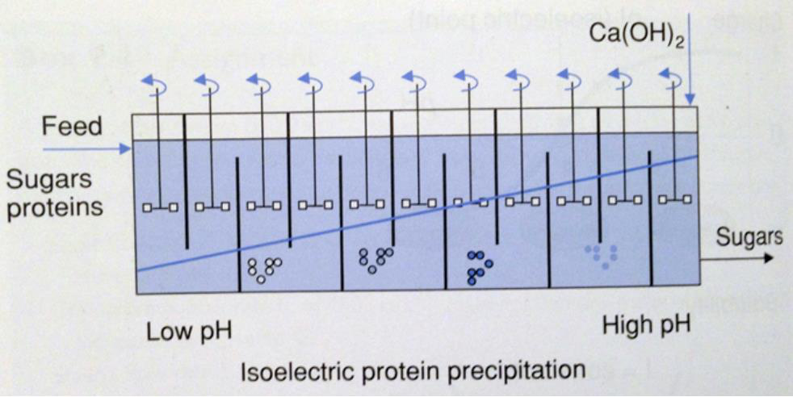

# Primary isolation — reading 13.3

[Previous](13-02-primary-isolation.md) · [Subject index](README.md) · [Next](13-04-primary-isolation.md)

<!-- reading-content:start -->
## Section 44: Isoelectric, polymer- and solvent-induced precipitation

### Intuition

A protein remains dissolved when solvent interactions and the free energy of mixing favour dispersed molecules over a protein-rich phase. Hydration and electrostatic interactions contribute, but reducing net charge or changing the solvent does not guarantee precipitation for every protein.

The alternatives change different contributions:
- **Isoelectric** — reduce net charge near the pI; charged surface groups can remain.
- **Polymer** — preferential exclusion and, under appropriate size conditions, depletion attraction favour association.
- **Solvent** — change dielectric properties and protein–solvent interactions by mixing in an organic solvent.

All four converge on the same end state, so the choice is governed by what the product tolerates and what must be removed afterwards.

*Analogy:* keeping magnets apart with both a repelling field and a layer of packing. You can remove the packing, switch off the field, or squeeze from outside. The analogy breaks down for the polymer case, where nothing is removed and nothing switched off — the aggregation is driven by the *entropy of the polymer*, not by a force between the proteins at all.

### Mechanism

#### Isoelectric precipitation

Proteins most often carry a **net electric charge**, or are **zwitterionic** (net charge zero, but parts of the protein positively or negatively charged).

- **Charge stabilises proteins against aggregation**, through Coulomb repulsion that counteracts hydrophobic interactions.
- **Charge is pH dependent**, through (de)protonation of charged amino acids. At low pH a protein is more likely to be positively charged; at high pH, negatively charged.
- The **isoelectric point (pI)** is the pH at which the protein has **zero net charge**; positively and negatively charged groups can still be present.

Reduced net electrostatic repulsion often gives a **solubility minimum near the pI**, although this is not universal. The vicilin curve shows this sharply: solubility falls by about an order of magnitude within one pH unit either side of pH 5.

A protein's pI depends on the ionisable groups in its sequence and their environment. Values span a wide range, so precipitation conditions must be chosen for the actual protein.

**Operation.** Precipitation is achieved by changing — typically reducing — the pH of the feed until the protein of interest reaches its minimum solubility and precipitates.

- **Potential advantage over salting out:** less added salt may be needed. Acid/base adjustment still introduces counterions, and subsequent buffer exchange depends on product requirements.
- **Drawback:** low solubility can cause irreversible aggregation; extreme pH can also denature the protein. Zero net charge alone does not imply an unfolded state.

**Conceptual example: staged pH-controlled precipitation.** If a mixture contains proteins with different solubility minima, successive compartments can adjust pH and remove precipitated fractions. Actual recovery also depends on residence time, mixing and overlapping solubility curves. Commercial beet-juice clarification uses lime treatment and removal of impurities; the schematic should not be taken as evidence that a particular sugar factory fractionates proteins one by one at their pI.

The schematic illustrates how pH-dependent solubility can guide equipment design. It does not guarantee individual protein fractions: proteins can have overlapping precipitation ranges.

#### Polymer-induced precipitation

Neutral polymers such as **PEG and dextran** can reduce protein solubility through preferential exclusion and changes in solvent interactions. They need not strip hydration water from the protein; excluded-volume effects can favour a protein-rich phase.

In addition, PEG causes aggregation of **large globular proteins** by inducing **depletion forces**, first explained by Asakura and Oosawa:
- The polymer coils are **excluded from the small gap between two adjacent large particles** (the proteins), because they do not fit.
- There is therefore a **larger osmotic pressure from the polymer outside the gap than inside it**.
- The imbalance produces a net **attractive force** pushing the proteins together.

This is a purely **entropic** effect — nothing binds to the protein. It depends on the size ratio between polymer coil and protein, which is why it works for large globular proteins and why polymer molecular weight is a design variable.

**Not to be confused with aqueous two-phase extraction** (Section 42), which also uses PEG and dextran but separates proteins *between* two liquid phases rather than precipitating them out of one.

#### Solvent-induced precipitation

The feed is mixed with a **miscible solvent**, for example ethanol or methanol.

**This is distinct from solvent extraction** (Section 42), which uses **immiscible** solvents to create a second liquid phase. Here the solvent dissolves fully and changes the properties of the single phase.

Mechanism:
- Adding sufficient organic solvent changes protein–solvent interactions and can reduce protein solubility. Preferential solvation and conformational effects depend on the protein and mixture.
- Ethanol or methanol lowers the **dielectric constant of the mixture**. This changes electrostatic interactions, including both attractions and repulsions; reduced dielectric constant alone is not a complete precipitation mechanism.

It is often used for primary isolation of **antibodies**.

### Motivation and explanation

**Comparing the four methods.**

| Method | Main change | Removal needed afterwards | Main risk |
|---|---|---|---|
| Salting out | salt-dependent solubility | salt removal as required | aggregation or loss of activity; native structure can also be stabilised |
| Isoelectric | reduced net charge near pI | pH readjustment; counterion removal if required | irreversible aggregation or pH damage |
| Polymer | solvent interactions and depletion attraction | polymer removal as required | product-dependent stability and residual polymer |
| Solvent | mixed-solvent properties, including dielectric constant | solvent removal | denaturation; often requires cooling |

The third column matters for downstream integration. Isoelectric precipitation can require less added salt, but acid and base introduce counterions. Readjusting pH restores protonation conditions without removing those ions; buffer exchange or desalting may still be needed.

**Why solvent precipitation is done cold.** Organic solvents denature proteins, and the rate of denaturation rises steeply with temperature. Industrial ethanol fractionation of blood plasma is run near 0 °C for exactly this reason. The same logic as the 5 °C homogenisation in Section 40: where the method itself threatens the product, temperature is the lever that buys tolerance.

**Why none of these is very selective.** All four exploit bulk physical properties — hydrophobicity, pI, size, solvation — that many proteins share. Two proteins of similar pI precipitate together. This is why precipitation sits in **primary isolation** (Section 32), taking purity from roughly 1 % to 10 %, with the real purification left to chromatography.

**Why precipitation is used at all, given that.** It removes **large amounts of water**, so it concentrates the product substantially while also purifying it a little. Compare extraction (Section 42), where improving recovery means diluting into a larger phase. Precipitation moves *both* concentration and purity in the right direction, which is why it so often follows extraction in a real train.

### Link to other topics

The depletion force is the same mechanism that flocculates colloids with free polymer, used deliberately in water treatment and arising as an unwanted instability in formulated products. In all cases the driving force is the entropy of the excluded species, not an interaction between the particles themselves.

### Summary

The three non-salt routes change different contributions to solubility: isoelectric precipitation reduces net charge near the pI, polymers alter solvent interactions and can produce depletion attraction, and miscible solvents change the solvent environment. A pH gradient can fractionate proteins, but acid/base counterions may require removal afterwards.
<!-- reading-content:end -->

[Previous](13-02-primary-isolation.md) · [Subject index](README.md) · [Next](13-04-primary-isolation.md)
