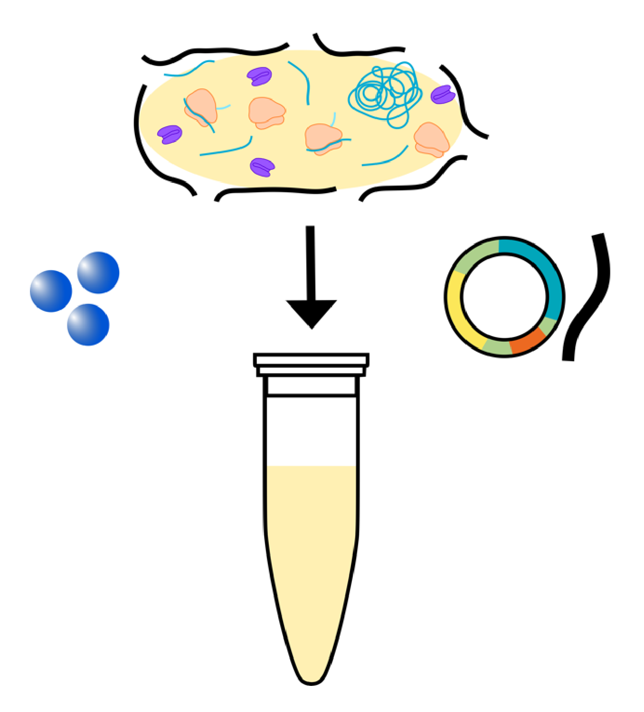

# Cell-free systems and synthetic cells — reading 16.1

[Previous](15-05-gene-regulation-and-synthetic-circuits.md) · [Subject index](README.md) · [Next](16-02-cell-free-systems-and-synthetic-cells.md)

<!-- reading-content:start -->
## Overview

Cell-free systems move transcription and translation into an engineered reaction mixture. In-vitro transcription enables mRNA production, while genome minimisation and bottom-up compartment construction explore complementary routes to simpler cellular systems.

*Assumed throughout:* gene expression, enzyme catalysis and membrane structure.

## Section 53: Cell-free TXTL — extracts and PURE

### Intuition

A cell is both a production plant and a system that maintains the plant. Cell-free expression keeps the production equipment while handing maintenance to the engineer: buffers control the environment, and added substrates support biosynthesis. A toxic product can therefore be made without requiring a host to keep growing, provided it does not inhibit the extracted machinery itself.

*Analogy:* operating machinery removed from a factory. The limit is that molecular machines continually degrade and share reagents; taking away the factory also removes repair, compartmentalisation and much of metabolic regulation.

### Derivation

The mechanism runs from DNA to mRNA to polypeptide, then folding. Each stage requires something different, so supplying DNA alone cannot sustain expression.

**Transcription.** RNA polymerase recognises a compatible promoter and uses nucleoside triphosphates (NTPs) to extend RNA. Magnesium supports catalysis. The promoter and polymerase must match; a bacterial extract can use endogenous polymerase, or a supplied polymerase such as T7 with its own promoter.

**Translation.** Aminoacyl-tRNA synthetases use ATP to attach each amino acid to its matching transfer RNA (tRNA). The ribosome recognises codon–anticodon pairs and transfers the growing peptide to the incoming aminoacyl-tRNA. Initiation, elongation, release and recycling factors coordinate the cycle; GTP supports delivery and translocation. Energy comes from activated substrates and nucleotide hydrolysis, rather than from the peptide bond spontaneously forming between free amino acids.

**Maintaining activity.** Added amino acids and NTPs supply material; energy substrates and regeneration enzymes replenish usable nucleotide triphosphates. Salt, magnesium, pH and sometimes crowding agents support the machinery. Reagent depletion, inhibitory by-products and degradation eventually stop a closed batch.

**Extract route.** Grow source cells, disrupt them, and clarify the lysate to remove intact cells and coarse debris while retaining ribosomes and soluble factors. Endogenous nucleic-acid activity is reduced by preparation-dependent treatments; clarification alone does not guarantee removal of all cellular DNA or mRNA. Add the chosen template and supplement the reaction. Bacterial, yeast, wheat-germ and rabbit-reticulocyte preparations differ in translation and processing capabilities.



**PURE route.** Protein synthesis Using Recombinant Elements combines individually purified synthetases, translation factors and energy-regeneration enzymes with ribosomes, tRNAs and small molecules. A representative formulation contains 36 non-ribosomal proteins; the exact set depends on the formulation. For TXTL from DNA, include a compatible RNA polymerase. Purified components give control over omissions and concentrations; they do not mean that every component, including the ribosome, is a single recombinant protein.

### Motivation and explanation

| Choice | What is gained | What must be managed |
|---|---|---|
| Crude extract | Inherited cofactors, enzymes and metabolic capacity; comparatively economical preparation | Batch variation, background reactions, nucleases and proteases |
| PURE | Defined composition and targeted removal or replacement of factors | Many separate purification steps, cost and limited auxiliary functions |

Extracts often offer higher practical protein yields than a basic PURE mixture, but yield depends on the protein, formulation and operating mode. Membrane proteins need an appropriate membrane mimic or lipid compartment; folding and post-translational processing may need extra machinery.

Changing DNA avoids a new host-engineering cycle for each product. It also supports automation, linear templates and, in suitable preparations, freeze-dried storage. Linear DNA may need protection against nucleases. Cell-free production removes growth and harvest from the expression stage, but source-cell cultivation and disruption are still needed to prepare extracts. Purification must still separate product from enzymes, nucleic acids and other impurities. Product-specific quality and safety requirements remain, and oxygen transfer can still matter when energy regeneration uses respiration.

### Worked example

Suppose a protein must contain a non-canonical amino acid at a chosen stop codon. In a defined PURE mixture, omit the release factor that normally recognises that codon and supply a suitably charged suppressor tRNA. The tRNA now competes successfully to insert the desired amino acid where termination would otherwise occur.


This works only if the remaining factors support elongation and the product has a separate, effective termination route. Removing a release factor alone supplies neither the unusual amino acid nor its correctly charged tRNA. An extract is harder to control because endogenous release factors and competing reactions remain.

### Link to other topics

Cell-free systems reuse the transcription and translation mechanisms of gene regulation while exposing resource competition directly to experimental control. Their preparation uses cell disruption and clarification, whereas their products still need downstream purification.

### Summary

Extracts preserve biochemical breadth; PURE trades that breadth for control. The same separation of machinery from living cells also allows RNA to be manufactured without translating it into protein.

## Section 54: Manufacturing mRNA by in vitro transcription

### Intuition

Manufacture the instruction rather than the antigen: a recipient cell later translates the delivered mRNA into protein. The production problem therefore shifts from folding and purifying an antigen to controlling RNA sequence, integrity, end chemistry and impurities.

*Analogy:* printing an instruction sheet with protective covers and a delivery envelope. The limit is that a cap and poly(A) tail actively recruit cellular proteins; they are more than packaging, and RNA impurities can change how the immune system responds.

### Derivation

**Template and polymerisation.** Prepare DNA containing a promoter recognised by the selected polymerase, followed by the RNA sequence. A linear template provides a defined run-off endpoint; a plasmid can be linearised or the required region amplified. T7 RNA polymerase uses ATP, CTP, GTP and UTP as building blocks, with magnesium as a catalytic cofactor. A buffer controls pH, and polyamines such as spermidine can support transcription under suitable conditions.

The RNA's terminal hydroxyl attacks the incoming NTP's phosphate, forming a phosphodiester bond and releasing pyrophosphate. Repeated template-directed addition produces RNA while leaving the DNA available for further transcription. This mixture needs no ribosomes or amino acids because it does not make protein.

**End structures.** The message comprises a cap, untranslated regions (UTRs), a coding sequence and a poly(A) tail. The UTRs affect stability and translation. The 5′ cap contains a methylated guanosine joined through an unusual 5′–5′ triphosphate linkage; it supports translation initiation and resistance to degradation. The tail recruits poly(A)-binding proteins and supports stability and translation.

Two capping routes are possible. Post-transcriptional capping treats the RNA with capping enzymes: removal of the terminal phosphate, addition of guanosine and methylation build the cap, with additional methylation where required. Co-transcriptional capping introduces a suitable cap analogue during initiation. The latter can remove the separate capping reactor, but requires compatible template and reaction design. The poly(A) tail can be encoded in the template or added afterwards by template-independent poly(A) polymerase.

**Purification and formulation.** Remove residual DNA, enzymes, unused NTPs and aberrant RNA, including truncated or double-stranded species. DNA digestion reduces the template to smaller fragments that subsequent operations can remove. Tangential-flow filtration concentrates or exchanges buffer where its membrane retains the RNA and passes smaller solutes. Chromatography adds selectivity: ion exchange exploits charge, size exclusion exploits hydrodynamic size, and oligo(dT) affinity captures a poly(A) tail through base pairing. Tail capture alone does not prove that an RNA has the correct cap or intact coding region.

Finally, formulate the purified message for delivery, for example in lipid nanoparticles. Their job includes RNA protection and cytoplasmic delivery; producing pure RNA alone does not accomplish either.

### Motivation and explanation

The architecture makes IVT adaptable: change the coding sequence while retaining much of the manufacturing platform. However, a new sequence can change secondary structure, reaction behaviour and impurity formation, so the recipe is not automatically transferable without optimisation.

Double-stranded RNA and uncapped or damaged transcripts can alter innate sensing and reduce useful translation. Total RNA mass is therefore not the same as acceptable product mass. A selective separation train is needed even though no cells are present in the IVT reactor.

The process below includes proposed enzyme-recycling loops. These require a separation that recovers active enzyme without unacceptable product carryover. Ordinary ultrafiltration may retain both enzyme and long RNA; the presence of a filtration step does not by itself establish selective recycling. The diagram is a conceptual process, rather than a universal manufacturing recipe.

### Worked example


Follow the stream through IVT, purification, capping and final formulation. In the diagram, VCC denotes vaccinia capping enzyme; the methyl donor supplies the cap-methylation reaction. A hypothetical batch starts with $`m_0=100\,\mathrm{mg}`$ of intact target RNA. Let $`f_c=0.90`$ be its correctly capped fraction, $`y_p=0.80`$ the recovery of that fraction in purification, and $`y_f=0.95`$ its recovery in formulation. Assume these fractions are measured for the target population, with no additional degradation; neglect the small cap mass increase.

By the definition of capped fraction, the available capped RNA is $`m_c=m_0f_c`$. Recovery is the fraction of the incoming target retained, so purified RNA is $`m_p=m_cy_p`$. Applying the same definition at formulation gives $`m_f=m_py_f`$. Substitution eliminates the intermediate masses:


**Equation (125)**

```math
m_f=m_0f_cy_py_f.
```


Python gives $`m_c=90.0\,\mathrm{mg}`$, $`m_p=72.0\,\mathrm{mg}`$ and $`m_f=68.4\,\mathrm{mg}`$: an overall recovery of $`68.4\%`$ relative to the initial target RNA. These are illustrative inputs, not measured process performance. All factors are dimensionless, so the final mass retains the units of $`m_0`$; if any factor vanishes, acceptable recovered product also vanishes.

### Link to other topics

IVT reuses DNA assembly and transcription, but stops before the translation stage of TXTL. Its purification applies the filtration, chromatography and nucleic-acid recognition mechanisms already used elsewhere in bioprocessing.

### Summary

mRNA manufacture couples template-directed synthesis to end processing, selective purification and delivery. Removing cells simplifies the reaction environment while leaving product quality and separation as central engineering problems.
<!-- reading-content:end -->

[Previous](15-05-gene-regulation-and-synthetic-circuits.md) · [Subject index](README.md) · [Next](16-02-cell-free-systems-and-synthetic-cells.md)
