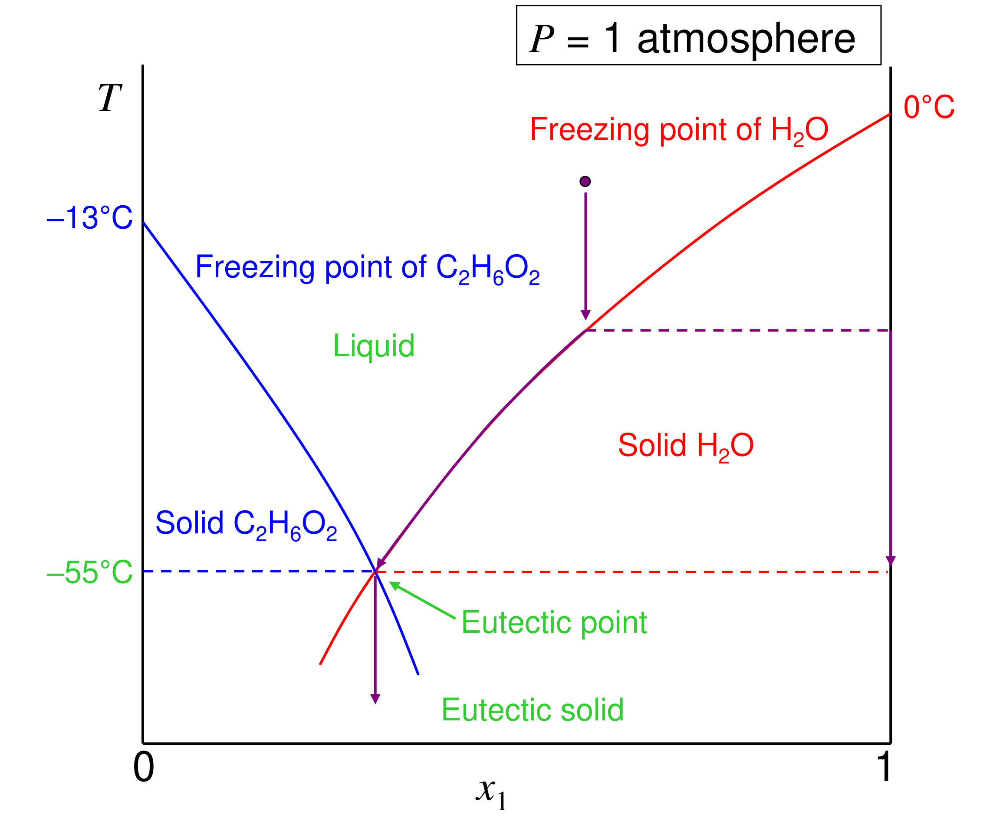

# Measuring activity coefficients and freezing-point depression — reading 04.2

[Previous](04-01-measuring-activity-coefficients-and-freezing-point-depression.md) · [Subject index](README.md) · [Next](05-01-activity-coefficient-models.md)

<!-- reading-content:start -->
## Section 15: Freezing-point depression

*Notation:* component 1 is the solvent that freezes out (e.g. water); component 2 is the solute that stays in the liquid. $`T_f`$ is the freezing point of pure 1 at the system pressure. $`\Delta\underline{H}_1^{\mathrm{fus}}`$, $`\Delta\underline{S}_1^{\mathrm{fus}}`$ and $`\Delta\underline{G}_1^{\mathrm{fus}}`$ are the molar changes on melting pure 1 (liquid minus solid).

### Intuition

Dissolving a solute lowers the solvent's chemical potential in the liquid, through the $`RT\ln x_1`$ mixing term (and $`\gamma_1`$). The pure solid is unaffected, because the solute does not enter it. The liquid is therefore stabilised relative to the solid, and the temperature must fall further before the solid's $`\underline{G}`$ drops below the liquid's.

*Physically:* the liquid has an entropic advantage (mixing) that the solid cannot share, so the solid can only win once the temperature has fallen enough for its lower enthalpy to dominate.

### Derivation

**Step 1: equilibrium condition.** With pure solid 1 in contact with the liquid mixture at $`(T, P)`$:


**Equation (78)**

```math
\mu_1^{S} = \mu_1^{L}
```


**Step 2: the two sides.** The solid is pure, so $`\mu_1^S = \underline{G}_1^S(T,P)`$. The liquid side is (Section 10):


```math
\mu_1^L = \underline{G}_1^L(T,P) + RT\ln(\gamma_1x_1)
```


where $`\underline{G}_1^L`$ is *pure liquid* 1 at the same $`T`$, $`P`$. Below $`T_f`$ this is a supercooled liquid: a well-defined hypothetical state.

**Step 3: combine.** Write $`\underline{G}_1^S = \underline{G}_1^L - \Delta\underline{G}_1^{\mathrm{fus}}`$ and substitute into (78):


**Equation (79)**

```math
RT\ln(\gamma_1x_1) = -\Delta\underline{G}_1^{\mathrm{fus}}(T)
```


The pressure dependence of $`\Delta\underline{G}^{\mathrm{fus}}`$ is dropped, because condensed-phase volumes are small (Section 06).

**Step 4: temperature dependence of $`\Delta\underline{G}^{\mathrm{fus}}`$.** At $`T_f`$ the pure solid and liquid coexist, so $`\Delta\underline{G}_1^{\mathrm{fus}}(T_f) = 0`$ and $`\Delta\underline{S}_1^{\mathrm{fus}} = \Delta\underline{H}_1^{\mathrm{fus}}/T_f`$. From $`(\partial\Delta\underline{G}/\partial T)_P = -\Delta\underline{S}`$, with $`\Delta\underline{S}^{\mathrm{fus}}`$ taken as constant between $`T`$ and $`T_f`$:


**Equation (80)**

```math
\Delta\underline{G}_1^{\mathrm{fus}}(T) = -\Delta\underline{S}_1^{\mathrm{fus}}(T - T_f) = \frac{\Delta\underline{H}_1^{\mathrm{fus}}}{T_f}(T_f - T)
```


**Step 5: the freezing-point equation.** Substitute (80) into (79) and divide by $`RT`$:


**Equation (81)**

```math
\boxed{\ln(\gamma_1x_1) = \frac{\Delta\underline{H}_1^{\mathrm{fus}}}{R}\left(\frac{1}{T_f} - \frac{1}{T}\right)}
```


Since $`\Delta\underline{H}^{\mathrm{fus}} > 0`$ and $`\gamma_1x_1 < 1`$ for an ideal or near-ideal mixture, $`T < T_f`$: the freezing point is depressed.

**Step 6: small depression.** Let $`\Delta T = T_f - T \ll T_f`$. Then $`1/T_f - 1/T = -\Delta T/(TT_f) \approx -\Delta T/T_f^2`$:


**Equation (82)**

```math
\ln(\gamma_1x_1) \approx -\frac{\Delta\underline{H}_1^{\mathrm{fus}}}{RT_f^2}\,\Delta T
```


**Step 7: dilute ideal limit.** For dilute solute, $`\gamma_1\to 1`$ (Gibbs–Duhem, Section 11) and $`-\ln x_1 = -\ln(1-x_2)\approx x_2`$. With molality $`m`$ (mol solute per kg solvent) and solvent molar mass $`M_1`$, $`x_2\approx M_1m`$. Hence


**Equation (83)**

```math
\Delta T \approx \frac{RT_f^2M_1}{\Delta\underline{H}_1^{\mathrm{fus}}}\,m = K_f\,m
```


### Motivation and explanation

**A colligative property.** Equation (83) contains nothing about the solute's identity, only how many solute particles there are. If the solute dissociates (NaCl gives Na⁺ and Cl⁻), $`x_2`$ counts the particles, roughly doubling the effect. In concentrated solutions the solute affects the result only through $`\gamma_1`$, which is exactly why (81) can be used to *measure* $`\gamma_1`$.

**Measuring activity coefficients.** Measure $`T`$ at known $`x_1`$. Then (81) gives $`\gamma_1x_1`$, hence $`\gamma_1`$, with no vapour-pressure measurement. This is essential for involatile mixtures (salts, polymers, sugars). Gibbs–Duhem then gives the solute's $`\gamma_2`$.

**What is assumed, and when it fails.**
1. *Only pure solid 1 freezes out.* This fails for solid solutions, and for hydrates or water of crystallisation.
2. Negligible $`\Delta\underline{C}_P`$ between liquid and solid, so both $`\Delta\underline{S}^{\mathrm{fus}}`$ and $`\Delta\underline{H}^{\mathrm{fus}}`$ can be treated as constant. Over tens of kelvin, the heat-capacity difference between liquid and solid changes $`\Delta\underline{H}^{\mathrm{fus}}`$ noticeably (see the next section).
3. Small $`\Delta T`$ for (82)–(83). Large depressions, e.g. alloys such as solders, need (81).
4. *Pressure effects neglected.* This is fine at ordinary pressures.

### Worked example

**Problem.** (a) Compute water's cryoscopic constant from $`\Delta\underline{H}^{\mathrm{fus}} = 333.55`$ J g⁻¹, i.e. 6009 J mol⁻¹. (b) Find the freezing point of an ideal 1 mol kg⁻¹ aqueous solution of a non-electrolyte using (81) and (83). (c) Estimate the freezing point of sea water, with 35 g kg⁻¹ of salt, about 0.6 mol kg⁻¹ NaCl.

**(a)** $`K_f = RT_f^2M_1/\Delta\underline{H}^{\mathrm{fus}} = 8.314\times273.15^2\times0.018015/6009 = 1.860`$ K kg mol⁻¹. This matches the textbook value of 1.86, derived here entirely from the thermodynamics of the pure solvent.

**(b)** $`x_2 = 0.018015/(1 + 0.018015) = 0.01770`$, so $`-\ln x_1 = 0.01785`$.
- Equation (81) with $`\gamma_1 = 1`$: $`\Delta T = 1.83`$ K.
- Equation (83): $`\Delta T = 1.86`$ K.

The linear law overestimates by 1.6 % even at 1 mol kg⁻¹, because it linearises both $`\ln(1-x_2)`$ and $`1/T`$.

**(c)** NaCl dissociates fully into two particles, so treat sea water as about 1.2 mol kg⁻¹ of ideal solute particles. Equation (81) gives $`\Delta T \approx 2.2`$ K, against observed sea water at about −2 °C. Agreement is fair. The remaining difference reflects the approximate composition and the non-ideality of a concentrated electrolyte ($`\gamma_1\neq 1`$), which ionic-solution theory addresses later in the course.

### Link to other topics

The same derivation, with the vapour in place of the solid, gives boiling-point elevation. With a semipermeable membrane in place of the phase boundary, it gives osmotic pressure. All three are colligative properties and all three measure solvent activity. Equation (81) applied to each component in turn gives the full solid–liquid phase diagram, with its eutectic, in the next section.

### Summary

Freezing equilibrium between a pure solid and a liquid mixture gives $`\ln(\gamma_1x_1) = (\Delta\underline{H}_1^{\mathrm{fus}}/R)(1/T_f - 1/T)`$. In the dilute limit this becomes the cryoscopic law $`\Delta T = K_fm`$, with $`K_f = RT_f^2M_1/\Delta\underline{H}^{\mathrm{fus}}`$ (1.86 K kg mol⁻¹ for water). In concentrated mixtures it is a way to measure the solvent's activity coefficient.

## Section 16: Worked example, ethylene glycol–water freezing and the eutectic

*Components:* water (1), ethylene glycol (2).

### Intuition

Start from pure water and add glycol: the ice-freezing temperature falls. Start from pure glycol and add water: the glycol-freezing temperature falls too. The two curves run downward towards each other and must meet. At the meeting point (the eutectic) the liquid is in equilibrium with *both* solids at once.

Cool any liquid mixture and one solid crystallises first, depending on which side of the eutectic composition the liquid lies. The remaining liquid moves along that freezing curve towards the eutectic. At the eutectic the rest freezes together as a fine intergrowth of the two pure solids: the "eutectic solid". On a molecular scale each solid phase is still pure.



### Derivation

**Step 1: water (ice) freezing curve.** Pure ice is in equilibrium with the liquid:


**Equation (84)**

```math
\ln(\gamma_1x_1) = \frac{\Delta\underline{H}_1^{\mathrm{fus}}}{R}\left(\frac{1}{T_{f,1}} - \frac{1}{T}\right)
```


**Step 2: glycol freezing curve.** Pure solid glycol is in equilibrium with the liquid:


**Equation (85)**

```math
\ln(\gamma_2x_2) = \frac{\Delta\underline{H}_2^{\mathrm{fus}}}{R}\left(\frac{1}{T_{f,2}} - \frac{1}{T}\right)
```


**Step 3: eutectic.** Both conditions hold at once, with $`x_1 + x_2 = 1`$. For an ideal mixture ($`\gamma_i = 1`$), invert each equation for $`x_i(T)`$ and require


**Equation (86)**

```math
x_1(T_e) + x_2(T_e) = 1
```


then solve for $`T_e`$ numerically.

**Step 4: activity coefficient from a measured freezing point.** If the measured freezing temperature on the ice branch is $`T`$ at known $`x_1`$, (84) gives


**Equation (87)**

```math
\gamma_1 = \frac{1}{x_1}\exp\!\left[\frac{\Delta\underline{H}_1^{\mathrm{fus}}}{R}\left(\frac{1}{T_{f,1}} - \frac{1}{T}\right)\right]
```


**Step 5: heat-capacity correction for large depressions.** If $`\Delta\underline{C}_P = \underline{C}_P^{L} - \underline{C}_P^{S}`$ is constant, integrating $`d\Delta\underline{H} = \Delta\underline{C}_P\,dT`$ and $`d\Delta\underline{S} = (\Delta\underline{C}_P/T)\,dT`$ from $`T_f`$ gives

```math
\Delta\underline{H}(T) = \Delta\underline{H}^{\mathrm{fus}} + \Delta\underline{C}_P(T - T_f), \qquad \Delta\underline{S}(T) = \frac{\Delta\underline{H}^{\mathrm{fus}}}{T_f} + \Delta\underline{C}_P\ln\frac{T}{T_f},
```

and


**Equation (88)**

```math
\ln(\gamma_1x_1) = -\frac{\Delta\underline{H}(T) - T\,\Delta\underline{S}(T)}{RT}
```


This reduces to (84) when $`\Delta\underline{C}_P = 0`$.

### Worked example

**Data.**
- Water: $`T_{f,1} = 273.15`$ K, $`\Delta\underline{H}_1^{\mathrm{fus}} = 6009`$ J mol⁻¹; $`\underline{C}_P^{L} = 75.34`$ and $`\underline{C}_P^{S} = 38.09`$ J mol⁻¹ K⁻¹, so $`\Delta\underline{C}_P = 37.25`$ J mol⁻¹ K⁻¹.
- Ethylene glycol: $`M = 62.07`$ g mol⁻¹, $`T_{f,2} = 260.25`$ K (−12.9 °C), $`\Delta\underline{H}_2^{\mathrm{fus}} = 9.958`$ kJ mol⁻¹ (another measurement gives 11.6 kJ mol⁻¹).
- Observation: a 60 wt % glycol / 40 wt % water mixture freezes at about −45 °C.

**(a) Ideal eutectic.** Solving (86) gives $`T_e = 222.2`$ K (−51 °C) at $`x_1 = 0.545`$, i.e. 74 wt % glycol. The two pure components melt at 0 °C and −13 °C, yet the mixture stays liquid down to about −51 °C, purely from the entropy of mixing. The schematic diagram above is qualitative; its eutectic position is illustrative only.

**(b) The 60 wt % mixture.** Mole fractions: $`n_2 = 60/62.07 = 0.967`$ and $`n_1 = 40/18.015 = 2.220`$ per 100 g, so $`x_2 = 0.303`$ and $`x_1 = 0.697`$.
- Ice branch, ideal, from (84): $`T = 240.3`$ K (−33 °C). With the heat-capacity correction (88): −37 °C.
- Glycol branch, ideal, from (85): −66 °C, below the ice branch. So ice is the first solid to appear at this composition.

The real mixture freezes at about −45 °C, 8–12 K **lower** than the ideal prediction.

**(c) Water's activity coefficient** from (87) or (88) at $`T = 228.15`$ K:

| Treatment | $`\gamma_1x_1`$ | $`\gamma_1`$ |
|---|---|---|
| Constant $`\Delta\underline{H}^{\mathrm{fus}}`$, (87) | 0.593 | 0.85 |
| With $`\Delta\underline{C}_P`$, (88) | 0.641 | 0.92 |

**Interpretation.** $`\gamma_1 < 1`$: water is held more strongly in the glycol mixture than an ideal mixture would hold it. This is a negative deviation, consistent with strong water–glycol hydrogen bonding between the –OH groups. It lowers water's chemical potential further and so deepens the freezing-point depression beyond the ideal value. That is good for antifreeze.

The heat-capacity correction shifts $`\gamma_1`$ from 0.85 to 0.92. For a 45 K depression the constant-$`\Delta\underline{H}`$ assumption is no longer negligible, and the inferred $`\gamma`$ is only as good as the thermal data. The freezing temperature and the glycol $`\Delta\underline{H}^{\mathrm{fus}}`$ are also approximate, so these are estimates.

### Motivation and explanation

**Why a eutectic exists.** Each pure solid excludes the other component, so mixing always stabilises the liquid relative to either solid. Both freezing curves therefore slope downward from the pure-component melting points, and they must intersect. Below $`T_e`$ no liquid can exist at any composition.

**What is assumed.**
- Pure solids only. Some systems form compounds or hydrates (water of crystallisation), which add extra branches and peaks to the diagram.
- Equilibrium. Glycol–water mixtures readily supercool and can form glasses at low temperature, so real cooling may not follow the diagram.

**Engineering consequence.** The lowest protection is reached near the eutectic composition, not with pure glycol. More glycol beyond that point *raises* the freezing temperature again, because the liquid then sits on the glycol branch. Practical antifreeze mixtures stay on the water-rich side.

### Link to other topics

The same two-branch construction gives the phase diagrams of alloys, such as tin–lead solders, and of pharmaceutical co-crystals. Non-ideal $`\gamma`$'s from an activity-coefficient model can be inserted directly into (84)–(85) to predict the curves, and the models that would do that are surveyed in the next unit.

### Summary

Applying the freezing-point equation to each component gives two freezing curves that meet at a eutectic. For ideal glycol–water this is about −51 °C at 74 wt % glycol. The real 60 wt % mixture freezes about 10 K below the ideal prediction, revealing a negative deviation ($`\gamma_{\mathrm{water}} \approx 0.85`$–$`0.92`$) caused by hydrogen bonding.

## Conclusion

Activity coefficients are inferred from measurements of something in equilibrium with the mixture: boiling pressures, vapour compositions or freezing temperatures. Freezing-point depression is both a measurement method and a design tool, giving freezing curves, eutectics and the cryoscopic constant. The next part surveys the activity-coefficient models these measurements are fitted to.
<!-- reading-content:end -->

[Previous](04-01-measuring-activity-coefficients-and-freezing-point-depression.md) · [Subject index](README.md) · [Next](05-01-activity-coefficient-models.md)
